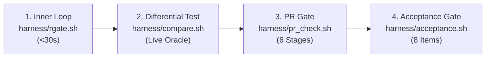

# VarDictRust Contributor Guide

Welcome to the **VarDictRust** developer and contributor guide! VarDictRust is an idiomatic, production-grade Rust rewrite of [VarDictJava](https://github.com/AstraZeneca-NGS/VarDictJava) v1.8.3, built under the principles of the [rewrites.bio](https://rewrites.bio) manifesto.

This document serves as the authoritative, standalone manual for developing, testing, benchmarking, and submitting contributions to the VarDictRust codebase.

---

## 1. The rewrites.bio Parity Mission

VarDictRust is built with one central commitment: **to produce output identical to VarDictJava v1.8.3 on valid inputs while scaling gracefully to deep whole-genome sequencing (WGS).**

### 1.1 The Prime Directive ([AGENTS.md §5](AGENTS.md#5-emulate-exactly-the-rewritesbio-prime-directive))
All variant calling output on valid genomic inputs must match VarDictJava v1.8.3:
- **Exact Variant Parity:** The variant set (`CHROM`, `POS`, `REF`, `ALT`), every `FILTER` decision, `INFO` and `FORMAT` tags, genotypes (`GT`), variant `TYPE`, and somatic `STATUS` must match upstream VarDictJava.
- **Float Tolerance:** P-values, odds ratios, and allele frequencies must match within **$\varepsilon = 10^{-6}$**, adhering strictly to IEEE 754 half-even banker's rounding ([`round_half_even`](DIVERGENCES.md#statistical-rounding--floating-point-half-even)).
- **Intermediate Column Counts:** Intermediate `.var` tables must strictly adhere to upstream column schemas:
  - **Simple Mode:** 36 columns (default) / 38 columns (`--fisher`).
  - **Amplicon Mode:** 38 columns (default) / 40 columns (`--fisher`).
  - **Somatic Mode:** 55 columns (default) / 61 columns (`--fisher`).
- **Bug Emulation Policy (v1.0):** If VarDictJava v1.8.3 has an output quirk (such as single-winner multi-allelic site collapsing or SV split-read requirements), **replicate it faithfully**. Corrections are deferred to post-1.0 releases behind individual opt-in flags (e.g. `--fix <id>`) per [`ROADMAP.md`](ROADMAP.md). Where VarDictJava crashes (e.g. `modifyCigar` #341 or NPEs), VarDictRust must produce valid output or fail fast without panicking.

### 1.2 Integrity: Evidence Before Assertions ([AGENTS.md §0 & §0b](AGENTS.md#0-meta-rule--evidence-before-completion))
- **Never claim a task is done without verifiable evidence.** Evidence consists of passing [`harness/compare.sh`](harness/README.md#key-scripts--runners) (**MATCH**), passing `cargo test`, or passing [`harness/acceptance.sh`](harness/README.md#key-scripts--runners).
- **Never fake a pass.** You must never relax `--eps`, narrow column ranges, hand-edit golden/expected files, or skip failing fixtures to force a match. If a check fails, the Rust port is wrong: fix the port, not the test.

---

## 2. Prerequisites & Repository Setup

### 2.1 Cloning the Repository with Submodules
VarDictRust relies on the upstream `VarDictJava` test suite as a git submodule:
```bash
# Clone with all submodules initialized:
git clone --recurse-submodules https://github.com/palakpsheth/VarDictRust.git
cd VarDictRust

# Or if cloned without --recurse-submodules:
git submodule update --init --recursive
```

### 2.2 Toolchain Requirements
1. **Rust Toolchain:**
   - Rust stable (`rustc >= 1.85.0`, `cargo`, `rustfmt`, `clippy`):
     ```bash
     rustup update stable
     rustup component add clippy rustfmt
     ```
2. **Oracle Environment (VarDictJava v1.8.3):**
   - The reference oracle runs VarDictJava v1.8.3 via bioconda:
     ```bash
     bash harness/setup_oracle.sh
     ```
3. **Bioinformatics & Security Utilities:**
   - Tools required for testing and secret scanning: `samtools`, `bwa`, `rtg-tools`, and `gitleaks`:
     ```bash
     # If creating via conda:
     conda env create -f harness/env/g4-tools.yml
     conda activate g4-tools
     ```
4. **Conda Package Manager:**
   - If `conda` is not installed on your system, install [Miniforge](https://github.com/conda-forge/miniforge) or [Miniconda](https://docs.anaconda.com/miniconda/).
5. **Reference Genomes & Test Data Ingestion:**
   - Ingest the minimal reference assets required for differential testing:
     ```bash
     bash harness/fetch_data.sh refs
     ```

### 2.3 The Three-Tier Environment Model (Zero-Virtualenv Architecture)
VarDictRust enforces a clear separation of toolchains across three distinct environments:

| Tier | Environment Scope | Managed By | Specification & Lockfile |
| :--- | :--- | :--- | :--- |
| **Tier 1** | **Rust Engine Core** (Compilation, benchmarks, unit tests) | `rustup`, `cargo` | [`Cargo.lock`](Cargo.lock) (cryptographically locked) |
| **Tier 2** | **Test & Metrology Harness** (VCF comparators, self-tests) | System `python3` (3.8+) | **100% Python Standard Library** (Zero PyPI / Zero Venv) |
| **Tier 3** | **Genomics Oracle & Benchmarks** (`vardict-java`, `rtg-tools`, `samtools`) | Bioconda / Conda-Forge | [`benchmarks/env/vardict-oracle.yml`](benchmarks/env/vardict-oracle.yml), [`harness/env/g4-tools.yml`](harness/env/g4-tools.yml) |
| *(Ephemeral)* | **Ad-Hoc Developer Tools** (`cffconvert`, `pre-commit`) | Astral `uvx` (Zero-install) | Ephemeral user cache (no permanent virtualenv) |

> [!NOTE]
> **Toolchain Tiers vs Test Verification Tiers:** The *Tiers* in the table above classify environment isolation and package management. They are distinct from the *Seven-Level Test Architecture* and *Differential Testing Tiers* (Tier-1 `.var` table parity vs Tier-2 VCF parity vs Tier-3 truth concordance) described in [`docs/testing/test-matrix-and-ci-audit.md`](docs/testing/test-matrix-and-ci-audit.md) and [`harness/README.md`](harness/README.md).
>
> **No Python Virtual Environment Required:** All scripts in `harness/` and `harness/tests/` depend exclusively on the Python standard library (`argparse`, `json`, `gzip`, `math`, `subprocess`, `unittest`). Contributors do not need to create a `venv` or run `pip install` to execute the regression harness. This zero-PyPI contract is enforced continuously by [`harness/tests/test_stdlib_purity.py`](harness/tests/test_stdlib_purity.py).

### 2.4 Building VarDictRust

VarDictRust is built using standard Cargo workflows:

```bash
# Build debug binary (faster compile, includes debug symbols):
cargo build

# Build optimized release binary (recommended for benchmarking and production):
cargo build --release

# Inspect the compiled binary and CLI options:
./target/release/vardictrust --help
./target/release/vardictrust --version
```

---

## 3. Automated Pre-Commit Hook Framework

To catch formatting issues, lint warnings, and accidentally staged secrets before commits enter git history, VarDictRust supports automated pre-commit hooks.

### Track A: Zero-Dependency Native Git Hook (Recommended)
VarDictRust includes a native bash pre-commit hook that requires no Python or pip dependencies:
```bash
bash harness/setup_hooks.sh
```
This configures Git to use repository-managed hooks in `.githooks/` (`git config core.hooksPath .githooks`).

**What it checks in $<3$ seconds:**
1. **Staged File Filtering:** If no Rust or Cargo files are staged (e.g. documentation, markdown, or shell script commits), `cargo fmt` and `cargo clippy` are skipped, completing in $<0.3$ seconds.
2. **Code Formatting:** Runs `cargo fmt --all -- --check`.
3. **Clippy Lints:** Runs `cargo clippy --all-targets --all-features -- -D warnings`.
4. **Secret Scanning:** Runs `gitleaks protect --staged -v` using any available `gitleaks` installation.

### Track B: Standard Python Pre-Commit (Optional)
Contributors who prefer the standard Python `pre-commit` framework can use `.pre-commit-config.yaml`:
```bash
# First unset core.hooksPath if Track A was previously active:
git config --unset core.hooksPath

# Install and activate python pre-commit:
pip install pre-commit
pre-commit install
```

> [!NOTE]
> Track A and Track B are mutually exclusive. To switch back to Track A at any time, run `bash harness/setup_hooks.sh`. To disable all hooks, run `git config --unset core.hooksPath`.

<a id="agent-skills"></a>
### 3.4 Repository-Specific Agent Skills (`.agents/skills/`)

VarDictRust ships four repository-specific [Agent Skills](AGENTS.md#19-repository-specific-agent-skills) under `.agents/skills/` that encode the repository's verification gates, profiling workflows, and release runbooks for both human contributors and AI coding agents:

| Skill | Path | When to Use & Bundled Tools |
| :--- | :--- | :--- |
| **`vardictrust-issue`** | [`.agents/skills/vardictrust-issue/SKILL.md`](.agents/skills/vardictrust-issue/SKILL.md) | Filing, triaging, or reproducing GitHub issues (`v1.0.x` parity/crash bugs vs `v1.1+ --fix <id>` proposals) with `harness/slice.sh` and `harness/compare.sh`. |
| **`vardictrust-pr`** | [`.agents/skills/vardictrust-pr/SKILL.md`](.agents/skills/vardictrust-pr/SKILL.md) | Opening, recertifying (`harness/recertify.sh`), reviewing, or squash-merging PRs, completing `.github/pull_request_template.md`, and replying inline to review threads. |
| **`vardictrust-profiling`** | [`.agents/skills/vardictrust-profiling/SKILL.md`](.agents/skills/vardictrust-profiling/SKILL.md) | Running `profile-cpu`, `profile-heap`, or `profile-dhat` via `harness/profile.sh` and `harness/profile_catalog.py` ([API reference](.agents/skills/vardictrust-profiling/references/rust-profiling-api.md)). |
| **`vardictrust-release`** | [`.agents/skills/vardictrust-release/SKILL.md`](.agents/skills/vardictrust-release/SKILL.md) | Cutting a release across GitHub Releases, Crates.io, Bioconda, Nextflow `nf-core/modules`, and ReadTheDocs ([consistency validator](.agents/skills/vardictrust-release/scripts/check_release_consistency.py) & [19-file surface map](.agents/skills/vardictrust-release/references/version-surface-map.md)). |

**Discovery across AI tools:** `.agents/skills/` is committed in-tree and discovered automatically by Gemini CLI, OpenAI Codex, GitHub Copilot, Cursor, and OpenCode. Contributors can also run the bundled release consistency validator directly:
```bash
python3 .agents/skills/vardictrust-release/scripts/check_release_consistency.py --version 1.0.3 --phase pre-tag
```

---

## 4. Architectural Invariants & Safety

All contributions to `crates/vardictrust-core/` and `crates/vardictrust/` must adhere strictly to the following architectural rules:

### 4.1 Memory Safety & The No-Panic Rule
- **`#![forbid(unsafe_code)]`:** The core engine crate strictly forbids `unsafe` code.
- **Zero Panics in Library Code:** In `crates/vardictrust-core/src/**` (outside `#[cfg(test)]`), you must **never** use `unwrap()`, `expect()`, `panic!()`, `unreachable!()`, bare slice indexing `x[i]` without prior bounds checks, or arithmetic that can overflow on user input.
- **Actionable Error Propagation:** Return `Result<T, VardictError>` with the `?` operator.

### 4.2 Coordinate Indexing ([AGENTS.md §6](AGENTS.md#6-coordinate-indexing--the-1-silent-footgun))
- **0-based Coordinates (`Pos0`):** Coordinates from BAM/SAM alignments (via noodles) are **0-based, half-open** `[start, end)`.
- **1-based Coordinates (`Pos1`):** VCF output and internal VarDict logic are **1-based inclusive** `[start, end]`.
- **Strict Conversions:** Always convert via `.to_one_based()` and `.to_zero_based()`. Never add a raw integer to a coordinate.

### 4.3 Determinism & Fidelity Hazards ([AGENTS.md §8](AGENTS.md#8-fidelity-hazards-these-break-output-equivalence-silently))
- **Banker's Rounding:** Every floating-point metric written to table or VCF output must use IEEE 754 half-even rounding via [`round_half_even`](DIVERGENCES.md#statistical-rounding--floating-point-half-even). Never use Rust's default formatter rounding.
- **Java HashMap Iteration Parity:** Java's `HashMap` iteration order is emulated using deterministic [`JavaHashMap`](DIVERGENCES.md#ub-3-var-row-order-across-positions-follows-hashmap-iteration-order-282-family), which reproduces OpenJDK 8+ hash bucket spread, binning, and iteration semantics. Never replace it with `std::collections::HashMap` in output or realignment paths.
- **Sequences as Bytes:** Biological sequences are byte slices (`&[u8]` or `Vec<u8>`), never `String`.
- **Phred Quality Scores:** Encoded as Phred+33: `Phred(byte.saturating_sub(33))`.

### 4.4 Bounded Memory & Scale ([AGENTS.md §10](AGENTS.md#10-scale-rules-optimize-for-large-wgs-by-default))
- **Tile-and-Halo Traversal:** Regions are processed in discrete tiles (default 50 kb) with an overlapping halo (2 kb). State is streamed through the per-tile pipeline and dropped promptly via RAII.
- **Zero Whole-Chromosome Buffering:** Never load or buffer entire chromosomes in memory.

---

## 5. Testing Hierarchy & Developer Inner Loop

VarDictRust enforces a multi-tiered testing hierarchy designed for fast local iteration and exhaustive verification.



### 5.1 The Port Loop ([AGENTS.md §7](AGENTS.md#7-the-port-loop-rewritesbio-work-small))
When porting or modifying variant calling logic, follow the rewrites.bio port loop:
1. Read the upstream VarDictJava implementation and cite it (e.g. `/// ports CigarModifier.java:61-71`).
2. Write the Rust code and its corresponding unit test.
3. Verify against the live oracle using `harness/compare.sh`.
4. Commit when differential comparison yields **MATCH**.

### 5.2 Inner Developer Loop (`rgate.sh` & Cargo)
For fast local iteration while coding:
```bash
# Automated compound inner loop (<30s):
bash harness/rgate.sh

# Or execute specific Cargo steps directly:
cargo test --workspace                                     # Run all workspace unit tests
cargo test -p vardictrust-core cigar                       # Run tests in a specific module
cargo clippy --all-targets --all-features -- -D warnings    # Zero-warning linter
cargo fmt --all -- --check                                 # Check code formatting
```
Runs code formatting checks, Clippy lints, workspace unit tests, and a quick differential smoke test against the live oracle.

### 5.3 Differential Testing (`compare.sh`)
Compare VarDictRust output against the live VarDictJava oracle:
```bash
# Simple / Germline Mode:
bash harness/compare.sh <ref.fa> <sample.bam> <regions.bed> [sample_name]

# Somatic Paired Mode (tumor|normal syntax):
bash harness/compare.sh <ref.fa> "tumor.bam|normal.bam" <regions.bed> [sample_name]
```

### 5.4 Comprehensive PR Verification (`pr_check.sh`)
Before submitting a pull request, run the comprehensive 6-stage PR validation suite defined in [`harness/pr_check.sh`](harness/README.md#key-scripts--runners):
```bash
bash harness/pr_check.sh
```
This suite automatically verifies:
1. **Stage 1 (Hygiene & Unit Tests):** Formatting, Clippy lints, and all 277 workspace unit and integration tests ([Level 1](docs/testing/test-matrix-and-ci-audit.md#level-1)).
2. **Stage 2 (Crash Robustness):** PR #402, missing index #187, and Issue #341 family fixtures.
3. **Stage 3 (Upstream Integration Corpus):** 92 fixtures ([Level 2](docs/testing/test-matrix-and-ci-audit.md#level-2-upstream-integration-regression-corpus-92-fixtures)), asserting `91 PASS / 1 XFAIL` ([UB-4](docs/upstream-bugs.md#ub-4) upstream fixture defect).
4. **Stage 4 (Dual-Engine Differential Parity):** Micro differential fixture and 17-modality extended coverage against the live VarDictJava oracle ([Level 3](docs/testing/test-matrix-and-ci-audit.md#level-3-dual-engine-differential-parity-testing)).
5. **Stage 5 (Performance & Memory Budgets):** 4-target regression budget via [`harness/perf_budget.py`](harness/perf_budget.py) ([Level 5](docs/testing/test-matrix-and-ci-audit.md#level-5-performance--memory-budgets)).
6. **Stage 6 (Security Hygiene):** Staged and repository secret scanning with `gitleaks`.

### 5.5 Master Release Acceptance Gate (`acceptance.sh`)
For full release qualification or certifying engine changes against committed benchmark evidence, run the 8-item acceptance gate:
```bash
bash harness/acceptance.sh
```
This gate enforces the 8 acceptance criteria defined in [AGENTS.md §15](AGENTS.md#15-definition-of-done-every-change) and [docs/testing/test-matrix-and-ci-audit.md §2](docs/testing/test-matrix-and-ci-audit.md#2-master-verification-matrix), validating engine fingerprints across all 16 committed evidence JSONs.

Additionally, contributors can execute the diagnostic self-test suite ([Level 6](docs/testing/test-matrix-and-ci-audit.md#level-6-diagnostic-self-tests)) at any time:
```bash
bash harness/run_self_tests.sh   # Executes all 24 diagnostic test scripts in <10s
```

*For the complete seven-level testing architecture, push-button reproduction commands, and dataset provenance catalog, see the Master Reproducibility Runbook in [`docs/testing/test-matrix-and-ci-audit.md`](docs/testing/test-matrix-and-ci-audit.md).*

---

## 6. Pull Request Lifecycle & Requirements

### 6.1 Atomic Commits
- Use descriptive conventional commits: `fix(cigar): <short description>` or `feat(somatic): <short description>`.
- Do not combine unrelated refactorings or formatting changes with algorithmic edits.

### 6.2 The Pull Request Checklist
When opening a pull request (see the [`vardictrust-pr` skill](.agents/skills/vardictrust-pr/SKILL.md)), complete all items in [`.github/pull_request_template.md`](.github/pull_request_template.md):
- [ ] Code compiles with zero warnings: `cargo clippy --all-targets --all-features -- -D warnings`.
- [ ] Code formatting verified: `cargo fmt --all -- --check`.
- [ ] All unit tests pass: `cargo test --workspace`.
- [ ] PR validation suite passes: `bash harness/pr_check.sh`.
- [ ] No regression against the 4-target performance budget (runtime regression $\le 5\%$, peak RSS 0% increase across HG008, SEQC2, HG002, and Amplicon).
- [ ] No secrets or credentials in git history (`gitleaks`).

---

## 7. Governance & Repository Policies

Contributors must adhere to the following governance policies:

### 7.1 Commit Trailer Hygiene Policy
- **Strictly Zero `Co-Authored-By` Trailers:** Do **not** include `Co-Authored-By` trailers in commit messages.
- **Transparent AI Disclosures:** Machine assistance and AI tool participation are documented transparently in [`README.md`](README.md) and [`CITATION.cff`](CITATION.cff), not in commit metadata.

### 7.2 Concurrency & Resource Management
- **Parallel Testing on Constrained Systems:** Running heavy multi-threaded test suites (e.g. `cargo test --workspace`) spawns threads proportional to available logical CPU cores. On systems with constrained memory, restrict test parallelism using standard Cargo flags or environment variables:
  ```bash
  RUST_TEST_THREADS=4 cargo test --workspace
  # or:
  cargo test --workspace -- --test-threads=4
  ```
- **Differential Runner Threads:** Scripts accepting thread flags (such as `compare.sh -th <N>`) default to multi-threaded execution. Adjust `<N>` to match your hardware capacity.

---

## 8. Getting Help & Security

- **Reporting Issues:** Search existing issues before creating a new report (see the [`vardictrust-issue` skill](.agents/skills/vardictrust-issue/SKILL.md)). Include the exact BAM slice, reference region, and command line to reproduce.
- **Reporting Security Vulnerabilities:** Please review our [Security Policy](.github/SECURITY.md) to report vulnerabilities privately. Do not disclose security issues publicly in GitHub Issues.

---

<a id="release-process"></a>
## 9. Release Process & Packaging Runbook

Releases are executed through a disciplined **three-phase workflow** (Pre-Release PR → Annotated Tag & CI Release → Post-Tag Downstream Sync) governed by [`AGENTS.md §§0, 0b, 5, 15, 18`](AGENTS.md) and automated by the [`vardictrust-release` skill](.agents/skills/vardictrust-release/SKILL.md) ([`check_release_consistency.py`](.agents/skills/vardictrust-release/scripts/check_release_consistency.py)). Direct pushes to `main` are blocked by `.githooks/pre-push`.

### 9.1 Release Policy & SemVer Governance
- **`v1.0.x` Patch / Maintenance Releases:** Preserve pure byte-for-byte and floating-point parity ($\varepsilon = 10^{-6}$) with **VarDictJava v1.8.3** on valid inputs ([`AGENTS.md §5`](AGENTS.md#5-emulate-exactly-the-rewritesbio-prime-directive)). Allowed changes include crash/robustness fixes, harness/reproducibility additions, packaging, and documentation updates.
- **`v1.1.0+` Feature & Opt-In Fix Releases:** Output-changing corrections to upstream VarDictJava bugs ship only behind explicit opt-in `--fix <id>` flags (default off) with a diff-confinement gate per [`ROADMAP.md`](ROADMAP.md).

### 9.2 Phase 1 — Pre-Release Branch, Version Bump & Fingerprint Rule
1. **Branch off fresh `origin/main`:**
   ```bash
   git fetch origin
   git checkout -b release/vX.Y.Z origin/main
   ```
2. **Update version-bearing files (keep `packaging/bioconda/recipes/vardictrust/meta.yaml` for Phase 3):**
   - [`Cargo.toml`](Cargo.toml) (`[workspace.package] version = "X.Y.Z"`) and [`crates/vardictrust/Cargo.toml`](crates/vardictrust/Cargo.toml) (`vardictrust-core = { version = "X.Y.Z", path = "../vardictrust-core" }`), followed by `cargo update -w` so [`Cargo.lock`](Cargo.lock) updates only the workspace packages.
   - [`CHANGELOG.md`](CHANGELOG.md): add `## [X.Y.Z] - YYYY-MM-DD` (required by `cargo-dist` to populate GitHub Release notes) and preserve exact Bioconda subdir names (`linux-64`, `linux-aarch64`, `osx-arm64`, `osx-64`).
   - [`CITATION.cff`](CITATION.cff) (`version` and `date-released`), [`README.md`](README.md) (install tags and BibTeX version), [`.github/ISSUE_TEMPLATE/bug_report.yml`](.github/ISSUE_TEMPLATE/bug_report.yml), and [`packaging/bioconda/prepare_bioconda_pr.sh`](packaging/bioconda/prepare_bioconda_pr.sh) (`VERSION="${1:-X.Y.Z}"`).
   - Release certification dossier `docs/release/vX.Y.Z-pr.md` and release metadata references in [`docs/testing/test-matrix-and-ci-audit.md`](docs/testing/test-matrix-and-ci-audit.md), [`docs/validation/omnibus-empirical-validation.md`](docs/validation/omnibus-empirical-validation.md), [`DIVERGENCES.md`](DIVERGENCES.md), [`benchmarks/README.md`](benchmarks/README.md), [`harness/README.md`](harness/README.md), [`mkdocs.yml`](mkdocs.yml), and [`wiki/`](wiki/).
3. **Engine Fingerprint & Live Recertification Rule (`AGENTS.md §0b`):**
   - [`harness/engine_fingerprint.sh`](harness/engine_fingerprint.sh) (`normalize_gate_blob()`) canonicalizes workspace-only SemVer fields in `Cargo.toml`, `crates/vardictrust/Cargo.toml`, and `Cargo.lock` before hashing, so a pure workspace version bump preserves the certified engine fingerprint across all 16 evidence JSONs in [`benchmarks/evidence/`](benchmarks/evidence/).
   - If **any** engine source (`crates/*/src`), external dependency (`Cargo.lock`), comparator, runner, or fixture in `GATE_FILES` changed since the last certification, you **must** run `bash harness/recertify.sh` to re-run the live dual-engine parity suites and stamp updated evidence JSONs honestly (never hand-edit `benchmarks/evidence/*.json`).

### 9.3 Phase 1 — Commit-First Verification Sequence & Crates.io Dry-Run
Because [`harness/engine_fingerprint.sh`](harness/engine_fingerprint.sh) enforces `git diff --quiet HEAD -- "${GATE_FILES[@]}"` and hashes `HEAD:<path>`, commit the release edits on `release/vX.Y.Z` (with zero `Co-Authored-By` trailers per §7.1) **before** running the harness gates:

```bash
# 1. Verify formatting, zero-warning Clippy, workspace tests, and --version output
cargo fmt --all -- --check
cargo clippy --all-targets --all-features -- -D warnings
RUST_TEST_THREADS=4 cargo test --workspace
cargo build --release -p vardictrust
./target/release/vardictrust --version

# 2. Commit tracked release changes on release/vX.Y.Z (clean HEAD required by engine_fingerprint.sh)
git commit -m "chore(release): prepare vX.Y.Z release"

# 3. Verify engine fingerprint and run all 24 diagnostic self-tests
bash harness/engine_fingerprint.sh
bash harness/run_self_tests.sh

# 4. Stage and verify MkDocs documentation site in strict mode (then clean staging dir)
python3 harness/prepare_docs_site.py
mkdocs build --strict
rm -rf .docs_staged site

# 5. Pre-tag crates.io packaging verification
#    Note: `cargo publish -p vardictrust --dry-run` queries crates.io for `vardictrust-core = "^X.Y.Z"`,
#    which is published first by release.yml during Phase 2. Validate binary packaging via `cargo package --list`.
cargo publish -p vardictrust-core --dry-run
cargo package --list -p vardictrust

# 6. Run 6-stage PR gate (restore timestamp-only diff in extended-coverage-tier2.json if fingerprint is unchanged)
bash harness/pr_check.sh
git checkout -- benchmarks/evidence/extended-coverage-tier2.json

# 7. Run 8-item Master Release Acceptance Gate (must exit 0 with 8/8 PASS, including Item 8 musl-ci.json from harness/bin_equiv.sh; restore timestamp/timing noise if fingerprint is unchanged)
bash harness/acceptance.sh
git checkout -- benchmarks/evidence/extended-coverage-tier2.json benchmarks/evidence/multimodal-slices-tier2.json
```

### 9.4 Phase 1 — Opening & Merging the Release PR
Push `release/vX.Y.Z` and open a pull request to `main` via `gh pr create`, completing every section of [`.github/pull_request_template.md`](.github/pull_request_template.md) and including the mandatory validation receipt (`validated vs VarDictJava 1.8.3, dataset <name>, cmd <…>` per [`AGENTS.md §15`](AGENTS.md#15-definition-of-done-every-change)). Merge to `main` once all required GitHub Actions workflows (`ci.yml`, `differential.yml`, `docs.yml`, `security.yml`) are green.

### 9.5 Phase 2 — Tagging `main`, `cargo-dist` SLSA Level 3 & Crates.io Publish
1. **Sync `main` and push an annotated SemVer tag:**
   ```bash
   git checkout main
   git pull --ff-only origin main
   grep -q '^version = "X.Y.Z"' Cargo.toml
   git tag -a vX.Y.Z -m "VarDictRust vX.Y.Z"
   git push origin vX.Y.Z
   ```
2. **Automated Release Pipeline ([`.github/workflows/release.yml`](.github/workflows/release.yml)):**
   Pushing `vX.Y.Z` triggers `cargo-dist 0.33.0`, which executes:
   - `plan`: parses `CHANGELOG.md` for `## [X.Y.Z]` and computes the 4 build targets (`x86_64-unknown-linux-gnu`, `x86_64-unknown-linux-musl`, `aarch64-unknown-linux-musl`, `aarch64-apple-darwin`).
   - `build-local-artifacts` & `build-global-artifacts`: compiles release archives across all 4 target triples and generates the shell installer and SHA-256 checksums (`musl` vs `gnu` VCF byte equivalence on Linux x86_64 is certified pre-tag via [`harness/bin_equiv.sh`](harness/bin_equiv.sh) inside [`harness/recertify.sh`](harness/recertify.sh) and verified by [`harness/acceptance.sh`](harness/acceptance.sh) Item 8).
   - `host`: creates the GitHub Release and generates **SLSA v1.0 Level 3 build provenance attestations** via `actions/attest-build-provenance`.
   - `publish-crates`: publishes `vardictrust-core` to `crates.io` first, then polls up to `30 × 10s` for index propagation before publishing `vardictrust`.
   - `announce`: finalizes and publishes the GitHub Release.
3. **Verify Release Artifacts & SLSA Attestations:**
   ```bash
   gh run watch
   gh release view vX.Y.Z
   gh attestation verify --owner palakpsheth vardictrust-x86_64-unknown-linux-musl.tar.xz
   ```

### 9.6 Phase 3 — Post-Tag Bioconda, Nextflow `nf-core/modules` & ReadTheDocs Sync
1. **Update and test the Bioconda recipe ([`packaging/bioconda/recipes/vardictrust/meta.yaml`](packaging/bioconda/recipes/vardictrust/meta.yaml)):**
   [`packaging/bioconda/prepare_bioconda_pr.sh`](packaging/bioconda/prepare_bioconda_pr.sh) enforces Rule 0b by downloading `https://github.com/palakpsheth/VarDictRust/archive/refs/tags/vX.Y.Z.tar.gz` directly from GitHub (refusing local `git archive` fallbacks):
   ```bash
   bash packaging/bioconda/prepare_bioconda_pr.sh X.Y.Z
   bash harness/test_bioconda_recipe.sh
   python3 .agents/skills/vardictrust-release/scripts/check_release_consistency.py --version X.Y.Z --phase post-bioconda
   ```
   Open and merge a follow-up PR updating `packaging/bioconda/recipes/vardictrust/meta.yaml` on `main`, and submit the recipe update to `bioconda/bioconda-recipes`.
2. **Update the Nextflow `nf-core/modules` module ([`packaging/nf-core/prepare_nfcore_pr.sh`](packaging/nf-core/prepare_nfcore_pr.sh)):**
   Once `bioconda::vardictrust=X.Y.Z` is indexed on `anaconda.org` for both `linux-64` and `linux-aarch64`, update `environment.yml`, provision multi-arch Seqera Wave containers, and update `nf-test` snapshots:
   ```bash
   bash packaging/nf-core/prepare_nfcore_pr.sh X.Y.Z
   python3 .agents/skills/vardictrust-release/scripts/check_release_consistency.py --version X.Y.Z --phase post-nfcore
   ```
3. **Trigger ReadTheDocs Documentation Build:**
   ```bash
   bash harness/trigger_rtd.sh build vardictrust latest
   bash harness/trigger_rtd.sh builds vardictrust
   ```

### 9.7 Rollback, Partial-Release Recovery & Hotfix Runbook
- **Transient CI Job Failure in `release.yml`:** If a runner experiences a transient network or registry timeout during Phase 2, re-run failed jobs via `gh run rerun <run-id> --failed`. If `vardictrust-core` already published to `crates.io` before `publish-crates` failed on `vardictrust`, publish `vardictrust` manually with `cargo publish -p vardictrust` or cut `vX.Y.(Z+1)`.
- **Never Force-Move or Delete Published Release Tags:** Once `crates.io` crates or SLSA Level 3 attestations are emitted for `vX.Y.Z`, never delete or force-push the tag. If a critical regression is discovered post-release:
  1. Yank affected crates on `crates.io`: `cargo yank --version X.Y.Z vardictrust && cargo yank --version X.Y.Z vardictrust-core`.
  2. Mark the GitHub Release `vX.Y.Z` as pre-release/yanked with a notice linking to the replacement version.
  3. Cut and certify `vX.Y.(Z+1)` off `main` following §§9.2–9.6.

