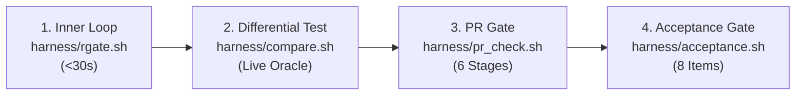

# VarDictRust Contributor Guide

Welcome to the **VarDictRust** developer and contributor guide! VarDictRust is an idiomatic, production-grade Rust rewrite of [VarDictJava](https://github.com/AstraZeneca-NGS/VarDictJava) v1.8.3, built under the principles of the [rewrites.bio](https://rewrites.bio) manifesto.

This document serves as the authoritative, standalone manual for developing, testing, benchmarking, and submitting contributions to the VarDictRust codebase.

---

## 1. The rewrites.bio Parity Mission

VarDictRust is built with one central commitment: **to produce output identical to VarDictJava v1.8.3 on valid inputs while scaling gracefully to deep whole-genome sequencing (WGS).**

### 1.1 The Prime Directive (§5)
All variant calling output on valid genomic inputs must match VarDictJava v1.8.3:
- **Exact Variant Parity:** The variant set (`CHROM`, `POS`, `REF`, `ALT`), every `FILTER` decision, `INFO` and `FORMAT` tags, genotypes (`GT`), variant `TYPE`, and somatic `STATUS` must match upstream VarDictJava.
- **Float Tolerance:** P-values, odds ratios, and allele frequencies must match within **$\varepsilon = 10^{-6}$**, adhering strictly to IEEE 754 half-even banker's rounding (`round_half_even`).
- **Intermediate Column Counts:** Intermediate `.var` tables must strictly adhere to upstream column schemas:
  - **Simple Mode:** 36 columns (default) / 38 columns (`--fisher`).
  - **Amplicon Mode:** 38 columns (default) / 40 columns (`--fisher`).
  - **Somatic Mode:** 55 columns (default) / 61 columns (`--fisher`).
- **Bug Emulation Policy (v1.0):** If VarDictJava v1.8.3 has an output quirk (such as single-winner multi-allelic site collapsing or SV split-read requirements), **replicate it faithfully**. Corrections are deferred to post-1.0 releases behind individual opt-in flags (e.g. `--fix <id>`) per [`ROADMAP.md`](ROADMAP.md). Where VarDictJava crashes (e.g. `modifyCigar` #341 or NPEs), VarDictRust must produce valid output or fail fast without panicking.

### 1.2 Integrity: Evidence Before Assertions (§0 & §0b)
- **Never claim a task is done without verifiable evidence.** Evidence consists of passing `harness/compare.sh` (**MATCH**), passing `cargo test`, or passing `harness/acceptance.sh`.
- **Never fake a pass.** You must never relax `--eps`, narrow column ranges, hand-edit golden/expected files, or skip failing fixtures to force a match. If a check fails, the Rust port is wrong: fix the port, not the test.

---

## 2. Prerequisites & Repository Setup

### 2.1 Cloning the Repository with Submodules
VarDictRust relies on the upstream `VarDictJava` test suite as a git submodule:
```bash
# Clone with all submodules initialized:
git clone --recurse-submodules https://github.com/palakpsheth/VarDictRust.git
cd VarDictRust

# Or if cloned without --recurse-submodules:
git submodule update --init --recursive
```

### 2.2 Toolchain Requirements
1. **Rust Toolchain:**
   - Rust stable (`rustc >= 1.85.0`, `cargo`, `rustfmt`, `clippy`):
     ```bash
     rustup update stable
     rustup component add clippy rustfmt
     ```
2. **Oracle Environment (VarDictJava v1.8.3):**
   - The reference oracle runs VarDictJava v1.8.3 via bioconda:
     ```bash
     bash harness/setup_oracle.sh
     ```
3. **Bioinformatics & Security Utilities:**
   - Tools required for testing and secret scanning: `samtools`, `bwa`, `rtg-tools`, and `gitleaks`:
     ```bash
     # If creating via conda:
     conda env create -f harness/env/g4-tools.yml
     conda activate g4-tools
     ```

### 2.3 The Three-Tier Environment Model (Zero-Virtualenv Architecture)
VarDictRust enforces a clear separation of toolchains across three distinct environments:

| Tier | Environment Scope | Managed By | Specification & Lockfile |
| :--- | :--- | :--- | :--- |
| **Tier 1** | **Rust Engine Core** (Compilation, benchmarks, unit tests) | `rustup`, `cargo` | [`Cargo.lock`](Cargo.lock) (cryptographically locked) |
| **Tier 2** | **Test & Metrology Harness** (VCF comparators, self-tests) | System `python3` (3.8+) | **100% Python Standard Library** (Zero PyPI / Zero Venv) |
| **Tier 3** | **Genomics Oracle & Benchmarks** (`vardict-java`, `rtg-tools`, `samtools`) | Bioconda / Conda-Forge | [`benchmarks/env/vardict-oracle.yml`](benchmarks/env/vardict-oracle.yml), [`harness/env/g4-tools.yml`](harness/env/g4-tools.yml) |
| *(Ephemeral)* | **Ad-Hoc Developer Tools** (`cffconvert`, `pre-commit`) | Astral `uvx` (Zero-install) | Ephemeral user cache (no permanent virtualenv) |

> [!NOTE]
> **No Python Virtual Environment Required:** All scripts in `harness/` and `harness/tests/` depend exclusively on the Python standard library (`argparse`, `json`, `gzip`, `math`, `subprocess`, `unittest`). Contributors do not need to create a `venv` or run `pip install` to execute the regression harness. This zero-PyPI contract is enforced continuously by [`harness/tests/test_stdlib_purity.py`](harness/tests/test_stdlib_purity.py).

---

## 3. Automated Pre-Commit Hook Framework

To catch formatting issues, lint warnings, and accidentally staged secrets before commits enter git history, VarDictRust supports automated pre-commit hooks.

### Track A: Zero-Dependency Native Git Hook (Recommended)
VarDictRust includes a native bash pre-commit hook that requires no Python or pip dependencies:
```bash
bash harness/setup_hooks.sh
```
This configures Git to use repository-managed hooks in `.githooks/` (`git config core.hooksPath .githooks`).

**What it checks in $<3$ seconds:**
1. **Staged File Filtering:** If no Rust or Cargo files are staged (e.g. documentation, markdown, or shell script commits), `cargo fmt` and `cargo clippy` are skipped, completing in $<0.3$ seconds.
2. **Code Formatting:** Runs `cargo fmt --all -- --check`.
3. **Clippy Lints:** Runs `cargo clippy --all-targets --all-features -- -D warnings`.
4. **Secret Scanning:** Runs `gitleaks protect --staged -v` using any available `gitleaks` installation.

### Track B: Standard Python Pre-Commit (Optional)
Contributors who prefer the standard Python `pre-commit` framework can use `.pre-commit-config.yaml`:
```bash
# First unset core.hooksPath if Track A was previously active:
git config --unset core.hooksPath

# Install and activate python pre-commit:
pip install pre-commit
pre-commit install
```

> [!NOTE]
> Track A and Track B are mutually exclusive. To switch back to Track A at any time, run `bash harness/setup_hooks.sh`. To disable all hooks, run `git config --unset core.hooksPath`.

---

## 4. Architectural Invariants & Safety

All contributions to `crates/vardict-core/` and `crates/vardict-cli/` must adhere strictly to the following architectural rules:

### 4.1 Memory Safety & The No-Panic Rule
- **`#![forbid(unsafe_code)]`:** The core engine crate strictly forbids `unsafe` code.
- **Zero Panics in Library Code:** In `crates/vardict-core/src/**` (outside `#[cfg(test)]`), you must **never** use `unwrap()`, `expect()`, `panic!()`, `unreachable!()`, bare slice indexing `x[i]` without prior bounds checks, or arithmetic that can overflow on user input.
- **Actionable Error Propagation:** Return `Result<T, VardictError>` with the `?` operator.

### 4.2 Coordinate Indexing (§6)
- **0-based Coordinates (`Pos0`):** Coordinates from BAM/SAM alignments (via noodles) are **0-based, half-open** `[start, end)`.
- **1-based Coordinates (`Pos1`):** VCF output and internal VarDict logic are **1-based inclusive** `[start, end]`.
- **Strict Conversions:** Always convert via `.to_one_based()` and `.to_zero_based()`. Never add a raw integer to a coordinate.

### 4.3 Determinism & Fidelity Hazards (§8)
- **Banker's Rounding:** Every floating-point metric written to table or VCF output must use IEEE 754 half-even rounding via `round_half_even`. Never use Rust's default formatter rounding.
- **Java HashMap Iteration Parity:** Java's `HashMap` iteration order is emulated using `vardict_core::javamap::JavaHashMap`, which reproduces OpenJDK 8+ hash bucket spread, binning, and iteration semantics. Never replace it with `std::collections::HashMap` in output or realignment paths.
- **Sequences as Bytes:** Biological sequences are byte slices (`&[u8]` or `Vec<u8>`), never `String`.
- **Phred Quality Scores:** Encoded as Phred+33: `Phred(byte.saturating_sub(33))`.

### 4.4 Bounded Memory & Scale (§10)
- **Tile-and-Halo Traversal:** Regions are processed in discrete tiles (default 50 kb) with an overlapping halo (2 kb). State is streamed through the per-tile pipeline and dropped promptly via RAII.
- **Zero Whole-Chromosome Buffering:** Never load or buffer entire chromosomes in memory.

---

## 5. Testing Hierarchy & Developer Inner Loop

VarDictRust enforces a multi-tiered testing hierarchy designed for fast local iteration and exhaustive verification.



### 5.1 The Port Loop (§7)
When porting or modifying variant calling logic, follow the rewrites.bio port loop:
1. Read the upstream VarDictJava implementation and cite it (e.g. `/// ports CigarModifier.java:61-71`).
2. Write the Rust code and its corresponding unit test.
3. Verify against the live oracle using `harness/compare.sh`.
4. Commit when differential comparison yields **MATCH**.

### 5.2 Inner Developer Loop (`rgate.sh`)
For fast feedback while coding:
```bash
bash harness/rgate.sh
```
Runs `cargo fmt --check`, `cargo clippy`, unit tests, and a quick differential smoke test in $<30$ seconds.

### 5.3 Differential Testing (`compare.sh`)
Compare VarDictRust output against the live VarDictJava oracle:
```bash
# Simple / Germline Mode:
bash harness/compare.sh <ref.fa> <sample.bam> <regions.bed> [sample_name]

# Somatic Paired Mode (tumor|normal syntax):
bash harness/compare.sh <ref.fa> "tumor.bam|normal.bam" <regions.bed> [sample_name]
```

### 5.4 Comprehensive PR Verification (`pr_check.sh`)
Before submitting a pull request, run the comprehensive 6-stage PR validation suite:
```bash
bash harness/pr_check.sh
```
This suite automatically verifies:
1. Workspace unit tests (all 208 workspace tests pass: 188 core + 13 cli + 5 robustness + 1 thread_determinism + 1 version).
2. Crash robustness corpus (PR #402, missing index #187, and issue #341 family).
3. Tier-1 upstream integration corpus (92 fixtures, asserting `91 PASS / 1 FAIL` where the sole static diff is Class D / UB-4 fixture flaw).
4. Tier-2 micro differential parity against live Java.
5. 4-Target performance budget (`harness/perf_budget.py`).
6. Staged and repository secret scanning with `gitleaks`.

7. Automated harness self-test suite (`bash harness/run_self_tests.sh`) running all 14 diagnostic test scripts in $<10\text{s}$.

*For the complete seven-level testing architecture, push-button reproduction commands, and dataset provenance catalog, see the Master Reproducibility Runbook in [`docs/testing/test-matrix-and-ci-audit.md`](docs/testing/test-matrix-and-ci-audit.md).*

---

## 6. Pull Request Lifecycle & Requirements

### 6.1 Atomic Commits
- Use descriptive conventional commits: `fix(cigar): <short description>` or `feat(somatic): <short description>`.
- Do not combine unrelated refactorings or formatting changes with algorithmic edits.

### 6.2 The Pull Request Checklist
When opening a pull request, complete all items in [`.github/pull_request_template.md`](.github/pull_request_template.md):
- [ ] Code compiles with zero warnings: `cargo clippy --all-targets --all-features -- -D warnings`.
- [ ] Code formatting verified: `cargo fmt --all -- --check`.
- [ ] All unit tests pass: `cargo test --workspace`.
- [ ] PR validation suite passes: `bash harness/pr_check.sh`.
- [ ] No regression against the 4-target performance budget (runtime regression $\le 5\%$, peak RSS 0% increase across HG008, SEQC2, HG002, and Amplicon).
- [ ] No secrets or credentials in git history (`gitleaks`).

---

## 7. Governance & Repository Policies

Contributors must adhere to the following governance policies:

### 7.1 Commit Trailer Hygiene Policy
- **Strictly Zero `Co-Authored-By` Trailers:** Do **not** include `Co-Authored-By` trailers in commit messages.
- **Transparent AI Disclosures:** Machine assistance and AI tool participation are documented transparently in `README.md` and `CITATION.cff`, not in commit metadata.

### 7.2 System Resource Courtesy Policy
- **Thread Constraints:** Multi-threaded local testing must not exceed 8 worker threads (`--test-threads=8` or `-th 8`).
- **Resource Courtesy Wrapping:** Long-running jobs should be executed using the courtesy wrapper:
  ```bash
  EST_MIN=15 bash harness/courtesy.sh -th 8 <command>
  ```
- **Maintenance Windows:** Avoid running heavy automated benchmarks during the nightly maintenance window (03:40–05:15 local time).

---

## 8. Getting Help & Security

- **Reporting Issues:** Search existing issues before creating a new report. Include the exact BAM slice, reference region, and command line to reproduce.
- **Reporting Security Vulnerabilities:** Please review our [Security Policy](.github/SECURITY.md) to report vulnerabilities privately. Do not disclose security issues publicly in GitHub Issues.
