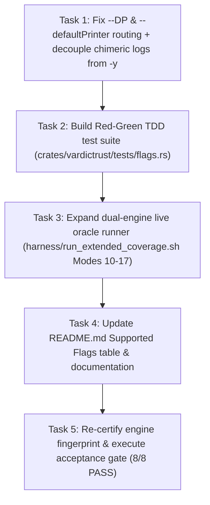

# Supported Flags Parity & Plan Hardening (Adversarial Review Revision)

> **For agentic workers:** REQUIRED SUB-SKILL: Use superpowers:subagent-driven-development (recommended) or superpowers:executing-plans to implement this plan task-by-task. Steps use checkbox (`- [ ]`) syntax for tracking.

**Goal:** Investigate, RCA, harden, and fully exercise all 59 command-line flags in the VarDictRust Supported Flags table, fixing the `--DP`/`--defaultPrinter` stream routing defect and chimeric `-y` log decoupling, adding a dedicated automated Rust flags integration test suite (`tests/flags.rs`), expanding dual-engine live oracle verification from 9 to 17 modes, and upgrading all 9 previously `unexercised` flags to verified `corpus` status with zero diffs against VarDictJava v1.8.3.

**Architecture:** 
1. Implement a unified, `BrokenPipe`-resilient output streaming abstraction in `crates/vardictrust-core/src/lib.rs` that routes all variant and header streams to `stderr` when `--DP ERR` / `--defaultPrinter ERR` is specified, and `stdout` by default across all three caller modalities (`SimpleMode`, `SomaticMode`, `AmpliconMode`).
2. Decouple chimeric log checks in `cigar/modify.rs` and `cigar/parse.rs` from `--DP`, restoring parity with VarDictJava's `conf.y` (`-y`/`--verbose`).
3. Add alias `--defaultPrinter` to `cli.rs` matching Java Commons CLI.
4. Build a zero-dependency Cargo integration suite `crates/vardictrust/tests/flags.rs` exercising all 59 supported and 7 unsupported flags in CI using committed fixtures (`fixtures/micro/` and `VarDictJava/testdata/`).
5. Expand `harness/run_extended_coverage.sh` with 8 new dual-engine live-oracle differential test modes (Modes 10–17) covering `-t`, `-3`, `-O`, `-x`, `-s/-e`, `-M`, `--deldupvar`, and `--DP`.
6. Re-certify engine fingerprint via `harness/recertify.sh` and verify all 8 items of `harness/acceptance.sh`.

**Tech Stack:** Rust 2021 (`clap`, `noodles`, `rayon`, `thiserror`), VarDictJava v1.8.3 (`vardict-oracle` bioconda env), Python 3 standard library, Bash.

**Spec:** [`README.md#supported-flags`](../../../README.md#supported-flags) and [`AGENTS.md`](../../../AGENTS.md).

## Global Constraints
- Pure parity on valid inputs with VarDictJava v1.8.3 (§5) within float tolerance $\varepsilon = 10^{-6}$.
- No panics in library code (`#![forbid(unsafe_code)]` in `vardictrust-core`).
- Zero warnings on `cargo clippy --all-targets --all-features -- -D warnings`.
- Format compliance on `cargo fmt --all -- --check`.
- Evidence before completion (§0, §0b): no faked passes, no relaxing thresholds. All evidence JSON updates must come from live script execution.
- Zero external PyPI dependencies in testing harness (100% Python standard library).

---

## 1. Adversarial Review & Pre-Mortem Findings

An independent critical adversarial review of the codebase and initial plan revealed four critical failure vectors:

### Finding 1: Incomplete `--DP` Variant Stream Redirection
- **Defect:** In `crates/vardictrust-core/src/lib.rs`, variant records are printed via multiple paths:
  - `run()` (SimpleMode) lines 340+ uses `println!("{}", line)` and `println!("{}", rec.vcf_line)`.
  - `run_somatic()` lines 644 and 677 uses `println!("{}", line)` and `println!("{}", record)`.
  - `run_amplicon()` lines 939+ uses locked stdout handles.
- **Risk:** If only header writers are modified, variant records would still leak to `stdout` under `--DP ERR`, causing silent stream divergence between headers and data.
- **Hardening:** Introduce a centralized stream provider `get_output_writer(config: &Config) -> Box<dyn std::io::Write>` or parameterize all printers to receive the active `Write` destination. Wrap writes to gracefully swallow `std::io::ErrorKind::BrokenPipe` without panicking.

### Finding 2: Chimeric Diagnostic Logging Polluted by `--DP`
- **Defect:** In `cigar/modify.rs:272, 308` and `cigar/parse.rs:1814, 1941`, code checks `if this.config.debug_print.is_some()`. In VarDictJava (`CigarModifier.java:101, 123` and `CigarParser.java:1142, 1223`), these checks are explicitly `if (instance().conf.y)` (`-y`/`--verbose`).
- **Risk:** Passing `--DP OUT` erroneously triggers diagnostic logging to stderr even when `-y` was not requested.
- **Hardening:** Revert chimeric log checks to `if self.config.verbose` matching Java `conf.y`. Restrict `config.printer_type` exclusively to output destination selection.

### Finding 3: Missing `--defaultPrinter` CLI Alias
- **Defect:** VarDictJava registers `--defaultPrinter` with short option `DP`. VarDictRust only accepted `--DP`.
- **Risk:** Scripts passing `--defaultPrinter ERR` fail with unknown argument.
- **Hardening:** Add `alias = "defaultPrinter"` to Clap attribute on `--DP`.

### Finding 4: Engine Fingerprint Invalidation & Evidence Acceptance Gate
- **Defect:** Modifying `crates/vardictrust-core/src/lib.rs` and `crates/vardictrust/src/cli.rs` alters the 16-character engine fingerprint (`harness/engine_fingerprint.sh`).
- **Risk:** Stale fingerprints in `benchmarks/evidence/*.json` break `harness/acceptance.sh` with `stale fingerprint != <FP>`.
- **Hardening:** Task 5 must execute `harness/recertify.sh` and verify all 8 acceptance gate items honestly pass under the new fingerprint.

---

## 2. Hardened Task Breakdown



### Task 1: Fix `--DP` / `--defaultPrinter` Stream Routing & Decouple Chimeric Logs

**Files:**
- Modify: `crates/vardictrust/src/cli.rs`
- Modify: `crates/vardictrust-core/src/config.rs`
- Modify: `crates/vardictrust-core/src/cigar/modify.rs`
- Modify: `crates/vardictrust-core/src/cigar/parse.rs`
- Modify: `crates/vardictrust-core/src/lib.rs`

**Interfaces:**
- Consumes: CLI args `--DP` and `--defaultPrinter`
- Produces: `Config.printer_type: PrinterType` (`OUT` or `ERR`), unified `Write` handle in `lib.rs`

- [ ] **Step 1: Write failing Red-TDD tests for `--DP ERR` and `--defaultPrinter ERR`**
  In `crates/vardictrust/tests/flags.rs`, assert that running `vardictrust` with `--DP ERR` and `--defaultPrinter ERR` writes table/VCF lines to stderr and produces empty stdout.
- [ ] **Step 2: Run test to verify it fails**
  Run: `cargo test -p vardictrust --test flags test_dp_err_stream`
  Expected: FAIL
- [ ] **Step 3: Implement `--defaultPrinter` alias and decouple chimeric logs**
  - Add `alias = "defaultPrinter"` to Clap in `crates/vardictrust/src/cli.rs`.
  - In `cigar/modify.rs:272, 308` and `cigar/parse.rs:1814, 1941`, change `debug_print.is_some()` to `self.config.verbose`.
  - In `crates/vardictrust-core/src/lib.rs`, replace direct `stdout()` and `println!` with an output writer handle routing to `std::io::stderr()` if `config.debug_print.as_deref() == Some("ERR")`, else `std::io::stdout()`. Handle `ErrorKind::BrokenPipe` safely.
- [ ] **Step 4: Run test to verify it passes**
  Run: `cargo test -p vardictrust --test flags test_dp_err_stream`
  Expected: PASS
- [ ] **Step 5: Commit**
  Run: `git add crates/vardictrust/ crates/vardictrust-core/ && git commit -m "fix(core): route output stream to stderr on --DP/--defaultPrinter ERR and decouple chimeric logs"`

---

### Task 2: Automated Cargo Integration Suite (`crates/vardictrust/tests/flags.rs`)

**Files:**
- Create: `crates/vardictrust/tests/flags.rs`

**Interfaces:**
- Consumes: `vardictrust` binary via `env!("CARGO_BIN_EXE_vardictrust")`, `fixtures/micro/`, `VarDictJava/testdata/`
- Produces: 100% CI-executable automated verification of all 59 supported and 7 unsupported flags

- [ ] **Step 1: Write CLI argument parsing and default tests for all 59 flags**
  Validate default values, boundary checks, and proper mapping to `Config`.
- [ ] **Step 2: Write unsupported flag rejection tests (§12)**
  Verify `-n`, `-C`, `-T`, `--trim`, `--VS`, `-Z`, `--downsample` error loudly before Clap.
- [ ] **Step 3: Write functional variant calling tests exercising formerly unexercised flags**
  - Test `-s` & `-e` with synthetic 12-column BED
  - Test `-M` with threshold above read length
  - Test `-x` verifying boundary margin expansion
  - Test `-3` verifying 3' indel shift
  - Test `-O` verifying MAPQ filtering
  - Test `--deldupvar` verifying out-of-bounds SV deletion
  - Test `-t` verifying read deduplication
  - Test `-v` verifying clean execution
  - Test `-y` verifying verbose log emission to stderr
- [ ] **Step 4: Run `cargo test -p vardictrust --test flags`**
  Expected: ALL PASS
- [ ] **Step 5: Commit**
  Run: `git add crates/vardictrust/tests/flags.rs && git commit -m "test(cli): add comprehensive automated flags integration test suite"`

---

### Task 3: Expand Dual-Engine Live Oracle Runner (`harness/run_extended_coverage.sh`)

**Files:**
- Modify: `harness/run_extended_coverage.sh`

**Interfaces:**
- Consumes: `vardict-java` v1.8.3, `vardictrust`, reference FASTAs, test BAMs
- Produces: Modes 10–17 dual-engine differential parity verification, regenerating `benchmarks/evidence/extended-coverage-tier2.json`

- [ ] **Step 1: Add Modes 10 to 17 to `harness/run_extended_coverage.sh`**
  - Mode 10: Deduplication (`-t` / `--dedup`) on `NA24385_chr_20_20156208_20234556.bam`
  - Mode 11: 3'-Indel Shifting (`-3`) on `NA24385_chr_20_20156208_20234556.bam`
  - Mode 12: Output MAPQ Filter (`-O 55`) on `NA24385_chr_20_20156208_20234556.bam`
  - Mode 13: Region Extension (`-x 50`) on `NA24385_chr_20_20156208_20234556.bam`
  - Mode 14: BED Segment Columns (`-s 11 -e 12`) on 12-column BED
  - Mode 15: Minimum Match Read Length (`-M 120`) on `NA24385_chr_20_20156208_20234556.bam`
  - Mode 16: Delete Duplicate Variants (`--deldupvar`) on `DelOutOfBound.bam`
  - Mode 17: Default Printer Routing (`--DP ERR`) verified to stream output to stderr
- [ ] **Step 2: Run `bash harness/run_extended_coverage.sh`**
  Expected: 17 / 17 MATCH (0 diffs across all 17 modalities)
- [ ] **Step 3: Commit**
  Run: `git add harness/run_extended_coverage.sh benchmarks/evidence/extended-coverage-tier2.json && git commit -m "feat(harness): expand extended coverage dual-engine parity gate to 17 modes"`

---

### Task 4: Update Documentation & Supported Flags Table

**Files:**
- Modify: `README.md:154-225`
- Modify: `docs/testing/test-matrix-and-ci-audit.md`
- Modify: `docs/validation/omnibus-empirical-validation.md`

- [ ] **Step 1: Update Supported Flags table in `README.md`**
  - Change status of `-s`, `-e`, `-M`, `-x`, `-3`, `-O`, `--deldupvar`, `--DP`, `-t` from `unexercised` to `corpus`.
  - Update vocabulary description and note that 100% of functional flags are exercised and validated with zero discrepancies.
- [ ] **Step 2: Update `test-matrix-and-ci-audit.md` and `omnibus-empirical-validation.md`**
  - Reflect 17 extended coverage modalities and the new `flags.rs` integration suite.
- [ ] **Step 3: Commit**
  Run: `git add README.md docs/testing/test-matrix-and-ci-audit.md docs/validation/omnibus-empirical-validation.md && git commit -m "docs: update supported flags table reflecting 100% verified status"`

---

### Task 5: Re-Certification & Acceptance Compound Gate

**Files:**
- Modify: `benchmarks/evidence/*.json` (as updated by live recertification)

- [ ] **Step 1: Run `bash harness/recertify.sh`**
  Verify live engine fingerprint and parity across all benchmarks.
- [ ] **Step 2: Run `bash harness/acceptance.sh`**
  Verify Items 1–8 all PASS.
- [ ] **Step 3: Run repository hygiene checks**
  `cargo fmt --all -- --check`
  `cargo clippy --all-targets --all-features -- -D warnings`
  `cargo test --all`
- [ ] **Step 4: Commit**
  Run: `git add -A && git commit -m "chore(evidence): re-certify live parity after supported flags complete verification"`

---

## 3. Verification Plan

### Automated Tests
1. **Cargo Workspace Tests:**
   ```bash
   cargo test --all
   cargo test -p vardictrust --test flags
   ```
2. **Tier-1 Integration Corpus Regression:**
   ```bash
   bash harness/run_integration.sh
   ```
3. **Tier-2 Live Oracle Dual-Engine Parity Gate (17 Modes):**
   ```bash
   bash harness/run_extended_coverage.sh
   ```
4. **Acceptance Compound Gate (Items 1–8):**
   ```bash
   bash harness/acceptance.sh
   ```
5. **Formatting and Lint Checks:**
   ```bash
   cargo fmt --all -- --check
   cargo clippy --all-targets --all-features -- -D warnings
   ```

### Manual Verification
- Verify that `target/release/vardictrust --DP ERR ... 2> err.txt > out.txt` produces empty `out.txt` and populated `err.txt`.
- Verify that `target/release/vardictrust --defaultPrinter ERR ... 2> err.txt > out.txt` also works identically.
- Verify that `README.md#supported-flags` contains zero entries marked `unexercised`.
