# VarDictRust Master Test Matrix & CI/CD Pipeline Audit

**Authoritative Technical Reference — Seven-Level Test Architecture & Verification Matrix**  
**Governing Standard:** [rewrites.bio](https://rewrites.bio) Manifesto (§0 Evidence Before Completion, §0b Integrity, §5 Pure Parity on Valid Inputs)  
**Target Release:** VarDictRust v1.0.0 (`release/v1.0.0`)  
**Certified Release Engine Fingerprint:** `dace5891208a52d2` (Certified Invariant)  
**Repository:** [https://github.com/palakpsheth/VarDictRust](https://github.com/palakpsheth/VarDictRust)  
**Author / Maintainer:** Palak Sheth <palakpsheth@gmail.com>  
**Companion Report:** [`docs/validation/omnibus-empirical-validation.md`](../validation/omnibus-empirical-validation.md) (Biological Truth & Empirical Parity)  

---

## 1. Executive Summary & Architectural Overview

To ensure that VarDictRust meets the exacting standards of the **rewrites.bio** manifesto and provides clinical-grade reliability for deep whole-genome sequencing (WGS), every release candidate is governed by a **Seven-Level Test Architecture** flanked by pre-commit hooks and cloud CI/CD pipelines.

This architecture operates on two complementary pillars:
- **Pillar A (Biological Parity & Empirical Truth):** Documented in the [Omnibus Master Empirical Validation Report](../validation/omnibus-empirical-validation.md), verifying variant-level concordance against gold-standard consortium benchmarks (NIST GIAB, FDA SEQC2, Hartwig) across GRCh38 and GRCh37.
- **Pillar B (Engineering Mechanics & Verification Pipeline):** Documented in this report, establishing the software testing hierarchy, developer feedback loops, crash resilience corpus, statistical invariants, continuous performance budgets, and SLSA-attested CI/CD workflows.

Across all testing layers, VarDictRust executes **208 automated Cargo workspace tests** ([Level 1](#level-1): Unit & Component Tests), **92 integration regression testcases** ([Level 2](#level-2): Upstream Integration Regression Corpus), **17 differential parity benchmarks** ([Level 3](#level-3): Dual-Engine Differential Parity Testing), **16 committed evidence JSONs** (spanning differential parity, robustness twins, truth concordance, performance budgets, and musl packaging), **5 ground truth concordance evaluations** via `rtg vcfeval` ([Level 4](#level-4): Ground Truth Concordance Benchmarking, all certified EQUAL), **4 continuous performance budgets** ([Level 5](#level-5): Performance & Memory Budgets), **16 diagnostic self-tests** ([Level 6](#level-6): Diagnostic Self-Tests), and **automated pre-PR and release acceptance compound gates** ([Level 7](#level-7): Pre-PR & Release Acceptance Compound Gates) alongside **5 automated cloud CI/CD pipelines**.

```mermaid
flowchart TD
    subgraph PreCommit ["Developer Local Pre-Commit (<3s)"]
        P1[".githooks/pre-commit (Track A Native)"]
        P2[".pre-commit-config.yaml (Track B Python)"]
        P1 & P2 -->|Checks| P_Fmt["cargo fmt --check"]
        P1 & P2 -->|Checks| P_Clip["cargo clippy -D warnings"]
        P1 & P2 -->|Checks| P_Leak["gitleaks protect --staged"]
    end

    subgraph Level1 ["Level 1: Unit & Component Tests (208 Total)"]
        C_Core["crates/vardictrust-core (188 lib tests)"]
        C_CLI["crates/vardictrust (13 cli tests)"]
        C_Rob["crates/vardictrust/tests/robustness.rs (5 tests)"]
        C_Det["crates/vardictrust/tests/thread_determinism.rs (1 test)"]
        C_Ver["crates/vardictrust/tests/version.rs (1 test)"]
    end

    subgraph Level2 ["Level 2: Upstream Integration Regression Corpus (92 Fixtures)"]
        I1["harness/run_integration.sh\n(91 static PASS / 1 static FAIL Class D defect)"]
        I2["Live Oracle Parity\n(100% byte-identical across all 92 fixtures)"]
    end

    subgraph Level3 ["Level 3: Dual-Engine Differential Parity Testing (Tier-2)"]
        D_Micro["fixtures/micro/ (Synthetic Micro BAM)"]
        D_Slices["harness/slices.tsv (10 Standard Slices: s1a-s9)"]
        D_Pub["Public Cohorts: HG008, SEQC2 Exome, HG002, Amplicon"]
        D_Ext["Extended Modalities Suite (9 Modes: RNA, SVs, Flags)"]
        D_Multi["Multi-Cohort Slice Suite (18 Slices across 6 Cohorts)"]
    end

    subgraph Level4 ["Level 4: Ground Truth Concordance Benchmarking (Tier-3)"]
        T_HG002["GIAB HG002 NIST v4.2.1 (F1: 0.9699, EQUAL)"]
        T_SEQC2["SEQC2 HCC1395 v1.2.1 Somatic (EQUAL)"]
        T_HG008["GIAB HG008 NIST Draft v0.3 (EQUAL)"]
        T_HG005["GIAB HG005 NIST v4.2.1 (F1: 0.9667, EQUAL)"]
        T_NA24385["GIAB NA24385 b37 NIST v4.2.1 (F1: 1.0000, EQUAL)"]
        T_Sites["Bitwise Site List Identity: tp/fp/fn.sites diff == 0"]
    end

    subgraph Level5 ["Level 5: Performance & Memory Budgets"]
        S_Chr1["harness/scale_bench.sh (Chr1: 4.85x speedup, 1.39x RSS)"]
        S_Budg["harness/perf_budget.py (4 Targets: HG008, SEQC2, HG002, Amp)"]
    end

    subgraph Level6 ["Level 6: Diagnostic Self-Tests (16 Tests)"]
        H_Self["bash harness/run_self_tests.sh\n(Comparator, Evidence, VCF Header, Resource Throttling, BAM edges)"]
    end

    subgraph Level7 ["Level 7: Pre-PR & Release Acceptance Compound Gates"]
        G_Rgate["harness/rgate.sh (Inner Loop <30s)"]
        G_PR["harness/pr_check.sh (6-Stage PR Gate)"]
        G_Accept["harness/acceptance.sh (8-Item Release Acceptance)"]
    end

    subgraph CloudCI ["Cloud CI/CD & Supply Chain Verification"]
        CI_Main[".github/workflows/ci.yml (Build, Test, Corpus, Robustness)"]
        CI_Sec[".github/workflows/security.yml (Gitleaks, Deny, Audit)"]
        CI_Rel[".github/workflows/release.yml (cargo-dist, musl, SLSA 3)"]
        CI_Diff[".github/workflows/differential.yml (Oracle, Micro, Slices)"]
        CI_Wiki[".github/workflows/wiki.yml (Wiki Sync)"]
    end

    PreCommit --> Level1
    Level1 --> Level2
    Level2 --> Level3
    Level3 --> Level4
    Level4 --> Level5
    Level5 --> Level6
    Level6 --> Level7
    Level7 --> CloudCI
```



---

<a id="tier-1"></a>
<a id="tier-1-corpus-var"></a>
<a id="tier-2"></a>
<a id="tier-2-live-dual-engine-differential"></a>
<a id="tier-3"></a>
<a id="tier-3-biological-truth-concordance"></a>
### 1.1 Verification Tiers (Tier-1, Tier-2, Tier-3) vs Seven-Level Test Architecture

VarDictRust organizes scientific variant calling validation into three rigorous **Verification Tiers**, mapped directly to its **Seven-Level Engineering Architecture**:

#### Tier-1: Corpus Intermediate Table Parity (`.var` Tables)
- **Definition:** Evaluates the engine's intermediate tabular output generated prior to VCF serialization using `python3 harness/compare_var.py golden/<case>.var <ours.var>`.
- **Validation Scope:** Enforces exact column count schemas across calling modes (Simple **36/38**, Amplicon **38/40**, Somatic **55/61**), raw float formatting vs banker's rounding, strand bias contingency counts, and candidate classification strings.
- **Architectural Mapping:** Operationalized in **Level 1** (table serialization unit tests) and **Level 2** (the 92-fixture upstream integration regression corpus; Release Acceptance Gate Item 2).

#### Tier-2: Live Dual-Engine Differential Parity (VCF Differential vs Oracle)
- **Definition:** Executes VarDictRust and VarDictJava v1.8.3 concurrently on identical BAM/CRAM alignment inputs, feeding both outputs into `harness/compare_vcf.py` under strict IEEE 754 half-even float tolerance $\varepsilon \le 10^{-6}$.
- **Validation Scope:** Aligns records strictly by `CHROM:POS:REF:ALT`, asserting 100% exact parity across FILTER decisions, INFO tags, FORMAT genotype fields, and variant types. Requires exactly **0 variant discrepancies**.
- **Architectural Mapping:** Operationalized as **Level 3: Dual-Engine Differential Parity Testing** (micro fixture, 10 standard slices `s1a`–`s9`, 9-modality extended coverage suite, 18 multimodal slices across 6 cohorts, and whole-cohort WGS/WES sweeps; Release Acceptance Gate Item 3).

#### Tier-3: Biological Ground Truth Concordance (NIST GIAB / SEQC2 via `rtg vcfeval`)
- **Definition:** Evaluates variant calling performance independently against orthogonally certified physical truth datasets using Real Time Genomics `rtg vcfeval`.
- **Validation Scope:** Measures biological precision, recall, and $F_1$ score against high-confidence gold standards (NIST GIAB v4.2.1, FDA SEQC2 Somatic v1.2.1). Proves the **rewrites.bio Transitivity Principle**: because $\text{VarDictRust} \equiv \text{VarDictJava}$, their concordance against biological reality is bitwise site-identical (`diff tp/fp/fn.sites == 0`).
- **Architectural Mapping:** Operationalized as **Level 4: Ground Truth Concordance Benchmarking** (Release Acceptance Gate Item 6).

---

## 2. Master Verification Matrix

The table below summarizes the complete testing inventory executed across the development and release lifecycle:

| Level | Category | Target Suite / Location | Test Count | Execution Trigger | Pass Criterion | Typical Runtime |
| :---: | :--- | :--- | :---: | :--- | :--- | :---: |
| **Pre** | **Pre-Commit Hook (Track A)** | `.githooks/pre-commit` | 3 checks | `git commit` (local) | fmt, clippy, gitleaks clean | $<3\text{ s}$ |
| **Pre** | **Pre-Commit Hook (Track B)** | `.pre-commit-config.yaml` | 6 hooks | `git commit` (local) | yaml, toml, whitespace, gitleaks | $<4\text{ s}$ |
| **1** | [**Level 1: Core Library Tests**](#level-1) | `crates/vardictrust-core/src/` | 188 tests | `cargo test -p vardictrust-core` | 0 failures, 0 panics | $\sim 2\text{ s}$ |
| **1** | [**Level 1: CLI Front-End Tests**](#level-1) | `crates/vardictrust/src/` | 13 tests | `cargo test -p vardictrust --bin vardictrust` | 0 failures, 0 panics | $<0.1\text{ s}$ |
| **1** | [**Level 1: Crash Robustness Corpus**](#level-1) | `crates/vardictrust/tests/robustness.rs` | 5 tests | `cargo test --test robustness` | PR #402, missing BAI, 0-tile pass | $\sim 0.2\text{ s}$ |
| **1** | [**Level 1: Thread Determinism**](#level-1) | `crates/vardictrust/tests/thread_determinism.rs` | 1 test | `cargo test --test thread_determinism` | Bitwise identical VCF (1, 2, 4, 8 thr) | $\sim 0.2\text{ s}$ |
| **1** | [**Level 1: Release Metadata & AI**](#level-1) | `crates/vardictrust/tests/version.rs` | 1 test | `cargo test --test version` | Lai (2016) cited, AI disclosed | $<0.01\text{ s}$ |
| **2** | [**Level 2: Integration Regression Corpus**](#level-2)| `harness/run_integration.sh` | 92 fixtures | PR gate & Acceptance Item 2 | `91 PASS / 1 XFAIL` (UB-4 signature) | $\sim 8\text{ s}$ |
| **3** | [**Level 3: Micro Differential**](#level-3) | `fixtures/micro/` | 1 fixture | PR gate & Acceptance Item 3 | Live Oracle MATCH (0 diffs) | $\sim 2\text{ s}$ |
| **3** | [**Level 3: Standard Slices**](#level-3) | `harness/slices.tsv` (`s1a`–`s9`) | 10 slices | Inner loop (`rgate`) & Acceptance Item 3 | Live Oracle MATCH (0 diffs) | $\sim 45\text{ s}$ |
| **3** | [**Level 3: Primary Public WGS/WES**](#level-3) | `hg008`, `seqc2`, `hg002`, `amplicon` | 4 cohorts | Evidence recertification & Acceptance | MATCH ($\varepsilon \le 10^{-6}$, 0 diffs) | $\sim 25\text{ m}$ |
| **3** | [**Level 3: Extended Modalities**](#level-3) | `harness/run_extended_coverage.sh` | 17 modes | Release Acceptance Item 3 | MATCH (RNA, SVs, flags, 0 diffs) | $\sim 30\text{ s}$ |
| **3** | [**Level 3: Multi-Slice Expansion**](#level-3) | `harness/run_multimodal_slices.sh` | 18 slices | Release Acceptance Item 3 | MATCH (6 cohorts, 9 chrs, 0 diffs) | $\sim 35\text{ s}$ |
| **4** | [**Level 4: Truth Concordance (HG002)**](#level-4) | `harness/concordance_germline.sh` | 1 evaluation | Release Acceptance Item 6 | $F_1 = 0.9699$, Bitwise Site EQUAL | $\sim 2\text{ m}$ |
| **4** | [**Level 4: Truth Concordance (SEQC2)**](#level-4) | `harness/concordance.sh seqc2` | 1 evaluation | Release Acceptance Item 6 | $F_1 = 0.1555$, Bitwise Site EQUAL | $\sim 4\text{ m}$ |
| **4** | [**Level 4: Truth Concordance (HG008)**](#level-4) | `harness/concordance.sh hg008` | 1 evaluation | Release Acceptance Item 6 | $F_1 = 0.3856$, Bitwise Site EQUAL | $\sim 1\text{ m}$ |
| **4** | [**Level 4: Truth Concordance (HG005)**](#level-4) | `harness/concordance_multimodal.sh` | 1 evaluation | Ground Truth Verification Gate | $F_1 = 0.9667$, Bitwise Site EQUAL | $\sim 5\text{ s}$ |
| **4** | [**Level 4: Truth Concordance (NA24385 b37)**](#level-4)| `harness/concordance_multimodal.sh`| 1 evaluation | Ground Truth Verification Gate | $F_1 = 1.0000$, Bitwise Site EQUAL | $\sim 5\text{ s}$ |
| **5** | [**Level 5: Whole Chromosome 1 Scale**](#level-5) | `harness/scale_bench.sh` | 1 benchmark | Release Acceptance Item 5 | $S_8 \ge 4.8\times$, Peak RSS $\le 1.5\times$ | $\sim 12\text{ m}$ |
| **5** | [**Level 5: Continuous Perf Budget**](#level-5) | `harness/perf_budget.py` | 4 targets | PR gate Stage 5 & Acceptance Item 5 | Runtime $\le +5\%$, RAM ratio $\le 1.0$ | $\sim 0.5\text{ s}$ |
| **6** | [**Level 6: Diagnostic Self-Tests**](#level-6) | `bash harness/run_self_tests.sh` | 16 scripts | Automated Diagnostics Runner | Exit code 0 across all 16 tests | $\sim 10\text{ s}$ |
| **7** | [**Level 7: Inner Developer Gate**](#level-7) | `harness/rgate.sh` | Compound | Developer inner loop | Cargo + Corpus + Micro + 5 slices PASS | $\sim 28\text{ s}$ |
| **7** | [**Level 7: Standard PR Gate**](#level-7) | `harness/pr_check.sh` | 6 stages | Pre-PR validation | Stages 1–6 PASS (Hygiene, Corpus, Perf) | $\sim 35\text{ s}$ |
| **7** | [**Level 7: Release Acceptance Gate**](#level-7) | `harness/acceptance.sh` | 8 items | Release qualification gate | Items 1–8 PASS under fingerprint | $\sim 1\text{ m}$ |
| **CI** | **Cloud CI: Test Matrix** | `.github/workflows/ci.yml` | 7 jobs/steps | Git push to `main` & PRs | Build, Test, Corpus, Robustness PASS | $\sim 3\text{ m}$ |
| **CI** | **Cloud CI: Security Audits** | `.github/workflows/security.yml` | 3 audits | Weekly cron, push `main`, PRs | Gitleaks, Deny, Audit PASS | $\sim 1\text{ m}$ |
| **CI** | **Cloud CI: Packaging & Provenance** | `.github/workflows/release.yml` | Dist/SLSA | Git tag push (`v1.0.0`) | Musl PIE binary, SLSA 3 attestations | $\sim 6\text{ m}$ |
| **CI** | **Cloud CI: Differential Parity** | `.github/workflows/differential.yml` | Oracle + slices | Git push to `main` & PRs | Micro MATCH, slices + 17 modes MATCH | $\sim 15\text{ m}$ |
| **CI** | **Cloud CI: Wiki Sync** | `.github/workflows/wiki.yml` | 1 sync job | Git push to `main` (`wiki/**`) & dispatch | `.wiki.git` matches `wiki/` or clean no-op | $<1\text{ m}$ |

---

<a id="level-1"></a>
<a id="level-1-unit--component-tests-208-total"></a>
## 3. Level 1: Unit & Component Tests (208 Cargo Workspace Tests)

Executing `cargo test --workspace` validates **208 tests** across `crates/vardictrust-core`, `crates/vardictrust`, and integration test suites:

### 3.1 `crates/vardictrust-core` (188 Library Tests)

The core variant calling engine enforces `#![forbid(unsafe_code)]` and zero unhandled panics. Its 188 unit tests are partitioned across the following modules:

1. **Output Formatting & Tables (`output/` — 37 tests):**
   - `output::table` (15 tests): verifies column schema counts (Simple 36/38, Amplicon 38/40, Somatic 55/61), raw float formatting vs banker's rounding, null-record row rendering for `-p` mode, and header generation.
   - `output::vcf` (22 tests): verifies Perl falsy-row skipping (`perl_row_skipped` matching `var2vcf_valid.pl:141` dropping empty or `"0"` REF cells), IEEE 754 half-even banker's rounding (`round_half_even`), VCFv4.2 header generation, and INFO/FORMAT tag serialization.
2. **CIGAR Parsing & Indel Realignment (`cigar/` & `realign/` — 36 tests):**
   - `cigar::modify` & `cigar::parse` (23 tests): verifies query-consumption calculations, insertion/deletion extension with `vext`, soft-clip adjustments, and bounds-checked base retrieval.
   - `realign` (13 tests): verifies Smith-Waterman local realignment, complex MNP adjustments, 3' soft-clip marking, large deletion realignment, and sequence match checks.
3. **Postprocessing & Variant Classification (`postprocess/` — 40 tests):**
   - `postprocess::simple` (6 tests): verifies single-winner multi-allelic collapsing ([UB-7](../upstream-bugs.md#ub-7)), raw start grouping, and pileup null-record fallback branches.
   - `postprocess::somatic` (23 tests): verifies tumor/normal subtraction, somatic status classification (`StrongSomatic`, `LikelySomatic`, `StrongLOH`, `LikelyLOH`, `Germline`), normal AF thresholds (`-V`), and delta filters.
   - `postprocess::amplicon` (11 tests): verifies overlapping primer bias detection (`is_amp_bias_flag`), primer trimming, `GoodVarCount`/`TotalVarCount` ratios, and `AMPBIAS` assignment.
4. **Statistical Analysis & Distributions (`stats/` — 21 tests):**
   - `stats::fisher` (10 tests): verifies Fisher's exact test $2 \times 2$ contingency table p-values and odds ratios against R and Java oracles.
   - `stats::f80` (3 tests): verifies 80-bit extended precision emulation for hypergeometric summations.
   - `stats::rmath` (5 tests): verifies exact R statistical routines (`dbinom_raw`, `dhyper`, `phyper`, `bd0`, `stirlerr`).
   - `stats::zeroin` (3 tests): verifies Brent's zero-finding root solver (`UnirootZeroIn`) for odds ratio confidence intervals.
5. **Structural Variants & Variation Models (`sv/` & `variations/` — 23 tests):**
   - `sv` (8 tests): verifies discordant mate-pair clustering (`is_overlap`, `check_cluster`), inversion anchor clustering (`find_inv_sub`), and duplication boundaries (`markDUPSV`).
   - `variations` (15 tests): verifies candidate variant filters (`is_good_var`), low-complexity sequence masking, strand bias counters, and consensus sequence finding.
6. **Coordinates, Tiling & Reference (`types`, `regions`, `reference` — 13 tests):**
   - `types` (5 tests): verifies strict 0-based (`Pos0`) to 1-based (`Pos1`) coordinate translations and banker's rounding edge cases.
   - `regions` (6 tests): verifies BED parsing, 0-based vs 1-based BED flags (`-z`), segment column resolution, and tile-halo boundary coverage.
   - `reference` (2 tests): verifies FASTA subsequence fetching and 2-bit nucleotide caching.
7. **Utilities (`util/` — 7 tests):**
   - Verifies safe slice extraction, bounds-checked negative-index character lookup, reverse complementation, and arithmetic overflow protection.
8. **Streaming Execution & Concurrency (`runner`, `bam` — 8 tests):**
   - `runner` (3 tests): verifies worker thread panic catching without process hang, Rayon bounded queue collection, and deterministic sorted output.
   - `bam` (5 tests): verifies SAM/BAM decoding, CIGAR query-consumption validation against SEQ length, and corrupt record rejection.
9. **Singletons & Integration Seeds (3 tests):**
   - `javamap` (1 test): verifies `JavaHashMap` OpenJDK 8+ hash bucket spread, binning, and treeify triggers against real Java oracle traces.
   - `config` (1 test): verifies configuration validation.
   - Root integration test: `tests::test_empty_ref_winner_suppresses_position`.

### 3.2 `crates/vardictrust` (13 Unit Tests)

Located in `crates/vardictrust/src/cli.rs`:
- Verifies CLI argument parsing via `clap`.
- Thread count resolution: verifies explicit `-th 4`, bare `-th` (all cores), default absent `-th` (all cores), and `-th 0` normalization to 1 core.
- Verifies header flag `-h` prints table headers (and does not trigger help).
- Verifies accepted and ignored upstream compatibility flags (`-v`).
- Verifies error propagation on invalid flag arguments (`-F bogus`) and zero tile size (`--tile-size 0`).

### 3.3 Integration Test Binaries (`crates/vardictrust/tests/` — 7 Tests)

Located in `crates/vardictrust/tests/`:
1. **`tests/robustness.rs` (5 tests):**
   - `locale_independence_c_vs_de_de`: verifies that floating-point numbers are emitted with standard decimal points (`.`) rather than European decimal commas (`,`) even when `LC_ALL=de_DE.UTF-8` is forced.
   - `test_zero_tile_size_fails_fast_without_hanging`: verifies that `--tile-size 0` returns an actionable `Parse` error instead of entering an infinite loop.
   - `test_invalid_flag_syntax_fails_with_actionable_error`: verifies that malformed SAM filter flags (e.g. `-F bogus`) fail with clear error messages.
   - `robustness_corpus_never_crashes`: runs VarDictRust over synthetic corrupt and truncated BAM files without aborting.
   - `test_pr402_11_bad_reads_does_not_abort`: feeds the 11 hostile CIGAR alignments from upstream PR #402 (negative match lengths like `…D-1M…`); confirms VarDictRust safely skips them without throwing unhandled exceptions.
2. **`tests/thread_determinism.rs` (1 test):**
   - `vcf_output_byte_identical_across_thread_counts`: executes variant calling over identical genomic BAM inputs across 1, 2, 4, and 8 worker threads; verifies that the resulting VCF files are **100% bitwise identical (`diff -u` exits 0)**.
3. **`tests/version.rs` (1 test):**
   - `version_credits_original_and_discloses_ai`: verifies that `vardictrust --version` displays the original author credit (Zhongwu Lai et al. 2016, AstraZeneca-NGS), upstream commit pins (`0886261` / `009e017`), and full AI tooling disclosures.

---

<a id="level-2"></a>
<a id="level-2-upstream-integration-regression-corpus-92-fixtures"></a>
## 4. Level 2: Upstream Integration Regression Corpus & UB-4 Audit Defense

When executing Level 2 integration regression testing via `harness/run_integration.sh`, the test runner outputs:
```
PASS: 91  XFAIL: 1  FAIL: 0  SKIP: 0  XPASS: 0
XFAIL: Simple;hard_clip_case.fa;hard_clip_next_to_del_test2.bam;test;6434-6564;-f 0.0 -p -r 1.txt (UB-4 upstream fixture defect, verified against live-oracle signature)
```

An uninformed external reviewer might interpret `FAIL: 1` as an unaddressed regression in VarDictRust. This section documents the mathematical and biological proof that this mismatch is an **upstream fixture defect (Class D / UB-4)** and that VarDictRust achieves **100% live oracle parity**.

### 4.1 Provenance of the Upstream Data Defect
- **Target Fixture:** `Simple;hard_clip_case.fa;hard_clip_next_to_del_test2.bam;test;6434-6564;-f 0.0 -p -r 1.txt`.
- **Root Cause:** In `VarDictJava/testdata/fastas/hard_clip_case.fa`, the reference FASTA sequence for contig `test` was generated by concatenating two overlapping CSV sequence chunks:
  - Chunk 1: `test,5234..7764`
  - Chunk 2: `test,5475..8024`
- Across the 2,290 base pairs of overlap between these two chunks, **1,734 bases disagree** (a 75.7% sequence conflict within the reference fixture itself).
- **The Upstream Fixture Split:**
  - The static expected file for `test2` was generated years ago using a FASTA generator that used a **first-chunk-wins** reconstruction.
  - The sibling fixture `test1` was generated using a **last-chunk-wins** reconstruction.
  - Today's upstream script `convert_fastas.py` in VarDictJava implements last-chunk-wins.
  - Consequently, **VarDictJava v1.8.3 itself cannot reproduce its own static expected file today**. When live `VarDictJava v1.8.3` is run against `hard_clip_case.fa`, it fails against its own checked-in `.txt` fixture with the exact same 34 mismatching lines.

### 4.2 Proof of 100% Live Oracle Parity
When VarDictRust and VarDictJava v1.8.3 are both executed live on `hard_clip_case.fa`:
- Both engines produce **7 table rows** (`diff -u` exits 0).
- Both engines produce **5 VCF variant records** (`diff -u` exits 0).
- Both engines reproduce the exact `-p` pileup null-record formatting quirks ([UB-1](../upstream-bugs.md#ub-1) and [UB-2](../upstream-bugs.md#ub-2)).
- Zero discrepancies exist between VarDictRust and VarDictJava on this fixture.

### 4.3 Gate Pinning Invariant
In `harness/pr_check.sh`, `harness/acceptance.sh`, and GitHub Actions CI, the test runner enforces:
```bash
grep -qx 'PASS: 91  XFAIL: 1  FAIL: 0  SKIP: 0  XPASS: 0' <log>
grep -qxF 'XFAIL: Simple;hard_clip_case.fa;hard_clip_next_to_del_test2.bam;test;6434-6564;-f 0.0 -p -r 1.txt (UB-4 upstream fixture defect, verified against live-oracle signature)' <log>
```
If any other fixture fails, or if the signature deviates from `91 PASS / 1 XFAIL`, the gate fails immediately. Thus, 100% of valid upstream test cases pass.

---

<a id="level-3"></a>
<a id="level-3-dual-engine-differential-parity-testing"></a>
<a id="5-level-3-dual-engine-differential-benchmark-inventory--evidence-map"></a>
## 5. Level 3: Dual-Engine Differential Parity Testing (Tier-2)

VarDictRust maintains **16 committed, cryptographically fingerprinted evidence files** in `benchmarks/evidence/` that certify parity across **17 primary benchmark targets**:

| Benchmark Target | Evidence JSON | Modality / Assay | Variant Count | Gate Status | Certified Invariant Fingerprint |
| :--- | :--- | :--- | :---: | :---: | :---: |
| **Synthetic Micro** | *In-line execution* | Simple Germline (Synthetic) | 2 | **MATCH** | `c1307fbc7f4f38cb` |
| **10 Standard Slices** | *In-line execution* (`s1a`–`s9`) | Germline / Somatic Slices | 100+ | **MATCH** | `c1307fbc7f4f38cb` |
| **GIAB HG008 Somatic** | [`hg008-tier2.json`](../../benchmarks/evidence/hg008-tier2.json) | Somatic Paired WGS (PDAC) | 18,426 | **MATCH** | `bc962a9db4365ca4` |
| **GIAB HG008 CRAM Twin**| [`hg008-cram-twin.json`](../../benchmarks/evidence/hg008-cram-twin.json) | CRAM vs BAM Twin Parity | 18,426 | **MATCH** | `bc962a9db4365ca4` |
| **SEQC2 Somatic Exome** | [`seqc2-exome-tier2.json`](../../benchmarks/evidence/seqc2-exome-tier2.json) | Somatic Paired WES (HCC1395) | 623,444 | **MATCH** | `bc962a9db4365ca4` |
| **SEQC2 Somatic Slices**| [`seqc2-slices-tier2.json`](../../benchmarks/evidence/seqc2-slices-tier2.json) | Multi-Chr Slices (chr1-21) | 4,151 | **MATCH** | `bc962a9db4365ca4` |
| **GIAB HG002 Germline** | [`hg002-tier2.json`](../../benchmarks/evidence/hg002-tier2.json) | Germline WGS (chr20 20 Mbp) | 227,562 | **MATCH** | `bc962a9db4365ca4` |
| **Targeted Amplicon** | [`amplicon-tier2.json`](../../benchmarks/evidence/amplicon-tier2.json) | Overlapping Primer Panel | 2 | **MATCH** | `bc962a9db4365ca4` |
| **Extended Modalities** | [`extended-coverage-tier2.json`](../../benchmarks/evidence/extended-coverage-tier2.json) | 17 Modes (RNA, SVs, All Supported Flags) | 4,993 | **MATCH** | `c1307fbc7f4f38cb` |
| **Multi-Modal Slices** | [`multimodal-slices-tier2.json`](../../benchmarks/evidence/multimodal-slices-tier2.json) | 18 Slices across 6 Cohorts | 1,129 | **MATCH** | `c1307fbc7f4f38cb` |
| **GIAB HG002 Truth** | [`hg002-truth.json`](../../benchmarks/evidence/hg002-truth.json) | NIST v4.2.1 High-Confidence | $F_1 = 0.9699$ | **EQUAL** | `bc962a9db4365ca4` |
| **SEQC2 Somatic Truth** | [`seqc2-truth.json`](../../benchmarks/evidence/seqc2-truth.json) | SEQC2 v1.2.1 Somatic Truth | $F_1 = 0.1555$ | **EQUAL** | `bc962a9db4365ca4` |
| **GIAB HG008 Truth** | [`hg008-truth.json`](../../benchmarks/evidence/hg008-truth.json) | NIST Draft v0.3 Somatic Truth | $F_1 = 0.3856$ | **EQUAL** | `bc962a9db4365ca4` |
| **GIAB HG005 Truth** | [`hg005-truth.json`](../../benchmarks/evidence/hg005-truth.json) | NIST v4.2.1 Han Chinese WGS | $F_1 = 0.9667$ | **EQUAL** | `bc962a9db4365ca4` |
| **GIAB NA24385 b37 Truth** | [`na24385-b37-truth.json`](../../benchmarks/evidence/na24385-b37-truth.json) | NIST v4.2.1 Ashkenazi Son b37 | $F_1 = 1.0000$ | **EQUAL** | `bc962a9db4365ca4` |
| **Chr1 Scale Benchmark**| [`scale.json`](../../benchmarks/evidence/scale.json) | Chromosome 1 Full Scaling | $S_8 = 4.85\times$ | **PASS** | `bc962a9db4365ca4` |
| **Continuous Perf Budget**| [`perf-budget.json`](../../benchmarks/evidence/perf-budget.json) | 4 Target Workload Regression | Wall/RAM gates | **PASS** | `bc962a9db4365ca4` |
| **Musl CI Distribution** | [`musl-ci.json`](../../benchmarks/evidence/musl-ci.json) | Static PIE Linux Packaging | Byte identity | **PASS** | `bc962a9db4365ca4` |

---

<a id="level-4"></a>
<a id="level-4-ground-truth-concordance-benchmarking-giab--seqc2"></a>
## 6. Level 4: Ground Truth Concordance Benchmarking (Tier-3 / GIAB / SEQC2)

A foundational question in scientific verification is: **Why are certain datasets evaluated under Level 3 Live Oracle Parity while others are also evaluated under Level 4 Biological Ground Truth Concordance?**

- **Level 3 (Dual-Engine Differential Parity Gate, Tier-2):** Evaluates whether $\text{VarDictRust} \equiv \text{VarDictJava v1.8.3}$ on valid inputs ($\varepsilon \le 10^{-6}$, 0 variant diffs). **Requires only reference FASTA and input BAM/CRAM.** Can and *must* be run on 100% of sequencing datasets.
- **Level 4 (Ground Truth Concordance Gate, Tier-3):** Evaluates variant calling performance ($F_1$, Precision, Recall) using `rtg vcfeval` against physical biological reality. **Requires independent consortium ground truth VCF + high-confidence BED.**

### The rewrites.bio Principle of Transitivity:
For any dataset $D$ and benchmark truth set $T$:
$$\text{VarDictRust}(D) \equiv \text{VarDictJava}(D) \implies \text{rtg}(\text{VarDictRust}(D), T) \equiv \text{rtg}(\text{VarDictJava}(D), T)$$

Because VarDictRust produces 0 variant discrepancies and 0 filter differences compared to VarDictJava, `rtg vcfeval` yields **100% identical True Positives, False Positives, False Negatives, and identical $F_1$ scores (0 site diffs)**. Level 4 proves biological equivalence to the original caller.

| Dataset / Assay | Modality & Reference Build | BAM / CRAM Source | Level 3 (Differential Parity) | Level 4 (Truth Concordance) | Reason / Ground Truth Asset |
| :--- | :--- | :--- | :---: | :---: | :--- |
| **GIAB HG002 Euchromatic WGS** | Germline WGS (GRCh38) | Illumina NovaSeq 125× (20 Mbp) | **RUN (MATCH, 0 diffs)** | **RUN (EQUAL, $F_1 = 0.9699$)** | NIST GIAB v4.2.1 High-Confidence Benchmark |
| **FDA SEQC2 HCC1395 Somatic** | Somatic WES (GRCh38) | Whole Exome (300×/100×) | **RUN (MATCH, 0 diffs)** | **RUN (EQUAL, $F_1 = 0.1555$)** | FDA SEQC2 v1.2.1 High-Confidence Somatic Truth |
| **GIAB HG008 Somatic PDAC** | Somatic WGS (GRCh38) | Tumor/Normal WGS (195×/169×) | **RUN (MATCH, 0 diffs)** | **RUN (EQUAL, $F_1 = 0.3856$)** | NIST Draft Somatic Benchmark v0.3 |
| **GIAB HG005 Han Chinese** | Diversity WGS (GRCh38) | Slices `s4a/b/c` (chr3, 6, 21) | **RUN (MATCH, 0 diffs)** | **RUN (EQUAL, $F_1 = 0.9667$)** | NIST GIAB v4.2.1 Han Chinese Trio Benchmark |
| **GIAB NA24385 b37 WGS** | Germline WGS (GRCh37/b37) | Multi-chr WGS (chr1, 19, 20) | **RUN (MATCH, 0 diffs)** | **RUN (EQUAL, $F_1 = 1.0000$)** | NIST GIAB v4.2.1 Ashkenazi Son (b37 build) |
| **SEQC2 Somatic Slices** | Somatic WES (GRCh38) | chr1, 2, 3, 17, 19, 21 slices | **RUN (MATCH, 0 diffs)** | **RUN (EQUAL, 0 site diffs)** | FDA SEQC2 v1.2.1 Sub-Regions |
| **Targeted Amplicon Panel** | Amplicon Assay (hg19) | EGFR L861Q primer panel | **RUN (MATCH, 0 diffs)** | *Methodologically Ineligible* | Targeted primer assay testing `AMPBIAS`; no diploid NIST truth VCF |
| **RNA-seq Splicing Introns** | Transcriptome (GRCh38) | STAR spliced BAM (chr8) | **RUN (MATCH, 0 diffs)** | *Methodologically Ineligible* | Tests exon-intron junctions (`-i`); `rtg vcfeval` rejects non-DNA features |
| **Hartwig COLO829 / COLO829BL** | Somatic WGS (GRCh37) | Tumor/Normal (`s1a/b/c`) | **RUN (MATCH, 0 diffs)** | *Methodologically Ineligible* | Structural variant benchmark (Valle-Inclan 2022); no diploid small-var VCF |
| **COLO829 CRISPR Target** | CRISPR Cut Site (GRCh37)| Illumina HiSeq WGS | **RUN (MATCH, 0 diffs)** | *Methodologically Ineligible* | Targeted cut site ($50,454,941$); evaluates CRISPR offset `-J/-j` |
| **10 Standard Slices (`s1a`–`s9`)** | Micro-Slices (GRCh38/b37) | Integration slices | **RUN (MATCH, 0 diffs)** | *Covered by Parent Truths* | Slices derive from SEQC2/HG002/Colo829 |
| **92 Integration Corpus Fixtures** | Synthetic / Corner Cases | Upstream test cases | **RUN (100% Live Oracle)** | *Methodologically Ineligible* | Miniature synthetic alignments testing CIGAR parser edge cases |

---

<a id="level-5"></a>
<a id="level-5-performance--memory-budgets"></a>
## 7. Level 5: Continuous Performance & Memory Budgets

Level 5 guarantees that VarDictRust delivers decisive scaling improvements over VarDictJava while preventing memory regressions:

1. **Whole-Chromosome Scaling (`harness/scale_bench.sh`):**
   - Evaluated across all 249 Mbp of human chromosome 1 on HCC1395.
   - Enforces an 8-thread parallel speedup factor $S_8 \ge 4.8\times$ (achieved **$4.85\times$**, 709.22s vs 3436.81s).
   - Enforces flat resident set size scaling: peak RSS ratio across a 25-fold increase in genomic span (10 Mbp to 249 Mbp) must remain $\le 1.5\times$ (achieved **$1.39\times$**, 2.87 GB vs 2.06 GB).
2. **Four-Target Workload Budget (`harness/perf_budget.py`):**
   - Continuous gate comparing wall clock time and peak resident memory against VarDictJava v1.8.3 across 4 core modalities: HG008 somatic WGS, SEQC2 somatic WES, HG002 germline WGS, and targeted amplicons.
   - Requires $\text{Runtime}_{\text{Rust}} \le \text{Runtime}_{\text{Java}}$ and $\text{RSS}_{\text{Rust}} \le \text{RSS}_{\text{Java}}$.

---

<a id="level-6"></a>
<a id="level-6-diagnostic-self-tests"></a>
## 8. Level 6: Diagnostic Self-Tests (`harness/run_self_tests.sh`)

Automated via [`harness/run_self_tests.sh`](../../harness/run_self_tests.sh), these **15 specialized scripts** (10 shell tests and 5 python unit test suites) validate the correctness of the testing infrastructure, documentation rendering, and zero-PyPI environment contracts in $<10\text{ seconds}$:

```bash
# Execute the full automated diagnostic test suite
bash harness/run_self_tests.sh
```

The runner dynamically discovers and executes:
1. `test_compare_sh.sh`: validates exit code conventions, diff formatting, and temporary file cleanup in the primary Level 3 differential comparator.
2. `test_compare_vcf.py`: validates strict-bytes VCF parsing, floating-point half-even rounding tolerances ($\varepsilon = 10^{-6}$), and duplicate key detection.
3. `test_concordance.sh`: validates the Real Time Genomics `rtg vcfeval` wrapper script, SDF reference building, and concordance metric parsers.
4. `test_courtesy.sh`: tests host resource throttling and scheduling guard enforcement (`harness/courtesy.sh`), validating that resource-intensive benchmarking tasks respect configurable blackout windows (`COURTESY_NOW`, `EST_MIN`), minimum available disk headroom (`MIN_FREE_GB`), and memory thresholds (`MIN_AVAIL_GB`) without disrupting shared infrastructure.
5. `test_edge_cases.sh`: tests variant caller handling of 4 BAM boundary conditions: zero-read empty BAMs (`empty.bam`), zero-coverage target regions, single-read BAMs, and contig boundary alignments.
6. `test_env_pinned.sh`: validates toolchain version pinning across `benchmarks/env/` (`vardict-oracle.yml`, `g4-tools.yml`, `toolchain.txt`).
7. `test_evidence.sh`: validates JSON schema conformity, fingerprint validation, and rejection of stale benchmark evidence in `harness/acceptance.sh:ev()`.
8. `test_fetch_data.sh`: validates formatting, URL schemes, and destination paths inside the asset registry (`harness/assets.tsv`).
9. `test_perf_budget.sh`: validates performance budget mathematical formulas on simulated JSON benchmarks.
10. `test_run_oracle.sh`: tests argument forwarding and flag preservation in `harness/run_oracle.sh`.
11. `test_select_slice_regions.py`: validates interval slicing, multi-interval BED grouping, and variant density sampling algorithms.
12. `test_seqc2_align.sh`: verifies that required alignment pipeline commands (`bwa mem`, `samtools fixmate/sort/markdup/index`) are correctly invoked in SEQC2 alignment scripts.
13. `test_stdlib_purity.py`: performs automated AST inspection of all Python files in `harness/`, asserting 100% Python standard library compliance (zero external PyPI dependencies).
14. `test_vcf_header.py`: validates standards-compliant VCFv4.2 header generation and contig length extraction from FASTA `.fai` index files (resolving issue #320).
15. `test_docs_ui.py`: validates table column consistency, non-HTML angle bracket escaping, KaTeX math hygiene, and Playwright headless Chromium GFM browser rendering across repository documentation.

---

<a id="level-7"></a>
<a id="level-7-pre-pr--release-acceptance-compound-gates"></a>
## 9. Level 7: Pre-PR & Release Acceptance Compound Gates

Level 7 aggregates all lower levels into deterministic, push-button verification gates:

1. **Inner Developer Loop ([`harness/rgate.sh`](../../harness/rgate.sh)):** Fast-feedback developer loop (<30s) running formatting, Clippy, core unit tests, and live micro differential validation.
2. **Pre-PR Regression Gate ([`harness/pr_check.sh`](../../harness/pr_check.sh)):** Mandatory 6-stage gate running Hygiene, Crash Robustness, Level 2 Corpus (91/1 signature), Level 3 Micro Parity, Level 5 Performance Budget, and Gitleaks secret scanning (<35s).
3. **Master Release Acceptance Gate ([`harness/acceptance.sh`](../../harness/acceptance.sh)):** Comprehensive 8-item release gate certifying the engine fingerprint against committed benchmark evidence, governed by [`docs/release/waivers.md`](../release/waivers.md).

---

## 10. Cloud CI/CD Automation & Supply Chain Security

VarDictRust utilizes 5 automated GitHub Actions workflows with strict security hardening:

### 10.1 Continuous Integration (`.github/workflows/ci.yml`)
- **StepSecurity Runner Hardening:** pinned to `step-security/harden-runner@ccd8616d44fd3846e67624a50d5aad6d37bf2d25` (`# v2.10.4`) with `egress-policy: audit`.
- **Submodule Recursion:** checks out complete repository including `VarDictJava` submodule (`actions/checkout@v7.0.1`).
- **Standard Checks:** runs `cargo fmt --all -- --check`, `cargo clippy --all-targets --all-features -- -D warnings`, `cargo test --all` (all 208 workspace tests), `cargo bench --no-run`, and `cargo build --release`.
- **Regression Gates in CI:** executes `harness/run_integration.sh` (asserting `91 PASS / 1 XFAIL`) and `tests/robustness.rs`.

### 10.2 Security & Supply Chain Scans (`.github/workflows/security.yml`)
- **Gitleaks Secret Scanning:** executes `gitleaks/gitleaks-action@e0c47f4f8be36e29cdc102c57e68cb5cbf0e8d1e` (`# v3.0.0`) with `fetch-depth: 0` across full git commit history.
- **Supply Chain Advisories & Licenses:** runs `cargo deny check advisories licenses` via `taiki-e/install-action@v2`.
- **RustSec Advisory Audit:** runs `cargo audit` against current Cargo dependencies.

<a id="103-release-packaging--slsa-level-3-githubworkflowsreleaseyml"></a>
### 10.3 Release Packaging & SLSA Level 3 (`.github/workflows/release.yml`)
- Automated by `cargo-dist 0.33.0`.
- Builds standalone, statically-linked `x86_64-unknown-linux-musl` executables.
- Emits cryptographic checksums and GitHub OIDC SLSA Level 3 build provenance attestations.

### 10.4 Differential Parity vs Live Oracle (`.github/workflows/differential.yml`)
- **Triggers:** push to `main` and every PR (`timeout-minutes: 15`).
- **Oracle setup:** installs the VarDictJava v1.8.3 bioconda oracle (`harness/setup_oracle.sh`) and materializes reference FASTAs (`harness/convert_fastas.py`), then builds the release binary.
- **Parity gates:** Tier-2 micro differential (`harness/compare.sh` on `fixtures/micro/`), the committed slice suite (`harness/slices.tsv` via `harness/run_slice.sh`), and the 17-modality extended coverage suite (`harness/run_extended_coverage.sh`) — all must MATCH with 0 diffs.

### 10.5 Wiki Sync (`.github/workflows/wiki.yml`)
- **Triggers:** push to `main` touching `wiki/**` (plus `workflow_dispatch`); never runs on PRs, so fork tokens stay read-only.
- **Action:** pushes `wiki/` into the separate `<owner>/<repo>.wiki.git` repo (`HEAD:master`), committing only on diff; concurrent runs are serialised via a `concurrency` group.
- **Prerequisite:** the wiki repo is created only by saving the first page in the Wiki tab UI — the job fails loudly with that instruction while it is still missing. Auth travels in an `http.extraheader`, never in the remote URL.

---

## 11. Cross-Reference Index

- **Biological Truth & Empirical Proofs:** [`docs/validation/omnibus-empirical-validation.md`](../validation/omnibus-empirical-validation.md)
- **Acceptance Gate Waivers & Exception Registry:** [`docs/release/waivers.md`](../release/waivers.md)
- **Developer Contributor Guide:** [`CONTRIBUTING.md`](../../CONTRIBUTING.md)
- **Main Project Readme & Scoreboard:** [`README.md`](../../README.md)
- **Pull Request v1.0.0 Certification:** [`docs/release/v1.0.0-pr.md`](../release/v1.0.0-pr.md)
- **Known Upstream Bugs & Divergences:** [`docs/upstream-bugs.md`](../upstream-bugs.md) & [`DIVERGENCES.md`](../../DIVERGENCES.md)
- **Master Release Roadmap:** [`ROADMAP.md`](../../ROADMAP.md)

---

## 12. Master Reproducibility Runbook & Dataset Provenance Catalog

Future contributors and clinical bioinformaticians can independently reproduce **every empirical claim** made in the VarDictRust v1.0.0 release using the structured runbook below.

### 12.1 Biological Asset Provenance Catalog

| Dataset ID | Public Accession / URL | Specimen & Assay | Platform & Mean Depth | Reference Build | Target BED Interval | Standard Dataset / Cache Path (`DATA_DIR`) |
| :--- | :--- | :--- | :--- | :---: | :--- | :--- |
| **GIAB HG002** | NCBI / GIAB S3 (Ashkenazim Trio) | NA24385 Son (B-lymphocyte) | NovaSeq 6000 (125× WGS) | GRCh38 | `chr20:10000000-30000000` | `${DATA_DIR:-scratch/g4}/hg002/HG002.chr20.bam` |
| **SEQC2 HCC1395** | ENA PRJNA488340 / NCBI SEQC | Primary Breast Carcinoma / BL | NovaSeq 6000 (300×/100× WES)| GRCh38 | `exome_v6_UTR_hg38` (Full WES) | `${DATA_DIR:-scratch/g4}/seqc2/HCC1395.bam` |
| **GIAB HG008** | NCBI GIAB Somatic (Liss Lab) | Pancreatic Ductal Carcinoma | NovaSeq 6000 (195×/169× WGS)| GRCh38 | `HG008-T_benchmark_all.bed` | `${DATA_DIR:-scratch/g4}/hg008/HG008-T.slice.bam` |
| **GIAB HG005** | NCBI GIAB Chinese Trio | NA24631 Son (B-lymphocyte) | HiSeq 2500 (300× WGS) | GRCh38 | `chr3:40000000-40100000` | `${DATA_DIR:-scratch/g4}/multimodal/hg005_s4a.bam` |
| **GIAB NA24385 b37** | NCBI GIAB Ashkenazim Trio | NA24385 Son (B-lymphocyte) | HiSeq 2500 (300× WGS) | GRCh37/b37 | `20:36018823-36039513` | `VarDictJava/src/test/resources/com/astrazeneca/vardict/integrationtests/NA24385_chr_20_36018823_36039513.bam` |
| **Targeted Amplicon**| AstraZeneca NGS Archive | Synthetic EGFR L861Q Panel | HiSeq 2000 (1000× Targeted) | hg19 | `chr7:55241000-55260500` | `VarDictJava/src/test/resources/com/astrazeneca/vardict/integrationtests/L861Q.bam` |
| **RNA Splicing Suite**| AstraZeneca NGS Archive | STAR Splice Junctions (chr8)| Illumina HiSeq (RNA-seq) | hg38 | `chr8:90534611-90620070` | `VarDictJava/src/test/resources/com/astrazeneca/vardict/integrationtests/Tcov_zero_SV_DEL_candidate3.bam` |
| **COLO829 Melanoma** | ENA PRJEB27698 (Hartwig / NYGC) | Malignant Melanoma / BL | HiSeqX (100×/40× Somatic WGS)| GRCh37/b37 | `1:10000000-10200000` | `${DATA_DIR:-scratch/g4}/multimodal/colo829_s1a_tumor.bam` |

### 12.2 Zero-Virtualenv Architecture & Toolchain Segregation

VarDictRust deliberately avoids requiring a Python virtual environment (`venv`) or root `pyproject.toml`:
1. **Engine Core (Rust):** Managed strictly by `cargo` and [`Cargo.lock`](../../Cargo.lock) (deterministic reproducible compilation).
2. **Test & Metrology Harness (Python):** All Python scripts in `harness/` and `harness/tests/` depend exclusively on the **Python 3.8+ Standard Library** (`argparse`, `json`, `gzip`, `math`, `subprocess`, `unittest`). Contributors execute tests immediately with system `python3` without creating virtualenvs or running `pip install`. This zero-PyPI contract is verified by `harness/tests/test_stdlib_purity.py`.
3. **Genomics Reference Oracle & Benchmarks (Bioconda):** Native non-Python binaries (`vardict-java=1.8.3`, `rtg-tools`, `samtools`, `bcftools`, `bwa`) are managed via isolated Conda environments ([`benchmarks/env/vardict-oracle.yml`](../../benchmarks/env/vardict-oracle.yml) and [`harness/env/g4-tools.yml`](../../harness/env/g4-tools.yml)).
4. **Ephemeral Developer Tools:** Single-command developer tools (`cffconvert`, `pre-commit`) run ephemerally via Astral's `uvx` without polluting the workspace.

### 12.3 Push-Button Level Reproduction Runbook

```bash
# 1. Pre-Commit: Install Local Pre-Commit Hooks (<1s)
bash harness/setup_hooks.sh

# 2. Level 1: Execute Unit & Component Test Matrix (<2s)
cargo test --workspace -- --test-threads=8

# 3. Level 2: Reproduce Upstream Integration Regression Corpus (<8s)
bash harness/run_integration.sh
# Expected: PASS: 91  XFAIL: 1  FAIL: 0  SKIP: 0  XPASS: 0 (asserting 100% live oracle parity)

# 4. Level 3: Reproduce Extended Modality Parity (9 Modes, <30s)
bash harness/run_extended_coverage.sh
# Expected: 9/9 MATCH (RNA splicing -i, CRISPR -J, <INV>, <DUP>, CLI flags)

# 5. Level 3: Reproduce Multi-Modal Cohort Slices (18 Slices across 6 Cohorts, <35s)
bash harness/run_multimodal_slices.sh
# Expected: 18/18 MATCH (0 diffs across 1,129 biological variants)

# 6. Level 4: Reproduce Ground Truth Concordance Benchmarking (<15s)
bash harness/concordance_multimodal.sh
# Expected: HG005 (F1=0.9667) and NA24385 b37 (F1=1.0000) both EQUAL (0 site diffs)

# 7. Level 5: Reproduce Continuous Performance Budgets (<1s)
python3 harness/perf_budget.py
# Expected: PASS across HG008, SEQC2, HG002, and Amplicon targets

# 8. Level 6: Reproduce Diagnostic Self-Tests (<10s)
bash harness/run_self_tests.sh
# Expected: ALL 16 HARNESS DIAGNOSTIC TESTS PASSED SUCCESSFULLY

# 9. Level 7: Reproduce Pre-PR Compound Regression Suite (<35s)
bash harness/pr_check.sh
# Expected: 6/6 stages PASS (Hygiene, Robustness, Corpus, Micro, Perf, Secrets)

# 10. Level 7: Reproduce Release Acceptance Compound Gate (<1m)
bash harness/acceptance.sh
# Expected: 8/8 items PASS under certified release fingerprint dace5891208a52d2
```
