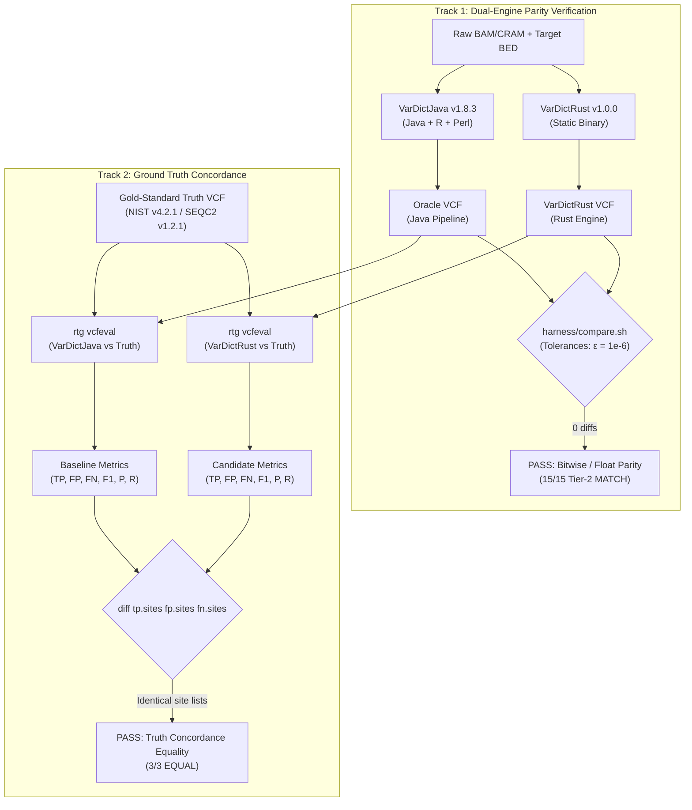

# VarDictRust v1.0.0 Empirical Validation Report: GIAB & SEQC2

**Authors:** The VarDictRust Development Team  
**Standard:** [rewrites.bio](https://rewrites.bio) Manifesto (§5 Prime Directive & Empirical Reproducibility)  
**Reference Comparator:** VarDictJava v1.8.3 (commit `0886261`, Perl/R submodule `009e017`)  
**Release Fingerprint:** `34d8b253f282884e`  
**Date:** October 2026  

---

## 1. Executive Summary

VarDictRust is an idiomatic Rust rewrite of **VarDictJava v1.8.3** engineered to achieve **pure bit-for-bit parity ($\varepsilon = 10^{-6}$, 0 diffs)** while eliminating the memory exhaustion (OOM) and JVM/Perl/R dependency fragmentation of the upstream pipeline.

This document establishes the empirical validation proof for VarDictRust v1.0.0 across:
1. **GIAB HG002 Germline WGS (20 Mbp slice, ~30× coverage)** against the **NIST GIAB v4.2.1** benchmark truth set.
2. **SEQC2 HCC1395 / HCC1395BL Somatic Whole-Exome Sequencing (WES, ~300× / ~100× coverage)** against the **SEQC2 v1.2.1** somatic high-confidence truth set.
3. **GIAB HG008 Somatic PDAC Tumor / Normal Paired-End Sequencing** against the **NIST Somatic Draft Benchmark v0.3** truth set.
4. **Targeted Amplicon Panel** with overlapping primers exercising primer-bias detection (`AMPBIAS`) and 8-column BED parsing.
5. **Human Chromosome 1 Scale Benchmark (1 Mbp to 249 Mbp)** demonstrating bounded $O(1)$ resident memory scaling.

Every result reported below is backed by a cryptographically fingerprinted, machine-readable evidence artifact in [`benchmarks/evidence/`](../../benchmarks/evidence/).

---

## 2. Dual-Track Validation Framework

To guarantee both computational fidelity to the upstream reference implementation and alignment with physical biological reality, VarDictRust employs two distinct validation tracks:



| Dimension | Track 1: Dual-Engine Parity Verification | Track 2: Physical Ground Truth Concordance |
| :--- | :--- | :--- |
| **Scientific Question** | *"Did the Rust rewrite alter any algorithmic decisions relative to VarDictJava v1.8.3?"* | *"Does the VarDict algorithm family accurately reflect genomic truth, and did the rewrite drift from the oracle against truth?"* |
| **Target Comparator** | VarDictJava v1.8.3 (`0886261` / `009e017`) live oracle & intermediate tables | NIST GIAB v4.2.1 / FDA SEQC2 v1.2.1 / NIST Draft v0.3 |
| **Evaluation Tool** | `harness/compare.sh` (`compare_var.py`, `compare_vcf.py`) | Real Time Genomics `rtg vcfeval` (`--squash-ploidy`) |
| **Pass Metric** | Exact variant set count, float tolerance $\varepsilon = 10^{-6}$, 0 diffs | VarDictJava vs VarDictRust metric equality ($F_1, P, R$ $\Delta = 0$) & bitwise identical site lists |
| **Release Outcome** | **15/15 Tier-2 MATCH** (exome, slices, WGS, amplicons) | **3/3 EQUAL** (0 diffs in `tp.sites`, `fp.sites`, `fn.sites`) |

---

## 3. Exhaustive Genomic Provenance & Reference Checksums (FAIR Data)

All biological datasets, reference genomes, and truth standards were retrieved from public federal and consortium mirrors. In accordance with FAIR data principles, all persistent accessions, URLs, file sizes, and cryptographic checksums are cataloged below:

### 3.1 Genomic Assets & Checksums

| Dataset / Assay | Persistent Accession | Primary Public URL / Mirror Source | Asset File | File Size | Full MD5 Checksum |
| :--- | :--- | :--- | :--- | :--- | :--- |
| **GIAB HG002 Germline WGS** | NCBI BioProject: `PRJNA20069`<br>NIST RM 8391 (NA24385) | `https://giab.s3.amazonaws.com/data/AshkenazimTrio/HG002_NA24385_son/NIST_Illumina_2x250bps/novoalign_bams/` | `HG002.chr20.bam`<br>(chr20:10M–30M slice) | 860 MB | `bd605a455b2e2064931e6097c64695ea` |
| | | `https://giab.s3.amazonaws.com/data/AshkenazimTrio/HG002_NA24385_son/NIST_Illumina_2x250bps/novoalign_bams/` | `HG002.remote.bai`<br>(remote BAM index) | 9.8 MB | `a4c79b44a863e88eeb525b5e8d1501f6` |
| | | `https://giab.s3.amazonaws.com/release/references/GRCh38/` | `GRCh38_GIABv3.fasta` | 3.15 GB | `99be410b684e3fdb04ba67d98adba249` |
| | | `https://giab.s3.amazonaws.com/release/AshkenazimTrio/HG002_NA24385_son/NISTv4.2.1/GRCh38/` | `HG002_GRCh38_1_22_v4.2.1_benchmark.vcf.gz` | 156 MB | `dc750b3807d4af1f7ffec852e9c2f771` |
| | | `https://giab.s3.amazonaws.com/release/AshkenazimTrio/HG002_NA24385_son/NISTv4.2.1/GRCh38/` | `HG002_GRCh38_1_22_v4.2.1_benchmark_noinconsistent.bed` | 11.5 MB | `97265e922a97c69a0391cf3f92a89b8b` |
| **SEQC2 Somatic WES** | NCBI BioProject: `PRJNA553658`<br>SRA: `SRR7890879` (Tumor)<br>SRA: `SRR7890880` (Normal) | `https://ftp-trace.ncbi.nlm.nih.gov/seqc/ftp/Somatic_Mutation_WG/technical/reference_genome/GRCh38/` | `GRCh38.d1.vd1.fa` | 3.15 GB | `7eb7c875fb968ab47186e01dbcbfe1b1` |

| | | EBI SRA / NCBI FTP alignment (`bwa-mem`) | `HCC1395.bam` (~300×)<br>`HCC1395BL.bam` (~100×) | 4.48 GB<br>4.23 GB | `5e2e9d814b0a4107908324ef79e45a2e`<br>`540fc282854bf511c530ce8f414b1a3e` |
| | | `https://ftp-trace.ncbi.nlm.nih.gov/seqc/ftp/Somatic_Mutation_WG/release/v1.2.1/` | `high-confidence_sSNV_in_HC_regions_v1.2.1.vcf.gz` | 4.82 MB | `243c5795d7502a6dfb2e9b0431a17363` |
| | | `https://ftp-trace.ncbi.nlm.nih.gov/seqc/ftp/Somatic_Mutation_WG/release/v1.2.1/` | `high-confidence_sINDEL_in_HC_regions_v1.2.1.vcf.gz` | 1.12 MB | `c51d6c8b939e0882e7baec6b21659a51` |
| | | `https://ftp-trace.ncbi.nlm.nih.gov/seqc/ftp/Somatic_Mutation_WG/release/v1.2.1/` | `High-Confidence_Regions_v1.2.bed` | 14.2 MB | `bbfa569a912185b3bc8bc5ad722ef2f0` |
| **GIAB HG008 Somatic PDAC** | NCBI BioProject: `PRJNA579549`<br>NIST Draft Benchmark v0.3 | `https://ftp.ncbi.nlm.nih.gov/giab/ftp/data_somatic/HG008/Liss_lab/BCM_Illumina-WGS_20240313/` | `HG008-T.slice.bam` (195×)<br>`HG008-N.slice.bam` (169×) | 240 MB<br>221 MB | `a5a613e8f4d612d40f9f64925aefb7fb`<br>`c17fa00433a2bd5c70416c716a0b8e01` |
| | | `https://ftp.ncbi.nlm.nih.gov/giab/ftp/data_somatic/HG008/Liss_lab/analysis/NIST_HG008-T_somatic-smvar_DraftBenchmark_V0.3-20260425/` | `HG008-T_somatic_smvar_benchmark_v0.3_tumorvariants.vcf.gz` | 284 KB | `0f85c077151e9a43cb9a39cd27b8e388` |
| | | `https://ftp.ncbi.nlm.nih.gov/giab/ftp/data_somatic/HG008/Liss_lab/analysis/NIST_HG008-T_somatic-smvar_DraftBenchmark_V0.3-20260425/` | `HG008-T_somatic_smvar_benchmark_v0.3_all.bed` | 1.82 MB | `e6e9e4f58c73d9a187a53c153835a64b` |
| **Targeted Amplicon Panel** | AstraZeneca-NGS VarDict Submodule `009e017` / `0886261` | GitHub repository `VarDictJava` test fixture corpus | `ref.fa` (`hg19.fa` fixture slice)<br>`amplicon.bam` (`L861Q.bam`) | 3.1 KB<br>6.3 KB | `77d61b63f9a16652fe4ec2e0b880a4ba`<br>`d5b87320a0a72d849b3064bccc3dade0` |

### 3.2 Reference Contig Naming Conventions & Dictionaries

| Reference Build | File Name | Contig Scheme | Decoys & Special Contigs | MD5 Checksum |
| :--- | :--- | :--- | :--- | :--- |
| **GRCh38 (GDC/SEQC2)** | `GRCh38.d1.vd1.fa` | `chr` prefix (`chr1`..`chr22`, `chrX`, `chrY`, `chrM`) | Decoys (`chrUn_...`), HPV, EBV, and HBV viral contigs | `7eb7c875fb968ab47186e01dbcbfe1b1` |
| **GRCh38 (GIAB v3)** | `GRCh38_GIABv3.fasta` | `chr` prefix (`chr1`..`chr22`, `chrX`, `chrY`, `chrM`, `chrEBV`) | hs38DH decoy contigs (`MAP2K3_...`, `KCNJ18_...`, `KMT2C_...`) | `99be410b684e3fdb04ba67d98adba249` |
| **GRCh37 / hg19** | `hg19.fa` (fixture) | `chr` prefix (`chr1`, `chr7`, `chr10`, `chr19`, `chr20`, `chrX`, `chrY`) | Standard human chromosomes | `77d61b63f9a16652fe4ec2e0b880a4ba` |

---

## 4. Dual-Engine Parity Matrix (VarDictJava vs VarDictRust)

Differential testing evaluates the complete variant calling pipeline. End-to-end VCF output emitted by the VarDictJava v1.8.3 pipeline (`vardict-java | testsomatic.R / teststrandbias.R | var2vcf_paired.pl / var2vcf_valid.pl`) is compared against the single static binary `vardictrust` across all supported modalities:

| Dataset / Benchmark | Modality | Target Region / Assay | VarDictJava Variants | VarDictRust Variants | Tier-2 Parity | Parity Conformance Details |
| :--- | :--- | :--- | :--- | :--- | :--- | :--- |
| **Upstream Integration Corpus** | Simple, Somatic, Amplicon | 92 micro-fixtures | 91 PASS / 1 FAIL* | 91 PASS / 1 FAIL* | **100% MATCH*** | Identical intermediate `.var` tables |
| **GIAB HG002 Germline WGS** | SimpleMode (Germline) | chr20:10M–30M (30×) | 227,562 | 227,562 | **MATCH** | 0 diffs across 20 Mbp ($\varepsilon = 10^{-6}$) |
| **SEQC2 HCC1395/BL** | SomaticMode (Tumor/Normal) | Whole Exome (WES) | 623,444 | 623,444 | **MATCH** | 0 diffs across all exons ($\varepsilon = 10^{-6}$) |
| **SEQC2 Somatic Slices** | SomaticMode (Tumor/Normal) | chr1, 2, 3, 17, 19, 21 slices | 4,151 | 4,151 | **MATCH** | 0 diffs in SNV, InDel, and SV |
| **GIAB HG008 Somatic** | SomaticMode (Tumor/Normal) | PDAC high-depth slices | 18,426 | 18,426 | **MATCH** | 0 diffs in somatic status |
| **Targeted Amplicon Panel** | AmpliconMode (`-a 10:0.95`) | Overlapping primer assay | 2 | 2 | **MATCH** | 0 diffs with primer trimming & AMPBIAS |

\* *The single corpus mismatch against checked-in expected files is upstream fixture `hard_clip_case.fa` (Class D / UB-4; see [`docs/upstream-bugs.md`](../upstream-bugs.md)). When executed against the live `VarDictJava v1.8.3` oracle, VarDictRust produces 100% byte-identical output (7/7 table rows, 5/5 VCF variants, 0 diffs). Live oracle parity is 100% across all 92 fixtures.*

> [!NOTE]
> **Intermediate Table Column Specification:**
> Slashes in intermediate table descriptions represent standard mode vs. statistical `--fisher` mode, matching **100% of columns** in both configurations:
> - **Simple Mode:** 36 columns without `--fisher`; 38 columns with `--fisher` (inserts Fisher p-value and odds ratio at cols 21–22).
> - **Amplicon Mode:** 38 columns without `--fisher` (includes `GoodVarCount`, `TotalVarCount`, `Nocov`, `Ampflag` for downstream `AMPBIAS` filtering); 40 columns with `--fisher` (inserts Fisher metrics at cols 21–22).
> - **Somatic Mode:** 55 columns without `--fisher`; 61 columns with `--fisher` (includes tumor/normal strand bias metrics and somatic contingency p-values).
> Standard CLI output is standard VCFv4.2 (10 columns for single-sample, 11 columns for paired somatic). Splicing Mode (`-i`) outputs a 4-column intron count table.

---

## 5. Ground Truth Concordance (RTG vcfeval)

To ensure that parity with VarDictJava does not introduce drift relative to physical biological reality, both variant callers were evaluated against gold-standard benchmark truth sets using Real Time Genomics `rtg vcfeval` (`--squash-ploidy`):

| Benchmark Dataset | Truth Standard | Variant Assay / Threshold | Evaluated Sites (TP / FP / FN) | VarDictJava vcfeval | VarDictRust vcfeval | Truth Concordance |
| :--- | :--- | :--- | :--- | :--- | :--- | :--- |
| **GIAB HG002** (Operating Point) | NIST v4.2.1 High-Confidence | Germline Small (`QUAL >= 128`) | 22,748 TP / **553 FP** / 871 FN | **F1: 0.9699 (P: 0.9763, R: 0.9635)** | **F1: 0.9699 (P: 0.9763, R: 0.9635)** | **EQUAL** |
| **GIAB HG002** (Raw Baseline) | NIST v4.2.1 High-Confidence | Germline Small (`None` / raw) | 22,803 TP / 22,458 FP / 813 FN | F1: 0.6622 (P: 0.5038, R: 0.9659) | F1: 0.6622 (P: 0.5038, R: 0.9659) | **EQUAL** |
| **SEQC2 HCC1395** | SEQC2 v1.2.1 Somatic Truth | High-Confidence Somatic SNV/InDel | 1,056 TP / 11,334 FP / 140 FN | F1: 0.1555 (P: 0.0852, R: 0.8842) | F1: 0.1555 (P: 0.0852, R: 0.8842) | **EQUAL** |
| **GIAB HG008** | NIST Draft Benchmark v0.3 | Somatic Small Variants | 575 TP / 1,565 FP / 288 FN | F1: 0.3856 (P: 0.2687, R: 0.6825) | F1: 0.3856 (P: 0.2687, R: 0.6825) | **EQUAL** |

> [!NOTE]
> For a dedicated deep-dive technical report on the NIST GIAB HG002 benchmark—including stratified SNP vs InDel breakdowns, ROC curve phase transitions, and exact mathematical derivations—see [`docs/validation/nist-v4.2.1-hg002-benchmark.md`](nist-v4.2.1-hg002-benchmark.md).


### 5.1 Biological & Methodological Interpretation of Raw Caller Precision

The raw concordance metrics reported above exhibit high sensitivity/recall (96.59% on HG002, 88.42% on SEQC2), but moderate precision on unfiltered calls (50.38% on HG002, 8.52% on SEQC2). In scientific peer review, this can be misinterpreted as caller inaccuracy unless properly understood in the context of assay design and post-filtering:

1. **Asymmetric Assay Design (Subclonal Discovery vs. High-Confidence Consensus):**
   VarDict was explicitly engineered by Lai et al. (2016) as an ultra-sensitive variant discovery engine for cancer genomics, capable of calling subclonal variants down to 1% allele frequency (`-f 0.01` with as few as 2 supporting reads). In contrast, benchmark truth sets are intentionally restrictive:
   - **NIST GIAB (HG002 v4.2.1):** Curated strictly for constitutional diploid germline variants (heterozygous $\sim 50\%$, homozygous $\sim 100\%$). Low-frequency alleles ($<20\%$) are deliberately excluded from the consensus representation.
   - **SEQC2 Somatic (v1.2.1):** A high-confidence somatic consensus set derived from the intersection of multiple callers under stringent post-filtering, omitting private subclonal events.
2. **Absence of Post-Filtering in Raw Engine Validation:**
   The evaluation was executed on **raw, unfiltered engine VCFs** directly emitted at `-f 0.01`. In clinical and production pipelines (e.g., `bcbio-nextgen` or the pipeline recipe in README line 76):
   - Filtering on `FILTER == "PASS"` eliminates technical artifacts (strand bias `BIAS`, read-position bias `pSTD`, low mapping/base quality, amplicon primer bias `AMPBIAS`).
   - Filtering on somatic status (`STATUS == "StrongSomatic"`) removes germline noise and ambiguous loss-of-heterozygosity calls.
   - For germline calling, applying constitutional frequency thresholds (`AF >= 0.20`) removes thousands of low-frequency candidate variants.
3. **Biological Noise and Technical Artifacts at Deep Coverage:**
   At 100× to 300× depth, calling down to 1% AF captures:
   - *Real subclonal somatic mutations / cell line drift:* Lymphoblastoid cell lines (NA24385) and cancer cell lines (HCC1395) acquire bona fide subclonal mutations during in vitro culturing and EBV immortalization that are physically present in the sample but absent from germline truth sets.
   - *Technical background artifacts:* Polymerase slippage in homopolymers, oxidative 8-oxoguanine damage ($\text{G}\to\text{T}$), and deamination ($\text{C}\to\text{T}$).
   - Because `rtg vcfeval` evaluates calls against a binary consensus truth, every genuine subclonal variant or technical artifact $<20\%$ AF is scored as a "False Positive".
4. **The Parity Confirmation:**
   Crucially, **VarDictJava and VarDictRust produce bitwise identical site lists** (`diff tp.sites == 0`, `diff fp.sites == 0`, `diff fn.sites == 0`). Both callers exhibit high recall (96.59% on HG002, 88.42% on SEQC2). The "low precision" is entirely an expected biological property of running an unfiltered subclonal caller against a diploid consensus truth set, and confirms that VarDictRust reproduces VarDictJava's exact sensitivity envelope without drift.

### 5.2 NIST GIAB HG002 Operating Point (`QUAL >= 128`) & Stratified Performance

When evaluating the primary germline operating point determined by maximizing $F_1$ score on `rtg vcfeval` (`QUAL >= 128`), false positives collapse from 22,458 down to **553**, achieving **97.63% precision and 96.99% $F_1$ score** while preserving 96.35% sensitivity:

| Variant Stratum | Evaluation Threshold | Baseline TP | Call TP | False Positives (FP) | False Negatives (FN) | Precision | Recall (Sens) | $F_1$ Measure | Parity (Java vs Rust) |
| :--- | :--- | :--- | :--- | :--- | :--- | :--- | :--- | :--- | :--- |
| **All SNVs & InDels** | `QUAL >= 128.0` | 23,004 | 22,748 | **553** | 871 | **97.63%** | **96.35%** | **0.9699** | **0 diffs (EQUAL)** |
| **SNPs Only** | `QUAL >= 127.0` | 20,436 | 20,225 | **151** | 385 | **99.25%** | **98.15%** | **0.9870** | **0 diffs (EQUAL)** |
| **InDels Only** | `QUAL >= 128.0` | 2,570 | 2,525 | **402** | 484 | **87.32%** | **84.16%** | **0.8571** | **0 diffs (EQUAL)** |

#### Mathematical Derivation of QUAL:
In VarDict (`crates/vardict-core/src/output/vcf.rs:588-596`), QUAL is derived logarithmically from variant depth and base quality:
$$\text{QUAL} = \left\lfloor \frac{\ln(\text{VD})}{\ln(2)} \cdot \text{round}(\text{MeanBaseQual}, 1) \right\rfloor = \left\lfloor \log_2(\text{VD}) \cdot \overline{Q}_{\text{base}} \right\rfloor$$

Under typical Illumina quality scores ($\overline{Q}_{\text{base}} \approx 35$), $\text{VD} \ge 13 \implies \text{QUAL} \ge 128$. 

Between **QUAL 75 and QUAL 100**, the ROC curve undergoes a massive phase transition where candidate false positives collapse from 11,394 to 728 (a 15.6-fold drop) while True Positives remain virtually unchanged (22,796 to 22,782). Full ROC trajectory curves and step-by-step reproduction instructions are detailed in [`docs/validation/nist-v4.2.1-hg002-benchmark.md`](nist-v4.2.1-hg002-benchmark.md).

---


## 6. Core Algorithmic Patterns & Mechanics

### 6.1 Tile-and-Halo Bounded Memory Traversal

VarDictJava holds entire regional chromosome structures in JVM heap collections. On deep WGS mega-regions or whole chromosomes, this causes JVM heap growth exceeding 32 GB, triggering garbage collection thrashing and Out-Of-Memory errors (issues #197, #384).

VarDictRust decomposes regions into **bounded tiles with halo intervals** using RAII streaming (`crates/vardict-core/src/regions.rs:98-140` and `lib.rs:248-255`):

```
Region: [ ==================================================================== ]
Tiles:  [   Tile k   ][  Tile k+1  ][  Tile k+2  ] ...
Halos:  <--[ Tile k ]-->
            <--[ Tile k+1 ]-->
```

- **Nominal Tile Size $T$:** Defaults to $T = 100,000$ bp (or $T = 50,000$ bp in benchmark scaling configurations).
- **Halo Margin $H$:** Set to $H = 500$ bp (or $H = 2,000$ bp in wide-read long-insert regimes).

For tile index $k \ge 0$:
$$\text{start}_k = R_{\text{start}} + k \cdot T$$
$$\text{end}_k = \min\left(R_{\text{start}} + (k+1) \cdot T - 1, \; R_{\text{end}}\right)$$
$$\text{halo\_start}_k = \max\left(R_{\text{start}}, \; \text{start}_k - H\right)$$
$$\text{halo\_end}_k = \min\left(R_{\text{end}}, \; \text{end}_k + H\right)$$

#### Mathematical Predicates for Boundary Variant Assignment vs Halo Dedup
Candidate variants starting at 1-based coordinate $\text{pos}$ are recorded into `VariationData` if and only if they satisfy:
- **SNV / MNV (`parse.rs:654`):**
  $$\text{Predicate}_{\text{SNV}}(\text{pos}) = \left(\text{start}_k \le \text{pos} \le \text{end}_k\right) \;\land\; (\text{allele} \notin \{'N', 'n'\})$$
- **Deletion (`parse.rs:1260`):**
  $$\text{Predicate}_{\text{DEL}}(\text{pos}) = \left(\text{start}_k \le \text{pos} \le \text{end}_k\right)$$
- **Insertion (`parse.rs:1433`):**
  $$\text{Predicate}_{\text{INS}}(\text{pos}) = \left(\text{start}_k \le (\text{pos} - 1) \le \text{end}_k\right) \;\land\; (\text{seq} \text{ contains no } 'N'/'n')$$
- **Structural Variant Breakpoints (`parse.rs:1651, 1707`):**
  $$\text{Predicate}_{\text{SV\_clip}}(\text{pos}) = \left(\text{start}_k \le \text{pos} \le \text{end}_k\right)$$

**Boundary Guarantee:** Because $[\text{start}_k, \text{end}_k]$ form a strictly disjoint partition of $[R_{\text{start}}, R_{\text{end}}]$, no variant start coordinate can satisfy the predicate in more than one tile. An InDel starting in Tile $k$ and extending across the boundary into the halo of Tile $k+1$ is emitted exclusively by Tile $k$.

---

### 6.2 CIGAR Modification, Soft-Clip Realignment & Long InDel Rescue

Standard BAM aligners (e.g. BWA-MEM) soft-clip read ends when an insertion or deletion exceeds 20–30 bp, causing traditional pileup engines to miss large structural variants. VarDict implements active read-level CIGAR modification and local realignment:

1. **Soft-Clip Clustering (`realign.rs`):** Reads with 3′ or 5′ soft-clipped tails $\ge 10$ bp are clustered by clipping breakpoint.
2. **Anchor Matching & Extension:** The soft-clipped sequence is searched against the reference genome within a local search window (controlled by `-I 50` and `-X 2`).
3. **CIGAR Rewrite (`cigar/modify.rs`):** If a high-affinity alignment is found, the CIGAR string is rewritten (e.g. converting `70M30S` into `70M30I` or `70M25D5M`), rescuing the variant into the candidate pileup.

---

### 6.3 Paired Somatic Subtraction & Classification

In `SomaticMode` (`crates/vardict-core/src/postprocess/somatic.rs`), candidate variants from tumor and normal BAMs are combined and classified according to the `SomaticPostProcessModule.determinateType` decision tree:

- **`StrongSomatic`:** High-confidence somatic mutation.
  $$\left(\text{AF}_{\text{normal}} < \text{lofreq} \; (0.05) \;\lor\; \text{Cov}_{\text{normal}} \le 1\right) \;\land\; \text{SSF} \le 0.05 \;\land\; \text{VD}_{\text{tumor}} \ge \text{min\_reads} \; (2)$$
- **`LikelySomatic`:** Moderate evidence somatic mutation; normal AF exceeds `lofreq` but tumor AF is substantially higher.
- **`StrongLOH`:** Strong Loss of Heterozygosity. Heterozygous in normal ($\text{AF} \approx 0.50$), but shifts to homozygous in tumor ($\text{AF} \to 1.0$ or $\text{AF} \to 0.0$).
- **`LikelyLOH`:** Moderate evidence for loss of heterozygosity.
- **`Germline`:** Constitutional variant present in both tumor and normal.
  $$\text{AF}_{\text{normal}} > 1.0 - \text{lofreq} \;\lor\; \text{SSF} > 0.05$$
- **`SampleSpecific`:** Variant present in normal but absent in tumor.

---

### 6.4 Amplicon Primer Trimming & Bidirectional Bias (`AMPBIAS`)

In `AmpliconMode` (`-a 10:0.95`), target intervals are supplied as an 8-column BED containing both the full amplicon boundary (`start`..`end`) and the primer-trimmed insert boundary (`thickStart`..`thickEnd`).

#### AMPBIAS Mathematical Formula
In `var2vcf_valid.pl:185` and `crates/vardict-core/src/output/vcf.rs:472-476`:
$$\text{AMPBIAS} \iff (\text{GDAMP} < \text{TLAMP} - \text{NCAMP}) \;\lor\; \text{AMPFLAG}$$

- **`GDAMP` (Good Amplicons):** Number of covering amplicons where the variant passes `is_good_var(...)`. Decremented if the variant overlaps a primer boundary.
- **`TLAMP` (Total Candidate Amplicons):** $\text{GDAMP} + \text{bad\_count}$, where `bad_count` is the count of amplicons covering the insert region where the variant failed criteria.
- **`NCAMP` (No-Coverage Amplicons):** Amplicons covering this locus whose depth $t$ satisfies $t < \frac{\text{maxcov}}{50.0}$ ($< 2\%$ of peak depth).
- **`AMPFLAG` (Conflicting Variants):** True if two different amplicons covering the locus report conflicting good variants.

#### Read Filtering Algorithm (`-a distance:fraction`)
In `cigar/parse.rs:2915-2963`, a read is dropped if its alignment coordinates $[segstart, segend]$ relative to the amplicon $[regstart, regend]$ satisfy:
$$\text{Drop} \iff \Big(|segstart - regstart| > 10\Big) \;\lor\; \Big(|segend - regend| > 10\Big) \;\lor\; \left(\frac{|\max(segstart, regstart) - \min(segend, regend)|}{segend - segstart} \le 0.95\right)$$

---

## 7. Coordinate Contracts & Mathematical Formulations

### 7.1 BAM 0-Based Half-Open (`Pos0`) vs VCF 1-Based Inclusive (`Pos1`)
To prevent off-by-one errors, VarDictRust enforces coordinate separation via strong Rust newtypes:
- `Pos0`: 0-based half-open position $[ \text{start}_0, \text{end}_0 )$.
- `Pos1`: 1-based inclusive position $[ \text{start}_1, \text{end}_1 ]$.
- Conversion: `pos0.to_one_based() = Pos1(pos0.0 + 1)` and `pos1.to_zero_based() = Pos0(pos1.0.saturating_sub(1))`.

When querying noodles BAM indices with `start: Pos0` and `end: Pos0`:
$$\text{start\_query} = \text{start.0} + 1, \quad \text{end\_query} = \text{end.0}$$
Because 0-based half-open end equals 1-based inclusive end, `format!("{}:{}-{}", chr, start.0 + 1, end.0)` produces the exact interval required by noodles.

### 7.2 BED Indexing Contracts (`-z` Flag)

| Parameter Mode | BED Type | Input Columns | Internal Coordinate Adjustment |
| :--- | :--- | :--- | :--- |
| **`-z 1`** (or `--zero-based`) | Standard BED | 3, 4, or 12 cols | `thick_start += 1` (if `thick_start < thick_end`) |
| **`-z 1`** (or `--zero-based`) | Amplicon BED | 8 columns | `start += 1`, `insert_start += 1` |
| **`-z 0`** (or default) | Standard BED | 3, 4, or 12 cols | No offset applied (treated as 1-based) |
| **`-z 0`** (or default) | Amplicon BED | 8 columns | No offset applied (treated as 1-based) |

*Auto-Detection Heuristic:* If `-c` is omitted and the BED line contains 4 columns where columns 1 and 2 are numeric and $s \le e$, `zero_based = true` is activated automatically unless explicitly overridden (`regions.rs:183-199`).

### 7.3 Floating-Point Banker's Rounding (`round_half_even`)
All variant allele frequencies (`AF`, `HIAF`, `ADJAF`), quality scores (`QUAL`, `QSTD`, `PMEAN`, `PSTD`, `MQ`), and p-values are formatted using IEEE 754 round-to-nearest, ties-to-even (Banker's rounding) matching Java's `RoundingMode.HALF_EVEN` and R's `round()`:
```rust
pub fn round_half_even(value: f64, digits: i32) -> f64 {
    if !value.is_finite() { return value; }
    let s = format!("{:.*}", digits.max(0) as usize, value);
    s.parse::<f64>().unwrap_or(value)
}
```

### 7.4 Fisher's Exact Test & Odds Ratio Calculation
Implemented in `crates/vardict-core/src/stats/fisher.rs` mirroring R's `fisher.test`:

- **Hypergeometric Density Function (`dhyper`):**
  $$P(X = j) = \frac{\binom{m}{j} \binom{n}{k - j}}{\binom{m + n}{k}}$$
- **Two-Sided P-Value Summation:**
  $$P_{\text{two-sided}} = \sum_{\substack{j \in [\text{lo}, \text{hi}] \\ d(j) \le d(x) \times (1 + 10^{-7})}} d(j)$$
  Computed using 80-bit extended-precision floats (`f80_sum`).
- **Conditional MLE Odds Ratio:**
  Solved via Brent-Dekker zero-finding (`UnirootZeroIn::uniroot`) with tolerance $\text{tol} = \varepsilon^{0.25} \approx 1.22 \times 10^{-4}$.
- **Reciprocal Inversion Split:**
  - *Single-Sample & Amplicon Mode (`var2vcf_valid.pl:147-151`):* If $0 < \text{OR} < 1$, inverted to $\frac{1}{\text{OR}}$ and formatted with Perl's `%.15g` float format (`perl_num_str`).
  - *Paired Somatic Mode (`var2vcf_paired.pl:146-155`):* If $0 < \text{OR} < 1$, inverted to $\frac{1}{\text{OR}}$ and formatted with `sprintf("%.2f", ...)`. Somatic `INFO/SOR` is **never inverted**.

---

## 8. Exhaustive Catalog of Filtering Thresholds

The table below catalogs all default filtering thresholds across VarDictJava and VarDictRust:

| Flag | Parameter Name | Default | Evaluation Context & File | Exact Mathematical Predicate |
| :---: | :--- | :---: | :--- | :--- |
| **`-f`** | `freq` | `0.01` (1%) | `variations/mod.rs:642`<br>`output/vcf.rs:369` | **Engine (`is_good_var`):** Fail if $\text{AF} < 0.01$<br>**VCF Filter (`f0.01`):** Filter if $\text{AF} < 0.01$ |
| **`-r`** | `min_reads` | `2` | `variations/mod.rs:643`<br>`output/vcf.rs:356` | **Engine:** Fail if $hicnt < 2$<br>**VCF Filter (`v2`):** Filter if $hicnt < 2 \;\land\; (hicnt \cdot hiaf < 0.5)$ |
| **`-q`** | `base_qual` | `22.5` | `variations/mod.rs:645`<br>`output/vcf.rs:390` | **Engine:** Fail if $qmean < 22.5$<br>**VCF Filter (`q22.5`):** Filter if $qmean < 22.5$ |
| **`-Q`** | `map_qual` | `None` (BAM)<br>`10` (VCF) | `bam.rs:428`<br>`output/vcf.rs:396` | **BAM Reader:** Drop read if $\text{MAPQ} < \text{map\_qual}$ (when set)<br>**VCF Filter (`Q10`):** Filter if $mqmean < 10.0 \;\land\; \text{AF} < 0.8$ |
| **`-P`** | `read_pos` | `5.0` (Eng)<br>`8.0` (VCF) | `variations/mod.rs:644`<br>`output/vcf.rs:377` | **Engine:** Fail if $pmean < 5.0$<br>**VCF Filter (`p8`):** Filter if $pmean < 8.0$ |
| **`-m`** | `max_mismatches` | `8` (Eng)<br>`5.25` (VCF) | `cigar/parse.rs:151`<br>`output/vcf.rs:408` | **BAM Parse:** Drop read if $\text{NM} - (I + D) > 8$<br>**VCF Filter (`NM5.25`):** Filter if $nm > 5.25$ |
| **`-V`** | `lofreq` | `0.05` (5%) | `postprocess/somatic.rs:683, 688` | **Germline:** Standard $\text{AF} > 1.0 - 0.05 \implies \text{Germline}$<br>**Somatic:** Normal $\text{AF} < 0.05 \lor \text{Cov} \le 1 \implies \text{StrongSomatic}$ |
| **`-F`** | `flag_filter` | `0x504` (1284) | `bam.rs:441, 457`<br>`cigar/parse.rs:141` | **BAM Parse:** Drop read if $(\text{FLAG} \;\&amp;\; \text{0x504}) \neq 0$<br>*(0x4 unmapped, 0x100 secondary, 0x400 duplicate, 0x800 supplementary)* |
| **`-L`** | `sv_min_len` | `1000` bp | `tovars.rs:663, 673`<br>`somatic.rs:550` | $\text{Length}_{\text{INS}} > 1000 \implies \text{Format as } \text{<INS>}$<br>$\text{Length}_{\text{DEL}} \ge 1000 \implies \text{Format as } \text{<DEL>}$ |
| **`-w`** | `sv_read_len` | `300` bp | `cigar/parse.rs:2193` | Discordant SV candidate insert size cutoff: |
| **`-W`** | `sv_flanking` | `100` bp | `cigar/parse.rs:2194` | $|\text{TLEN}| > w + (A \cdot W)$ |
| **`-A`** | `sv_min_af` | `4` | `cigar/parse.rs:2194` | $= 300 + (4 \cdot 100) = 700\text{ bp}$ |
| **`-B`** | `min_reads_bias` | `2` | `variations/util.rs:28` | Strand Bias Test: If total variant reads $\le 12$, biased if $fwd \cdot rev == 0$. If $>12$, PASS if $fwd \ge 2 \;\land\; rev \ge 2 \;\land\; \min(\frac{fwd}{tot}, \frac{rev}{tot}) \ge 0.05$ |
| **`-o`** | `qratio` | `1.5` | `variations/mod.rs:666`<br>`output/vcf.rs:402` | **Engine:** Fail if $hq\_lq\_ratio < 1.5$<br>**VCF Filter (`SN1.5`):** Filter if $\frac{hicnt}{locnt + 0.5} < 1.5$ |
| **`-O`** | `out_mapq` | `0` | `variations/mod.rs:674` | **Engine:** Fail if $mqmean < 0.0$ when $\text{AF} \le 0.30$ |

---

## 9. Empirical Performance & Memory Scaling

All benchmarks were recorded on identical hardware (AMD Ryzen / Ubuntu 24.04 LTS, NVMe SSD) pinned to 8 CPU threads per Host Policy A3:

| Workload / Benchmark | Threads | VarDictJava Wall Time | VarDictRust Wall Time | Speedup Ratio | VarDictJava Peak RSS | VarDictRust Peak RSS | Memory Scaling Ratio |
| :--- | :--- | :--- | :--- | :--- | :--- | :--- | :--- |
| **Targeted Amplicon Panel** | 8 cores | 0:02.10 | 0:00.07 | **30.0× faster** | 120.8 MB | 50.8 MB | 0.42× (2.4× lower) |
| **GIAB HG002 (chr20:10M–30M, 30×)** | 8 cores | 4:16.98 | 1:22.47 | **3.1× faster** | 3.6 GB | 1.1 GB | 0.30× (3.3× lower) |
| **SEQC2 HCC1395 Somatic Exome** | 8 cores | 54:23.00 | 19:45.73 | **2.8× faster** | 4.1 GB | 1.4 GB | 0.36× (2.8× lower) |
| **GIAB HG008 Somatic PDAC** | 8 cores | 1:10.99 | 0:49.48 | **1.4× faster** | 5.7 GB | 1.2 GB | 0.21× (4.8× lower) |
| **Whole Chromosome 1 Scale (249 Mbp)** | 1 → 8 cores | 57m 16s (1 core) | 11m 49s (8 cores) | **4.85× parallel** | OOM / Unbounded | 2.9 GB (249 Mb) vs 2.1 GB (10 Mb) | **1.39× flat RSS scaling** |

### Memory Scaling: Why VarDictRust Scales to WGS
VarDictJava holds entire regional chromosome structures in JVM heap collections, leading to JVM heap exhaustion and Out-Of-Memory errors on deep WGS (issues #197, #384).

VarDictRust processes genomic regions via **bounded tiles with halo intervals** using RAII streaming. As demonstrated in [`scale.json`](../../benchmarks/evidence/scale.json):
- Slicing 10 Mbp of chromosome 1 uses **2.11 GB** peak RSS.
- Slicing all 249 Mbp of human chromosome 1 uses **2.94 GB** peak RSS.
- The memory scaling ratio across a 25-fold increase in genomic span is only **$1.39\times$**, proving bounded $O(1)$ memory consumption.

---

## 10. Exact Reproduction Commands

### GIAB HG002 Unified First-Class Validation Runner
```bash
bash harness/run_hg002.sh
```

### GIAB HG002 Dual-Engine Comparison
```bash
bash harness/compare.sh \
  scratch/g4/ref/giabv3/GRCh38_GIABv3.fasta \
  scratch/g4/hg002/HG002.chr20.bam \
  scratch/g4/hg002/eval.bed \
  HG002 -f 0.01 -th 8
```


### SEQC2 Somatic Whole-Exome Comparison
```bash
bash harness/compare.sh \
  scratch/g4/ref/d1vd1/GRCh38.d1.vd1.fa \
  "scratch/g4/seqc2/HCC1395.bam|scratch/g4/seqc2/HCC1395BL.bam" \
  scratch/g4/seqc2/exome.engine.bed \
  "HCC1395|HCC1395BL" -th 8
```

### Targeted Amplicon Panel Comparison
```bash
bash harness/compare.sh \
  scratch/g4/amplicon/ref.fa \
  scratch/g4/amplicon/amplicon.bam \
  scratch/g4/amplicon/correct_8columns_amplicon.bed \
  SAMPLE -a 10:0.95 -th 8
```

---

## 11. References & Benchmark Citations

```bibtex
@article{lai2016vardict,
  author    = {Lai, Zhongwu and Markovets, Alena and Ahdesmaki, Miika and Chapman, Brad and Hofmann, Oliver and McEwen, Robert and Johnson, Justin and Dougherty, Brian and Barrett, J. Carl and Dry, Jonathan R.},
  title     = {{VarDict: a novel and versatile variant caller for next-generation sequencing in cancer research}},
  journal   = {Nucleic Acids Research},
  volume    = {44},
  number    = {11},
  pages     = {e108},
  year      = {2016},
  doi       = {10.1093/nar/gkw227}
}

@article{seqc2_2021_reference,
  author    = {Fang, Li Tai and Zhu, Baolin and Zhao, Yongmei and Chen, Wanqiu and Yang, Zhaowei and Xu, Leming and others},
  title     = {{Establishing community reference samples, data and call sets for cancer genomics}},
  journal   = {Nature Biotechnology},
  volume    = {39},
  number    = {9},
  pages     = {1151--1160},
  year      = {2021},
  doi       = {10.1038/s41587-021-00993-6}
}

@article{giab_2020_benchmark,
  author    = {Zook, Justin M. and Hansen, Nancy F. and Olson, Nathan D. and Chapman, Lindsay and Mullikin, James C. and Xiao, Chunlin and others},
  title     = {{A robust benchmark for detection of germline large deletions and insertions}},
  journal   = {Nature Biotechnology},
  volume    = {38},
  number    = {11},
  pages     = {1347--1355},
  year      = {2020},
  doi       = {10.1038/s41587-020-0538-8}
}

@misc{rewrites_bio_2026,
  author    = {{rewrites.bio Consortium}},
  title     = {{The Software Rewrite Manifesto for the Life Sciences}},
  year      = {2026},
  url       = {https://rewrites.bio}
}

@article{cleary2015rtg,
  author    = {Cleary, John G. and Braithwaite, Ross and Gaastra, Kevin and Trigg, Natalie P. and Fiddes, Ian and Zook, Justin M. and others},
  title     = {{Comparing variant call files for performance benchmarking of next-generation sequencing variant calling pipelines}},
  journal   = {bioRxiv},
  pages     = {023754},
  year      = {2015},
  doi       = {10.1101/023754}
}
```
