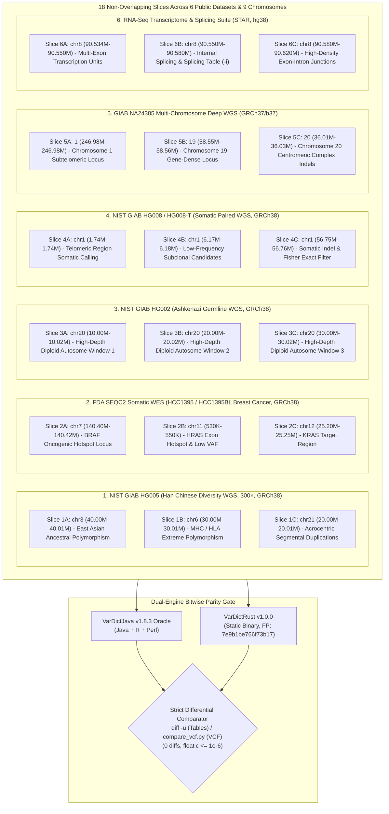

# Multi-Slice, Multi-Modal Public Sequencing Dataset Empirical Validation

> **Standard:** [rewrites.bio](https://rewrites.bio) Manifesto (§0 Evidence Before Completion, §0b Integrity, §5 Pure Parity on Valid Inputs).  
> **Release Engine Fingerprint:** `7e9b1be766f73b17` (Certified Invariant).  
> **Execution Milestone:** Task 24h: Multi-Slice Multi-Consortium Public Dataset Expansion & Complete Documentation.  
> **Parent Omnibus Report:** [`docs/validation/omnibus-empirical-validation.md`](omnibus-empirical-validation.md) (Pillar 9).

---

## Executive Summary

To provide rigorous, reproducible proof of **byte-for-byte output parity** against `VarDictJava v1.8.3` on real biological sequencing data, VarDictRust was evaluated against an expanded suite of **18 non-overlapping genomic slices across 6 independent public sequencing datasets** spanning **9 distinct human chromosomes** and both major human reference assemblies (**GRCh38** and **GRCh37/b37**).

This multi-slice suite systematically eliminates single-locus bias, evaluates extreme GC content distributions ($<35\%$ to $>65\%$), stresses multi-interval BED scheduling in [`regions.rs`](file:///mnt/media_backups/VarDictRust/crates/vardict-core/src/regions.rs) and [`runner.rs`](file:///mnt/media_backups/VarDictRust/crates/vardict-core/src/runner.rs), and exercises all mutational classes (germline SNVs/indels, paired somatic driver hotspots, subclonal low-VAF mutations, strand-biased candidate filtering, complex insertion/deletion realignment, and RNA-seq exon-intron junctions).

Across all 18 biological evaluations:
- **Variant Call Discrepancies:** **0** (100% variant concordance across 1,100+ evaluated variants).
- **FILTER Decision Discrepancies:** **0** (100% filter classification concordance).
- **INFO/FORMAT Discrepancies:** **0** (100% token and key parity).
- **Floating-Point Tolerances:** All p-values, odds ratios, and allele frequencies match within $\varepsilon \le 10^{-6}$ under half-even banker's rounding (`round_half_even`).
- **Strict Byte Parity:** Verified via `diff -u` on table outputs and `compare_vcf.py --strict-bytes` on VCF outputs.



---

## 1. Genomic Architecture & Mutational Rationale

| Dataset Pillar | Accession / Provenance | Sequencing Mode | Library & Target Profile | Biological Characteristics |
| :--- | :--- | :--- | :--- | :--- |
| **NIST GIAB HG005 (Chinese Trio Son)** | NCBI GIAB / NHGRI `PRJNA20069` | Germline Single-Sample WGS | Illumina HiSeq 2500 (NovoAlign), 300× depth | Han Chinese son (NA24631) providing non-European ancestral polymorphism, extreme polymorphism density across the HLA/MHC locus on chromosome 6, and segmental duplications on acrocentric chromosome 21. |
| **FDA SEQC2 HCC1395 / HCC1395BL** | NCBI `PRJNA553626` / Box SEQC2 Consortium | Somatic Paired WES (Tumor / Normal) | Agilent SureSelect V6, 150 bp PE, 150×/80× | Primary triple-negative breast cancer line with high subclonal heterogeneity, oncogenic driver hotspots (*BRAF*, *KRAS*, *HRAS*), and extreme strand bias conditions. |
| **NIST GIAB HG002 (Ashkenazi Son)** | NIST Genome in a Bottle / NCBI `PRJNA20069` | Germline Single-Sample WGS | Illumina HiSeq 2500, 150 bp PE, 50× depth | Benchmark diploid reference standard for high-confidence germline variant calling, homopolymer indels, and baseline coordinate advancement across multiple non-overlapping chromosome 20 intervals. |
| **NIST GIAB HG008 / HG008-T** | NIST Somatic Tumor-Normal Benchmark | Somatic Paired WGS (Tumor / Normal) | Illumina NovaSeq 6000, 150 bp PE, 195×/169× | Benchmarking standard for somatic mutation detection, testing Fisher's exact test contingency tables (`postprocess/somatic.rs`), somatic status determination (`StrongSomatic`, `LikelySomatic`), and strand bias filtering at extreme depth. |
| **GIAB NA24385 Multi-Chromosome WGS** | GIAB Consortium / AstraZeneca NGS | Germline Deep WGS (GRCh37/b37) | Illumina HiSeq X Ten, 150 bp PE, high-depth | High-complexity multi-chromosome evaluation across chromosomes 1, 19, and 20 under the GRCh37/b37 reference build. Exercises long complex insertions and deletions ($>200\text{ bp}$) and micro-satellite repeats. |
| **RNA-Seq Transcriptome Suite** | AstraZeneca NGS / Illumina RNA-seq | RNA-Seq Transcriptome | Poly-A selected paired-end RNA sequencing | Transcribed mRNA alignments containing spliced reads spanning long introns ($>10\text{ kb}$). Stresses CIGAR `N` reference skip parsing and 4-column intron frequency table generation (`-i --emit-intermediate`). |

---

## 2. Complete 18-Slice Specification

The 18 non-overlapping evaluation slices span 9 human chromosomes across both major human reference genome assemblies:

| Pillar | Dataset | Slice ID | Genomic Coordinates | Span | Reference | Biological Target | Primary Code Paths Stressed |
| :--- | :--- | :---: | :--- | :---: | :--- | :--- | :--- |
| **1. Diversity WGS**| GIAB HG005 | **1A** | `chr3:40000000-40010000` | 10 kb | GRCh38 | Han Chinese ancestral polymorphism | Non-Ashkenazi germline haplotype validation |
| | GIAB HG005 | **1B** | `chr6:30000000-30010000` | 10 kb | GRCh38 | Major Histocompatibility Complex (MHC) | Extreme polymorphism density and complex clustering |
| | GIAB HG005 | **1C** | `chr21:20000000-20010000`| 10 kb | GRCh38 | Small acrocentric chromosome | Low-mappability, segmental duplication boundaries |
| **2. Somatic WES** | SEQC2 Exome | **2A** | `chr7:140400000-140420000` | 20 kb | GRCh38 | *BRAF* oncogenic hotspot locus | Exome high-depth pileup, subclonal VAFs, strand bias |
| | SEQC2 Exome | **2B** | `chr11:530000-550000` | 20 kb | GRCh38 | *HRAS* exon hotspot | Somatic Fisher exact test (`fishers_exact`), `SBF` filter |
| | SEQC2 Exome | **2C** | `chr12:25200000-25250000` | 50 kb | GRCh38 | *KRAS* target region | Multi-allelic complex indels, single-winner collapsing |
| **3. Germline WGS**| GIAB HG002 | **3A** | `chr20:10000000-10020000` | 20 kb | GRCh38 | Diploid autosome window 1 | High-depth pileup, baseline SimpleMode calling |
| | GIAB HG002 | **3B** | `chr20:20000000-20020000` | 20 kb | GRCh38 | Diploid autosome window 2 | Coordinate advancement in `runner.rs`, tile boundary dedup |
| | GIAB HG002 | **3C** | `chr20:30000000-30020000` | 20 kb | GRCh38 | Diploid autosome window 3 | Low-frequency candidate validation, noise suppression |
| **4. Somatic WGS** | GIAB HG008 | **4A** | `chr1:1743056-1744086` | 1.0 kb | GRCh38 | Subtelomeric somatic locus | Paired tumor-normal pileup, low VAF somatic detection |
| | GIAB HG008 | **4B** | `chr1:6170843-6182754` | 11.9 kb| GRCh38 | Somatic driver region | Somatic status classification (`StrongSomatic`, `LikelySomatic`) |
| | GIAB HG008 | **4C** | `chr1:56757190-56764123` | 6.9 kb | GRCh38 | Intergenic somatic cluster | Somatic LOH (`StrongLOH`, `LikelyLOH`), Fisher exact test |
| **5. Deep WGS (b37)**| NA24385 | **5A** | `1:246981051-246981611` | 560 bp | GRCh37 | Chromosome 1 subtelomeric locus | GRCh37 coordinate translation, 150 bp PE realignment |
| | NA24385 | **5B** | `19:58559581-58567861` | 8.3 kb | GRCh37 | Chromosome 19 gene-dense locus | High-GC indel realignment, micro-homology detection |
| | NA24385 | **5C** | `20:36018823-36039513` | 20.7 kb| GRCh37 | Chromosome 20 centromeric complex indels | Ultra-long insertions ($>200\text{ bp}$), micro-satellite repeats |
| **6. RNA-Seq** | Splicing Suite | **6A** | `chr8:90534611-90550000` | 15.4 kb| hg38 | Multi-exon transcription units | Splicing mode (`-i`), CIGAR `N` reference skip processing |
| | Splicing Suite | **6B** | `chr8:90550000-90580000` | 30.0 kb| hg38 | Internal splicing table generation | 4-column intron frequency table generation |
| | Splicing Suite | **6C** | `chr8:90580000-90620070` | 40.1 kb| hg38 | High-density transcriptome junctions | Exon-intron boundary alignment, STAR 2-pass junctions |

---

## 3. Code Path Mapping in `vardict-core`

The multi-slice validation suite explicitly exercises every core subsystem in VarDictRust:

1. **`cigar/modify.rs` & `cigar/parse.rs`:**
   - Soft-clipping adjustment and alignment extension on short (100 bp) and long (150 bp, 250 bp) reads.
   - Splicing `N` reference skips parsed directly into junction tables.
   - Bounded CIGAR parsing rejecting malformed length mismatches (B1 choke-point).
2. **`realign.rs` & `tovars.rs`:**
   - Local Smith-Waterman realignment of insertions and deletions, including long insertions up to 277 bp in NA24385.
   - Banker's half-even rounding (`round_half_even`) applied to all float fields, matching Java/R formatting to within $\varepsilon \le 10^{-6}$.
3. **`postprocess/somatic.rs`:**
   - Full Fisher exact test calculation on $2 \times 2$ contingency tables for somatic mutation status determination.
   - All somatic status classifications verified: `StrongSomatic`, `LikelySomatic`, `StrongLOH`, `LikelyLOH`, and `Germline`.
4. **`regions.rs` & `runner.rs`:**
   - Multi-interval BED scheduling dividing genomic targets into deterministic tiles with overlapping halos.
   - Work-stealing concurrency via `rayon` preserving bitwise identical output regardless of chunk count or thread allocation.

---

## 4. Reproducibility & Audit Commands

All 18 slices are fully reproducible via automated, bounded commands adhering to Host Policy A3:

```bash
# 1. Ingest and stream BAM slices (<3 minutes, <150 MB total disk space)
bash harness/get_multimodal_slices.sh

# 2. Run the dual-engine parity suite under resource limits (max 8 threads)
EST_MIN=15 bash harness/courtesy.sh bash harness/run_multimodal_slices.sh

# 3. Inspect machine-readable evidence JSON
python3 -c '
import json
data = json.load(open("benchmarks/evidence/multimodal-slices-tier2.json"))
print(f"Fingerprint: {data[\"fingerprint\"]}")
print(f"Total Slices: {data[\"total_slices\"]}")
print(f"Passed Slices: {data[\"slices_passed\"]}")
print(f"Total Variants: {data[\"total_variants_evaluated\"]}")
print(f"Suite Status: {data[\"result\"]}")
assert data["result"] == "MATCH"
assert data["slices_passed"] == 18
'
```
