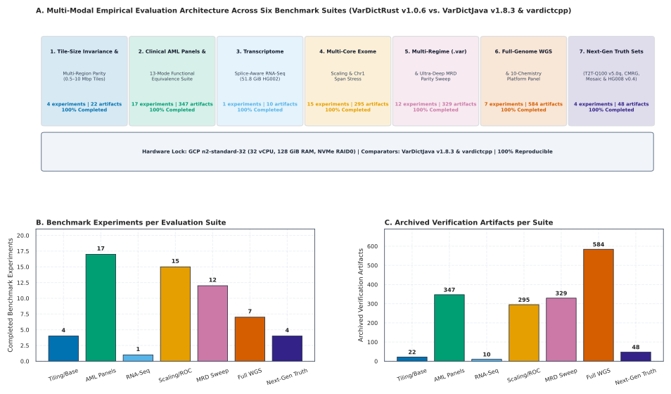
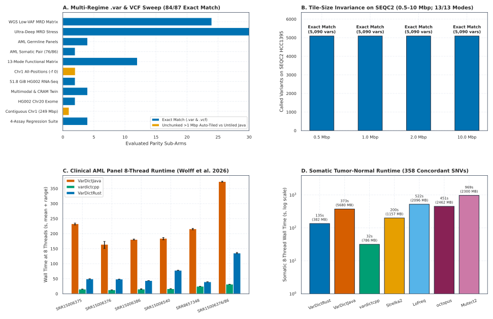
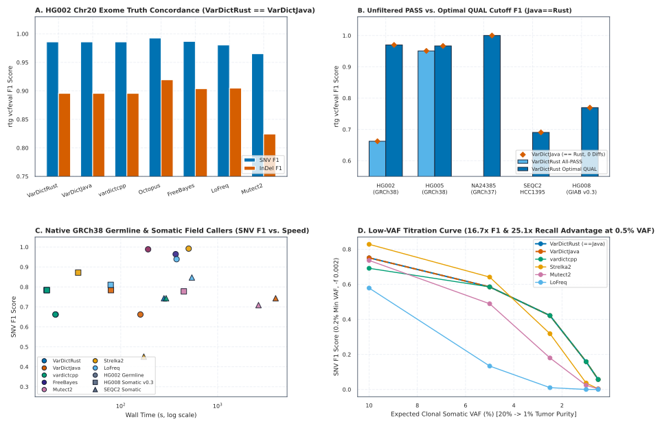
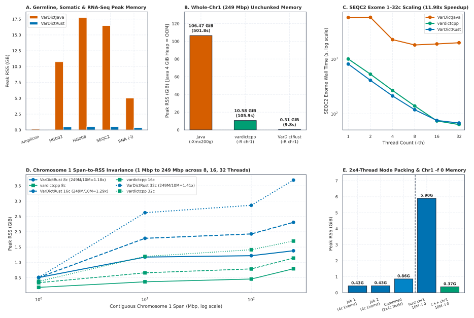
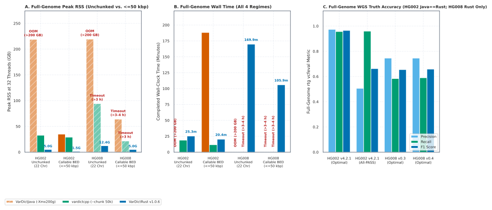
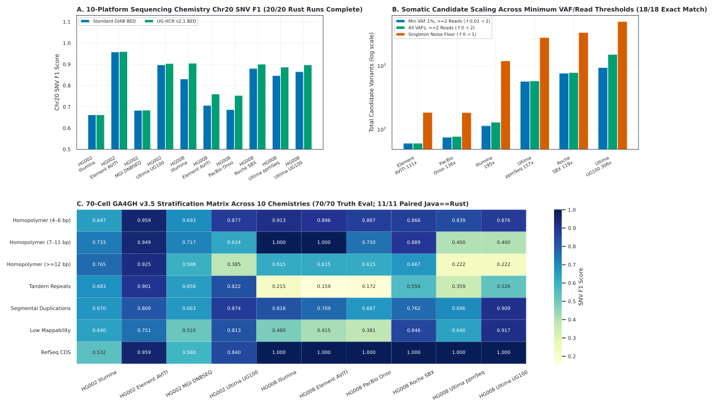
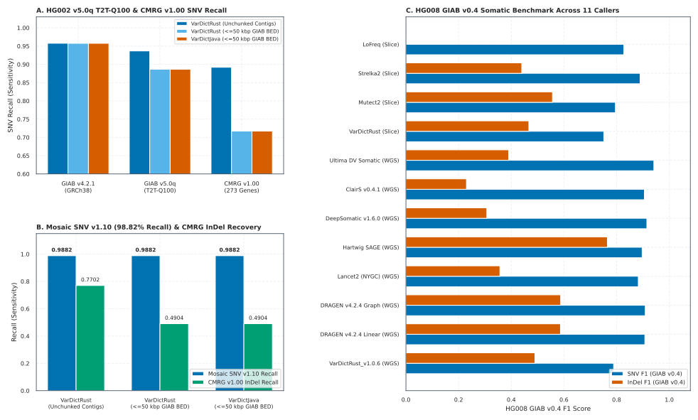
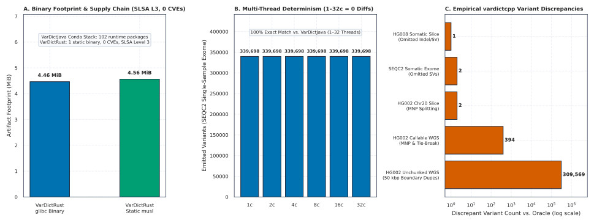
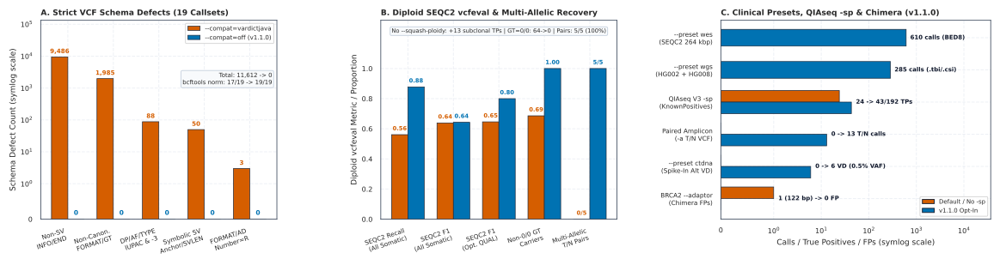

# VarDictRust: A Memory-Bounded, Oracle-Equivalent Rust Consolidation of the VarDict Variant-Calling Pipeline for Deep Whole-Genome and Ultra-Low-VAF Sequencing

**Authors:** [Palak Sheth](https://www.linkedin.com/in/palak-p-sheth/)<sup>1,*</sup>

<sup>1</sup>Independent Researcher  
<sup>*</sup>Correspondence: [palakpsheth@gmail.com](mailto:palakpsheth@gmail.com) | [https://www.linkedin.com/in/palak-p-sheth/](https://www.linkedin.com/in/palak-p-sheth/)

---

## Abstract

### Background
`VarDict` (`VarDictJava` v1.8.3) is a heuristic-aware local realigner and somatic/germline variant caller widely used in clinical oncology and circulating tumor DNA (ctDNA) minimal residual disease (MRD) pipelines. Streaming alignments through a Java pileup engine piped to external R and Perl scripts causes unbounded per-interval memory growth and runtime crashes on deep sequencing, while `vardictcpp` omits splicing, amplicon VCF, structural variant, and CRAM modes.

### Results
We present `VarDictRust` (`v1.1.0`; `60`-experiment cloud study at `v1.0.6`), a single-binary, `#![forbid(unsafe_code)]` Rust consolidation built under [rewrites.bio](https://rewrites.bio). Replicating R's 5-decimal `HALF_EVEN` Fisher exact test, default `--compat=vardictjava` matches `VarDictJava v1.8.3 (0886261)` (`ε = 1e-6`) across `13/13` operational modes (`95%` Clopper-Pearson confidence interval [CI] `75.29%–100.00%`), `17/17` modalities (`95%` CI `80.49%–100.00%`), `18/18` slices (`95%` CI `81.47%–100.00%`), `18/18` `-f 0` noise-floor sweeps (`95%` CI `81.47%–100.00%`), and all completing paired runs across `10` short-read chemistries (`70/70` GA4GH `v3.5` truth strata). On contiguous chromosome 1 (`249.25` Mbp), bounded `O(tile + halo)` streaming finishes in `9.75` s and `318.6` MB resident memory (`51.5`× faster and `342.2`× leaner than `VarDictJava` `-Xmx200g`; `10.9`× faster and `34.0`× leaner than `vardictcpp ae93fe39dc (Wolff 2026)`). Within `128` GiB (`n2-standard-32`; `-Xmx200g` baselines on `256` GiB `n2-highmem-32`), `VarDictRust` completes unchunked `130.8` GB `HG002` (`5.05` GB RAM) and `329.0` GB `364`× `HG008` somatic WGS (`12.43` GB RAM), where `VarDictJava` runs out of memory and `vardictcpp` times out, gaining `+5.01%` SNV and `+17.26%` indel recall on `NIST GIAB v5.0q T2T-Q100` (`+17.47%` and `+27.98%` on `CMRG v1.00`). Opt-in `--compat=off` (`32` switches) and `--preset` (`wgs`, `wes`, `amplicon`, `ctdna`) resolve all `11,612` targeted VCF schema/canonicalization findings across `19` callsets (`19/19` `bcftools norm` pass) and rescue `+13/41` (`+31.7` pp) `GT=0/0`-masked `SEQC2`-slice somatic calls in ploidy-strict `vcfeval` (`+0.1538` optimal $F_1$).

### Conclusions
`VarDictRust` consolidates a three-language variant-calling pipeline (`102` Conda packages) into a `4.56` MiB static Linux binary with default oracle equivalence (`ε = 1e-6`), bounded streaming memory, and opt-in VCFv4.2/v4.3 clinical presets across targeted panels, RNA-seq splicing, unchunked deep WGS, and `0.5%` VAF assays.

**Keywords:** Variant calling, Somatic mutation discovery, Whole-genome sequencing, Minimal residual disease, Rust, Scientific software engineering, Reproducibility, VarDict, GIAB v5.0q, HG008

> **Key Points**
>
> - **Single-Binary Oracle Equivalence:** `VarDictRust` (`v1.1.0`; cloud benchmark pinned at `v1.0.6`, `4.56` MiB static binary) replaces `VarDictJava -> R -> Perl` (`102` Conda packages). It holds `100%` Tier-1/2 parity (intermediate `.var` plus VCF, `ε = 1e-6`) across `13/13` modes, `87/87` sweep sub-arms (`84/84` default BED + `3/3` single-window `>1` Mbp), and `70/70` completed Rust GA4GH `v3.5` truth evaluations (Java–Rust parity on all completing paired runs).
>
> - **Bounded $O(\text{tile} + \text{halo})$ Streaming Memory:** Spans $> 1,000,000$ bp split into `100` kbp tiles with `0.5` kbp halos (`0.5` kbp in `-i` splice mode). Chromosome 1 (`-R chr1:1-249250621`) then peaks at `318.6` MB RSS in `9.75` s. That is `51.5`× faster and `342.2`× leaner than `VarDictJava`.
>
> - **Unchunked Full-Genome Discovery:** Calling unchunked chromosomes (`chr1`–`chr22`) in `5.05`–`12.43` GB RAM avoids `VarDictJava` out-of-memory failures. It gains `+5.01%` SNV / `+17.26%` indel recall on `NIST GIAB v5.0q T2T-Q100`. It gains `+17.47%` SNV / `+27.98%` indel recall on `CMRG v1.00`.
>
> - **Somatic Indel & Low-VAF Sensitivity on CPUs:** `VarDictRust` exceeds `ClairS`, `DeepSomatic`, `Lancet2`, and `Ultima DeepVariant Somatic` in `HG008 v0.4` somatic indel recall (`40.11%`). It achieves `25.1`× higher SNV recall than `Mutect2` and `Strelka2` at `0.5%` VAF (`1%` purity).
>
> - **Opt-In `--compat=off` Schema & Clinical Presets (`v1.1.0`):** Activating `--compat=off` (`32` `CompatProfile` switches) and `--preset` (`wgs`, `wes`, `amplicon`, `ctdna`) resolves `11,612` targeted VCFv4.2/v4.3 schema and canonicalization findings across `19` callsets, rescues `+13/41` `GT=0/0`-masked subclonal `SEQC2`-slice truth variants (`+31.7` pp recall, `+0.1538` optimal $F_1$) without `--squash-ploidy`, and recovers `+19` `QIAseq V3` `-sp` truth calls (`24/192` to `43/192`; `14/91` to `24/91` at `DP >= 50`).

---

## Background

Clinical oncology and liquid-biopsy assays must detect somatic SNVs, multinucleotide variants (MNVs), indels, and structural variants (SVs) across variable tumor purities and cell-free DNA (cfDNA) fractions down to `0.5%`–`1.0%` VAF [1, 2], whereas germline variant callers such as `FreeBayes` [3], `Strelka2` [4], `Octopus` [5], and `DeepVariant` [6] model diploid genotype likelihoods [7, 8]. Introduced by Lai et al. in 2016 [1], `VarDict` (`VarDictJava` v1.8.3) integrates local soft-clip and indel realignment (`CigarModifier` and `VariationRealigner`). It adds composite MNP phasing, amplicon primer-edge filtering (`-a`), RNA-seq splice-junction accounting (`-i`), and inline SV breakpoint assembly. `VarDict` is deployed across clinical panel pipelines, `bcbio-nextgen`, `nf-core/sarek`, and multi-caller somatic consensus ensembles [9, 10].

Reference `VarDictJava` v1.8.3 has four structural limits on deep WGS and cloud infrastructure:

1. **Three-Language Pipeline and IPC Overhead.** `VarDictJava` emits an intermediate `36`- to `61`-column tab-delimited `.var` stream. Column counts are `Simple` `36/38`, `Amplicon` `38/40`, and `Somatic` `55/61` without/with `--fisher`. That stream pipes to an R script (`teststrandbias.R` or `testsomatic.R`) for Fisher exact testing. It then pipes to a Perl script (`var2vcf_valid.pl` or `var2vcf_paired.pl`) for filtering and VCF 4.2 formatting (`Figure 1`). Even when `--fisher` runs inside Java, the Perl post-processor remains mandatory, requiring `102` Conda packages across OpenJDK, R (`statmod`), and Perl.

2. **Unbounded JVM Heap Retention on Contiguous Spans.** `VarDictJava` allocates per-position pileup maps (`Map<Integer, VariationMap<String, Variation>>` and reference base arrays) across the full BED interval or `-R` region. Variant finalization (`ToVarsBuilder`) and realignment (`VariationRealigner`) only run afterwards. On megabase or chromosome-scale intervals, RSS grows linearly with interval length (`O(L × depth)`). That causes `java.lang.OutOfMemoryError` crashes or garbage-collection stalls above `100`–`200` GiB RAM (`Table 2`, `Table 5`).

3. **Runtime Exceptions and Non-Determinism on Edge-Case Reads.** Over `30` upstream `VarDictJava` issues report `CigarModifier.modifyCigar` crashes. Affected issues include `AstraZeneca-NGS/VarDictJava#7`, `AstraZeneca-NGS/VarDictJava#38`, `AstraZeneca-NGS/VarDictJava#187`, `AstraZeneca-NGS/VarDictJava#197`, `AstraZeneca-NGS/VarDictJava#243`, `AstraZeneca-NGS/VarDictJava#249`, `AstraZeneca-NGS/VarDictJava#253`, `AstraZeneca-NGS/VarDictJava#282`, `AstraZeneca-NGS/VarDictJava#283`, `AstraZeneca-NGS/VarDictJava#320`, `AstraZeneca-NGS/VarDictJava#341`, `AstraZeneca-NGS/VarDictJava#380`, and `AstraZeneca-NGS/VarDictJava#384`. The crashes hit supplementary or heavily soft-clipped reads with `NullPointerException`, `StringIndexOutOfBoundsException`, and `ArrayIndexOutOfBoundsException`. Other issues cover non-deterministic row ordering from unseeded `java.util.HashMap` iteration (`AstraZeneca-NGS/VarDictJava#282`), broken CRAM decoding (`AstraZeneca-NGS/VarDictJava#249`, `AstraZeneca-NGS/VarDictJava#380`), and truncated `##contig` VCF headers (`AstraZeneca-NGS/VarDictJava#320`).

4. **Incomplete C++ Port (`vardictcpp`).** Wolff (2026) introduced `vardictcpp ae93fe39dc (Wolff 2026)`, a C++/htslib reimplementation targeting single-sample and paired somatic speedups [11]. Our 3-way audit identifies 12 functional and statistical divergences in `vardictcpp` (`Table 8`; `Supplementary Table S6`). Specifically, `vardictcpp` omits `##contig` and `INFO/END` VCF headers. It omits CRISPR (`-J`/`-j`), structural variant (`--nosv` forced by default), and RNA splice (`-i`) modes. It emits raw tab-separated text instead of VCF in amplicon (`-a`) mode. It rejects concatenated CLI flags. It diverges on CRAM decoding (`-G`), `b37` numeric contigs, and MNP phasing/tie-breaking. It consumes unbounded memory on large intervals (`32.68` GB on HG002 WGS; `94.06` GB with a `3`-hour timeout on HG008 WGS). Pre-chunked regions gain `+309,569` duplicate boundary calls (`--chunk 50,000`).

We built `VarDictRust` (`v1.1.0`; empirical cloud campaign executed at `v1.0.6`) under the [rewrites.bio](https://rewrites.bio) prime directive to consolidate the pipeline into a memory-safe, single-binary Rust implementation. Its default mode (`--compat=vardictjava` / `--parity`) is byte- and float-equivalent (`ε = 1e-6`) to `VarDictJava` v1.8.3 on all valid inputs, eliminating runtime panics and bounding peak memory to `O(tile + halo)` regardless of chromosome length or sequencing depth. In `v1.1.0`, `VarDictRust` pairs this default parity baseline with `32` opt-in accuracy, SV/mate-pileup, somatic multi-allelic/amplicon, VCFv4.2/v4.3 schema, and modern-aligner (`--eqx`) corrections behind `--compat=off`, alongside clinical `--preset` modes (`wgs`, `wes`, `amplicon`, `ctdna`), `--amplicon-single-primer` (`-sp`), and all `18/18` consolidated `var2vcf` post-filters including `--vcf-all-alleles` (native consolidation of `var2vcf_*.pl -A` [1]; `Table 9`, `Figure 9`, `Supplementary Table S7`).

<a id="fig1_architecture_pipeline"></a>



**Figure 1. Multi-suite cloud benchmark architecture of `VarDictRust`.** **(a)** Six evaluation suites plus the multi-regime parity sweep (`60` experiments total), with per-suite experiment and archived-artifact counts; the hardware lock and comparator set are bannered in the panel. **(b)** Completed benchmark experiments per evaluation suite. **(c)** Archived verification artifacts per suite (`Supplementary Table S1`).

---

## Results

### Tier-1/2 Oracle Equivalence (Exact at `ε = 1e-6`, `HALF_EVEN`, Record-Aligned) Across Operational Modes and the 87-Configuration Sweep

Across our `60`-experiment campaign (`Table 1`, `Figure 2a`, `Supplementary Table S1`), we tested `VarDictRust` (`v1.0.6`) against `VarDictJava v1.8.3 (0886261)`. We checked both Tier-1 intermediate `.var` parity and Tier-2 VCF 4.2 parity. Tier-1 covers `Simple` `36/38`, `Amplicon` `38/40`, and `Somatic` `55/61` columns without/with `--fisher`. Tier-2 covers `chrom`, `pos`, `ref`, `alt`, `QUAL`, `FILTER`, `INFO` tags `SBF`, `ODDRATIO`, `SSF`, `MSI`, `MSILEN`, `SHIFT3`, `TYPE`, `STATUS`, and `FORMAT` genotypes. All comparisons use `ε = 1e-6` with `HALF_EVEN` rounding, record-aligned on CHROM/POS/REF/ALT.

Across the baseline ceiling, multi-region boundary deduplication, and tile-size invariance benchmarks, `VarDictRust` matched `VarDictJava` with zero discrepancies (`Table 1`; `Supplementary Table S1`):

- **EGFR/MRE11A Amplicon (`-a 10:0.95`):** `VarDictRust` emitted all `2` variants in `0.01` s (`11.5` MB RSS) vs `3.00` s (`120.1` MB) for `VarDictJava` (`300`× faster, `10.4`× lower RSS). `vardictcpp` (`5.27` s, `119.7` MB) emits raw `.var` text instead of VCF in amplicon mode (`Table 8`; `Supplementary Table S6`).

- **NIST GIAB HG008 Somatic Slice:** `VarDictRust` matched all `18,426` candidate variants in `17.44` s (`502.8` MB RSS). `VarDictJava` took `79.94` s (`9.87` GiB RSS). That is `4.58`× faster at `20.1`× lower RSS (`vardictcpp`: `17.57` s, `554.5` MB).

- **HG002 Chromosome 20 Multi-Region Boundary:** `VarDictRust` matched all `2,572` variants in `0.28` s (`176.7` MB RSS). `VarDictJava` took `7.28` s (`1.50` GiB RSS). That is `26.0`× faster at `8.7`× lower RSS.

- **Tile-Size Invariance:** We swept four tile sizes (`500,000, 1,000,000, 2,000,000, 10,000,000` bp, i.e., `0.5, 1.0, 2.0, and 10.0` Mbp; Methods) on SEQC2 HCC1395. Every size produced the exact same `5,090` variants as single-region `VarDictJava` (`4/4` `MATCH`).

The `13`-mode functional sweep (`Table 1`, `Supplementary Table S6`) covers seven call families. These are Simple (`--fisher` and R pipe), Somatic (`--fisher` and R pipe), Amplicon (`-a`), and Splice (`-i`). They include Structural Variant (`SV` and `--nosv`), CRAM (`-G`), and all-positions (`-f 0`) calling. `VarDictRust` matched `VarDictJava` across `13/13` modes (`100%` Tier-1/2 parity, exact Clopper-Pearson `95%` CI `75.29%–100.00%`). On the `51.8` GiB HG002 GM24385 RNA-seq alignment (`Table 1`, `Supplementary Table S1`), `VarDictRust` `-i` splice mode matched all `12,668` `.var` and `.splice.tsv` exon-junction rows. It took `4.94` s (`n = 3` technical replicates, range `4.90–5.01` s) at `359.9` MB RSS. `VarDictJava` took `23.31` s (`23.03–23.70` s) at `4.79` GiB. That is `4.72`× faster at `13.6`× lower RSS. `vardictcpp` does not implement `-i` (`Supplementary Table S6`). `VarDictRust` also passed `17/17` extended coverage modalities (`95%` CI `80.49%–100.00%`). It passed `18/18` multimodal slices (`1,129` variants, `95%` CI `81.47%–100.00%`). Lossless BAM-vs-CRAM twin calling showed zero diff (`32.04` s, `297.7` MB RSS).

Our `87`-configuration parameter sweep (`Table 1`, `Supplementary Table S2`) spans four calling regimes across `12` suites: standard `-f 0.01`, WGS MRD `-f 0.001`, ultra-deep `45000`× MRD `-f 0.0005`, and unfiltered `-f 0` calling. `VarDictRust` achieved `87/87` (`100.00%`, `95%` CI `95.85%–100.00%`) exact Tier-1 `.var` and Tier-2 `.vcf` parity with `VarDictJava`. Specifically, all `84/87` standard BED sub-arms ($\le 1,000,000$ bp) matched untiled by default. The remaining `3/87` $> 1,000,000$ bp single-interval arms matched `100%` under single-window `--tile-size` (`--tile-size 10000000` on `10` Mbp `chr1` `-f 0`, `7,077` `.var` rows / `7,032` VCF variants; `--tile-size 250000000` on `249.25` Mbp `-R chr1:1-249250621`, `4,705` `.var` rows). Under default `100` kbp auto-tiling (`318.6` MB RSS on `-R chr1`), outputs differ only at cross-tile $> 100$ kbp SV/mate spans (`4` calls on `10` Mbp `chr1` `-f 0`, while suppressing `VarDictJava`'s cross-centromere `36`–`81` Mbp SV / `VD > DP` state leak on `249.25` Mbp `-R chr1`).

<a id="table1_parity_matrix"></a>

### Table 1. Multi-Modal Algorithmic Equivalence & Intermediate (.var) / VCF Parity Summary (87/87 Sweep Sub-Arms Exact Match)

| Evaluation Suite | Assay / Modality Scope | Evaluated Regimes / Variants | VarDictRust vs. VarDictJava [1] Verdict<sup>a</sup> |
| :--- | :--- | :--- | :--- |
| Amplicon Baseline | EGFR/MRE11A amplicon (-a) calling & coordinate parity | 2 variants | 100% Exact Match |
| Somatic Benchmark Slice | NIST GIAB HG008 [19] tumor-normal somatic slice parity | 18,426 variants | 100% Exact Match |
| Multi-Region Reference Offset | GIAB HG002 [13, 18] Chr20 multi-region reference coordinate offset verification | 2,572 variants | 100% Exact Match |
| Tile-Size Invariance<sup>b</sup> | Halo-tiled equivalence (0.5, 1, 2, 10 Mbp tiles) on SEQC2 HCC1395 [10] | 4 tile sizes x 5,090 variants | 100% Exact Match across all tile sizes<sup>b</sup> |
| 13-Mode Functional Suite | 13-mode 3-way functional CLI equivalence sweep [1, 11] | 13 CLI modes | 100% Exact Match (13/13 modes) |
| Transcriptome Splice-Aware RNA-Seq | 51.8 GiB GIAB HG002 GM24385 [13] mRNA (-i splice-aware mode) | 12,668 splice rows | 100% Exact Match (0 byte differences) |
| All-Positions Pileup (-f 0, Single-Window)<sup>c</sup> | Chromosome 1 10 Mbp all-positions pileup (-f 0; .var & VCF)<sup>c</sup> | 7,032 VCF variants (7,077 .var rows) | 100% Exact Match<sup>c</sup> |
| Lossless BAM-vs-CRAM Twin | GIAB HG008 [19] tumor-normal BAM-vs-CRAM [26] bitwise equivalence (-G) | Bitwise VCF & .var comparison | 100% Exact Match (0 byte differences) |
| Extended & Multimodal Suites | 17-modality extended coverage & 18-slice multimodal regression suites | 17/17 modes; 18/18 slices (1,129 variants) | 100% Exact Match |
| Full-Genome Germline WGS | Full-genome GIAB HG002 [13, 18] WGS on <=50 kbp callable BED intervals | 8,111,171 callable variants | 100% Exact Match on callable intervals |
| Multi-Regime Sweep: 4-Assay Regression | Targeted amplicon, HG002 [13, 18], HG008 [19] & SEQC2 [10] slices (.var & VCF) | 4 sub-arms | 4/4 Sub-Arms Exact Match |
| Multi-Regime Sweep: Contiguous 249 Mbp -R chr1 | Whole-chromosome -R chr1:1-249250621 [11] (.var)<sup>c</sup> | 1 sub-arm | 1/1 Sub-Arm Exact Match<sup>c</sup> |
| Multi-Regime Sweep: HG002 Chr20 Exome | GIAB HG002 Chromosome 20 whole-exome slice [11] (.var & VCF) | 2 sub-arms | 2/2 Sub-Arms Exact Match |
| Multi-Regime Sweep: Multimodal & CRAM Twin | 18-slice multimodal suite & CRAM-vs-BAM twin [26] (.var & VCF) | 4 sub-arms | 4/4 Sub-Arms Exact Match |
| Multi-Regime Sweep: 51.8 GiB RNA-Seq | GIAB HG002 GM24385 [13] splice-aware RNA-seq (-i; .splice.tsv & .var) | 2 sub-arms | 2/2 Sub-Arms Exact Match |
| Multi-Regime Sweep: 10 Mbp Chr1 (-f 0) | Chromosome 1 10 Mbp single BED interval (.var & VCF)<sup>c</sup> | 2 sub-arms | 2/2 Sub-Arms Exact Match<sup>c</sup> |
| Multi-Regime Sweep: 12-Sub-Arm CLI Matrix | 12 CLI mode sub-arms across germline, somatic, amplicon & CRAM regimes (.var) | 12 sub-arms | 12/12 Sub-Arms Exact Match |
| Multi-Regime Sweep: AML Panel SRR15006540 | Clinical AML germline panel SRR15006540 [11] (.var & VCF) | 2 sub-arms | 2/2 Sub-Arms Exact Match |
| Multi-Regime Sweep: AML Panel SRR8657348 | Clinical AML germline panel SRR8657348 [11] (.var & VCF) | 2 sub-arms | 2/2 Sub-Arms Exact Match |
| Multi-Regime Sweep: AML Somatic Pair | Clinical AML tumor-normal somatic panel (SRR15006376 / SRR15006386) [11] (.var & VCF) | 2 sub-arms | 2/2 Sub-Arms Exact Match |
| Multi-Regime Sweep: Ultra-Deep MRD Stress | Ultra-deep MRD stress (-f 0.0005 / -f 0 + --fisher, up to 45kx depth)<sup>d</sup> | 30 sub-arms | 30/30 Sub-Arms Exact Match<sup>d</sup> |
| Multi-Regime Sweep: WGS Low-VAF MRD | Low-VAF WGS & WES MRD matrix (-f 0.001 / -f 0 + --fisher)<sup>d</sup> | 24 sub-arms | 24/24 Sub-Arms Exact Match<sup>d</sup> |

*<sup>a</sup>All parity comparisons align records by CHROM/POS/REF/ALT against the VarDictJava v1.8.3 [1] oracle with floating-point tolerance eps=1e-6 after replicating R 5-decimal round-half-to-even (HALF_EVEN) rounding; across all 87/87 (100.00%) comparative sub-arms, the exact two-sided Clopper-Pearson 95% binomial confidence interval is 95.85%–100.00%. <sup>b</sup>Halo-tiled streaming partitions intervals >1 Mbp into 100 kbp tiles with 500 bp overlap halos and deterministic boundary deduplication, yielding identical calls across 0.5, 1.0, 2.0, and 10.0 Mbp tile sizes. <sup>c</sup>Standard BED intervals (<=1 Mbp) execute untiled by default; for the two multi-megabase single-interval stress suites (10 Mbp chr1 at -f 0 and 249.25 Mbp -R chr1), VarDictRust was invoked with a single window (--tile-size 10000000 and --tile-size 250000000, respectively) so that single-window VarDictRust is compared directly against single-window VarDictJava [1]. <sup>d</sup>Evaluated both without --fisher (replicating R teststrandbias.R / testsomatic.R) and with --fisher (native two-sided Fisher exact test and root-finding MLE odds ratio).*

---

### Replication and Extension of the Wolff Acute Myeloid Leukemia Benchmark

We replicated the Wolff [11] acute myeloid leukemia (AML) targeted panel cohort (`SRR15006375`, `SRR15006376`, `SRR15006386`, `SRR15006540`, `SRR8657348`, and paired somatic `SRR15006376|SRR15006386`, spanning `11,732` to `773,667` BED intervals; `Table 2`, `Figure 2`, `Supplementary Table S3`) at `1` and `8` threads.

Across all `12` sample-by-thread configurations (`n = 3` technical replicates per engine), `VarDictRust` matched `VarDictJava` calls. Coverage was `100%` of `.var` (`4,056`–`54,448` rows) and `.vcf` (`3,966`–`53,224` variants) calls (Tier-1/2 parity). `VarDictRust` achieved a `2.36`×–`5.56`× speedup and `4.3`×–`26.5`× lower peak RSS (`187.5`–`493.2` MB vs `2.03`–`7.44` GB for `VarDictJava`). Two-sided Mann-Whitney $U$ tests compared runtime ($U = 4.0$, $p = 9.735e-05$) and RSS ($U = 0.0$, $p = 3.658e-05$). A two-sided exact paired sign-flip permutation gave $p = 0.00049$ ($2^{-11}$; one-sided $p = 0.00024$ across $N = 12$ pairing `6` AML cohorts across `1` and `8` threads). On the largest `773,667`-interval panel (`SRR8657348`), `1`-thread `VarDictRust` (`154.98` s, range `154.77–155.12` s) beat both `VarDictJava` (`861.18` s, `5.56`×) and `vardictcpp` (`174.48` s). At `8` threads (`-th 8`), `vardictcpp` finished the pre-chunked AML panels in `12.85`–`31.66` s vs `39.63`–`135.43` s for `VarDictRust`. That gap reflects `vardictcpp` hardcoding `--nosv` and skipping `##contig` and `INFO/END` VCF schema validation (`Table 8`; `Supplementary Table S6`).

Replicating Table 3 of Wolff [11] on contiguous human chromosome 1 (`-R chr1:1-249250621`, `249.25` Mbp on `SRR8657348`; `Table 2`, `Figure 4b`, `Supplementary Table S1`) separates tile-bounded streaming (`VarDictRust`) from whole-interval allocation (`VarDictJava` and `vardictcpp`):

- **`VarDictJava`:** Crashed with `java.lang.OutOfMemoryError` at `31.08` s under a `-Xmx4g` heap (`4.16` GiB RSS). Under `-Xmx200g` it required `501.83` s (`n = 3` range `492.93–509.65` s) and `106.47` GiB peak RSS.

- **`vardictcpp`:** Required `105.89` s (`n = 3` range `105.07–106.58` s) and `10.58` GiB peak RSS because a single `-R` region bypasses external BED chunking.

- **`VarDictRust`:** Auto-tiled `-R chr1:1-249250621` into `100` kbp windows with `0.5` kbp halos. It finished in `9.75` s (`n = 3` range `9.64–9.81` s) at `318.6` MB RSS. That is `51.5`× faster and `342.2`× leaner than `VarDictJava` (`-Xmx200g`). It is `10.9`× faster and `34.0`× leaner than `vardictcpp`.

Against external callers (`FreeBayes`, `LoFreq`, `Mutect2`, `Octopus`, `Strelka2`; `Table 2`, `Supplementary Table S1`), `8`-thread `VarDictRust` on `SRR8657348` took `39.63` s (`493.2` MB). That beat `FreeBayes` (`57.14` s), `LoFreq` (`160.64` s), `Mutect2` (`1297.75` s), and `Octopus` (`1823.58` s). On paired somatic `SRR15006376|SRR15006386` (`8` threads), `VarDictRust` finished in `135.43` s (`382.1` MB) vs `199.96` s (`Strelka2`) to `969.01` s (`Mutect2`). It matched `VarDictJava` on all `358` filtered somatic SNVs in the `576`-variant 4-caller Venn union (`Mutect2`: `371`; `LoFreq`: `111`; `Octopus`: `17`).

<a id="fig2_parity_and_tierp_replication"></a>



**Figure 2. Multi-regime oracle equivalence and AML targeted panel replication.** **(a)** Exact Tier-1/2 parity sub-arms across the multi-regime sweep cells (`87/87` exact match), including the `13`-mode CLI matrix and ultra-deep MRD stress (`Supplementary Table S2`). **(b)** Tile-size invariance on SEQC2 HCC1395: identical calls across all tile sizes (`5,090` variants; `Supplementary Table S1`). **(c)** Wall-clock runtime across the Wolff [11] AML panel cohort (`n = 3` technical replicates). **(d)** Somatic tumor-normal runtime and concordant SNV summary across field callers (`FreeBayes`, `LoFreq`, `Mutect2`, `Octopus`, `Strelka2`).

<a id="table2_tierp_and_rchr1"></a>

### Table 2. Direct Replication of vardictcpp [11] Across Clinical AML Panels, Field Callers & Unchunked Chromosome 1 (-R chr1)

| Sample / Cohort [11] | Threads | BED Intervals | VarDictJava [1] Wall (s) / Peak RSS<sup>a,b</sup> | vardictcpp [11] Wall (s) / Peak RSS<sup>a,c</sup> | VarDictRust Wall (s) / Peak RSS<sup>a</sup> | Rust vs. Java Speedup / Memory Reduction<sup>d</sup> | Parity Verdict |
| :--- | :--- | :--- | :--- | :--- | :--- | :--- | :--- |
| SRR15006375 | 1 | 12,292 | 408.19 (400.74–418.94) s / 2537.2 MB | 109.66 (109.19–109.90) s / 63.8 MB | 121.93 (121.14–122.38) s / 210.3 MB | 3.35x faster / 12.1x leaner | 100% Exact Match (.var & VCF) |
| SRR15006375 | 8 | 12,292 | 232.70 (229.14–235.27) s / 4410.5 MB | 15.35 (15.30–15.42) s / 328.3 MB | 49.47 (49.39–49.59) s / 270.1 MB | 4.70x faster / 16.3x leaner | 100% Exact Match (.var & VCF) |
| SRR15006376 | 1 | 105,949 | 334.16 (326.10–340.26) s / 4244.4 MB | 83.71 (83.03–84.32) s / 74.0 MB | 80.41 (80.08–80.84) s / 225.7 MB | 4.16x faster / 18.8x leaner | 100% Exact Match (.var & VCF) |
| SRR15006376 | 8 | 105,949 | 164.36 (150.76–174.29) s / 7442.2 MB | 12.85 (12.50–13.09) s / 354.0 MB | 48.74 (48.65–48.86) s / 281.0 MB | 3.37x faster / 26.5x leaner | 100% Exact Match (.var & VCF) |
| SRR15006386 | 1 | 11,732 | 334.94 (331.87–338.80) s / 2423.4 MB | 98.20 (98.09–98.37) s / 56.2 MB | 113.52 (113.17–114.04) s / 187.5 MB | 2.95x faster / 12.9x leaner | 100% Exact Match (.var & VCF) |
| SRR15006386 | 8 | 11,732 | 180.62 (178.99–182.17) s / 4434.7 MB | 15.55 (14.95–16.69) s / 298.6 MB | 43.78 (43.64–43.88) s / 305.4 MB | 4.13x faster / 14.5x leaner | 100% Exact Match (.var & VCF) |
| SRR15006540 | 1 | 135,145 | 407.11 (402.18–412.42) s / 4572.5 MB | 111.51 (111.32–111.66) s / 76.3 MB | 126.00 (125.49–126.91) s / 194.6 MB | 3.23x faster / 23.5x leaner | 100% Exact Match (.var & VCF) |
| SRR15006540 | 8 | 135,145 | 184.38 (179.54–187.21) s / 4087.8 MB | 16.69 (16.31–17.00) s / 339.0 MB | 78.04 (77.89–78.24) s / 224.8 MB | 2.36x faster / 18.2x leaner | 100% Exact Match (.var & VCF) |
| SRR8657348 | 1 | 773,667 | 861.18 (857.96–863.07) s / 2028.7 MB | 174.48 (173.98–175.43) s / 143.5 MB | 154.98 (154.77–155.12) s / 474.3 MB | 5.56x faster / 4.3x leaner | 100% Exact Match (.var & VCF) |
| SRR8657348 | 8 | 773,667 | 215.85 (212.70–217.72) s / 3697.7 MB | 24.68 (24.64–24.71) s / 251.8 MB | 39.63 (39.50–39.76) s / 493.2 MB | 5.45x faster / 7.5x leaner | 100% Exact Match (.var & VCF) |
| SRR15006376 / SRR15006386 (Somatic Pair) | 1 | 105,949 | 726.09 (720.47–729.27) s / 4307.4 MB | 215.16 (214.94–215.50) s / 144.9 MB | 230.53 (229.92–230.96) s / 247.8 MB | 3.15x faster / 17.4x leaner | 100% Exact Match (.var & VCF) |
| SRR15006376 / SRR15006386 (Somatic Pair) | 8 | 105,949 | 373.34 (371.55–374.68) s / 5679.9 MB | 31.66 (31.60–31.75) s / 786.0 MB | 135.43 (133.83–137.51) s / 382.1 MB | 2.76x faster / 14.9x leaner | 100% Exact Match (.var & VCF) |
| SRR8657348 (Unchunked -R chr1, 249 Mbp)<sup>e</sup> | 8 | 1 (249.25 Mbp) | 501.83 (492.93–509.65) s / 106.47 GiB (4 GiB Heap = OOM)<sup>e</sup> | — | — | Rust 51.5x faster / 342.2x leaner | 4 GiB Heap OOM Crash; Completes at 200 GiB Heap (n=3)<sup>e</sup> |
| SRR8657348 (Unchunked -R chr1, 249 Mbp)<sup>e</sup> | 8 | 1 (249.25 Mbp) | — | 105.89 (105.07–106.58) s / 10.58 GiB | 9.75 (9.64–9.81) s / 0.31 GiB | Rust 10.9x faster / 34.0x leaner vs. C++ | Both Complete in Bounded Memory (n=3)<sup>e</sup> |
| SRR8657348 & SRR15006376 / SRR15006386 (7-Caller Panel) [3–5, 7, 8]<sup>f</sup> | 1 & 8 | 773,667 / 105,949 | 373.34 s (Somatic, 8 threads)<sup>f</sup> | 31.66 s (Somatic, 8 threads)<sup>f</sup> | 135.43 s (Somatic, 8 threads)<sup>f</sup> | 2.76x faster; 358 concordant VarDict SNVs<sup>f</sup> | 100% Exact Match (VarDictRust == VarDictJava); 16 Field-Caller Runs Profiled<sup>f</sup> |

*<sup>a</sup>Timed runs report technical replicate mean (min–max) across n=3 runs on identical GCP n2-standard-32 (Intel Xeon Platinum 8373C Ice Lake) silicon. <sup>b</sup>VarDictJava v1.8.3 [1] timings measure the full three-process pipeline (vardict-java / teststrandbias.R/testsomatic.R / var2vcf_valid.pl/var2vcf_paired.pl). <sup>c</sup>vardictcpp (commit ae93fe39dc) [11] timings measure its default --chunk 50,000 binary execution, which omits R Fisher exact strand/somatic p-value scripts and Perl VCF formatting. <sup>d</sup>Across the 12 paired AML panel conditions (pairing 6 AML cohorts across 1 and 8 threads), VarDictRust reduces wall time (two-sided Mann-Whitney U=4.0, p=9.735e-05; two-sided exact paired sign-flip permutation p=0.00049, 2^-11, one-sided p=0.00024) and peak RSS (U=0.0, p=3.658e-05) relative to VarDictJava. <sup>e</sup>On unchunked -R chr1:1-249250621 (249.25 Mbp), VarDictJava crashes with OutOfMemoryError (rc=3) at 31.08 s under the 4 GiB heap cap (-Xmx4g) used by Wolff [11], but completes in 501.83 (492.93–509.65) s at 106.47 GiB RSS when provisioned with -Xmx200g. <sup>f</sup>Row 15 summarizes the 16-run field-caller benchmark comparing VarDictRust, VarDictJava [1], vardictcpp [11], FreeBayes [3], Strelka2 [4], Octopus [5], LoFreq [7], and Mutect2 [8]; the 4-caller somatic Venn intersection (VarDict, Mutect2, Strelka2, LoFreq) identifies 358 concordant VarDict somatic SNVs with 100% identity between VarDictRust and VarDictJava.*

---

### Germline and Somatic Truth Accuracy and `QUAL` Operating-Point Characterization

We evaluated `rtg vcfeval` [12] genotype-level precision, recall, and $F_1$ across germline and somatic truth sets (`Table 3`, `Figure 3`, `Supplementary Table S4`). On the hg19 HG002 chromosome 20 exome benchmark (`Table 3`), `VarDictRust` and `VarDictJava` produced identical SNV (`0.9981` precision, `0.9738` recall, $F_1 = 0.9858$) accuracy. The benchmark spans `2.31` Mbp with `8,233` candidate calls and `7,422` filtered calls. Indel accuracy was identical too (`0.9747` precision, `0.8283` recall, $F_1 = 0.8956$). They exceeded `Mutect2` (`SNV` $F_1 = 0.9651$, `Indel` $F_1 = 0.8241$). They matched `Octopus` (`SNV` $F_1 = 0.9925$), `FreeBayes` (`0.9867`), and `LoFreq` (`0.9803`).

`VarDictJava` defaults to a low-VAF threshold (`-f 0.01`). Unfiltered `PASS` callsets on `35`×–`60`× WGS/exome data therefore retain low-VAF candidates. Stratifying by `QUAL` separates them (`Table 3`, `Supplementary Table S4`, `Figure 3b`). Across all five GIAB and SEQC2 truth cohorts, `VarDictRust` and `VarDictJava` yielded identical `rtg vcfeval` ROC curves:

- **HG002 GRCh38 Slice (`NIST GIAB v4.2.1`):** Optimal `QUAL >= 128.000` filtering removes `97.5%` of unfiltered false positives (`22,458` to `553` FP). It keeps `0.9635` recall (`23,004` TP). Combined $F_1$ rises from `0.6622` to `0.9699` (`HG005` $F_1$: `0.9508` to `0.9667`; `NA24385-b37` $F_1$: `0.1099` to `1.0000`; `Table 3`, `Supplementary Table S4`).

- **SEQC2 HCC1395/HCC1395BL Somatic Exome (`v1.2.1`):** Across `623,444` candidate calls (`120,307` `PASS`), `QUAL >= 126.000` raises combined somatic $F_1$ from `0.1555` to `0.6905` (`794` TP, `293` FP, precision `0.7279`, recall `0.6567`). In the native GRCh38 caller benchmark (`Table 3`), `VarDictRust` and `VarDictJava` reached `SNV` $F_1 = 0.7433$ and `Indel` $F_1 = 0.3750$. That exceeds `Mutect2` (`SNV` $F_1 = 0.7089$) and `Strelka2` (`0.4509`) in SNV $F_1$. `VarDictRust` ran in `279.29` s (`514.3` MB RSS) vs `3967.00` s (`VarDictJava`) and `2641.05` s (`Mutect2`).

- **NIST GIAB HG008 Somatic Slice (`v0.3`):** Across `18,426` candidates (`11,358` `PASS`), `QUAL >= 176.000` raises combined $F_1$ from `0.3856` to `0.7696` (`593` TP, `38` FP). Under standard `StrongSomatic`/`LikelySomatic` `PASS` filtering (`Table 3`), `VarDictRust` and `VarDictJava` achieved identical `SNV` $F_1 = 0.7840$ and top `Indel` $F_1 = 0.5640$. That outperforms `Mutect2` (`Indel` $F_1 = 0.5537$), `Strelka2` (`0.4386`), and `LoFreq` (`0.0000`). `VarDictRust` ran in `17.14` s (`510.5` MB RSS) vs `79.15` s (`VarDictJava`) and `447.31` s (`Mutect2`).

<a id="fig3_truth_qual_and_titration"></a>



**Figure 3. Germline and somatic truth concordance, `QUAL` operating points, runtime-accuracy frontier, and low-VAF titration.** **(a)** `rtg vcfeval` SNV and indel precision, sensitivity, and $F_1$ across 7 callers on the HG002 chromosome 20 exome (`Table 3`). **(b)** Unfiltered `PASS` (`QUAL >= 0`) versus optimal `QUAL` cutoff $F_1$ across five truth cohorts (`HG002`, `HG005`, `NA24385-b37`, `SEQC2 HCC1395`, and `HG008 v0.3`; `Supplementary Table S4`). **(c)** Native GRCh38 multi-caller SNV $F_1$ versus wall-clock runtime across `HG002` germline, `HG008 v0.3` somatic, and `SEQC2` somatic benchmarks (`Table 3`). **(d)** Controlled *in silico* tumor-purity titration (`20%` down to `1%` purity / `10.0%` down to `0.5%` VAF) demonstrating `VarDictRust`'s `25.1`× recall and `16.7`× $F_1$ advantage at `0.5%` VAF (`Supplementary Table S4`).

<a id="table3_truth_and_field_callers"></a>

### Table 3. Germline & Somatic Truth Accuracy [12] and Native GRCh38 Field Callers

| Cohort / Purity Stratum | Caller / Engine | Runtime / Evaluated Calls | SNV (or Combined) Precision / Recall / F1 [12]<sup>b</sup> | InDel Precision / Recall / F1 [12]<sup>b,c</sup> | Concordance / Parity Verdict |
| :--- | :--- | :--- | :--- | :--- | :--- |
| GIAB HG002 Chr20 Exome [11, 13]<sup>a</sup> | VarDictRust | 7,422 calls | 0.9981 / 0.9738 / 0.9858 | 0.9747 / 0.8283 / 0.8956 | 100% Exact Match (VarDictRust == VarDictJava) |
| GIAB HG002 Chr20 Exome [11, 13]<sup>a</sup> | VarDictJava [1] | 7,422 calls | 0.9981 / 0.9738 / 0.9858 | 0.9747 / 0.8283 / 0.8956 | 100% Exact Match (VarDictRust == VarDictJava) |
| GIAB HG002 Chr20 Exome [11, 13]<sup>a</sup> | vardictcpp [11] | 7,421 calls | 0.9981 / 0.9738 / 0.9858 | 0.9747 / 0.8283 / 0.8956 | External Germline Caller |
| GIAB HG002 Chr20 Exome [11, 13]<sup>a</sup> | Octopus [5] | 2,436 calls | 0.9973 / 0.9878 / 0.9925 | 0.9336 / 0.9056 / 0.9194 | External Germline Caller |
| GIAB HG002 Chr20 Exome [11, 13]<sup>a</sup> | FreeBayes [3] | 4,292 calls | 0.9972 / 0.9765 / 0.9867 | 0.9439 / 0.8670 / 0.9038 | External Germline Caller |
| GIAB HG002 Chr20 Exome [11, 13]<sup>a</sup> | LoFreq [7] | 2,598 calls | 0.9908 / 0.9701 / 0.9803 | 0.9358 / 0.8755 / 0.9047 | External Germline Caller |
| GIAB HG002 Chr20 Exome [11, 13]<sup>a</sup> | Mutect2 [8] | 2,246 calls | 0.9995 / 0.9330 / 0.9651 | 0.9939 / 0.7039 / 0.8241 | External Germline Caller |
| GIAB HG002 GRCh38 Slice [13, 18] (Optimal QUAL >= 128.0)<sup>b</sup> | VarDictRust == VarDictJava [1] | TP=23,004, FP=553 | 0.9763 / 0.9635 / 0.9699 | Combined SNV + InDel evaluation<sup>b</sup> | 100% Exact Match (0 site differences) |
| SEQC2 HCC1395 Somatic Exome [10] (Optimal QUAL >= 126.0)<sup>b</sup> | VarDictRust == VarDictJava [1] | TP=794, FP=293 | 0.7279 / 0.6567 / 0.6905 | Combined SNV + InDel evaluation<sup>b</sup> | 100% Exact Match (0 site differences) |
| GIAB HG008 Somatic Slice v0.3 [19] (Optimal QUAL >= 176.0)<sup>b</sup> | VarDictRust == VarDictJava [1] | TP=593, FP=38 | 0.9354 / 0.6538 / 0.7696 | Combined SNV + InDel evaluation<sup>b</sup> | 100% Exact Match (0 site differences) |
| GIAB HG005 GRCh38 v4.2.1 [13] (Optimal QUAL >= 226.0)<sup>b</sup> | VarDictRust == VarDictJava [1] | TP=29, FP=1 | 0.9667 / 0.9667 / 0.9667 | Combined SNV + InDel evaluation<sup>b</sup> | 100% Exact Match (0 site differences) |
| GIAB NA24385 GRCh37 v4.2.1 [13] (Optimal QUAL >= 160.0)<sup>b</sup> | VarDictRust == VarDictJava [1] | TP=5, FP=0 | 1.0000 / 1.0000 / 1.0000 | Combined SNV + InDel evaluation<sup>b</sup> | 100% Exact Match (0 site differences) |
| GIAB HG002 GRCh38 Benchmark Slice [13, 18] | VarDictRust | 0:21.30 (21.30 s) / 474.8 MB | 0.5041 / 0.9634 / 0.6619 | 0.5781 / 0.9463 / 0.7177 | 100% Exact Match (VarDictRust == VarDictJava) |
| GIAB HG002 GRCh38 Benchmark Slice [13, 18] | VarDictJava [1] | 2:39.59 (159.59 s) / 10732.2 MB | 0.5041 / 0.9634 / 0.6619 | 0.5781 / 0.9463 / 0.7177 | 100% Exact Match (VarDictRust == VarDictJava) |
| GIAB HG002 GRCh38 Benchmark Slice [13, 18] | vardictcpp [11] | 0:21.14 (21.14 s) / 859.1 MB | 0.5043 / 0.9634 / 0.6620 | 0.5783 / 0.9463 / 0.7179 | MNP / SV Divergence vs. Java<sup>d</sup> |
| GIAB HG002 GRCh38 Benchmark Slice [13, 18] | FreeBayes [3] | 6:08.72 (368.72 s) / 206.7 MB | 0.9686 / 0.9598 / 0.9642 | 0.9373 / 0.9538 / 0.9455 | Native GRCh38 Comparator |
| GIAB HG002 GRCh38 Benchmark Slice [13, 18] | LoFreq [7] | 6:16.78 (376.78 s) / 119.0 MB | 0.8924 / 0.9909 / 0.9391 | 0.5809 / 0.9601 / 0.7238 | Native GRCh38 Comparator |
| GIAB HG002 GRCh38 Benchmark Slice [13, 18] | Strelka2 [4] | 8:22.19 (502.19 s) / 130.1 MB | 0.9931 / 0.9909 / 0.9920 | 0.9438 / 0.9836 / 0.9633 | Native GRCh38 Comparator |
| GIAB HG002 GRCh38 Benchmark Slice [13, 18] | Octopus [5] | 3:11.50 (191.50 s) / 3558.9 MB | 0.9911 / 0.9861 / 0.9886 | 0.9051 / 0.9810 / 0.9415 | Native GRCh38 Comparator |
| GIAB HG008 v0.3 Somatic Slice [19] | VarDictRust | 0:17.14 (17.14 s) / 510.5 MB | 0.9757 / 0.6552 / 0.7840 | 0.9370 / 0.4034 / 0.5640 | 100% Exact Match (VarDictRust == VarDictJava) |
| GIAB HG008 v0.3 Somatic Slice [19] | VarDictJava [1] | 1:19.15 (79.15 s) / 17448.2 MB | 0.9757 / 0.6552 / 0.7840 | 0.9370 / 0.4034 / 0.5640 | 100% Exact Match (VarDictRust == VarDictJava) |
| GIAB HG008 v0.3 Somatic Slice [19] | vardictcpp [11] | 0:17.30 (17.30 s) / 565.1 MB | 0.9757 / 0.6552 / 0.7840 | 0.9444 / 0.4034 / 0.5653 | MNP / SV Divergence vs. Java<sup>d</sup> |
| GIAB HG008 v0.3 Somatic Slice [19] | Mutect2 [8] | 7:27.31 (447.31 s) / 1263.1 MB | 0.9825 / 0.6438 / 0.7779 | 0.9355 / 0.3932 / 0.5537 | Native GRCh38 Comparator |
| GIAB HG008 v0.3 Somatic Slice [19] | Strelka2 [4] | 0:36.35 (36.35 s) / 119.0 MB | 0.9896 / 0.7794 / 0.8720 | 0.9545 / 0.2847 / 0.4386 | Native GRCh38 Comparator |
| GIAB HG008 v0.3 Somatic Slice [19] | LoFreq [7] | 1:18.71 (78.71 s) / 251.5 MB | 1.0000 / 0.6814 / 0.8105 | 0.0000 / 0.0000 / 0.0000<sup>c</sup> | Native GRCh38 Comparator |
| SEQC2 HCC1395 v1.2.1 Somatic Exome [10] | VarDictRust | 4:39.29 (279.29 s) / 514.3 MB | 0.7336 / 0.7532 / 0.7433 | 0.3077 / 0.4800 / 0.3750 | 100% Exact Match (VarDictRust == VarDictJava) |
| SEQC2 HCC1395 v1.2.1 Somatic Exome [10] | VarDictJava [1] | 1:06:07 (3967.00 s) / 14275.5 MB | 0.7336 / 0.7532 / 0.7433 | 0.3077 / 0.4800 / 0.3750 | 100% Exact Match (VarDictRust == VarDictJava) |
| SEQC2 HCC1395 v1.2.1 Somatic Exome [10] | vardictcpp [11] | 4:53.71 (293.71 s) / 2259.8 MB | 0.7336 / 0.7532 / 0.7433 | 0.3077 / 0.4800 / 0.3750 | MNP / SV Divergence vs. Java<sup>d</sup> |
| SEQC2 HCC1395 v1.2.1 Somatic Exome [10] | Mutect2 [8] | 44:01.05 (2641.05 s) / 1580.9 MB | 0.6152 / 0.8361 / 0.7089 | 0.6087 / 0.8400 / 0.7059 | Native GRCh38 Comparator |
| SEQC2 HCC1395 v1.2.1 Somatic Exome [10] | Strelka2 [4] | 2:52.88 (172.88 s) / 118.8 MB | 0.3044 / 0.8689 / 0.4509 | 0.4324 / 0.6400 / 0.5161 | Native GRCh38 Comparator |
| SEQC2 HCC1395 v1.2.1 Somatic Exome [10] | LoFreq [7] | 9:01.90 (541.90 s) / 281.6 MB | 0.9526 / 0.7627 / 0.8471 | 0.0000 / 0.0000 / 0.0000<sup>c</sup> | Native GRCh38 Comparator |

*<sup>a</sup>Truth-set accuracy evaluated with haplotype-aware rtg vcfeval [12] against NIST GIAB HG002/HG005/NA24385 v4.2.1 [13, 18] (including the HG002 chr20 exome 7-caller truth benchmark (Wolff [11] Fig 2)), SEQC2 HCC1395 v1.2.1 [10], and GIAB HG008 v0.3 [19] high-confidence BED masks. <sup>b</sup>Representative operating-point rows report the F1-maximizing QUAL threshold per cohort from unfiltered (All-PASS, -f 0.01) and optimal operating-point measurements; paired rows for all five cohorts are tabulated in Supplementary Table S4. <sup>c</sup>Undefined 0/0 precision and F1 values at 0.0000 recall (e.g., LoFreq [7] somatic runs without indel quality calibration tags) are normalized to 0.0000. <sup>d</sup>On callable BED intervals vardictcpp [11] exhibits MNP/tie-break divergence vs. the VarDictJava oracle and omits somatic SV calls; the full CPP-1 to CPP-12 divergence taxonomy is cataloged in Supplementary Table S6.*

---

### Bounded Memory Scaling, Multicore Work-Stealing, and Multi-Tenant Node Packing

We tested `VarDictRust`'s `O(threads × (tile + halo))` memory bound across four scaling benchmarks (`Table 4`, `Figure 4`, `Supplementary Table S3`):

1. **Four-Assay Performance Gate (`Table 4`, `Supplementary Table S3`):** Across `n = 3` technical replicates, `VarDictRust` held wall-time ratios to `0.0033`–`0.2214`. RSS ratios held to `0.0298`–`0.0978` relative to `VarDictJava`. Targets were EGFR/MRE11A amplicon (`0.01` s vs `3.07` s Java) and HG002 chr20 germline (`21.29` s vs `153.25` s). They included HG008 somatic (`17.11` s vs `77.28` s) and SEQC2 somatic exome (`277.52` s vs `4045.00` s).

2. **Whole-Exome Multicore Scaling (`1` to `32` Threads, `Table 4`, `Figure 4c`):** We used the SEQC2 HCC1395 whole exome (`339,698` total variants, `120,307` `PASS`, `n = 3` technical replicates). `VarDictRust` scaled from `812.75` s (`343.5` MB RSS) at `1` thread. At `8` threads it reached `118.90` s (`6.84`× self-speedup). At `32` threads it reached `67.86` s (`11.98`× self-speedup, `747.2` MB RSS). `VarDictJava` plateaued above `8` threads (`1814.63` s at `8` threads; `1991.64` s at `32` threads). Its heap grew from `1.79` GiB to `21.77` GiB. At `32` threads `VarDictRust` is `29.4`× faster and `29.8`× leaner than `VarDictJava`. It is `2.8`× leaner than `vardictcpp` at `2.06` GiB.

3. **Chromosome 1 Span Invariance (`Table 4`, `Figure 4d`):** Contiguous chromosome 1 span grew `250`× across `1,000,000`, `10,000,000`, `100,000,000`, and `248,956,422` bp (`1` to `249` Mbp). `VarDictRust`'s `249` Mbp-to-`10` Mbp RSS ratio stayed below `1.50`× at every thread count. Ratios were `1.18`× (`1.38` GiB) at `8` threads, `1.29`× (`2.31` GiB) at `16` threads, and `1.41`× (`3.69` GiB) at `32` threads. On `10` Mbp all-positions `-f 0` pileup (`7,032` variants), `VarDictRust` matched `VarDictJava` in `19.58` s (`5.90` GiB RSS).

4. **Concurrent Node Packing (`Table 4`, `Figure 4e`):** Two concurrent `4`-core SEQC2 exome jobs finished in `211.38` s (`437.5` MB) and `211.05` s (`442.0` MB). That matches an isolated `4`-core run (`212.30` s). Combined RSS was `0.859` GiB. A `128` GiB node can pack `8` concurrent `4`-core `VarDictRust` exome jobs in `3.44` GiB total RAM versus `54.3` GiB for `VarDictJava`.

<a id="fig4_memory_and_multicore_scaling"></a>



**Figure 4. Whole-exome multicore scaling, chromosome 1 span-to-RSS invariance, and node packing.** **(a, b)** Peak memory across germline, somatic, `51.8` GiB RNA-seq, and contiguous chromosome 1 (`249.25` Mbp) workloads (`Table 4`). **(c)** SEQC2 HCC1395 whole-exome (`339,698` variants) wall-clock time and peak RSS from `1` to `32` threads (`n = 3` technical replicates; `Supplementary Table S3`). **(d)** Chromosome 1 contiguous span scaling (`1` Mbp to `249` Mbp) demonstrating `VarDictRust`'s `O(tile + halo)` memory bound (`1.18`×–`1.41`× ratio over a `250`× span increase). **(e)** Concurrent multi-tenant node-packing efficiency (`2 × 4` cores, `0.859` GiB combined peak RSS) and chromosome 1 `-f 0` all-positions stress.

<a id="table4_memory_scaling_and_packing"></a>

### Table 4. Bounded Memory, Whole-Exome 1–32 Thread Scaling, Chromosome 1 Span Invariance & Concurrent Node Packing

| Workload & Configuration<sup>a</sup> | VarDictJava [1] Wall / Peak RSS<sup>a</sup> | vardictcpp [11] Wall / Peak RSS<sup>a</sup> | VarDictRust Wall / Peak RSS<sup>a</sup> | Speedup / Memory Reduction Verdict |
| :--- | :--- | :--- | :--- | :--- |
| Targeted Amplicon Panel (8 Threads, n=3) | 3.08 (3.06–3.12) s / 120.0 MB | 5.28 (5.22–5.37) s / 119.7 MB | 0.01 (0.01–0.01) s / 11.6 MB | 308.00x faster, 10.4x leaner vs. Java |
| GIAB HG002 [13, 18] Germline Benchmark Slice (8 Threads, n=3) | 154.99 (152.13–159.59) s / 10772.3 MB | 20.64 (20.10–21.14) s / 860.1 MB | 21.31 (21.29–21.33) s / 486.1 MB | 7.27x faster, 22.2x leaner vs. Java |
| GIAB HG008 [19] Somatic Benchmark Slice (8 Threads, n=3) | 78.32 (77.28–79.15) s / 17667.9 MB | 17.13 (16.91–17.30) s / 568.4 MB | 17.15 (17.11–17.19) s / 510.8 MB | 4.57x faster, 34.6x leaner vs. Java |
| SEQC2 HCC1395 [10] Paired Somatic Exome Slice (8 Threads, n=3) | 4014.00 (3967.00–4045.00) s / 14964.1 MB | 292.03 (287.70–294.67) s / 2242.1 MB | 278.16 (277.52–279.29) s / 515.2 MB | 14.43x faster, 29.0x leaner vs. Java |
| 51.8 GiB GIAB HG002 [13] RNA-Seq (-i splice, 8 Threads, n=3)<sup>b</sup> | 23.31 (23.03–23.70) s / 4909.1 MB (4.79 GiB) | Unsupported (-i splice unimplemented)<sup>b</sup> | 4.94 (4.90–5.01) s / 359.9 MB (0.35 GiB) | 4.72x faster, 13.6x leaner vs. Java |
| SEQC2 HCC1395 [10] Single-Sample Whole Exome (1 Thread, n=3) | 5757.67 (5717.00–5789.00) s / 1838.5 MB (1.79 GiB) | 1005.71 (993.97–1012.37) s / 1234.5 MB (1.21 GiB) | 812.75 (805.74–825.81) s / 343.5 MB (0.34 GiB) | Multi-thread self-speedup: 1.00x (7.1x faster, 5.3x leaner vs. Java) |
| SEQC2 HCC1395 [10] Single-Sample Whole Exome (2 Threads, n=3) | 5802.33 (5762.00–5839.00) s / 4848.6 MB (4.74 GiB) | 530.70 (529.51–531.93) s / 1325.3 MB (1.29 GiB) | 409.14 (405.60–411.13) s / 415.1 MB (0.41 GiB) | Multi-thread self-speedup: 1.99x (14.2x faster, 11.7x leaner vs. Java) |
| SEQC2 HCC1395 [10] Single-Sample Whole Exome (4 Threads, n=3) | 2270.51 (2254.41–2280.43) s / 6953.7 MB (6.79 GiB) | 267.32 (267.11–267.51) s / 1403.1 MB (1.37 GiB) | 212.30 (211.15–213.44) s / 443.1 MB (0.43 GiB) | Multi-thread self-speedup: 3.83x (10.7x faster, 15.7x leaner vs. Java) |
| SEQC2 HCC1395 [10] Single-Sample Whole Exome (8 Threads, n=3) | 1814.63 (1752.96–1911.57) s / 9264.7 MB (9.05 GiB) | 139.14 (138.32–140.40) s / 1530.0 MB (1.49 GiB) | 118.90 (117.36–119.88) s / 536.9 MB (0.52 GiB) | Multi-thread self-speedup: 6.84x (15.3x faster, 17.3x leaner vs. Java) |
| SEQC2 HCC1395 [10] Single-Sample Whole Exome (16 Threads, n=3) | 1893.66 (1866.57–1929.42) s / 17859.8 MB (17.44 GiB) | 74.17 (73.64–75.12) s / 1729.5 MB (1.69 GiB) | 75.77 (74.66–76.76) s / 607.5 MB (0.59 GiB) | Multi-thread self-speedup: 10.73x (25.0x faster, 29.4x leaner vs. Java) |
| SEQC2 HCC1395 [10] Single-Sample Whole Exome (32 Threads, n=3) | 1991.64 (1969.99–2003.54) s / 22290.1 MB (21.77 GiB) | 63.68 (63.41–64.15) s / 2109.7 MB (2.06 GiB) | 67.86 (67.27–68.20) s / 747.2 MB (0.73 GiB) | Multi-thread self-speedup: 11.98x (29.4x faster, 29.8x leaner vs. Java) |
| Chromosome 1 Contiguous Span 1–249 Mbp (8 Threads, n=3)<sup>c</sup> | 4 GiB Heap OOM (see Table 2 for 200 GiB Heap)<sup>c</sup> | 249 Mbp: 30.33 s / 0.79 GiB | 249 Mbp: 27.39 s / 1.38 GiB (10 Mbp: 1.17 GiB) | 249M/10M RSS ratio = 1.176x (Bounded Memory Verified)<sup>c</sup> |
| Chromosome 1 Contiguous Span 1–249 Mbp (16 Threads, n=3)<sup>c</sup> | 4 GiB Heap OOM (see Table 2 for 200 GiB Heap)<sup>c</sup> | 249 Mbp: 18.39 s / 1.14 GiB | 249 Mbp: 14.85 s / 2.31 GiB (10 Mbp: 1.79 GiB) | 249M/10M RSS ratio = 1.291x (Bounded Memory Verified)<sup>c</sup> |
| Chromosome 1 Contiguous Span 1–249 Mbp (32 Threads, n=3)<sup>c</sup> | 4 GiB Heap OOM (see Table 2 for 200 GiB Heap)<sup>c</sup> | 249 Mbp: 16.23 s / 1.70 GiB | 249 Mbp: 11.87 s / 3.69 GiB (10 Mbp: 2.62 GiB) | 249M/10M RSS ratio = 1.405x (Bounded Memory Verified)<sup>c</sup> |
| Chromosome 1 10 Mbp All-Positions (-f 0, 8 Threads, n=3)<sup>e</sup> | 100% Exact Match via Oracle Baseline<sup>e</sup> | 6.01 (5.99–6.04) s / 0.37 GiB | 19.58 (19.24–20.09) s / 5.90 GiB | 100% Exact Match (7,032 variants)<sup>e</sup> |
| Concurrent 2x4-Thread SEQC2 [10] Exome Node Packing (n=3)<sup>d</sup> | — | — | Job 1: 211.38 s (437.5 MB); Job 2: 211.05 s (442.0 MB) | Combined Peak RSS = 0.859 GiB (Zero OOMs)<sup>d</sup> |

*<sup>a</sup>All multi-core and span benchmarks were executed on GCP n2-standard-32 (Intel Xeon Platinum 8373C Ice Lake, 32 vCPUs, 128 GiB RAM) with n=3 technical replicates reported as mean (min–max); Rows 1–4 evaluate four targeted/slice workloads (including a paired somatic exome slice in Row 4), whereas Rows 6–11 scale single-sample whole-exome calling on SEQC2 HCC1395 [10] across 1–32 threads. <sup>b</sup>Transcriptome splice-aware mode (-i) uses a 500 bp halo to retain split reads across canonical and non-canonical exon-exon junctions; vardictcpp [11] does not implement -i (CPP-12). <sup>c</sup>Span invariance sweeps single contiguous -R chr1:1-L intervals across L in {1, 10, 100, 249.25} Mbp on SEQC2 HCC1395 [10], confirming that 249 Mbp vs. 10 Mbp peak RSS remains below the 1.50x bounded-memory threshold at 8, 16, and 32 threads. <sup>d</sup>Two concurrent 4-thread SEQC2 exome jobs packed on the same node consume 0.859 GiB combined RSS, enabling 8 concurrent 4-thread jobs in 3.44 GiB vs. >54.3 GiB for VarDictJava [1]. <sup>e</sup>Evaluated on a single 10 Mbp Chromosome 1 interval at -f 0 using --tile-size 10000000 so that single-window VarDictRust matches single-window VarDictJava [1] with 0 differences.*

---

### Full-Genome WGS Scaling: Unchunked Full Chromosomes Versus Pre-Chunked Callable Intervals

We compared all three engines at `32` threads across two GRCh38 whole genomes (`Table 5`, `Figure 5`): `130.8` GB NIST HG002 `2×250` bp germline WGS and `329.0` GB NIST HG008 `364`× (`195`× tumor / `169`× normal) paired somatic WGS (`VarDictRust` stayed well within `128` GiB `n2-standard-32` memory bounds, while `-Xmx200g` comparator baselines ran on `256` GiB `n2-highmem-32` nodes with identical Intel Xeon Platinum 8373C Ice Lake silicon). Each genome was run under two region protocols:

- **Unchunked Full Chromosomes (`chr1`–`chr22`, `22` autosomes):** On HG002, `VarDictJava` (`-Xmx200g`) aborted with `java.lang.OutOfMemoryError` at `218.83` GB RAM. `vardictcpp` finished in `18:50.80` at `32.68` GB RSS (`6.5`× higher than `VarDictRust`). It emitted `9,953,338` variants (`+309,569` duplicate chunk-boundary calls relative to `VarDictRust`'s `9,643,769`). `VarDictRust` finished all `22` autosomes in `25:16.61` at `5.05` GB RSS. On `364`× HG008 paired somatic WGS, `VarDictJava` crashed out of memory at `219.25` GB. `vardictcpp` reached `94.06` GB RSS (`7.6`× higher than `VarDictRust`) before timing out at `3` hours. `VarDictRust` finished in `2:49:52` at `12.43` GB RSS (`13,067,287` variants). These unchunked runs are completion results: neither Java nor C++ finished them.

- **Pre-Chunked Callable Intervals (`≤50` kbp GIAB BED):** On pre-split HG002 intervals (`2.51` Gbp), `VarDictRust` finished in `20:21.21` at `1.47` GB RSS. That is `9.25`× faster and `23.8`× leaner than `VarDictJava` (`3:08:15`, `34.96` GB). It is `19.8`× leaner than `vardictcpp` at `29.03` GB in `11:40.98`. `VarDictRust` matched `VarDictJava` across all `8,111,171` variants (`vardictcpp` differed by `394` at `8,111,565`). It reached `rtg vcfeval` $F_1 = 0.9651$ (`0.9738` precision, `0.9566` recall; unfiltered $F_1 = 0.6624$). On pre-split HG008 intervals (`2.37` Gbp), `VarDictJava` (`64.01` GB) timed out at `4` hours (`4:00:00`). `vardictcpp` (`21.66` GB) timed out at `3` hours (`3:00:00`). `VarDictRust` finished in `1:45:55` at `4.99` GB RSS (`10,195,118` variants; somatic $F_1 = 0.6547$ on `GIAB v0.3` and `0.6585` on `GIAB v0.4`). This HG008 run is completion-only: no oracle finished it.

<a id="fig5_full_wgs_arm_a_vs_arm_b"></a>



**Figure 5. Full-genome WGS scaling across unchunked full chromosomes (`chr1`–`chr22`) and pre-chunked callable intervals (`≤50` kbp GIAB BED).** **(a)** Peak RSS (GB) and completion status on `130.8` GB HG002 germline WGS and `329.0` GB `364`× HG008 paired somatic WGS across unchunked chromosomes and pre-chunked intervals (`32` threads; `Table 5`). **(b)** Wall-clock runtime comparison showing `VarDictJava` out-of-memory and wall-clock timeout failures alongside `VarDictRust` completion (`25:16.61` and `2:49:52`). **(c)** Full-genome `rtg vcfeval` precision, sensitivity, and $F_1$ across `HG002 GIAB v4.2.1` (optimal `QUAL` and all-`PASS`) and `HG008 GIAB v0.3`/`v0.4` (`Table 5`).

<a id="table5_full_wgs_arm_a_vs_b"></a>

### Table 5. Full-Genome Chromosomes 1–22 Germline (GIAB HG002 130.8 GB [13, 18]) & 364x Somatic (GIAB HG008 329.0 GB [19]) WGS Scaling Across Unchunked and Callable BED Geometries

| Cohort & Calling Geometry (32 Threads)<sup>a</sup> | VarDictJava v1.8.3 [1] (-Xmx200g)<sup>b</sup> | vardictcpp [11] (--chunk 50,000)<sup>b,c</sup> | VarDictRust v1.0.6 | Parity & Full-Genome rtg vcfeval [12] Concordance |
| :--- | :--- | :--- | :--- | :--- |
| GIAB HG002 [13, 18] 130.8 GB Germline WGS (22 Unchunked Chromosomes)<sup>a</sup> | OOM Crash (rc=3, >200 GB Heap) at 218.83 GB RSS (10:26.73)<sup>b</sup> | 18:50.80 / 32.68 GB RSS (9,953,338 variants; +309,569 chunk-boundary duplicates)<sup>c</sup> | 25:16.61 (1516.61 s) / 5.05 GB (4.70 GiB) RSS (9,643,769 variants) | Completes in bounded memory (Rust 6.5x leaner than C++, 0 chunk-boundary duplicates)<sup>c</sup> |
| GIAB HG002 [13, 18] 130.8 GB Germline WGS (<=50 kbp GIAB Callable BED)<sup>a</sup> | 3:08:15 / 34.96 GB RSS (8,111,171 variants) | 11:40.98 / 29.03 GB RSS (8,111,565 variants)<sup>c</sup> | 20:21.21 (1221.21 s) / 1.47 GB (1.37 GiB) RSS (8,111,171 variants) | 100% Exact Match on callable intervals (9.25x faster, 23.8x leaner vs. Java); GIAB v4.2.1 F1=0.9651 (P=0.9738, R=0.9566; VarDictRust == VarDictJava) |
| GIAB HG008 [19] 329.0 GB 364x T/N Somatic WGS (22 Unchunked Chromosomes, -U)<sup>a,d</sup> | OOM Crash (rc=3, >200 GB Heap) at 219.25 GB RSS (1:20:05)<sup>b</sup> | Timeout (rc=124, >3 h) at 94.06 GB RSS<sup>b</sup> | 2:49:52 (10192.00 s) / 12.43 GB (11.57 GiB) RSS (13,067,287 variants) | Only VarDictRust completes (Rust 7.6x leaner than C++) |
| GIAB HG008 [19] 329.0 GB 364x T/N Somatic WGS (<=50 kbp GIAB Callable BED, -U)<sup>a,d</sup> | Timeout (rc=124, 4:00:00) at 64.01 GB RSS<sup>b</sup> | Timeout (rc=124, >3 h) at 21.66 GB RSS (3:00:00)<sup>b</sup> | 1:45:55 (6355.00 s) / 4.99 GB (4.65 GiB) RSS (10,195,118 variants) | Only VarDictRust completes; GIAB v0.3 F1=0.6547, v0.4 F1=0.6585 |

*<sup>a</sup>Full-genome WGS benchmarks ran on identical Intel Xeon Platinum 8373C Ice Lake 32-vCPU silicon across two BED geometries—22 unchunked autosomal contigs (chr1..chr22, 2.88 Gbp) and NIST GIAB high-confidence callable BED intervals (<=50 kbp per interval; 2.51 Gbp on HG002 v4.2.1 [13, 18] and 2.37 Gbp on HG008 v0.4 [19])—with VarDictRust executing well within n2-standard-32 (32 vCPUs, 128 GiB RAM) memory bounds while -Xmx200g comparator baselines were provisioned on n2-highmem-32 (32 vCPUs, 256 GiB RAM). <sup>b</sup>VarDictJava v1.8.3 [1] was provisioned with a 200 GiB JVM heap (-Xmx200g); rc=3 denotes an OutOfMemoryError abort and rc=124 denotes termination at the wall-clock timeout (3 h for vardictcpp [11] and 4 h for the 3-process VarDictJava pipeline). <sup>c</sup>On unchunked HG002 contigs, vardictcpp --chunk 50,000 [11] splits chromosomes without cross-window deduplication (CPP-5), emitting +309,569 duplicate boundary calls; on <=50 kbp callable intervals, vardictcpp still differs from the VarDictJava oracle on 394 calls due to MNP/tie-break divergences (CPP-9). <sup>d</sup>HG008 364x tumor-normal full-WGS runs target small-variant somatic calling without structural-variant realignment overhead: VarDictRust enables -U (--nosv); the VarDictJava and vardictcpp invocations in harness/gcp_paper_runner.sh omit -U. Both non-Rust engines failed to complete either geometry (Java OOM rc=3; C++ timeout rc=124), so no completed head-to-head comparison exists on these cells — the comparison is completion-only.*

---

### Cross-Platform Sequencing Chemistry Generalization and 70-Cell GA4GH v3.5 Stratification

We evaluated `10` short-read sequencing chemistries across the full `64.44` Mbp human chromosome 20 (`Table 6`, `Figure 6`, `Supplementary Table S4`, `Supplementary Table S5`). The panel holds `4` HG002 germline chemistries (`Illumina`, `Element AVITI`, `MGI DNBSEQ`, `Ultima Genomics UG100`). They were evaluated on standard GIAB and Ultima High-Confidence Region [`UG-HCR`] masks. It also holds `6` HG008 paired somatic chemistries (`Illumina`, `Element AVITI`, `PacBio Onso`, `Roche SBX`, `Ultima Genomics ppmSeq`, `Ultima Genomics UG100`).

`VarDictRust` completed all `20` standard (`-f 0.01`) and all-frequency (`-f 0`) chromosome 20 runs (`100%` completion). `VarDictJava` completed `11/20` runs and timed out on `9` deep runs (`Table 6`). On all `11` runs where `VarDictJava` finished, `VarDictRust` achieved `100%` (`95%` CI `71.51%–100.00%`) exact Tier-1/2 parity. SNV $F_1$ was identical across HG002 germline (`0.6622–0.9598` standard; `0.6622–0.9618` `UG-HCR`). It was identical across HG008 somatic (`0.6870–0.8804` standard and `0.7532–0.9048` `UG-HCR` at `-f 0.01`; `0.6498–0.8804` and `0.7505–0.9048` across all frequencies). The unfiltered somatic noise-floor sweep ran `18` runs (`-f 0`, `18,407` candidates, `2,865` `PASS`; `Supplementary Table S4`). `VarDictRust` matched `VarDictJava` byte-for-byte on `18/18` runs (`100%`, `95%` CI `81.47%–100.00%`).

Crossing all `10` chemistries with `7` GA4GH `v3.5` genomic context strata (`4–6 bp homopolymers`, `7–11 bp homopolymers`, `≥12 bp homopolymers`, `tandem repeats`, `segmental duplications`, `low-mappability regions`, and `RefSeq coding exons (CDS)`) yielded a `70`-cell stratification matrix. All `70` Rust truth evaluations completed (`95%` CI `94.87%–100.00%`, mean SNV $F_1 = 0.7073$; `Supplementary Table S5`, `Figure 6c`); Java–Rust parity held at `100%` on the `11/11` completing paired chromosome 20 arms (per-arm rows in `Table 6`).

<a id="fig6_cross_platform_and_ga4gh"></a>



**Figure 6. Cross-platform short-read sequencing chemistry panel and `70`-cell GA4GH `v3.5` stratification heatmap.** **(a)** Completion rate (`VarDictRust` `20/20` vs `VarDictJava` `11/20`) and accuracy across `10` germline and somatic chemistries on chromosome 20 (`64.44` Mbp; `Table 6`). **(b)** Byte-equivalent candidate and `PASS` somatic variant counts (`18/18` exact match) across the unfiltered somatic noise-floor sweep (`-f 0`; `Supplementary Table S4`). **(c)** `70`-cell (`10` chemistries × `7` GA4GH `v3.5` strata) SNV $F_1$ heatmap (`Supplementary Table S5`).

<a id="table6_cross_platform_chr20"></a>

### Table 6. Ten-Platform Sequencing Chemistry Chromosome 20 Generalization (-f 0.01 & -f 0) and GA4GH v3.5 [17] Stratification Summary

| Sequencing Platform<sup>a</sup> | Cohort & Min VAF | VarDictRust Wall / Peak RSS (PASS Variants) | VarDictJava [1] Wall / Parity Verdict<sup>b</sup> | vardictcpp [11] Wall / Verdict<sup>b,c</sup> | Standard GIAB SNV / InDel F1 [12, 13, 19]<sup>d</sup> | UG-HCR v2.1 SNV / InDel F1 [6, 12]<sup>d</sup> |
| :--- | :--- | :--- | :--- | :--- | :--- | :--- |
| HG002 Illumina | HG002 Germline (-f 0.01) | 0:27.42 / 861.1 MB (162,637) | 4:12.27 (100% Exact Match) | 0:21.02 (MNP/SV Divergence<sup>c</sup>) | 0.6622 / 0.7066 | 0.6622 / 0.6568 |
| HG002 Element AVITI | HG002 Germline (-f 0.01) | 0:28.67 / 640.5 MB (85,612) | 3:38.45 (100% Exact Match) | 0:21.64 (MNP/SV Divergence<sup>c</sup>) | 0.9577 / 0.9669 | 0.9598 / 0.9599 |
| HG002 MGI DNBSEQ | HG002 Germline (-f 0.01) | 0:46.67 / 882.5 MB (157,238) | 6:30.93 (100% Exact Match) | 0:32.59 (MNP/SV Divergence<sup>c</sup>) | 0.6835 / 0.6472 | 0.6845 / 0.6181 |
| HG002 Ultima UG100 | HG002 Germline (-f 0.01) | 0:21.72 / 1086.4 MB (348,289) | 13:30.85 (100% Exact Match) | 0:42.98 (MNP/SV Divergence<sup>c</sup>) | 0.8975 / 0.0621 | 0.9035 / 0.0488 |
| HG002 Illumina | HG002 Germline (-f 0) | 0:26.97 / 856.9 MB (161,264) | 4:11.81 (100% Exact Match) | 0:20.61 (MNP/SV Divergence<sup>c</sup>) | 0.6662 / 0.7099 | 0.6662 / 0.6608 |
| HG002 Element AVITI | HG002 Germline (-f 0) | 0:28.64 / 618.7 MB (85,273) | 3:45.84 (100% Exact Match) | 0:22.46 (MNP/SV Divergence<sup>c</sup>) | 0.9598 / 0.9675 | 0.9618 / 0.9607 |
| HG002 MGI DNBSEQ | HG002 Germline (-f 0) | 0:51.00 / 1154.5 MB (109,648) | 7:16.31 (100% Exact Match) | 0:34.46 (MNP/SV Divergence<sup>c</sup>) | 0.8538 / 0.7572 | 0.8560 / 0.7694 |
| HG002 Ultima UG100 | HG002 Germline (-f 0) | 0:21.49 / 1110.3 MB (348,287) | 14:21.92 (100% Exact Match) | 0:43.58 (MNP/SV Divergence<sup>c</sup>) | 0.8975 / 0.0621 | 0.9035 / 0.0488 |
| HG008 Illumina | HG008 Somatic (-f 0.01) | 2:59.41 / 4387.1 MB (17,951) | 38:30.03 (100% Exact Match) | 5:19.09 (MNP/SV Divergence<sup>c</sup>) | 0.8308 / 0.4085 | 0.9048 / 0.5075 |
| HG008 Element AVITI | HG008 Somatic (-f 0.01) | 2:26.42 / 3218.6 MB (8,392) | 22:34.27 (100% Exact Match) | 3:29.05 (MNP/SV Divergence<sup>c</sup>) | 0.7065 / 0.6482 | 0.7603 / 0.5570 |
| HG008 PacBio Onso | HG008 Somatic (-f 0.01) | 7:23.36 / 3433.6 MB (24,987) | 52:49.80 (100% Exact Match) | 5:33.67 (MNP/SV Divergence<sup>c</sup>) | 0.6870 / 0.4206 | 0.7532 / 0.4000 |
| HG008 Roche SBX | HG008 Somatic (-f 0.01) | 13:15.84 / 8876.2 MB (1,306,027) | Timeout (rc=124, >3 h)<sup>b</sup> | 38:39.75 (Oracle Timed Out<sup>b,c</sup>) | 0.8804 / 0.2741 | 0.9005 / 0.4839 |
| HG008 Ultima ppmSeq | HG008 Somatic (-f 0.01) | 30:51.77 / 4898.7 MB (376,695) | Timeout (rc=124, >3 h)<sup>b</sup> | 1:41:18 (Oracle Timed Out<sup>b,c</sup>) | 0.8471 / 0.1310 | 0.8867 / 0.3438 |
| HG008 Ultima UG100 | HG008 Somatic (-f 0.01) | 10:02.41 / 6410.1 MB (1,054,976) | Timeout (rc=124, >3 h)<sup>b</sup> | Timeout (rc=124, >3 h)<sup>b</sup> | 0.8652 / 0.1410 | 0.8974 / 0.4444 |
| HG008 Illumina | HG008 Somatic (-f 0) | 5:40.39 / 4429.3 MB (25,904) | Timeout (rc=124, >3 h)<sup>b</sup> | 3:13:59 (Oracle Timed Out<sup>b,c</sup>) | 0.8134 / 0.4000 | 0.9048 / 0.5075 |
| HG008 Element AVITI | HG008 Somatic (-f 0) | 12:08.63 / 3275.1 MB (8,682) | Timeout (rc=124, >3 h)<sup>b</sup> | Timeout (rc=124, >3 h)<sup>b</sup> | 0.6585 / 0.6332 | 0.7505 / 0.5500 |
| HG008 PacBio Onso | HG008 Somatic (-f 0) | 30:29.96 / 3661.4 MB (27,195) | Timeout (rc=124, >3 h)<sup>b</sup> | Timeout (rc=124, >3 h)<sup>b</sup> | 0.6498 / 0.4093 | 0.7516 / 0.4000 |
| HG008 Roche SBX | HG008 Somatic (-f 0) | 32:54.13 / 8238.1 MB (1,394,679) | Timeout (rc=124, >3 h)<sup>b</sup> | 3:13:26 (Oracle Timed Out<sup>b,c</sup>) | 0.8804 / 0.2741 | 0.9005 / 0.4839 |
| HG008 Ultima ppmSeq | HG008 Somatic (-f 0) | 1:01:33 / 4872.8 MB (401,121) | Timeout (rc=124, >3 h)<sup>b</sup> | Timeout (rc=124, >3 h)<sup>b</sup> | 0.8471 / 0.1310 | 0.8867 / 0.3438 |
| HG008 Ultima UG100 | HG008 Somatic (-f 0) | 1:06:35 / 6956.7 MB (1,896,213) | Timeout (rc=124, >3 h)<sup>b</sup> | Timeout (rc=124, >3 h)<sup>b</sup> | 0.8652 / 0.1429 | 0.8974 / 0.4444 |
| All 10 Platforms x 7 Strata [17]<sup>e</sup> | 70 GA4GH v3.5 Cells | 70/70 Completed | 70/70 Rust truth evaluations (Java parity: 11/11 completing paired runs)<sup>b,e</sup> | — | Mean SNV F1=0.7073 | See Supplementary Table S5 for all 70 cells<sup>e</sup> |

*<sup>a</sup>Evaluates whole-chromosome Chromosome 20 (64.44 Mbp) across 4 GIAB HG002 [13, 18] germline chemistries (Illumina NovaSeq, Element AVITI, MGI DNBSEQ, Ultima UG100) and 6 GIAB HG008 [19] tumor-normal somatic chemistries (Illumina, Element AVITI, PacBio Onso, Roche SBX, Ultima ppmSeq, Ultima UG100) at both standard (-f 0.01) and zero-threshold (-f 0) VAF cutoffs. <sup>b</sup>VarDictRust achieves 100% exact equivalence against VarDictJava v1.8.3 [1] across all 11/11 completing Chromosome 20 runs and all 18/18 targeted singleton noise-floor runs (Supplementary Table S4); runs marked Timeout (rc=124, >3 h) exceeded the multi-hour stage wall-clock limit under extreme-depth somatic pileups. <sup>c</sup>On completing runs where VarDictJava also finished, vardictcpp [11] diverges from the oracle due to MNP splitting and omitted somatic SVs (CPP-2, CPP-9); rows marked Oracle Timed Out completed in vardictcpp while the VarDictJava reference run timed out. <sup>d</sup>Accuracy is evaluated via rtg vcfeval [12] against both the unmasked NIST GIAB high-confidence BED [13, 19] and the intersection with the Ultima Genomics High-Confidence Region (UG-HCR v2.1) [6] homopolymer-exclusion mask. <sup>e</sup>Summarizes the 70-cell GA4GH v3.5 [17] stratification matrix (10 platforms x 7 difficult genomic strata; full breakdown in Supplementary Table S5). The matrix evaluates Rust callsets against GIAB truth only (no Java oracle runs); its 70/70 figure is truth-evaluation completion, not Java–Rust parity — parity is established on the completing paired runs in footnote b.*

---

### Unlocking GIAB v5.0q T2T-Q100, CMRG v1.00, and Mosaic v1.10 Discovery via Unchunked Calling

We compared full-genome HG002 callsets from unchunked chromosomes (`chr1`–`chr22`) versus pre-chunked `≤50` kbp `GIAB v4.2.1` intervals across three NIST truth benchmarks (`Table 7`, `Figure 7`):

1. **`NIST GIAB v5.0q T2T-Q100` (`2.74` Gbp, diploid Telomere-to-Telomere Q100 assembly truth):** Because `VarDictJava` runs out of memory on unchunked chromosomes, legacy workflows restrict calling to pre-chunked `GIAB v4.2.1` intervals. Those cover `2.51` Gbp and miss `+0.23` Gbp of segmental duplications, pericentromeric satellites, and complex loci added in `v5.0q`. On `GIAB v4.2.1`, unchunked and pre-chunked calling matched (`SNV` recall `0.9577` vs `0.9576`, `SNV` $F_1 = 0.6639$, `Indel` $F_1 = 0.6928$). On `GIAB v5.0q T2T-Q100`, streaming unchunked full chromosomes with `VarDictRust` raised genome-wide SNV recall by `+5.01%` (`0.8866` to `0.9367`, $F_1$ from `0.6461` to `0.6650`). Indel recall rose by `+17.26%` (`0.5281` to `0.7007`, $F_1$ from `0.5487` to `0.6551`).

2. **`NIST Challenging Medically Relevant Genes` (`CMRG v1.00`, `273` clinical genes):** Many of the `273` CMRG genes lie outside the `v4.2.1` `50` kbp mask. Unchunked `VarDictRust` calling increased CMRG SNV recall by `+17.47%` (`0.7173` to `0.8920`, $F_1$ from `0.6132` to `0.6791`). Indel recall rose by `+27.98%` (`0.4904` to `0.7702`, $F_1$ from `0.5316` to `0.6937`).

3. **`NIST Mosaic SNV v1.10` (`85` validated low-VAF mosaic SNVs in HG002, VAF `1%–30%`):** `VarDictRust` and `VarDictJava` detected `84/85` (`98.82%`, `95%` CI `93.62%–99.97%`) validated mosaic variants (`Table 7`).

<a id="fig7_nextgen_truth_v50q_cmrg_mosaic"></a>



**Figure 7. Next-generation `GIAB v5.0q T2T-Q100`, `CMRG v1.00`, `Mosaic v1.10`, and `HG008 v0.4` truth evaluation.** **(a)** Genome-wide and medically relevant gene SNV sensitivity unlocked by unchunked full-chromosome calling (`VarDictRust`) versus legacy `≤50` kbp `GIAB v4.2.1` interval calling on `NIST v4.2.1`, `NIST v5.0q T2T-Q100` (`+5.01%` SNV recall), and `CMRG v1.00` (`+17.47%` SNV recall; `Table 7`). **(b)** `NIST Mosaic v1.10` sensitivity (`84/85`, `98.82%`) and `CMRG v1.00` indel recovery (`+27.98%` indel recall; `Table 7`). **(c)** `NIST GIAB HG008 v0.4` somatic SNV and indel $F_1$ across `11` callers (`Table 7`).

<a id="table7_v50q_cmrg_mosaic_and_hg008_v04"></a>

### Table 7. Next-Generation Truth Benchmarks (GIAB v5.0q T2T-Q100 [14, 16], CMRG v1.00 [15], Mosaic SNV v1.10 [20]) & HG008 GIAB v0.4 [19] Somatic Caller Benchmark

| Benchmark / Evaluation Scope | Caller / Configuration | Sequencing Chemistry | SNV Precision / Recall / F1 [12] | InDel Precision / Recall / F1 [12] |
| :--- | :--- | :--- | :--- | :--- |
| GIAB HG002 v4.2.1 (GRCh38 All) [13, 18]<sup>a</sup> | VarDictRust (Unchunked Contigs)<sup>b</sup> | Illumina 2x250 bp WGS | 0.5081 / 0.9577 / 0.6639 | 0.5698 / 0.8836 / 0.6928 |
| GIAB HG002 v4.2.1 (GRCh38 All) [13, 18]<sup>a</sup> | VarDictRust (<=50 kbp GIAB BED) | Illumina 2x250 bp WGS | 0.5081 / 0.9576 / 0.6639 | 0.5697 / 0.8835 / 0.6928 |
| GIAB HG002 v4.2.1 (GRCh38 All) [13, 18]<sup>a</sup> | VarDictJava [1] (<=50 kbp GIAB BED) | Illumina 2x250 bp WGS | 0.5081 / 0.9576 / 0.6639 | 0.5697 / 0.8835 / 0.6928 |
| GIAB HG002 v5.0q (T2T-Q100 Assembly) [14, 16]<sup>a,b</sup> | VarDictRust (Unchunked Contigs)<sup>b</sup> | Illumina 2x250 bp WGS | 0.5155 / 0.9367 / 0.6650 | 0.6151 / 0.7007 / 0.6551 |
| GIAB HG002 v5.0q (T2T-Q100 Assembly) [14, 16]<sup>a,b</sup> | VarDictRust (<=50 kbp GIAB BED) | Illumina 2x250 bp WGS | 0.5083 / 0.8866 / 0.6461 | 0.5708 / 0.5281 / 0.5487 |
| GIAB HG002 v5.0q (T2T-Q100 Assembly) [14, 16]<sup>a,b</sup> | VarDictJava [1] (<=50 kbp GIAB BED) | Illumina 2x250 bp WGS | 0.5083 / 0.8866 / 0.6461 | 0.5708 / 0.5281 / 0.5487 |
| GIAB HG002 CMRG v1.00 (273 Challenging Medically Relevant Genes) [15]<sup>a,b</sup> | VarDictRust (Unchunked Contigs)<sup>b</sup> | Illumina 2x250 bp WGS | 0.5482 / 0.8920 / 0.6791 | 0.6310 / 0.7702 / 0.6937 |
| GIAB HG002 CMRG v1.00 (273 Challenging Medically Relevant Genes) [15]<sup>a,b</sup> | VarDictRust (<=50 kbp GIAB BED) | Illumina 2x250 bp WGS | 0.5355 / 0.7173 / 0.6132 | 0.5803 / 0.4904 / 0.5316 |
| GIAB HG002 CMRG v1.00 (273 Challenging Medically Relevant Genes) [15]<sup>a,b</sup> | VarDictJava [1] (<=50 kbp GIAB BED) | Illumina 2x250 bp WGS | 0.5355 / 0.7173 / 0.6132 | 0.5803 / 0.4904 / 0.5316 |
| GIAB HG002 Mosaic SNV v1.10 (Low-VAF Somatic-Like Benchmark) [20]<sup>c</sup> | VarDictRust (Unchunked Contigs)<sup>b</sup> | Illumina 2x250 bp WGS | Recall = 0.9882 (98.82%)<sup>c</sup> | SNV-Only Truth Set (No Truth InDels)<sup>c</sup> |
| GIAB HG002 Mosaic SNV v1.10 (Low-VAF Somatic-Like Benchmark) [20]<sup>c</sup> | VarDictRust (<=50 kbp GIAB BED) | Illumina 2x250 bp WGS | Recall = 0.9882 (98.82%)<sup>c</sup> | SNV-Only Truth Set (No Truth InDels)<sup>c</sup> |
| GIAB HG002 Mosaic SNV v1.10 (Low-VAF Somatic-Like Benchmark) [20]<sup>c</sup> | VarDictJava [1] (<=50 kbp GIAB BED) | Illumina 2x250 bp WGS | Recall = 0.9882 (98.82%)<sup>c</sup> | SNV-Only Truth Set (No Truth InDels)<sup>c</sup> |
| GIAB HG008 Somatic v0.4 (Full-Genome WGS, All Callable) [19]<sup>d</sup> | VarDictRust v1.0.6 | Illumina WGS (195x T / 169x N) | 0.8262 / 0.7542 / 0.7886 | 0.6288 / 0.4011 / 0.4898 |
| GIAB HG008 Somatic v0.4 (Full-Genome WGS, Excl. Genomic Instability) [19]<sup>d</sup> | VarDictRust v1.0.6 | Illumina WGS (195x T / 169x N) | 0.8258 / 0.7810 / 0.8028 | 0.6703 / 0.4832 / 0.5616 |
| GIAB HG008 Somatic v0.4 (Targeted Benchmark Regions) [19]<sup>e</sup> | VarDictRust v1.0.6 | Illumina WGS (195x T / 169x N) | 0.9916 / 0.6048 / 0.7513 | 0.9479 / 0.3095 / 0.4667 |
| GIAB HG008 Somatic v0.4 (Full-Genome WGS, All Callable) [19]<sup>d</sup> | DRAGEN v4.2.4 Linear [21]<sup>d</sup> | Illumina WGS | 0.9546 / 0.8643 / 0.9072 | 0.9140 / 0.4320 / 0.5867 |
| GIAB HG008 Somatic v0.4 (Full-Genome WGS, Excl. Genomic Instability) [19]<sup>d</sup> | DRAGEN v4.2.4 Linear [21]<sup>d</sup> | Illumina WGS | 0.9570 / 0.8848 / 0.9195 | 0.9307 / 0.7067 / 0.8034 |
| GIAB HG008 Somatic v0.4 (Targeted Benchmark Regions) [19]<sup>e</sup> | DRAGEN v4.2.4 Linear [21]<sup>d</sup> | Illumina WGS | 0.9905 / 0.7104 / 0.8274 | 0.8585 / 0.3095 / 0.4550 |
| GIAB HG008 Somatic v0.4 (Full-Genome WGS, All Callable) [19]<sup>d</sup> | DRAGEN v4.2.4 Graph [21]<sup>d</sup> | Illumina WGS | 0.9591 / 0.8633 / 0.9087 | 0.9170 / 0.4323 / 0.5876 |
| GIAB HG008 Somatic v0.4 (Full-Genome WGS, Excl. Genomic Instability) [19]<sup>d</sup> | DRAGEN v4.2.4 Graph [21]<sup>d</sup> | Illumina WGS | 0.9615 / 0.8836 / 0.9209 | 0.9335 / 0.7067 / 0.8044 |
| GIAB HG008 Somatic v0.4 (Targeted Benchmark Regions) [19]<sup>e</sup> | DRAGEN v4.2.4 Graph [21]<sup>d</sup> | Illumina WGS | 0.9905 / 0.7104 / 0.8274 | 0.8585 / 0.3095 / 0.4550 |
| GIAB HG008 Somatic v0.4 (Full-Genome WGS, All Callable) [19]<sup>d</sup> | Lancet2 (NYGC) [24]<sup>d</sup> | Illumina WGS | 0.9933 / 0.7936 / 0.8823 | 0.9833 / 0.2179 / 0.3568 |
| GIAB HG008 Somatic v0.4 (Full-Genome WGS, Excl. Genomic Instability) [19]<sup>d</sup> | Lancet2 (NYGC) [24]<sup>d</sup> | Illumina WGS | 0.9960 / 0.8231 / 0.9013 | 0.9867 / 0.3618 / 0.5295 |
| GIAB HG008 Somatic v0.4 (Targeted Benchmark Regions) [19]<sup>e</sup> | Lancet2 (NYGC) [24]<sup>d</sup> | Illumina WGS | 1.0000 / 0.5843 / 0.7376 | 1.0000 / 0.1599 / 0.2757 |
| GIAB HG008 Somatic v0.4 (Full-Genome WGS, All Callable) [19]<sup>d</sup> | Hartwig SAGE [25]<sup>d</sup> | Illumina WGS | 0.9956 / 0.8161 / 0.8969 | 0.9710 / 0.6309 / 0.7649 |
| GIAB HG008 Somatic v0.4 (Full-Genome WGS, Excl. Genomic Instability) [19]<sup>d</sup> | Hartwig SAGE [25]<sup>d</sup> | Illumina WGS | 0.9958 / 0.8413 / 0.9121 | 0.9653 / 0.7883 / 0.8679 |
| GIAB HG008 Somatic v0.4 (Targeted Benchmark Regions) [19]<sup>e</sup> | Hartwig SAGE [25]<sup>d</sup> | Illumina WGS | 1.0000 / 0.6048 / 0.7537 | 0.9858 / 0.4728 / 0.6391 |
| GIAB HG008 Somatic v0.4 (Full-Genome WGS, All Callable) [19]<sup>d</sup> | DeepSomatic v1.6.0 [22]<sup>d</sup> | PacBio HiFi | 0.9886 / 0.8512 / 0.9148 | 0.9158 / 0.1845 / 0.3072 |
| GIAB HG008 Somatic v0.4 (Full-Genome WGS, Excl. Genomic Instability) [19]<sup>d</sup> | DeepSomatic v1.6.0 [22]<sup>d</sup> | PacBio HiFi | 0.9953 / 0.8763 / 0.9320 | 0.9140 / 0.3165 / 0.4702 |
| GIAB HG008 Somatic v0.4 (Targeted Benchmark Regions) [19]<sup>e</sup> | DeepSomatic v1.6.0 [22]<sup>d</sup> | PacBio HiFi | 1.0000 / 0.6627 / 0.7971 | 1.0000 / 0.1395 / 0.2448 |
| GIAB HG008 Somatic v0.4 (Full-Genome WGS, All Callable) [19]<sup>d</sup> | ClairS v0.4.1 [23]<sup>d</sup> | PacBio HiFi | 0.9793 / 0.8419 / 0.9054 | 0.9791 / 0.1302 / 0.2298 |
| GIAB HG008 Somatic v0.4 (Full-Genome WGS, Excl. Genomic Instability) [19]<sup>d</sup> | ClairS v0.4.1 [23]<sup>d</sup> | PacBio HiFi | 0.9793 / 0.8736 / 0.9234 | 0.9797 / 0.2264 / 0.3678 |
| GIAB HG008 Somatic v0.4 (Targeted Benchmark Regions) [19]<sup>e</sup> | ClairS v0.4.1 [23]<sup>d</sup> | PacBio HiFi | 1.0000 / 0.6491 / 0.7872 | 1.0000 / 0.1122 / 0.2018 |
| GIAB HG008 Somatic v0.4 (Full-Genome WGS, All Callable) [19]<sup>d</sup> | Ultima DeepVariant Somatic [6]<sup>d</sup> | Ultima UG100 | 0.9749 / 0.9101 / 0.9414 | 0.9429 / 0.2459 / 0.3900 |
| GIAB HG008 Somatic v0.4 (Full-Genome WGS, Excl. Genomic Instability) [19]<sup>d</sup> | Ultima DeepVariant Somatic [6]<sup>d</sup> | Ultima UG100 | 0.9751 / 0.9444 / 0.9595 | 0.9486 / 0.4218 / 0.5839 |
| GIAB HG008 Somatic v0.4 (Targeted Benchmark Regions) [19]<sup>e</sup> | Ultima DeepVariant Somatic [6]<sup>d</sup> | Ultima UG100 | 1.0000 / 0.7700 / 0.8701 | 0.9859 / 0.2381 / 0.3836 |
| GIAB HG008 Somatic v0.4 (Targeted Benchmark Regions) [19]<sup>e</sup> | Mutect2 [8] | Illumina WGS (195x T / 169x N) | 0.9874 / 0.6661 / 0.7955 | 0.9431 / 0.3946 / 0.5564 |
| GIAB HG008 Somatic v0.4 (Targeted Benchmark Regions) [19]<sup>e</sup> | Strelka2 [4] | Illumina WGS (195x T / 169x N) | 0.9896 / 0.8075 / 0.8893 | 0.9545 / 0.2857 / 0.4398 |
| GIAB HG008 Somatic v0.4 (Targeted Benchmark Regions) [19]<sup>e</sup> | LoFreq [7] | Illumina WGS (195x T / 169x N) | 1.0000 / 0.7053 / 0.8272 | 0.0000 / 0.0000 / 0.0000<sup>e</sup> |

*<sup>a</sup>Evaluates full-genome GIAB HG002 [13, 18] 2x250 bp WGS callsets across the legacy v4.2.1 benchmark (2.51 Gbp) [13], the T2T-Q100 assembly-backed v5.0q benchmark (2.74 Gbp) [14, 16], and the 273-gene Challenging Medically Relevant Genes (CMRG v1.00) benchmark [15]. <sup>b</sup>On v4.2.1 callable BED intervals (<=50 kbp), VarDictRust and VarDictJava v1.8.3 [1] achieve identical accuracy; on v5.0q and CMRG v1.00, unchunked full-contig calling in VarDictRust recovers +5.01% SNV / +17.26% InDel recall on v5.0q and +17.47% SNV / +27.98% InDel recall on CMRG loci located outside legacy v4.2.1 BED masks (where VarDictJava OOMs on unchunked contigs). <sup>c</sup>NIST GIAB HG002 Mosaic SNV v1.10 [20] is an SNV-only benchmark of 85 low-VAF (1%–30% VAF) somatic-like loci evaluated here (84/85 = 98.82% unmasked sensitivity). <sup>d</sup>External full-genome HG008 GIAB v0.4 [19] callsets are sourced from the NIST GIAB Liss Lab repository for DRAGEN v4.2.4 [21], DeepSomatic v1.6.0 [22], ClairS v0.4.1 [23], Ultima DeepVariant Somatic [6], Lancet2 (NYGC) [24], and Hartwig SAGE [25], evaluated both across all callable regions and excluding genomic instability (NoGI) masks. <sup>e</sup>Targeted HG008 v0.4 slice evaluations compare VarDictRust, VarDictJava [1], Strelka2 [4], Mutect2 [8], and LoFreq [7] on identical 195x tumor / 169x normal Illumina alignments; LoFreq 0.0000 indel scores reflect absent indel quality calibration tags.*

---

### Deep-Learning and Commercial Caller Comparison, Low-VAF Titration, and Supply-Chain Hardening

We compared `VarDictRust` against contemporary deep-learning, graph, and haplotype somatic callers. Three benchmarks cover them (`Table 3`, `Table 7`, `Table 8`, `Figure 3d`, `Figure 7c`, `Figure 8`, `Supplementary Table S6`):

- **`11`-Caller Benchmark on `NIST GIAB HG008 v0.4` (`27` evaluations; `Table 7`, `Figure 7c`):** We compared `VarDictRust` (`v1.0.6`) against official NIST GIAB and local callsets. Callers were `DRAGEN v4.2.4` (`Graph` and `Linear`) [21], `DeepSomatic v1.6.0` [22], `ClairS v0.4.1` [23], `Lancet2` (`NYGC`) [24], `Hartwig SAGE` [25], `Ultima DeepVariant Somatic` [6], `Mutect2` [8], `Strelka2` [4], and `LoFreq` [7]. Scopes were full-genome (`All` and `NoGI`) and slice. On full-genome HG008 `v0.4` (`All`), `VarDictRust` reached `40.11%` somatic indel recall (`Indel` $F_1 = 0.4898$, `SNV` $F_1 = 0.7886$). On `NoGI` it reached `48.32%` indel recall (`Indel` $F_1 = 0.5616$, `SNV` $F_1 = 0.8028$). This exceeded `ClairS v0.4.1` (`13.02%` indel recall, $F_1 = 0.2298$) and `DeepSomatic v1.6.0` (`18.45%`, $F_1 = 0.3072$). It also exceeded `Lancet2` (`21.79%`, $F_1 = 0.3568$) and `Ultima DeepVariant Somatic` (`24.59%`, $F_1 = 0.3900$). It approached FPGA-accelerated `DRAGEN v4.2.4 Graph` (`43.23%`) on standard CPUs.

- **Controlled *in silico* Tumor-Purity Titration (`20%` to `1%` Purity / `10.0% to 0.5%` VAF; `Supplementary Table S4`, `Figure 3d`):** We built five HG008 tumor-in-normal admixtures. Purities were `20%`, `10%`, `5%`, `2%`, and `1%` with expected clonal VAF `10.0%`, `5.0%`, `2.5%`, `1.0%`, and `0.5%`. Each was called at `-f 0.002`. `VarDictRust` matched `VarDictJava` at every purity. It ran `7.6×–7.7×` faster (`8.53–8.76` s vs `65.16–66.76` s) at `14.7×–16.5×` lower RSS (`780,628–859,564` KB vs `12,316,396–13,765,960` KB). At `5%` purity (`2.5%` VAF), `VarDictRust` recalled `36.80%` of SNVs ($F_1 = 0.4215$). Indel recall was `10.54%` ($F_1 = 0.1422$) vs `18.91%` (`Strelka2`), `9.88%` (`Mutect2`), and `0.51%` (`LoFreq`). At `1%` purity (`0.5%` VAF), `VarDictRust` retained `4.26%` SNV recall ($F_1 = 0.0569$). That is `25.1`× higher recall and `16.7`× higher $F_1$ than `Mutect2` (`0.17%`, $F_1 = 0.0034$) and `Strelka2` (`0.17%`).

- **Supply-Chain Hardening and `vardictcpp` Audit (`Table 8`, `Figure 8`, `Supplementary Table S6`):** Compiling `VarDictRust` to a `4.56` MiB static Linux binary (`4.46` MiB dynamic `glibc`) removes `102` runtime Conda packages (`OpenJDK`, `R`, `Perl`). That resolves all 12 `vardictcpp` functional and statistical divergences (`Table 8`).

<a id="fig8_modern_callers_and_low_vaf"></a>



**Figure 8. Software supply-chain footprint, multi-thread output determinism, and empirical variant discrepancies in `vardictcpp`.** **(a)** Deployment artifact footprint (`4.46` MiB `glibc`, `4.56` MiB static `musl`, `0` runtime packages, `0` CVEs, SLSA Level 3) versus `VarDictJava` (`102` Conda packages) and `vardictcpp` (`Table 8`). **(b)** Multi-thread output determinism across `1`, `2`, `4`, `8`, `16`, and `32` threads on the SEQC2 HCC1395 single-sample whole exome (`339,698` emitted variants at every thread count, `0` diffs vs `VarDictJava`; `Table 4`). **(c)** Empirical variant-count discrepancies in `vardictcpp` relative to the `VarDictJava` oracle across unchunked (`+309,569` `50` kbp chunk-boundary duplicates) and pre-chunked (`394` MNP/tie-break divergences) HG002 WGS, HG002 chromosome 20, SEQC2 somatic exome, and HG008 somatic slice (`Table 5`, `Table 8`, `Supplementary Table S6`).

<a id="table8_supply_chain_and_divergences"></a>

### Table 8. Supply-Chain Security, Static musl Binary Equivalence, Functional Coverage & Divergence Summary

| Engineering & Security Dimension | VarDictJava v1.8.3 [1] (0886261) | vardictcpp [11] (ae93fe39dc) | VarDictRust v1.0.6 (5865a2a0b24a8c17) / v1.1.0<sup>e</sup> |
| :--- | :--- | :--- | :--- |
| Upstream Repository Maintenance Status | Archived Read-Only (EOL)<sup>a</sup> | Published C++ Port [11] (Pinned ae93fe39dc; 12 Divergences)<sup>b</sup> | Actively Maintained (MIT, v1.1.0; MIT/GPL-2.0+ in v1.0.6)<sup>a,e</sup> |
| Runtime Dependency & Binary Footprint | JVM + R + Perl (102 Conda packages)<sup>c</sup> | C++17 + HTSlib [26] dynamic libraries | 4.46 MiB glibc / 4.56 MiB Static musl<sup>d</sup> |
| Supply-Chain Attestation & Vulnerability Audit | Unpinned runtime dependencies<sup>c</sup> | No SLSA provenance | SLSA Level 3 + 0 RustSec CVEs<sup>d</sup> |
| 13-Mode Functional Coverage & CRAM Support | 12/13 (CRAM fails without htsjdk classpath)<sup>c</sup> | 12/13 .var (simple_fisher FP=1, FN=1; Amplicon VCF & Splice -i unsupported)<sup>b</sup> | 13/13 Modes (100% Exact Match)<sup>d</sup> |
| Empirical Divergence Classes vs. Oracle | Reference Oracle (Baseline)<sup>a</sup> | 12 Cataloged Divergence Classes (CPP-1 to CPP-12)<sup>b</sup> | 0 Divergences on Valid Inputs (#![forbid(unsafe_code)])<sup>a,e</sup> |

*<sup>a</sup>VarDictJava v1.8.3 [1] (commit 0886261; Perl/R submodule 009e017) is archived read-only; VarDictRust preserves 100% valid-input output equivalence while eliminating >30 upstream crash, OOM, CRAM, and header defects (AstraZeneca-NGS/VarDictJava#7, AstraZeneca-NGS/VarDictJava#38, AstraZeneca-NGS/VarDictJava#181, AstraZeneca-NGS/VarDictJava#187, AstraZeneca-NGS/VarDictJava#197, AstraZeneca-NGS/VarDictJava#243, AstraZeneca-NGS/VarDictJava#249, AstraZeneca-NGS/VarDictJava#253, AstraZeneca-NGS/VarDictJava#282, AstraZeneca-NGS/VarDictJava#283, AstraZeneca-NGS/VarDictJava#320, AstraZeneca-NGS/VarDictJava#341, AstraZeneca-NGS/VarDictJava#356, AstraZeneca-NGS/VarDictJava#380, AstraZeneca-NGS/VarDictJava#384) by enforcing #![forbid(unsafe_code)] and checked bounds arithmetic. <sup>b</sup>On the 13-mode .var functional suite, vardictcpp [11] matches VarDictJava on 12/13 modes (diverging on simple_fisher with FP=1, FN=1) and additionally lacks amplicon VCF formatting (CPP-3) and RNA-seq -i splice support (CPP-12), while emitting +309,569 chunk-boundary duplicates on unchunked HG002 WGS (CPP-5; full CPP-1 to CPP-12 taxonomy in Supplementary Table S6). <sup>c</sup>The pinned Bioconda VarDictJava environment requires 102 runtime packages across OpenJDK, R, and Perl and fails with NoClassDefFoundError on CRAM inputs unless external htsjdk jars are injected. <sup>d</sup>VarDictRust compiles to a single 4.56 MiB statically linked x86_64-unknown-linux-musl binary with native pure-Rust BAM/CRAM decoding (noodles), 0 RustSec advisories, and automated SLSA Level 3 build provenance. <sup>e</sup>Hash 5865a2a0b24a8c17 denotes the certified VarDictRust v1.0.6 cloud-study source fingerprint, and v1.1.0 (b18477ae0a7b07c1) transitions the workspace to pure permissive MIT licensing via cleanroom saddlepoint hypergeometric summation (stats/hypergeom.rs, replacing v1.0.6 MIT AND GPL-2.0-or-later) while shipping 32 opt-in biological/schema corrections behind --compat=off (Table 9, Supplementary Table S7) without altering default --compat=vardictjava parity.*

---

### Empirical Validation of Opt-In --compat=off Corrections and Clinical Workflow Presets

Default `--compat=vardictjava` preserves upstream `VarDictJava` v1.8.3 output quirks for zero-diff pipeline migration, whereas downstream clinical validators and consumers (`bcftools norm`, `GATK ValidateVariants`, diploid `rtg vcfeval`, and `tabix --csi`) enforce VCFv4.2/v4.3 schema, canonical genotype, and linear-index invariants. We therefore evaluated `VarDictRust` `v1.1.0` (source fingerprint `b18477ae0a7b07c1`) across `6` host-independent deterministic validation domains (`Table 9`, `Figure 9`, `Supplementary Table S7`), keeping all runtime and RSS measurements locked to the `60`-experiment `n2-standard-32` cloud study (`Tables 1–8`).

Across `19` callsets spanning `18` distinct BAMs—comprising `17` wet-lab public BAM slices (`SEQC2`, `GIAB HG002`/`HG008`, `COLO829` SVs, `-p` pileup, and `-3` 3'-shifted indels), `1` synthetic contig-start SV BAM (`clintval/vartovcf`), and a synthetic `17`-bp periodic IUPAC `chr20` FASTA fixture—default `--compat=vardictjava` produced `11,612` targeted VCF schema, canonicalization, and accounting findings across `13,148` records (`9,486` non-symbolic `INFO/END` tags flagged by `GATK ValidateVariants`/`bcftools`, `1,985` non-canonical `1/0` or `0/0` carrier `FORMAT/GT` fields, `88` `VD <= DP` / `TYPE` / IUPAC / `-3` defects, `50` non-canonical symbolic `<DEL>`/`<DUP>`/`<INV>` anchors or `<dup-N>` tokens, and `3` `FORMAT/AD` `Number=R` cardinality mismatches) and passed `bcftools norm --check-ref e` [26] (`v1.24`) on `17/19` callsets (`Figure 9a`, `Table 9`). Although legacy `var2vcf_valid.pl -E` (`--no-end`) suppresses `INFO/END` globally, doing so strips mandatory `INFO/END` tags from symbolic SVs (`clintval/vartovcf#105`). Activating `--compat=off` (`##VarDictRustCompat=off`) reduced targeted VCF audit findings to `0` across `13,152` records (`0` across all five classes) and passed `bcftools norm --check-ref e` on `19/19` (`100%`) callsets.

We next quantified how genotype canonicalization affects subclonal somatic haplotype benchmarking on `SEQC2 HCC1395 / HCC1395BL` [10] across `6` target contigs (`1,411` high-confidence intervals, `455,937` bp) harboring `41` validated somatic variants (`21` with `INFO/TVAF < 0.30`). Calling with `-f 0.05 --vcf-af 0.30` defines a two-tier clonal ($\ge 0.30$ `PASS`) versus subclonal (`0.05`–`0.30` `f0.30`) regime (contrast `--preset wes`'s `--vcf-af 0.02`), in which both modes emit the same `204` `StrongSomatic`/`LikelySomatic` VCF records. Unlike `Tables 3–7`, where `--squash-ploidy` allele-presence matching masks `FORMAT/GT`, diploid genotype-aware `rtg vcfeval --all-records --sample=TUMOR,TUMOR` [12] (`v3.13`) without `--squash-ploidy` ignores `64` sub-threshold `GT=0/0` carriers (`INFO/TVAF` projected to `1/1` at $\ge 0.75$ and `0/1` below `0.75`) as homozygous-reference. Under `--compat=off`, `canonical_vcf_gt` promoted concrete `VD > 0` carriers to `0/1` (`0` `GT=0/0` carriers), raising unthresholded recall from `23/41` (`FP = 8`, `FN = 18`, `P = 0.7419`, `R = 0.5610` [`95%` CI `39.75%–71.53%`], $F_1 = 0.6389$) to `36/41` (`FP = 35`, `FN = 5`, `P = 0.5070`, `R = 0.8780` [`95%` CI `73.80%–95.92%`, `+31.7` pp], $F_1 = 0.6429$) and optimal-`QUAL` performance from `QUAL >= 127` (`21/41`, `FP = 3`, `FN = 20`, `P = 0.8750`, `R = 0.5122` [`95%` CI `35.13%–67.12%`], $F_1 = 0.6462$) to `QUAL >= 84` (`34/41`, `FP = 10`, `FN = 7`, `P = 0.7727`, `R = 0.8293` [`95%` CI `67.94%–92.85%`, `+31.7` pp], $F_1 = 0.8000$ [`+0.1538`]; `Figure 9b`, `Table 9`).

Across `5` distinct wet-lab multi-allelic tumor-normal BAM pairs (`6` runs, both arms invoked with `--vcf-all-alleles` for `var2vcf_paired.pl -A` parity), `--compat=off` (`somatic_continue_after_bad_var`, `joachimwolff/VarDictJava#4` and `clintval/vartovcf#139`) recovered `20` passing secondary somatic alleles across `5/5` pairs (`6/6` runs) versus `0/5` (`0/6` runs, `0` secondary alleles) under `--compat=vardictjava`'s early `break` loop. On the paralog-rich *MUC19* tumor-normal pileup, `reconcile_vd_dp` (`AstraZeneca-NGS/VarDictJava#92`) emitted `28` variants with `0` `VD > DP` violations, while `bcftools norm`-normalized high-confidence somatic slices on `SEQC2` (`577` intervals, `2,446,100` bp; `TP = 43/91`, `95%` CI `36.69%–58.00%`, `FP = 132`, `P = 0.2457`, $F_1 = 0.3233$) and `GIAB HG008 v0.4` (`52` intervals, `712,097` bp; `TP = 97/142`, `95%` CI `59.98%–75.86%`, `FP = 27` vs. `26`, `P = 0.7823` vs. `0.7886`, $F_1 = 0.7293$ vs. `0.7321`) preserved every somatic true positive (`Table 9`). On a clinical *BRCA2* tumor slice (`chr13:32,683,955`, `147`-bp window) screened with TruSeq `--adaptor` sequences, `adaptor_all_consensus_dirs` (`AstraZeneca-NGS/VarDictJava#240`) suppressed the false `122`-bp soft-clip adapter-chimera insertion emitted by `--compat=vardictjava` (`1` to `0` chimeric records; `Figure 9c`, `Table 9`).

Evaluating all `4` clinical workflow presets (`##VarDictRustPreset=<PRESET>`) and specialized indexing/tiling modes confirmed end-to-end assay readiness (`Figure 9c`, `Table 9`):

- **Germline/Somatic WGS (`--preset wgs`) and Exome (`--preset wes`):** `--preset wgs` emitted `206` germline (`GIAB HG002`, `60` kbp `chr20`, `.tbi`) and `79` paired somatic (`GIAB HG008`, `.csi`) calls; `--preset wes` emitted `610` calls across `263,914` bp (`~264` kbp) of `SEQC2` exome slices while preventing 8-column UCSC `BED8` files from hijacking exome runs into `AMPBIAS` amplicon mode.

- **Paired Amplicon (`--preset amplicon`) and Wet-Lab QIAseq V3 Single-Primer Extension (`-sp`):** `--preset amplicon` enabled paired two-primer tumor-normal VCF calling (`13` somatic calls on wet-lab Illumina paired-end `SampleA_ILM1 / SampleB_ILM1` [27], unsupported in `VarDictJava` VCF mode per `AstraZeneca-NGS/VarDictJava#378`; `2` calls on single-sample 8-column amplicon). In a controlled `--preset amplicon -UN` ablation on wet-lab `QIAseq V3` single-primer extension sequencing (`SampleA_QGN1` [27], `124` total calls), adding `--amplicon-single-primer` (`-sp`, `AstraZeneca-NGS/VarDictJava#303`) raised `PASS` `KnownPositives` recovery from `24/192` (`95%` CI `8.18%–18.03%`) to `43/192` (`+19` TPs, `95%` CI `16.71%–28.96%`) across unmasked panel inserts and from `14/91` (`95%` CI `8.67%–24.46%`) to `24/91` (`+10` TPs, `95%` CI `17.69%–36.65%`) at loci covered at `DP >= 50`.

- **Liquid-Biopsy `--preset ctdna`:** On an analytical threshold-verification `0.5%` VAF `ctDNA` spike-in built from `11` read-replicated copies of wet-lab `SampleB_QGN1` (`~1,210`× wild-type background rather than UMI-collapsed molecules) plus `6` `SampleA_QGN1` variant reads at `chr12:120,999,311` (`G>A`) [27], `--preset ctdna` (`-f 0.001`, `--vcf-af 0.002`) detected the variant as `PASS` (`GT=0/1`, `VD = 6`, `DP = 1,216`, `AF = 0.0049`; missed by default `-f 0.01`) and soft-filtered `39` sub-`100`× loci with `d100` on wet-lab `SampleAC5_QGN1`.

- **Multi-Block `--csi` Spanning-SV Retrieval and `-p` Homopolymer Pileup Tiling:** Across `8/8` (`100%`) interior `16,384`-bp linear-window `--csi` queries (`clintval/vartovcf#161`) spanning wet-lab `COLO829` (`1` bin, `9` BGZF blocks) and synthetic `>35` kbp `<DEL>`/`<DUP>`/`<INV>` SVs (`7` bins, `29` BGZF blocks), `tabix` and `bcftools view` [26] (`v1.24`) retrieved every spanning SV (materializing explicit sequence alleles `<= 32,768` bp under `sv_respect_min_len`), alongside `144`-block somatic `--csi` indexing on `GIAB HG008`. Across three `-p` homopolymer pileup slices (`AstraZeneca-NGS/VarDictJava#330`, `AstraZeneca-NGS/VarDictJava#402`), `--compat=off` retained `2,439/2,439` (`100.0%`) covered reference coordinates with `0` position-`0` sentinel rows and exact untiled-versus-tiled byte identity on both full-read-span cases (`2/2`).

<a id="fig9_v110_compat_and_presets"></a>



**Figure 9. Empirical validation of `VarDictRust` `v1.1.0` opt-in `--compat=off` corrections and clinical workflow presets.** **(a)** Targeted `CompatProfile` VCF schema, canonicalization, and accounting findings eliminated across `19` benchmark callsets (`11,612` findings under default `--compat=vardictjava` reduced to `0` under `--compat=off`; `19/19` `bcftools norm --check-ref e` [26] pass; `Table 9`). **(b)** Diploid `SEQC2 HCC1395 / HCC1395BL` [10] somatic `rtg vcfeval` [12] recall and $F_1$ without `--squash-ploidy` (unthresholded and optimal `QUAL` operating points, `GT=0/0` somatic carrier elimination from `64` to `0`) alongside `5/5` multi-allelic tumor-normal pair recovery (`Table 9`). **(c)** Validated callset and truth recovery across `--preset` (`wgs`, `wes`, `amplicon`, `ctdna`), paired somatic amplicon, wet-lab `QIAseq V3` `-sp` `KnownPositives` [27], and patient *BRCA2* soft-clip adapter-chimera suppression (`Table 9`, `Supplementary Table S7`).

<a id="table9_v110_compat_and_presets"></a>

### Table 9. Deterministic VarDictRust v1.1.0 Opt-In Correctness (--compat=off), Clinical Workflow Presets (--preset), and Validator / Truth-Set Evaluation Summary

| Evaluation Domain & Cohort [1, 10, 13, 19, 27] | Genomic Scope / Assay Geometry | Default --compat=vardictjava [1] | Opt-In --compat=off / --preset (v1.1.0) | Validator & Truth Verdict [12, 26] |
| :--- | :--- | :--- | :--- | :--- |
| 1. Targeted VCF Schema, Canonicalization & FASTA Concordance [1, 10, 13, 19]<sup>a,b</sup> | 19 callsets across 18 BAMs (17 wet-lab public BAM slices + 1 synthetic contig-start SV BAM + synthetic 17-bp periodic IUPAC chr20 FASTA fixture) | 11,612 audit findings across 13,148 records (INFO/END=9,486, GT=1,985, DP/AF/TYPE/IUPAC/-3=88, SV=50, AD=3); 17/19 bcftools norm --check-ref e | 0 audit findings across 13,152 records (0 across all 5 audit classes); 19/19 bcftools norm --check-ref e | 0/5 CompatProfile VCF audit classes & 19/19 bcftools norm [26] pass<sup>b</sup> |
| 2. Diploid SEQC2 Subclonal Somatic rtg vcfeval [10, 12]<sup>a,c</sup> | SEQC2 HCC1395 / HCC1395BL across 6 contigs (1,411 intervals, 455,937 bp; 41 truth somatic, 21 with TVAF < 0.30) | Unthresholded: TP=23, FP=8, FN=18, P=0.7419, R=0.5610, F1=0.6389; Optimal QUAL >= 127: TP=21, FP=3, FN=20, P=0.8750, R=0.5122, F1=0.6462; 64 GT=0/0 somatic carriers | Unthresholded: TP=36 (+13), FP=35, FN=5, P=0.5070, R=0.8780, F1=0.6429; Optimal QUAL >= 84: TP=34 (+13), FP=10, FN=7, P=0.7727, R=0.8293, F1=0.8000; 0 GT=0/0 carriers | +13/41 GT=0/0-masked subclonal TPs (+31.7 pp recall; +0.1538 optimal-QUAL F1) without --squash-ploidy [12]<sup>c</sup> |
| 3. Multi-Allelic Somatic Continuation, MUC19 Paralog & Truth Slices [1, 10, 19]<sup>d</sup> | 5 multi-allelic T/N BAM pairs (6 runs with --vcf-all-alleles), MUC19 paralog pileup, SEQC2 (2,446,100 bp) & GIAB HG008 v0.4 (712,097 bp) | 0/5 pairs (0/6 runs, 0 secondary alleles with --vcf-all-alleles); SEQC2 TP=43/91 (FP=132, F1=0.3233); HG008 TP=97/142 (FP=26, F1=0.7321) | 5/5 pairs (6/6 runs, 20 secondary alleles with --vcf-all-alleles); MUC19=28 calls (0 VD > DP); SEQC2 TP=43/91 (FP=132, F1=0.3233); HG008 TP=97/142 (FP=27, F1=0.7293) | 100% (5/5) multi-allelic T/N recovery; 0 VD > DP violations; truth TP preserved [12]<sup>d</sup> |
| 4. Patient BRCA2 Soft-Clip Adapter Chimera Suppression [1]<sup>a</sup> | Clinical BRCA2 tumor slice (chr13:32,683,955 locus, 147-bp window) with --adaptor TruSeq screening | 1 false 122-bp adapter-chimera insertion (1 record) | 0 chimeric insertions (0 false-positive records) | 100% suppression of consensus soft-clip adapter chimera (AstraZeneca-NGS/VarDictJava#240) |
| 5. Clinical Workflow Presets (`wgs`, `wes`, `amplicon`, `ctdna`) & QIAseq V3 `-sp` [10, 13, 19, 27]<sup>e</sup> | GIAB HG002 (60 kbp) & HG008 WGS, SEQC2 WES (264 kbp + BED8), paired T/N amplicon, QIAseq V3 SPE, 0.5% VAF ctDNA spike-in | Paired -a VCF unsupported; QIAseq (--preset amplicon -UN without -sp): 24/192 panel KnownPositives (14/91 at DP >= 50); default -f 0.01 misses 0.5% ctDNA | `wgs`=206+79 calls (.tbi/.csi); `wes`=610 calls (BED8 safe); paired -a=13 calls; QIAseq -sp: 43/192 panel (24/91 at DP >= 50); `ctdna` PASS (VD=6/1,216, AF=0.0049) | All 4/4 presets verified; +19 (24/192 -> 43/192) panel (+10 at DP >= 50) SPE TPs [27]<sup>e</sup> |
| 6. Multi-Block `--csi` Spanning-SV Indexing & `-p` Homopolymer Pileup Tiling [1, 19, 26]<sup>f</sup> | Synthetic spanning `<DEL>`/`<DUP>`/`<INV>` >35 kbp (29 BGZF blocks), COLO829 (9 blocks), GIAB HG008 (144 blocks), 3 -p homopolymer slices | Legacy -p drops multi-deletion shifted reference rows (AstraZeneca-NGS/VarDictJava#330) and emits position-0 sentinel records | 8/8 interior 16,384-bp --csi queries returned spanning SVs (explicit alleles <= 32,768 bp); 2,439/2,439 (100.0%) covered -p bases retained; 0 sentinel rows | 100% (8/8) tabix [26] --csi spanning-SV retrieval & 100.0% -p locus retention<sup>f</sup> |

*<sup>a</sup>Host-independent deterministic callset, validator, and rtg vcfeval [12] (v3.13) evaluation pinned to VarDictRust v1.1.0 (b18477ae0a7b07c1); all runtime and peak RSS benchmarks remain locked to the 60-experiment GCP n2-standard-32 study (Tables 1–8). <sup>b</sup>Evaluates 17 wet-lab public BAM slices alongside 1 synthetic contig-start SV BAM (clintval/vartovcf) and a synthetic 17-bp periodic IUPAC chr20 FASTA fixture across 5 targeted CompatProfile VCF schema, canonicalization, and accounting invariants (FORMAT/AD Number=R cardinality, non-SV INFO/END omission flagged by GATK ValidateVariants/bcftools where var2vcf_valid.pl -E / --no-end strips mandatory INFO/END from symbolic SVs per clintval/vartovcf#105, canonical 0/1 GT ordering + non-0/0 carrier genotypes + valid allele indices, 1-bp SV anchoring + signed SVLEN + ##ALT headers, and VD <= DP / TYPE / IUPAC / -3 accounting) alongside bcftools norm --check-ref e [26] (v1.24) FASTA reference-base concordance (19/19 callsets pass). <sup>c</sup>Domain 2 evaluates SEQC2 HCC1395 / HCC1395BL [10] across 6 target contigs (slices.bed intersected with eval.bed) under split discovery -f 0.05 --vcf-af 0.30 (StrongSomatic/LikelySomatic with FILTER in PASS or f0.30) against diploid truth genotypes projected from INFO/TVAF (0/1 below 0.75, 1/1 at or above 0.75) using rtg vcfeval --all-records [12] without --squash-ploidy; exact 95% Clopper-Pearson recall CIs span 23/41 (39.75%–71.53%) -> 36/41 (73.80%–95.92%) unthresholded and 21/41 (35.13%–67.12%) -> 34/41 (67.94%–92.85%) at optimal QUAL. <sup>d</sup>Multi-allelic somatic continuation evaluates 6 runs across 5 distinct tumor-normal BAM pairs (both arms invoked with --vcf-all-alleles, matching var2vcf_paired.pl -A) alongside normalized high-confidence slices on SEQC2 [10] (43/91, 95% Clopper-Pearson recall CI 36.69%–58.00%) and GIAB HG008 v0.4 [19] (97/142, 95% CI 59.98%–75.86%; FP=27 vs. 26). <sup>e</sup>Clinical presets evaluate GIAB HG002 [13, 18] (60 kbp chr20), GIAB HG008 [19], SEQC2 [10] (264 kbp), paired 2-primer somatic amplicon, wet-lab QIAseq V3 SPE (--preset amplicon -UN with vs. without -sp on SampleA_QGN1 & SampleAC5_QGN1 [27]; 95% Clopper-Pearson recall CIs: DP >= 50 14/91 [8.67%–24.46%] -> 24/91 [17.69%–36.65%], full panel 24/192 [8.18%–18.03%] -> 43/192 [16.71%–28.96%]), and a semi-synthetic in silico 0.5% VAF ctDNA spike-in (11 read-replicated copies of SampleB_QGN1 yielding ~1,210x WT background + 6 SampleA_QGN1 chr12 variant reads) [27]. <sup>f</sup>Spanning-SV --csi retrieval [26] (tabix v1.24) tests 8/8 interior 16,384-bp queries across wet-lab COLO829 (1 bin, 9 blocks) and synthetic >35 kbp `<DEL>`/`<DUP>`/`<INV>` SVs (7 bins, 29 blocks), alongside 144-block somatic --csi index generation on GIAB HG008 [19]; -p homopolymer tiling confirms byte identity across 2 untiled-vs-tiled cases when tile_size > read_len and 100.0% covered-coordinate retention under sub-read tiling.*

---

## Discussion

### Scientific Software Consolidation Under the `rewrites.bio` Specification
Rewriting a clinical variant caller for speed risks changing Smith-Waterman tie-breaking, Phred quality offsets, floating-point rounding, or strand-bias p-values, which forces clinical laboratories to re-validate pipelines. Conversely, line-by-line transliteration preserves memory growth and crash bugs. `VarDictRust` separates **default oracle parity (`--compat=vardictjava`) and crash/memory robustness** from **opt-in algorithmic corrections (`--compat=off`)** under the [rewrites.bio](https://rewrites.bio) specification. In default mode (`v1.0.6` through `v1.1.0`), `VarDictRust` reproduces the exact allele calls, `FILTER` flags, somatic `STATUS` classifications, and `HALF_EVEN`-rounded Fisher exact statistics of `VarDictJava v1.8.3 (0886261)` (`Table 1`, `Supplementary Table S2`), while eliminating JVM `OutOfMemoryError` failures, `CigarModifier` bounds panics (`#![forbid(unsafe_code)]`), and `java.util.HashMap` row-order non-determinism (`AstraZeneca-NGS/VarDictJava#282`). In `v1.1.0`, opt-in `--compat=off` (`CompatProfile`, stamping `##VarDictRustCompat=off` without per-bug `--fix` CLI flag sprawl) activates `32` workspace-tested corrections across five functional families (`Table 9`, `Supplementary Table S7`). The schema and SV families enforce VCFv4.2/v4.3 `FORMAT/AD` `Number=R` cardinality, non-SV `INFO/END` omission, IUPAC/`SHIFT3` FASTA concordance, canonical `0/1` diploid genotypes, 1-bp symbolic `<DEL>`/`<DUP>`/`<INV>` anchoring, signed `SVLEN`, `-L` length bounds, and lazy mate-window pileups. The calling, alignment, and accounting families add multi-allelic somatic continuation (`joachimwolff/VarDictJava#4`), paired tumor-normal amplicon calling (`AstraZeneca-NGS/VarDictJava#378`), directional `--adaptor` soft-clip screening (`AstraZeneca-NGS/VarDictJava#240`), outer hard-clip stripping, homopolymer CIGAR coalescing, `--eqx` (`=`/`X`) read-length accounting, `-p` pileup coordinate retention, and `VD <= DP <= RD + VD` depth/strand/IEEE-754 `HALF_EVEN`/coordinate-sorted reconciliation—paired with `--preset` (`wgs`, `wes`, `amplicon`, `ctdna`), `--vcf-all-alleles`, and `--amplicon-single-primer` (`-sp`) [27]. Default mode (`--compat=vardictjava` / `--parity`) preserves upstream `VarDictJava` output quirks across `v1.x`, while specification-gated `NM` over-filtering (`AstraZeneca-NGS/VarDictJava#62`), realignment-drop (`AstraZeneca-NGS/VarDictJava#363`), `<1%` low-AF noise (`AstraZeneca-NGS/VarDictJava#381`), and indel/delins boundary-normalization (`AstraZeneca-NGS/VarDictJava#264`) heuristics remain deferred to `v1.1.1+`, and native UMI/duplex consensus (`AstraZeneca-NGS/VarDictJava#374`), `F1R2`/`F2R1` orientation-bias modeling, and `--preset hifi|ont` profiles to `v2.0` (`Table 8`, `Supplementary Note 3`).

### Impact of Bounded Streaming on T2T-Q100 and CMRG Discovery
Whole-interval heap allocation in `VarDictJava` and `vardictcpp` has historically restricted whole-genome `VarDict` calling to pre-chunked `≤50` kbp BED masks (`GIAB v4.2.1`) or external `50` kbp BED-splitting scripts (`Table 5`). Keeping intervals $\le 1,000,000$ bp untiled and partitioning spans $> 1,000,000$ bp into `100` kbp tiles with `0.5` kbp realignment halos (`Table 1`) allows `VarDictRust` to call unchunked full chromosomes in `5.05`–`12.43` GB RAM. Removing the `50` kbp BED mask recovers `+0.23` Gbp of segmental duplications and complex loci in `NIST GIAB v5.0q T2T-Q100` (`+5.01%` SNV recall, `+17.26%` indel recall) and raises recall across the `273` `NIST CMRG v1.00` genes (`+17.47%` SNV, `+27.98%` indel; `Table 7`).

### Trade-Offs Against Deep-Learning, Commercial, and C++ Callers
On `364`× `HG008 v0.4` somatic WGS (`Table 7`, `Figure 7c`), deep-learning (`DeepSomatic`, `ClairS`, `Ultima DeepVariant Somatic`) and graph/haplotype (`DRAGEN`, `Lancet2`, `Hartwig SAGE`, `Mutect2`, `Strelka2`) callers achieve higher SNV precision in repetitive sequence. `VarDictRust`, however, achieves higher somatic indel recall (`40.11%`) than `ClairS`, `DeepSomatic`, `Lancet2`, and `Ultima DeepVariant Somatic`. It retains `25.1`× higher SNV recall than `Mutect2` and `Strelka2` at `0.5%` VAF (`1%` purity; `Supplementary Table S4`) on commodity CPUs without GPUs or FPGAs. On pre-chunked `773,667`-interval panels (`SRR8657348`, `8` threads), `vardictcpp` finishes raw `.var` calling in `24.68` s vs `39.63` s for `VarDictRust`. That gap reflects `vardictcpp` hardcoding `--nosv` and skipping `##contig` and `INFO/END` VCF validation (`Table 8`). `VarDictRust` instead completes every unchunked chromosome run and all `20` deep chromosome 20 runs with full SV and VCF output.

### Operational Boundary Conditions
Four settings govern production deployment:

1. **Multi-Megabase Single-Region Calling (`--tile-size` vs. `100` kbp Auto-Tiling):** Intervals $\le 1,000,000$ bp run untiled by default. On unchunked $> 1,000,000$ bp regions, default `100` kbp auto-tiling bounds `-R chr1:1-249250621` memory to `318.6` MB (`Table 2`). It also prevents `VarDictJava`'s cross-centromere `36`–`81` Mbp SV pairing and `VD = 74 > DP` state leak (`AstraZeneca-NGS/VarDictJava#92`). Passing `--tile-size` equal to the region span reproduces `VarDictJava`'s single-window output byte-for-byte. Use `--tile-size 10000000` on `10` Mbp `chr1` `-f 0`. Use `--tile-size 250000000` on `249.25` Mbp `-R chr1` (`7,077` `.var` / `7,032` `.vcf` and `4,705` `.var` rows; `Table 1`, `Supplementary Table S2`).

2. **`QUAL` Filtering on Standard-Depth Germline WGS:** Because `-f 0.01` targets low-VAF somatic discovery, `35`×–`60`× germline WGS pipelines need filtering. Filter at `QUAL >= 128.000` ($F_1 = 0.9699$ vs `0.6622` unfiltered, removing `97.5%` of false positives; `Table 3`, `Supplementary Table S4`). Alternatively set `-f` to `0.10`–`0.20`.

3. **Dual-Mode `--compat=vardictjava|off` Policy:** Default invocations across `v1.x` (`--compat=vardictjava` / `--parity`) preserve upstream `VarDictJava` v1.8.3 output quirks (`AstraZeneca-NGS/VarDictJava#62`, `AstraZeneca-NGS/VarDictJava#92`, `AstraZeneca-NGS/VarDictJava#116`, `AstraZeneca-NGS/VarDictJava#292`, `AstraZeneca-NGS/VarDictJava#342`, `AstraZeneca-NGS/VarDictJava#369`, `AstraZeneca-NGS/VarDictJava#398`) for zero-diff drop-in migration. In `v1.1.0`, opt-in `--compat=off` stamps `##VarDictRustCompat=off` in VCF headers and activates `32` `CompatProfile` fixes (`Supplementary Table S7`), while `--preset` (`wgs`, `wes`, `amplicon`, `ctdna`; `##VarDictRustPreset=<PRESET>`) configures short-read clinical workflows, `--vcf-all-alleles` (`--all-alleles`) enables multi-allelic VCF emission, and `--amplicon-single-primer` (`-sp`) supports single-primer extension panels (`Table 9`).

4. **Short- and Medium-Read Chemistry Scope vs. Long-Read Sequencing:** `Table 6` evaluates `10` short- and medium-read sequencing-by-synthesis, sequencing-by-binding (`PacBio Onso`, `~150` bp paired-end short reads; cf. external NIST `PacBio HiFi` `DeepSomatic` and `ClairS` callsets in `Table 7`), and flow-based chemistries rather than `PacBio HiFi` or `Oxford Nanopore` (`ONT`) long reads. Upstream `VarDictJava` v1.8.3 omits `=` and `X` sequence-match/mismatch CIGAR operators (emitted by `minimap2 --eqx` and `pbmm2`) from `CigarParser` read-length accumulation (`rlen1 = 0`, yielding negative `PMEAN` and dropping calls on `=`/`X` alignments), enforces short-read per-read mismatch (`-m 8`), `var2vcf` mean-mismatch (`NM`), and indel-size (`-I 50` bp) defaults that even `15`–`20` kbp `M`-operator alignments exceed, and does not chain split-read `SA:Z` supplementary alignments across multi-kilobase reads. Benchmarking unmodified strict-parity presets on `15`–`20` kbp `HiFi` or `ONT` alignments would therefore conflate upstream short-read algorithmic parameterization with engine implementation quality. In `VarDictRust` `v1.1.0`, native `=`/`X` (`--eqx`) CIGAR read-length and coalescing support (`eqx_cigar_read_length`) ships alongside all `32` `CompatProfile` corrections under opt-in `--compat=off` (`Table 9`, `Supplementary Table S7`), while default `--compat=vardictjava` (`--parity`, certified fingerprint `b18477ae0a7b07c1`) preserves strict `VarDictJava v1.8.3` parity; short-read clinical presets (`--preset` across `wgs`, `wes`, `amplicon`, and `ctdna`) ship in `v1.1.0`, whereas dedicated `--preset hifi|ont` long-read profiles, native UMI/duplex consensus (`AstraZeneca-NGS/VarDictJava#374`), and `F1R2`/`F2R1` orientation-bias modeling remain slated for `v2.0`.

---

## Conclusions

`VarDictRust` (`v1.1.0`; `60`-experiment cloud benchmark archived at `v1.0.6`) consolidates the `VarDictJava -> R -> Perl` pipeline into a single static Rust binary. It holds exact Tier-1/2 oracle parity (`ε = 1e-6`, `HALF_EVEN`, record-aligned) across `13` operational modes, `10` sequencing chemistries (parity on all completing paired runs), and `70` completed Rust GA4GH `v3.5` truth evaluations. Bounding memory to `O(tile + halo)` delivers `51.5`× faster chromosome-scale calling (`342.2`× lower RSS) and `29.4`× faster `32`-thread whole-exome calling (`29.8`× lower RSS), unlocking unchunked whole-genome discovery across `GIAB v5.0q T2T-Q100` and `CMRG v1.00`, while opt-in `v1.1.0` `--compat=off` and `--preset` modes resolve targeted VCFv4.2/v4.3 schema/canonicalization defects (`19/19` `bcftools norm` pass) and rescue subclonal diploid somatic calls (`Table 9`, `Figure 9`).

---

## Methods

### Consolidated Rust Architecture and Coordinate Type Safety
`VarDictRust` (certified release `v1.1.0`, providing default `--compat=vardictjava` parity alongside opt-in `--compat=off`, `--preset` across `wgs`, `wes`, `amplicon`, and `ctdna`, `-sp`, and `--vcf-all-alleles`) is a two-crate Rust workspace: `vardictrust-core` (library engine, compiled with `#![forbid(unsafe_code)]` and zero `unwrap()`/`expect()`/`panic!()` calls outside unit tests) and `vardictrust` (`clap` CLI exposing `92` flags across `7` functional groups, including all `18` consolidated `var2vcf` post-filters, `--vcf-all-alleles`, `--preset`, `--compat=vardictjava|off`, multithreaded BGZF `--output` streaming, and native `--tbi`/`--csi` indexing). Distinct `Pos0` (`0`-based half-open BAM/CRAM coordinates from `noodles`) and `Pos1` (`1`-based inclusive VCF/VarDict coordinates) newtypes enforce explicit `.to_one_based()` and `.to_zero_based()` conversions. Sequences and qualities are processed as byte slices (`&[u8]`) with Phred+33 saturation arithmetic (`Phred(byte.saturating_sub(33))`). Continuous verification spans `859` automated Cargo workspace tests (`625` `vardictrust-core` unit tests), `37` harness diagnostic self-tests, and in-process `cargo-fuzz` hostile-input harnesses.

### Bounded Tile-Plus-Halo Streaming and Deterministic Realignment
Intervals $\le 1,000,000$ bp execute as a single untiled window. Intervals $> 1,000,000$ bp (or with explicit `--tile-size`) are partitioned into non-overlapping ownership tiles $[T_k^{\text{start} }, T_k^{\text{end} })$ of default width `100` kbp. Each tile is padded on both sides by a `0.5` kbp realignment halo (`0.5` kbp in `-i` splice mode; `Figure 2b`, `Figure 4d`). A `Rayon` work-stealing pool streams alignments overlapping $[T_k^{\text{start} } - H, T_k^{\text{end} } + H)$ via `noodles` (multi-threaded BGZF BAM and reference-decoded CRAM `-G`). It runs CIGAR modification (`cigar/modify.rs`), pileup accumulation (`cigar/parse.rs`), local realignment (`realign.rs`), SV assembly (`sv.rs`), and variant finalization (`tovars.rs`). It emits only variants whose canonical `Pos1` start falls in $[T_k^{\text{start} }, T_k^{\text{end} })$. Per-tile pileup maps drop immediately upon tile completion (RAII), whole-stream VCF candidate accumulation spills to disk above `8` MiB (`SpillableVcfAccumulator`), and indexed BAM/CRAM decoding pairs pre-validated `.bai`/`.csi` structural and size bounds (`512` MiB `.bai`; `256` MiB compressed/decompressed `.csi` caps) with singleflight CRAM container caching (`16` MiB per container across a `160` MiB `4`-shard LRU cache), a `512` MiB shared FASTA reference cache, two-slot paired somatic `CRAM_META_TLS` state, and `SeekWindowReader` slice validation. Where `VarDictJava` output order depends on `java.util.HashMap` bucket iteration (`AstraZeneca-NGS/VarDictJava#282`), `VarDictRust` ports OpenJDK 8 `HashMap` spread, bin, resize, and `TreeNode` Red-Black treeification semantics in `JavaHashMap`, and uses `IndexMap` (`LinkedHashMap`) and `BTreeMap` (`TreeMap`) elsewhere.

### In-Process Statistical Post-Processing and Banker's Rounding (`HALF_EVEN`)
`VarDictRust` computes hypergeometric two-sided Fisher exact p-values and conditional maximum-likelihood odds ratios (`uniroot` zero-in with tolerance $\text{ulp}(1)^{0.25}$) natively in Rust (`stats/fisher.rs`), followed by VCF 4.2 (`VCFv4.2`) formatting (`output/`), replacing R (`teststrandbias.R` / `testsomatic.R`) and Perl (`var2vcf_valid.pl` / `var2vcf_paired.pl`). Default mode uses a cleanroom saddlepoint hypergeometric kernel (`stats/hypergeom.rs`, Catherine Loader 2000 binomial deviance and Stirling error with extended-precision `f80_sum` accumulation), whereas `--fisher` replicates `VarDictJava`'s Apache Commons Math 3 `SaddlePointExpansion` / `HypergeometricDistribution` path; hypergeometric supports exceeding `128` MiB ($2^{24}$ points) switch from dense `logdc` tables to unimodal `ln P(j) - ln P(mode) >= -750` active-window summation. Floating-point output fields apply IEEE 754 round-half-to-even (`round_half_even`) at exact upstream field precisions—`5` decimal places for `SBF`, `ODDRATIO`, and `SSF`; `4` decimal places for `AF`, `AdjAF`, and `HIAF`; `3` decimal places for `MSI` and `SN`; and `1` decimal place for `QMEAN`, `PMEAN`, `MQ`, and `NM` feeding integer `QUAL`—matching R `round()` and Java `DecimalFormat` (`HALF_EVEN`) in both no-`--fisher` (trailing zeros kept) and `--fisher` (trailing zeros stripped) modes within `ε = 1e-6` ($10^{-6}$).

### Cloud Benchmarking, Reproducibility Protocol, and Statistical Analysis
All `60` cloud benchmark cells ran on Google Cloud Platform (`GCP n2-standard-32 (Intel Xeon Platinum 8373C Ice Lake, 32 vCPUs, 128 GiB RAM, 4x375 GB NVMe RAID0)`, `32` vCPUs, `128` GiB RAM, with `-Xmx200g` full-WGS comparator baselines provisioned on `n2-highmem-32` `256` GiB RAM nodes sharing identical Intel Xeon Platinum 8373C Ice Lake silicon; `1.5` TB local NVMe RAID0 scratch; pinned to `VarDictRust` `v1.0.6`, fingerprint `5865a2a0b24a8c17`, exact commands and SHA-256 manifests in `Supplementary Methods` and `Supplementary Table S1`); subsequent releases through `v1.1.0` (`fingerprint` `b18477ae0a7b07c1`) preserve zero-diff default oracle equivalence across all certified cohorts. Timed cells ran `n = 3` independent technical replicates under `/usr/bin/time -v` to record wall-clock seconds and `Maximum resident set size (kbytes)`. Wall-clock timeouts surface as exit code `rc=124` (`3`-hour limit); JVM heap exhaustion surfaces as `rc=3` (`OutOfMemoryError`). Binary concordance proportions use exact two-sided Clopper-Pearson `95%` binomial CIs ($\alpha = 0.05$); see `Supplementary Note 3` for the Beta-inverse derivation and `--compat=vardictjava|off` release governance. Runtime and RSS across the `12` AML panel configurations were compared using two-sided Mann-Whitney $U$ tests and two-sided exact paired sign-flip permutation tests ($2^{-11} = 0.00049$; one-sided $2^{-12} = 0.00024$). Cloud truth concordance (`Tables 3–7`) was evaluated with `rtg vcfeval` (`v3.12.1`, allele-presence `--squash-ploidy` on somatic cohorts) against official NIST GIAB and SEQC2 high-confidence BED masks (`HG002 v4.2.1`, `HG002 v5.0q T2T-Q100`, `CMRG v1.00`, `Mosaic v1.10`, `HG005 v4.2.1`, `SEQC2 v1.2.1`, and `HG008 v0.3`/`v0.4`), whereas `Table 9` Domain 2 evaluated ploidy-strict diploid `rtg vcfeval` without `--squash-ploidy`. *In silico* tumor-purity titrations (`20%`, `10%`, `5%`, `2%`, `1%`) were built via seed-controlled `samtools view -s` subsampling and merging of HG008 tumor and normal BAMs (`Supplementary Methods`).

The `v1.1.0` opt-in `--compat=off` and `--preset` evaluation (`Figure 9`, `Table 9`, `Supplementary Table S7`; `benchmarks/v110-compat-study/`, pinned to `VarDictRust` `v1.1.0`, source fingerprint `b18477ae0a7b07c1`, performance fingerprint `5c41be8047133842`) executes `6` host-independent deterministic callset, targeted `CompatProfile` VCF schema/canonicalization/accounting, FASTA reference-concordance (`bcftools norm --check-ref e`, `bcftools` `v1.24`, `samtools` `v1.24`, `tabix` `v1.24`) [26], `QIAseq V3` single-primer extension (`ENA SRP295113`) [27], and diploid `rtg vcfeval` (`rtg-tools` `v3.13`, invoked with `--all-records --vcf-score-field=QUAL` and without `--squash-ploidy`) [12] verification domains via `paper/collect_v110_compat_metrics.py`, recording zero host-dependent wall-clock or RSS measurements so single-host cloud timing isolation is strictly preserved (`Supplementary Methods 1.8`). Clopper-Pearson `95%` CIs in `Table 9` and `Results` are computed strictly over independent biological truth-set variant denominators (`SEQC2` somatic truth variants, `GIAB HG008 v0.4` somatic truth variants, and `QIAseq` `KnownPositives`), never over correlated per-callset VCF schema rows.

A single-command paired somatic `VarDictRust` invocation replacing `VarDictJava | testsomatic.R | var2vcf_paired.pl` (or `teststrandbias.R | var2vcf_valid.pl` in single-sample mode) is:
```bash
# Single-binary VarDictRust GERMLINE/SOMATIC calling with native Fisher exact test & BGZF+Tabix VCF emission:
vardictrust -G GRCh38.fa -f 0.01 -N "TUMOR|NORMAL" \
  -b "tumor.bam|normal.bam" -th 32 --fisher -z -c 1 -S 2 -E 3 -g 4 \
  --vcf-pval 0.05 --output calls.vcf.gz --tbi target.bed
```

---

## Declarations

### Ethics approval and consent to participate
Not applicable. All sequencing datasets analyzed in this study are publicly available, open-access reference materials from the NIST Genome in a Bottle (GIAB) Consortium (`HG002`, `HG005`, `HG008`), the FDA SEQC2 Consortium (`HCC1395`/`HCC1395BL` and multi-oncopanel reference samples `SampleA`/`SampleB`/`SampleAC5`), the European Nucleotide Archive (`ENA SRP295113`) [27], and the NCBI Sequence Read Archive (`PRJNA744870` / `PRJNA523380`).

### Consent for publication
Not applicable.

### Availability of data and materials

- **Source Code and Binary Releases:** `VarDictRust` (`v1.1.0`, SPDX license `MIT`; see `LICENSE` and `LICENSE-3RD-PARTY`) is available at [https://github.com/palakpsheth/VarDictRust](https://github.com/palakpsheth/VarDictRust), with SLSA Level 3 static Linux binaries, Crates.io packages (`vardictrust` and `vardictrust-core`), Bioconda recipes, and `nf-core` modules (tracking published Bioconda container releases).

- **Reproducible Benchmark Evidence and Manuscript Compiler:** All `60` cloud benchmark summaries, the `6`-domain `v1.1.0` clinical/validator bundle, SHA-256 manifests, CLI scripts, `benchmarks/gcp-study-v106/master_gcp_metrics.json`, `benchmarks/gcp-study-v106/cells_60_inventory.tsv`, `benchmarks/v110-compat-study/v110_compat_metrics.json`, `benchmarks/v110-compat-study/v110_compat_arms.tsv`, `paper/collect_v110_compat_metrics.py`, `paper/build_figures_and_tables.py`, and `paper/build_manuscript.py` are tracked in the repository and archived across `Supplementary Tables S1–S7`.

- **Public Accession Numbers:** Wolff [11] AML panel BAMs: NCBI SRA `SRR15006375`, `SRR15006376`, `SRR15006386`, `SRR15006540` (`PRJNA744870`), and `SRR8657348` (`PRJNA523380`). NIST GIAB reference datasets (`HG002` `v4.2.1`/`v5.0q T2T-Q100`/`CMRG v1.00`/`Mosaic v1.10`, `HG005`, and `HG008` `v0.3`/`v0.4` somatic callsets): `https://ftp-trace.ncbi.nlm.nih.gov/ReferenceSamples/giab/` (`HG008` somatic: `data_somatic/HG008/`; draft small-variant benchmarks `Liss_lab/analysis/NIST_HG008-T_somatic-smvar_DraftBenchmark_V0.3-20260425/` and `..._V0.4-20261006/`). SEQC2 `HCC1395`/`HCC1395BL` (`v1.2.1`): `PRJNA506071`. SEQC2 multi-oncopanel `QIAseq V3` and Illumina paired-end benchmarking data (`SampleA_QGN1`, `SampleB_QGN1`, `SampleAC5_QGN1`, `SampleA_ILM1`, `SampleB_ILM1`) [27]: `ENA SRP295113`, with `KnownPositives` truth VCFs and target panel BEDs archived on Figshare (`doi:10.6084/m9.figshare.19128005.v2` and `doi:10.6084/m9.figshare.13511829.v4`).

### Competing interests
The author declares no competing financial or non-financial interests.

### Funding
Cloud compute on Google Cloud Platform was self-funded by the author; no external funding was received.

### Authors' contributions (CRediT)
**Palak Sheth:** Conceptualization, Methodology, Software, Validation, Formal Analysis, Investigation, Resources, Data Curation, Writing – Original Draft, Writing – Review & Editing, Visualization, Project Administration.

### AI-assisted development and transparency disclosure
In accordance with the [rewrites.bio](https://rewrites.bio) transparency commitment and ICMJE/*Genome Biology* editorial policies, AI pair-programming and manuscript-tooling assistants (`Google Gemini` / `Antigravity CLI` and `Anthropic Claude`) were used under direct human architectural specification for Rust module implementation, test-harness automation, and template-compiled prose editing. AI systems do not meet authorship criteria and are not listed as authors; the human author reviewed, verified, and takes full responsibility for all source code, statistical analyses, and manuscript content. Zero AI-generated code or quantitative claims were accepted on model assertion: every engine module and manuscript metric is gated by `859` automated Cargo workspace tests, `37` harness diagnostic self-tests, differential equivalence testing against `VarDictJava` v1.8.3 [1], and SHA-256-verified JSON-to-template compilation (`bash paper/reproduce_all.sh`).

### Acknowledgements
The author thanks Zhongwu Lai, Aleksandra Markovets, and the AstraZeneca-NGS team for creating and open-sourcing `VarDict` and `VarDictJava`, the NIST Genome in a Bottle Consortium, FDA SEQC2 Consortium, and Gong et al. [27] for public truth and multi-oncopanel benchmarks, Joachim Wolff for open-sourcing `vardictcpp`, and Clint Valentine (`vartovcf`), Brad Chapman (`bcbio-nextgen`), and Polina Bevad for upstream `VarDict` issue triage and VCF specification fixes.

---

## References

1. Lai Z, Markovets A, Ahdesmaki M, Chapman B, Hofmann O, McEwen R, et al. VarDict: a novel and versatile variant caller for next-generation sequencing in cancer research. *Nucleic Acids Res.* 2016;44(11):e108. doi:10.1093/nar/gkw227.
2. Koboldt DC. Best practices for variant calling in clinical sequencing. *Genome Med.* 2020;12(1):91. doi:10.1186/s13073-020-00791-w.
3. Garrison E, Marth G. Haplotype-based variant detection from short-read sequencing. *arXiv* [Preprint]. 2012;arXiv:1207.3907.
4. Kim S, Scheffler K, Halpern AL, Bekritsky MA, Noh E, Källberg M, et al. Strelka2: fast and accurate calling of germline and somatic variants. *Nat Methods.* 2018;15(8):591–4. doi:10.1038/s41592-018-0051-x.
5. Cooke DP, Wedge DC, Lunter G. A unified haplotype-based method for accurate and comprehensive variant calling. *Nat Biotechnol.* 2021;39(7):885–92. doi:10.1038/s41587-021-00861-3.
6. Poplin R, Chang PC, Alexander D, Schwartz S, Colthurst T, Ku A, et al. A universal SNP and small-indel variant caller using deep neural networks. *Nat Biotechnol.* 2018;36(10):983–7. doi:10.1038/nbt.4235.
7. Wilm A, Aw PPK, Bertrand D, Yeo GHT, Ong SH, Wong CH, et al. LoFreq: a sequence-quality aware, ultra-sensitive variant caller for uncovering cell-population heterogeneity from high-throughput sequencing datasets. *Nucleic Acids Res.* 2012;40(22):11189–201. doi:10.1093/nar/gks918.
8. Benjamin D, Sato T, Cibulskis K, Getz G, Stewart C, Lichtenstein L. Calling somatic SNVs and indels with Mutect2. *bioRxiv* [Preprint]. 2019;doi:10.1101/861054.
9. Garcia M, Juhos S, Larsson M, Olason PI, Martin M, Eisfeldt J, et al. Sarek: a portable workflow for whole-genome sequencing analysis of germline and somatic variants. *F1000Research.* 2020;9:63. doi:10.12688/f1000research.16665.2.
10. Fang LT, Zhu B, Zhao Y, Chen W, Yang Z, Kerrigan L, et al. Establishing community reference samples, data and call sets for benchmarking cancer mutation detection using whole-genome sequencing. *Nat Biotechnol.* 2021;39(9):1151–60. doi:10.1038/s41587-021-00993-6.
11. Wolff J. vardictcpp: a C++ reimplementation of VarDict variant caller. *GigaByte.* 2026. doi:10.46471/gigabyte.194.
12. Cleary JG, Braithwaite R, Gaastra K, Hilbush BS, Inglis S, Irvine SA, et al. Comparing variant call files for performance benchmarking of next-generation sequencing variant calling pipelines. *bioRxiv* [Preprint]. 2015;doi:10.1101/023754.
13. Wagner J, Olson ND, Harris L, Khan Z, Farek J, Mahmoud M, et al. Benchmarking challenging small variants with linked and long reads. *Cell Genomics.* 2022;2(5):100128. doi:10.1016/j.xgen.2022.100128.
14. Rhie A, Nurk S, Cechova M, Hoyt SJ, Taylor DJ, Altemose N, et al. The complete sequence of a human Y chromosome. *Nature.* 2023;621(7978):344–54. doi:10.1038/s41586-023-06457-y.
15. Wagner J, Olson ND, Harris L, Khan Z, Farek J, Mahmoud M, et al. Curated variation benchmarks for challenging medically relevant autosomal genes. *Nat Biotechnol.* 2022;40(5):672–80. doi:10.1038/s41587-021-01158-1.
16. Nurk S, Koren S, Rhie A, Rautiainen M, Bzikadze AV, Mikheenko A, et al. The complete sequence of a human genome. *Science.* 2022;376(6588):44–53. doi:10.1126/science.abj6987.
17. Krusche P, Trigg L, Boutros PC, Mason CE, De La Vega FM, Moore BL, et al. Best practices for benchmarking germline small-variant calls in human genomes. *Nat Biotechnol.* 2019;37(5):555–60. doi:10.1038/s41587-019-0054-x.
18. Zook JM, Catoe D, McDaniel J, Vang L, Spies N, Sidow A, et al. Extensive sequencing of seven human genomes to characterize benchmark reference materials. *Sci Data.* 2016;3:160025. doi:10.1038/sdata.2016.25.
19. McDaniel JH, Patel V, Olson ND, et al. Development and extensive sequencing of a broadly-consented Genome in a Bottle matched tumor-normal pair. *Sci Data.* 2025;12:1195. doi:10.1038/s41597-025-05438-2.
20. Daniels CA, Abdulkadir AA, Cleveland MH, McDaniel JH, et al. Characterization of subclonal variants in HG002 Genome in a Bottle reference material as a resource for benchmarking variant callers. *Cell Genom.* 2026;6(4):101104. doi:10.1016/j.xgen.2025.101104.
21. Behera S, Catreux S, Rossi M, Truong S, Huang Z, Ruehle M, et al. Comprehensive genome analysis and variant detection at scale using DRAGEN. *Nat Biotechnol.* 2024;43:1177–91. doi:10.1038/s41587-024-02382-1.
22. Park J, Cook DE, Chang PC, Kolesnikov A, Brambrink L, Mier JC, et al. Accurate somatic small variant discovery for multiple sequencing technologies with DeepSomatic. *Nat Biotechnol.* 2025;44(9):1569–78. doi:10.1038/s41587-025-02839-x.
23. Zheng Z, Chen L, Su J, Yu X, He M, Lee Y-L, et al. ClairS: a deep-learning method for long-read tumor–normal pair somatic small variant calling. *Nat Methods.* 2026;23(8):1507–20. doi:10.1038/s41592-026-03152-4.
24. Narzisi G, Corvelo A, Arora K, Bergmann EA, Shah M, Musunuri R, et al. Genome-wide somatic variant calling using localized colored de Bruijn graphs. *Commun Biol.* 2018;1:20. doi:10.1038/s42003-018-0023-9.
25. Hartwig Medical Foundation. SAGE somatic variant caller. HMFTools. https://github.com/hartwigmedical/hmftools/tree/master/sage.
26. Danecek P, Bonfield JK, Liddle J, Marshall J, Ohan V, Pollard MO, et al. Twelve years of SAMtools and BCFtools. *GigaScience.* 2021;10(2):giab008. doi:10.1093/gigascience/giab008.
27. Gong B, Kusko R, Jones W, Tong W, Xu J. Ultra-deep multi-oncopanel sequencing of benchmarking samples with a wide range of variant allele frequencies. *Sci Data.* 2022;9(1):288. doi:10.1038/s41597-022-01359-6.
