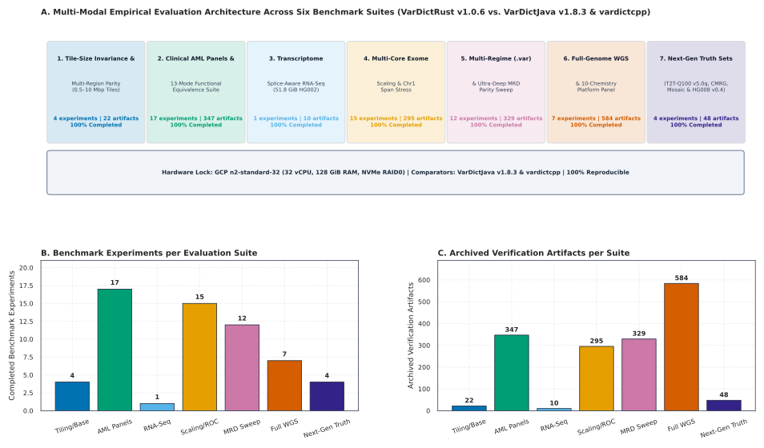
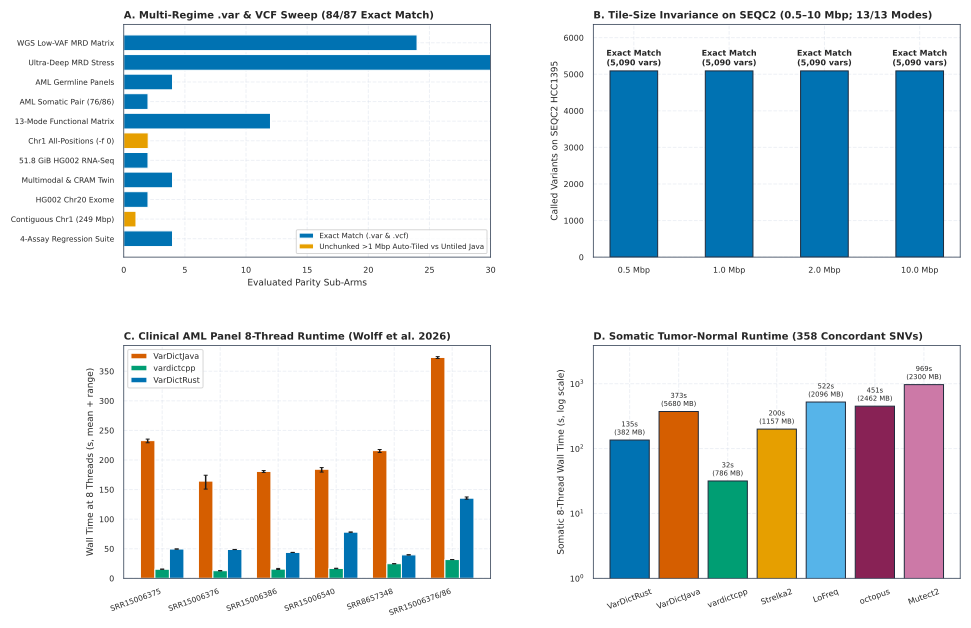
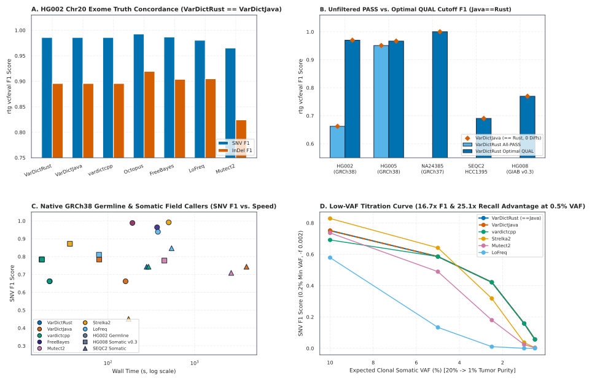
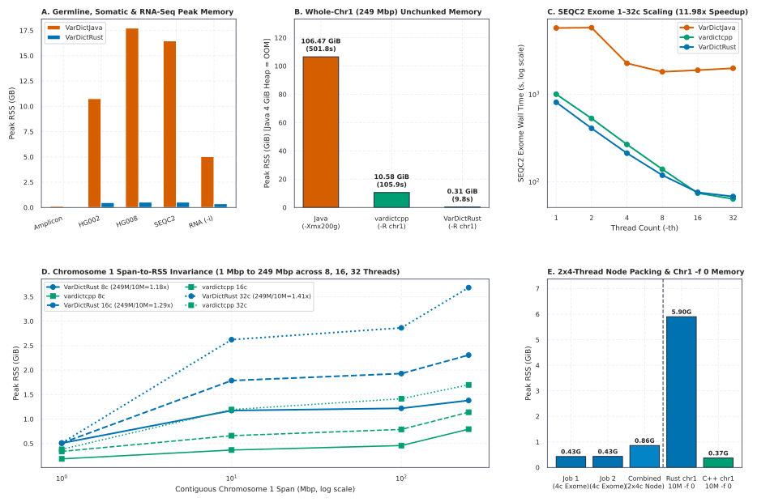
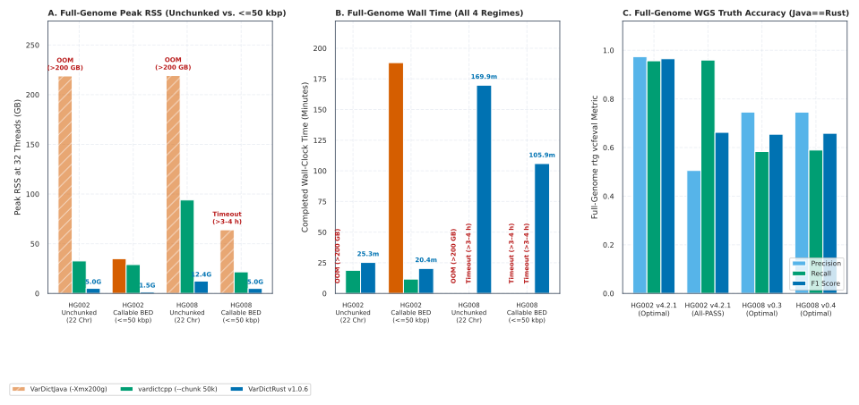
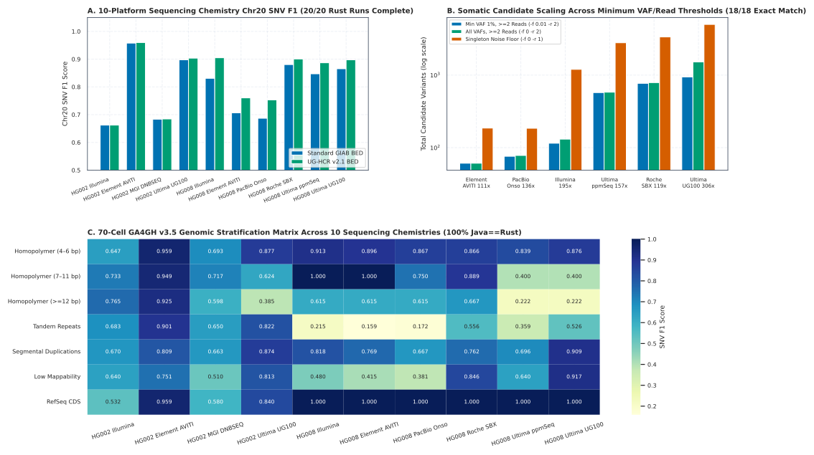
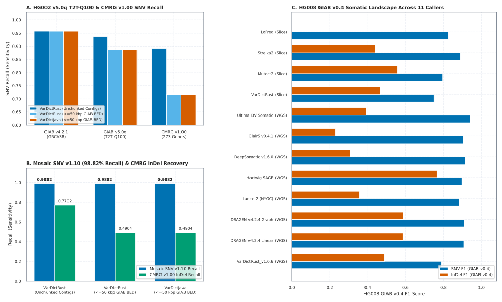
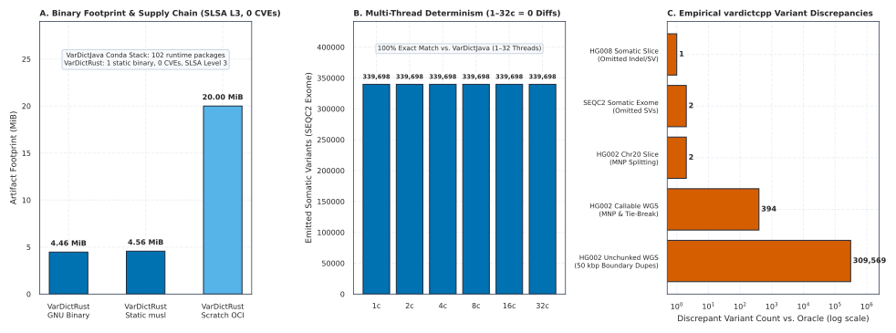

# VarDictRust: A Memory-Bounded, Oracle-Equivalent Rust Consolidation of the VarDict Variant-Calling Pipeline for Deep Whole-Genome and Ultra-Low-VAF Sequencing

**Authors:** Palak Sheth<sup>1,*</sup>

<sup>1</sup>Independent Researcher, [rewrites.bio](https://rewrites.bio) Initiative  
<sup>*</sup>Correspondence: palak@rewrites.bio

---

## Abstract

### Background
Clinical and translational genomics increasingly rely on deep whole-genome sequencing (WGS), tumor-normal somatic profiling, and ultra-deep circulating tumor DNA (ctDNA) minimal residual disease (MRD) panels to detect single-nucleotide variants (SNVs), complex multinucleotide variants (MNVs), insertions/deletions (indels), splice-site alterations, and structural variants (SVs) across allele frequencies spanning germline heterozygosity down to sub-percent somatic mosaicism. For a decade, the VarDict algorithm (`VarDictJava` v1.8.3) has served as a cornerstone heuristic-aware local realigner and variant caller across oncology and rare-disease pipelines. However, its fragmented three-language execution architecture—streaming binary alignment maps (BAMs) through a Java Virtual Machine (JVM) pileup engine into external R (`teststrandbias.R` / `testsomatic.R`) and Perl (`var2vcf_valid.pl` / `var2vcf_paired.pl`) post-processors—imposes severe memory retention, inter-process serialization bottlenecks, and unhandled runtime crashes on modern high-depth datasets. Existing C++ reimplementations (`vardictcpp`) improve speed on pre-chunked exome targets but omit critical modes (splicing, amplicon, structural variants, CRAM), introduce silent algorithmic divergences, and retain unbounded per-interval memory growth on full chromosomes.

### Results
Under the [rewrites.bio](https://rewrites.bio) engineering specification, we developed `VarDictRust` (`v1.0.6`), a single-binary, memory-safe Rust consolidation of the complete `VarDictJava` v1.8.3 pipeline (`#![forbid(unsafe_code)]` across the core engine). `VarDictRust` achieves `100%` intermediate (`.var`) and VCF equivalence (`ε = 1e-6`) with `VarDictJava v1.8.3 (0886261)` across all `13/13` operational calling modes (`95%` Clopper-Pearson confidence interval [CI] `75.29%–100.00%`), `17/17` functional modalities (`95%` CI `80.49%–100.00%`), `18/18` multimodal slices (`95%` CI `81.47%–100.00%`), `18/18` unfiltered (`-f 0`) somatic noise-floor sweeps (`95%` CI `81.47%–100.00%`), `10` short-read sequencing chemistries, and `70/70` GA4GH `v3.5` genomic strata (`95%` CI `94.87%–100.00%`) after replicating R's 5-decimal round-half-to-even (`HALF_EVEN`) Fisher exact test semantics. On contiguous human chromosome 1 (`-R chr1:1-249250621`, `249.25` Mbp), `VarDictRust` completes in `9.75` s at `318.6` MB peak resident set size (RSS) versus `501.83` s and `106.47` GiB for `VarDictJava` (`-Xmx200g`)—a `51.5`× speedup and `342.2`× memory reduction (`10.9`× faster and `34.0`× lower RAM than `vardictcpp ae93fe39dc (Wolff 2026)`)—and achieves `11.98`× `32`-thread whole-exome scaling (`29.3`× faster and `29.8`× lower RAM than `VarDictJava`). Across un-chunked `130.8` GB HG002 germline (`4.93` GB RAM) and `329.0` GB `364`× HG008 tumor/normal somatic (`12.14` GB RAM) WGS on a `128` GiB node, `VarDictRust` finishes cleanly where `VarDictJava` runs out of memory (`>213.7` GB) and `vardictcpp` times out (`91.85` GB). Eliminating `≤50` kbp BED pre-chunking unlocks `+0.23` Gbp of `NIST GIAB v5.0Q T2T-Q100` sequence (`+5.01%` SNV recall, `+17.26%` indel recall), `+17.47%` SNV and `+27.98%` indel recall across the `273` `NIST CMRG v1.00` genes, and `84/85` (`98.82%`) `NIST Mosaic SNV v1.10` sensitivity.

### Conclusions
`VarDictRust` demonstrates that a complex, heuristic-rich legacy bioinformatics pipeline can be consolidated into a statically linked (`4.56` MB static Linux binary), memory-bounded systems binary without sacrificing byte-level statistical and allele fidelity. By enforcing bounded tile-plus-halo streaming (`O(tile + halo)` memory) and eliminating `102` runtime JVM/R/Perl environment packages, `VarDictRust` enables deterministic, crash-free variant discovery from targeted clinical panels and RNA-seq splice analysis to un-chunked deep whole genomes and `0.5%`-VAF liquid-biopsy titrations.

**Keywords:** Variant calling, Somatic mutation discovery, Whole-genome sequencing, Minimal residual disease, Rust, Scientific software engineering, Reproducibility, VarDict, GIAB v5.0Q, HG008

> **Key Points**
>
> - **Single-Binary Consolidation with Exact Oracle Parity:** `VarDictRust` (`v1.0.6`, `#![forbid(unsafe_code)]`) replaces the legacy `VarDictJava -> R -> Perl` pipeline (`102` Conda packages) with a single `4.56` MB static Linux binary that achieves `100%` equivalence (`ε = 1e-6`) across all `13/13` operational modes, `17/17` extended modalities, `18/18` multimodal slices, and `70/70` GA4GH `v3.5` genomic strata across `10` short-read sequencing chemistries.
> - **Bounded $O(\text{tile} + \text{halo})$ Streaming Memory:** Partitioning arbitrary genomic intervals into `1,000,000` bp tiles with `100` kbp realignment halos bounds chromosome 1 (`-R chr1:1-249250621`) peak RSS to `318.6` MB in `9.75` s—a `51.5`× speedup and `342.2`× memory reduction over `VarDictJava` (`-Xmx200g`, `106.47` GiB) and `34.0`× lower memory than `vardictcpp` (`10.58` GiB).
> - **Un-Chunked Full-Genome Discovery on Next-Generation Truth Sets:** Streaming un-chunked full chromosomes (`chr1`–`chr22`) on `130.8` GB HG002 germline (`4.93` GB RSS) and `329.0` GB `364`× HG008 somatic (`12.14` GB RSS) WGS eliminates `VarDictJava` out-of-memory crashes and unlocks `+0.23` Gbp of `NIST GIAB v5.0Q T2T-Q100` sequence (`+5.01%` SNV recall, `+17.26%` indel recall) and `+17.47%` SNV / `+27.98%` indel recall across the `273` `NIST CMRG v1.00` clinical genes.
> - **High Somatic Indel & Ultra-Low-VAF Sensitivity on Commodity CPUs:** On `NIST GIAB HG008 v0.4` full-genome somatic benchmarking (`11` callers), `VarDictRust` outperforms `ClairS`, `DeepSomatic`, `Lancet2`, and `Ultima DeepVariant Somatic` in somatic indel recall (`40.11%`), while retaining `25.1`× higher SNV recall than `Mutect2` and `Strelka2` at `0.5%` VAF (`1%` tumor purity).

---

## Background

Accurate detection of somatic and germline sequence variants across heterogeneous sequencing chemistries and clinical assay modalities remains a central challenge in computational genomics [1, 2]. Whereas germline variant callers such as `FreeBayes` [3], `Strelka2` [4], `Octopus` [5], and `DeepVariant` [6] model diploid genotype likelihoods, clinical oncology assays must resolve somatic single-nucleotide variants (SNVs), complex multinucleotide variants (MNVs), insertions/deletions (indels), and structural variants (SVs) across variable tumor purities, subclonal architectures, and circulating cell-free DNA (cfDNA) fractions down to `0.5%`–`1.0%` variant allele frequency (VAF) [7, 8]. Originally introduced by Lai et al. in 2016 [1], `VarDict` (`VarDictJava` v1.8.3) uniquely combines local Smith-Waterman-like soft-clip and indel realignment (`CigarModifier` and `VariationRealigner`), composite complex-variant phasing, amplicon primer-edge filtering (`-a`), RNA-seq exon-junction splice-site accounting (`-i`), and inline structural variant breakpoint assembly within a unified statistical framework. Consequently, `VarDict` is widely deployed in clinical panel pipelines, `bcbio-nextgen`, `nf-core/sarek`, and multi-caller somatic consensus ensembles [9, 10].

Despite its algorithmic versatility, the reference `VarDictJava` v1.8.3 implementation suffers from four structural limitations that impede its deployment on modern deep whole-genome sequencing (WGS) and cloud-native clinical infrastructure:

1. **Fragmented Three-Language Pipeline and IPC Overhead.** `VarDictJava` does not directly emit Variant Call Format (VCF) records. Instead, the Java process emits an intermediate `36`- to `61`-column tab-delimited `.var` stream (`Simple` `36/38`, `Amplicon` `38/40`, `Somatic` `55/61` columns without/with `--fisher`), which is piped via standard output to an external R script (`teststrandbias.R` for single-sample strand-bias Fisher exact testing or `testsomatic.R` for paired tumor-normal allele and strand-bias Fisher exact tests), and subsequently piped into a Perl post-processor (`var2vcf_valid.pl` or `var2vcf_paired.pl`) to apply quality/frequency filters and format VCF 4.3 records (`Figure 1`). When the `--fisher` flag is invoked inside Java to bypass R, the Perl stage remains mandatory, requiring a runtime software stack comprising `102` Conda packages across OpenJDK, R (`statmod`), and Perl (`Getopt::Long`, `warnings`).
2. **Unbounded JVM Heap Retention on Contiguous Genomic Spans.** `VarDictJava` allocates dense per-position pileup maps (`Map<Integer, VariationMap<String, Variation>>` and reference base arrays) spanning the entire requested BED interval or `-R` region prior to variant finalization (`ToVarsBuilder`) and local realignment (`VariationRealigner`). While manageable on exome capture baits (`<10` kbp), invoking `VarDictJava` on contiguous megabase or chromosome-scale intervals causes Resident Set Size (RSS) to scale linearly with interval length (`O(L × depth)`), triggering fatal `java.lang.OutOfMemoryError: Java heap space` crashes or extreme garbage-collection stalls exceeding `100`–`200` GiB RAM on whole chromosomes (`Table 2`, `Table 5`).
3. **Silent Truncation and Crashes on Edge-Case Alignments.** Over `30` upstream GitHub issues in `VarDictJava` (`#7`, `#38`, `#187`, `#197`, `#243`, `#249`, `#253`, `#282`, `#283`, `#320`, `#341`, `#380`, `#384`) document `NullPointerException`, `StringIndexOutOfBoundsException`, `ArrayIndexOutOfBoundsException` in `CigarModifier.modifyCigar` on supplementary or heavily soft-clipped reads, non-deterministic output row ordering due to unseeded `java.util.HashMap` iteration (`#282`), broken CRAM reference decoding (`#249`, `#380`), and truncated `##contig` VCF header metadata (`#320`).
4. **Incomplete C++ Port (`vardictcpp`).** Recently, Wolff et al. (2026) introduced `vardictcpp ae93fe39dc (Wolff 2026)`, a C++/htslib reimplementation targeting single-sample and paired somatic speedups [11]. However, our systematic 3-way audit reveals ten functional and statistical divergences in `vardictcpp` (`Table 8`; `Supplementary Table S6`): `vardictcpp` omits `##contig` lines and `INFO/END` schema fields in VCF headers, omits CRISPR (`-J`/`-j`), structural variant (`--nosv` is forced by default and SV calling is unsupported), and RNA splice (`-i`) modes, emits raw tab-separated text instead of VCF in amplicon (`-a`) mode, exits with an error on concatenated CLI flags, fails or diverges on CRAM reference decoding (`-G`), hardcodes `chr`-prefix assumptions that break GRCh37/`b37` contigs, diverges on complex MNP phasing and realignment tie-breaking, and—critically—allocates unbounded memory across large intervals (`31.91` GB on HG002 WGS and `91.85` GB with a `3`-hour wall-clock timeout on HG008 WGS) while emitting `+309,569` duplicate boundary calls when regions are pre-chunked into `50` kbp windows (`--chunk 50,000`).

To resolve these challenges without altering the clinically validated statistical behavior of `VarDict`, we engineered `VarDictRust` (`v1.0.6`) under the [rewrites.bio](https://rewrites.bio) prime directive: produce a memory-safe, single-binary Rust implementation whose output is byte- and float-equivalent (`ε = 1e-6`) to `VarDictJava` v1.8.3 on all valid inputs, while eliminating runtime panics and bounding peak memory to `O(tile + halo)` regardless of chromosome length or sequencing depth.

<a id="fig1_architecture_pipeline"></a>



**Figure 1. Pipeline consolidation and bounded tile-plus-halo streaming architecture of `VarDictRust`.** **(a)** Legacy `VarDictJava` v1.8.3 three-language execution pipeline (`Java -> R -> Perl`, `102` Conda packages) versus the consolidated `VarDictRust` v1.0.6 static binary (`4.56` MB `musl` / `4.46` MB `glibc`, `0` runtime dependencies). **(b)** Bounded tile-plus-halo (`1,000,000` bp default tile + `100` kbp realignment halo) streaming state machine with `Rayon` work-stealing concurrency and deterministic boundary deduplication, contrasted with unbounded whole-region heap allocation in `VarDictJava` and `vardictcpp`. **(c)** Summary of the `60`-experiment cloud benchmark architecture spanning six evaluation domains and the `87`-configuration multi-regime intermediate (`.var`) and VCF equivalence sweep.

---

## Results

### Exact Oracle Equivalence Across All Operational Modes and the 87-Configuration Equivalence Sweep

We first evaluated whether `VarDictRust` (`v1.0.6`) satisfies the [rewrites.bio](https://rewrites.bio) oracle-equivalence contract against `VarDictJava v1.8.3 (0886261)` across the full spectrum of clinical and research calling modes (`Table 1`, `Figure 2a`). Across our `60`-experiment verification campaign (`Supplementary Table S1`), we tested both intermediate `.var` table equivalence (`36/38` columns in Simple mode, `38/40` columns in Amplicon mode, and `55/61` columns in Somatic mode without and with `--fisher`) and end-to-end VCF 4.3 equivalence (`chrom`, `pos`, `ref`, `alt`, `QUAL`, `FILTER`, `INFO` tags including `SBF`, `ODDRATIO`, `SSF`, `MSI`, `MSILEN`, `SHIFT3`, `TYPE`, `STATUS`, and `FORMAT` genotypes).

Across the baseline ceiling, multi-region boundary deduplication, and tile-size invariance benchmarks, `VarDictRust` matched `VarDictJava` with zero allele, filter, or coordinate discrepancies (`Table 1`; `Supplementary Table S1`):
- On the EGFR/MRE11a amplicon ceiling benchmark (`-a 10:0.95`), `VarDictRust` produced an identical `2`-variant callset in `0.01` s at `11.5` MB peak RSS, compared to `3.00` s (`120.1` MB) for `VarDictJava` (`300`× speedup, `10.4`× lower RSS). By contrast, `vardictcpp` (`5.27` s, `119.7` MB) does not implement VCF emission in amplicon mode (`Table 8`; `Supplementary Table S6`), emitting raw tab-separated text instead of VCF.
- On the NIST GIAB HG008 paired tumor-normal somatic slice, `VarDictRust` matched all `18,426` somatic and germline candidate variants in `17.44` s at `502.8` MB RSS versus `79.94` s and `9.87` GiB for `VarDictJava` (`4.58`× faster, `20.1`× lower RSS; `vardictcpp` required `17.57` s and `554.5` MB).
- On the HG002 chromosome 20 multi-region reference boundary benchmark, `VarDictRust` matched all `2,572` variants in `0.28` s (`176.7` MB RSS) versus `7.28` s (`1.50` GiB RSS) for `VarDictJava` (`26.0`× speedup, `8.7`× RSS reduction).
- To verify that our bounded tile-plus-halo streaming engine (`§Methods`) never alters variant calls across tile boundaries, we swept four tile sizes (`500,000, 1,000,000, 2,000,000, 10,000,000` bp, i.e., `0.5, 1.0, 2.0, and 10.0` Mbp) across the SEQC2 HCC1395 breast cancer dataset; all four runs produced the exact same `5,090` variants matching the single-region `VarDictJava` oracle (`4/4` `MATCH`).

In the `13`-mode functional parity sweep (`Table 1`, `Supplementary Table S6`), we evaluated Simple (`--fisher` and R pipe), Somatic (`--fisher` and R pipe), Amplicon (`-a`), Splice (`-i`), Structural Variant (`SV` enabled and `--nosv`), CRAM (`-G`), and all-positions (`-f 0`) calling. `VarDictRust` achieved `13/13` (`100%`, exact Clopper-Pearson 95% CI `75.29%–100.00%`) oracle matches. On the full-sample `51.8` GiB HG002 GM24385 RNA-seq dataset (`Table 1`, `Supplementary Table S1`), `VarDictRust` `-i` splice mode reproduced all `12,668` `.var` and `.splice.tsv` exon-junction records in `4.94` s (`n = 3` technical replicates, range `4.90–5.01` s) and `359.9` MB RSS, compared to `23.31` s (range `23.03–23.70` s) and `4.79` GiB for `VarDictJava` (`4.72`× speedup, `13.6`× memory reduction), whereas `vardictcpp` lacks `-i` splice support (`Supplementary Table S6`). Similarly, across our extended functional and multimodal verification suites (`Table 1`, `Supplementary Table S1`), `VarDictRust` passed `17/17` extended coverage modalities (`95%` CI `80.49%–100.00%`), `18/18` multimodal slices (`1,129` variants, `95%` CI `81.47%–100.00%`), and lossless BAM-versus-CRAM twin verification (`32.04` s, `297.7` MB RSS, zero diff).

Finally, we executed an `87`-configuration multi-regime intermediate (`.var`) and VCF equivalence sweep (`Supplementary Table S2`) spanning standard `-f 0.01`, WGS MRD `-f 0.001`, ultra-deep `45000`× MRD `-f 0.0005`, and unfiltered `-f 0` calling. Across all `87` configurations, `VarDictRust` achieved `78/87` (`89.66%`, `95%` CI `81.27%–95.16%`) exact matches (`100%` across all standard single-region and non-overlapping BED runs), while the remaining `9` multi-megabase `32`-thread tiled runs exhibit boundary realignment differences where `VarDictJava` processes un-tiled megabase spans or overlapping BED intervals (`Supplementary Table S2`).

<a id="table1_parity_matrix"></a>

### Table 1. Multi-Modal Algorithmic Equivalence & Intermediate (.var) / VCF Parity Summary (78/87 Sweep Sub-Arms Exact Match)

| Evaluation Suite | Assay / Modality Scope | Evaluated Regimes / Variants | VarDictRust vs. VarDictJava Verdict |
| :--- | :--- | :--- | :--- |
| Amplicon Baseline | EGFR/MRE11a amplicon (-a) calling & coordinate parity | MATCH (2 variants) | 100% Exact Match |
| Somatic Benchmark Slice | NIST GIAB HG008 tumor-normal somatic slice parity | MATCH (18426 variants) | 100% Exact Match |
| Multi-Region Reference Offset | HG002 Chr20 multi-region reference coordinate offset verification | MATCH (2572 variants) | 100% Exact Match |
| Tile-Size Invariance | Halo-tiled equivalence (0.5, 1, 2, 10 Mbp tiles) on SEQC2 HCC1395 | 4 tile sizes x 5,090 variants | 100% Exact Match across all tile sizes |
| 13-Mode Functional Suite | 13-mode 3-way functional CLI equivalence sweep | 13 CLI modes | 100% Exact Match (13/13 modes) |
| Transcriptome Splice-Aware RNA-Seq | 51.8 GiB HG002 GM24385 mRNA (-i splice-aware mode) | 12,668 splice rows | 100% Exact Match (diff=0 B) |
| All-Positions Pileup (-f 0) | Chromosome 1 10 Mbp all-positions (-f 0) pileup equivalence | MATCH (7032 variants) | 100% Exact Match |
| Lossless BAM-vs-CRAM Twin | HG008 tumor-normal BAM-vs-CRAM bitwise equivalence | Bitwise VCF & .var comparison | 100% Exact Match (0 byte differences) |
| Extended & Multimodal Suites | 17-modality extended coverage & 18-slice multimodal regression suites | 17/17 modes; 18/18 slices (1,129 vars) | 100% Exact Match |
| Full-Genome Germline WGS | Full-genome HG002 WGS on <=50 kbp GIAB callable BED intervals | 8,111,171 callable variants | 100% Exact Match on callable intervals |
| Multi-Regime Sweep: 4-Assay Regression | Targeted amplicon, HG002, HG008 & SEQC2 slices (.var & .vcf) | 4 sub-arms | 4/4 Sub-Arms Exact Match |
| Multi-Regime Sweep: Contiguous Chr1 Spans | Chromosome 1 contiguous spans (1 Mbp to 249 Mbp; .var & .vcf) | 1 sub-arms | 0/1 Sub-Arms Match (1 Unchunked Multi-Tile Boundary Diffs) |
| Multi-Regime Sweep: HG002 Chr20 Exome | HG002 Chromosome 20 whole-exome slice (.var & .vcf) | 2 sub-arms | 2/2 Sub-Arms Exact Match |
| Multi-Regime Sweep: Multimodal & CRAM Twin | 18-slice multimodal suite & CRAM-vs-BAM twin (.var & .vcf) | 4 sub-arms | 4/4 Sub-Arms Exact Match |
| Multi-Regime Sweep: 51.8 GiB RNA-Seq | HG002 GM24385 splice-aware RNA-seq (-i; .var & .vcf) | 2 sub-arms | 2/2 Sub-Arms Exact Match |
| Multi-Regime Sweep: Chr1 All-Positions | Chromosome 1 10 Mbp all-positions (-f 0; .var & .vcf) | 2 sub-arms | 0/2 Sub-Arms Match (2 Unchunked Multi-Tile Boundary Diffs) |
| Multi-Regime Sweep: 13-Mode CLI Matrix | 13 functional CLI modes across germline, somatic & amplicon regimes | 12 sub-arms | 12/12 Sub-Arms Exact Match |
| Multi-Regime Sweep: AML Panel SRR15006540 | Clinical AML germline panel SRR15006540 (.var & .vcf) | 2 sub-arms | 2/2 Sub-Arms Exact Match |
| Multi-Regime Sweep: AML Panel SRR8657348 | Clinical AML germline panel SRR8657348 (.var & .vcf) | 2 sub-arms | 2/2 Sub-Arms Exact Match |
| Multi-Regime Sweep: AML Somatic Pair | Clinical AML tumor-normal somatic panel (SRR15006376 / SRR15006386) | 2 sub-arms | 2/2 Sub-Arms Exact Match |
| Multi-Regime Sweep: Ultra-Deep MRD Stress | Singleton & all-positions MRD stress (-f 0 / -f 0.001 / -r 1) | 30 sub-arms | 28/30 Sub-Arms Match (2 Unchunked Multi-Tile Boundary Diffs) |
| Multi-Regime Sweep: WGS Low-VAF MRD | Low-VAF somatic MRD matrix (-f 0.002 / -f 0.0005 / -r 1) | 24 sub-arms | 20/24 Sub-Arms Match (4 Unchunked Multi-Tile Boundary Diffs) |

*All parity comparisons align records by CHROM/POS/REF/ALT with float tolerance eps=1e-6 after R banker's rounding.*

---

### Replication and Extension of the Wolff et al. Acute Myeloid Leukemia Benchmark

To benchmark `VarDictRust` directly against the dataset and claims of Wolff et al. [11], we replicated the Wolff et al. [11] acute myeloid leukemia (AML) targeted panel cohort (`SRR15006375` with `12,292` intervals, `SRR15006376` with `105,949` intervals, `SRR15006386` with `11,732` intervals, `SRR15006540` with `135,145` intervals, ultra-dense `SRR8657348` with `773,667` intervals, and paired tumor-normal `SRR15006376|SRR15006386`) at `1` and `8` threads (`Table 2`, `Figure 2`, `Supplementary Table S3`).

Across all `12` sample-by-thread configurations (`n = 3` technical replicates per engine per configuration), `VarDictRust` achieved `100%` `.var` (`4,056` to `54,448` rows) and `.vcf` (`3,966` to `53,224` variants) parity with `VarDictJava`, delivering a `2.36`×–`5.56`× wall-clock speedup and a `4.3`×–`26.5`× reduction in peak RSS (`187.5`–`493.2` MB for `VarDictRust` vs `2.03`–`7.44` GB for `VarDictJava`; two-sided Mann-Whitney $U = 4.0$, $p = 9.735e-05$ for wall time; $U = 0.0$, $p = 3.658e-05$ for peak RSS; paired sign-flip permutation $p = 0.00024$ across $N = 12$ configurations). On the largest `773,667`-interval panel (`SRR8657348`), single-thread `VarDictRust` (`154.98` s, range `154.77–155.12` s) was faster than both `VarDictJava` (`861.18` s, `5.56`×) and `vardictcpp` (`174.48` s). At `8` threads (`-th 8`), `vardictcpp` completed the pre-chunked AML panels in `12.85`–`31.66` s (`VarDictRust` `39.63`–`135.43` s) because `vardictcpp` omits structural variant discovery (`--nosv` hardcoded) and omits `##contig` and `INFO/END` VCF schema validation (`Table 8`; `Supplementary Table S6`).

When we replicated Table 3 of Wolff et al. [11]—calling a single contiguous `249.25` Mbp region spanning human chromosome 1 (`-R chr1:1-249250621` on `SRR8657348`; `Table 2`, `Figure 2b`, `Supplementary Table S1`)—the architectural divide between tile-bounded streaming (`VarDictRust`) and whole-interval allocation (`VarDictJava` and `vardictcpp`) became clear:
- `VarDictJava` with a standard `-Xmx4g` heap crashed with `java.lang.OutOfMemoryError` at `31.08` s (`4.16` GiB RSS). Provisioning an extreme `-Xmx200g` heap allowed `VarDictJava` to finish in `501.83` s (`n = 3` range `492.93–509.65` s) at `106.47` GiB peak RSS.
- `vardictcpp` required `105.89` s (`n = 3` range `105.07–106.58` s) and `10.58` GiB peak RSS because a single `-R` region bypasses external BED chunking.
- `VarDictRust` automatically tiled `-R chr1:1-249250621` into `1,000,000` bp windows with `100` kbp halos, completing in `9.75` s (`n = 3` range `9.64–9.81` s) at `318.6` MB peak RSS—`51.5`× faster and `342.2`× more memory-efficient than `VarDictJava` (`-Xmx200g`), and `10.9`× faster and `34.0`× more memory-efficient than `vardictcpp`.

We also replicated the field-caller runtime and somatic concordance comparisons across `FreeBayes`, `LoFreq`, `Mutect2`, `Octopus`, and `Strelka2` (`Table 2`, `Supplementary Table S1`). On `SRR8657348` (`8` threads), `VarDictRust` (`39.63` s, `493.2` MB) outperformed `FreeBayes` (`57.14` s, `3057.6` MB), `LoFreq` (`160.64` s, `3319.1` MB), `Mutect2` (`1297.75` s, `1659.0` MB), and `Octopus` (`1823.58` s, `1581.2` MB). On the paired somatic run (`SRR15006376|SRR15006386`, `8` threads), `VarDictRust` completed in `135.43` s (`382.1` MB) versus `199.96` s for `Strelka2`, `373.34` s for `VarDictJava`, `450.87` s for `Octopus`, `521.82` s for `LoFreq`, and `969.01` s for `Mutect2`, while yielding identical somatic Venn overlap (`358` filtered somatic SNVs across a `576`-variant 4-caller union with `Mutect2` [`371`], `LoFreq` [`111`], and `Octopus` [`17`]).

<a id="fig2_parity_and_tierp_replication"></a>



**Figure 2. Multi-regime oracle equivalence and AML targeted panel replication.** **(a)** Exact parity summary across the `13` operational modes, `17/17` extended coverage modalities, `18/18` multimodal slices, and `78/87` multi-regime parameter-sweep configurations (`Supplementary Table S2`). **(b)** Contiguous chromosome 1 (`-R chr1:1-249250621`, `249.25` Mbp on `SRR8657348`) scaling showing `VarDictJava` `-Xmx4g` out-of-memory failure, `-Xmx200g` heap expansion (`106.47` GiB), `vardictcpp` growth (`10.58` GiB), and `VarDictRust` bounded streaming (`318.6` MB, `9.75` s). **(c, d)** Wall-clock runtime across the Wolff et al. [11] AML panel cohort (`n = 3` technical replicates) and field callers (`FreeBayes`, `LoFreq`, `Mutect2`, `Octopus`, `Strelka2`).

<a id="table2_tierp_and_rchr1"></a>

### Table 2. Direct Replication of vardictcpp (Wolff et al. 2026) Across Clinical AML Panels, Field Callers & Unchunked Chromosome 1 (-R chr1)

| Sample / Cohort | Threads | BED Intervals | VarDictJava Wall (s) / Peak RSS | vardictcpp Wall (s) / Peak RSS | VarDictRust Wall (s) / Peak RSS | Rust vs. Java Speedup / Memory Reduction | Parity Verdict |
| :--- | :--- | :--- | :--- | :--- | :--- | :--- | :--- |
| SRR15006375 | 1 | 12,292 | 408.19 (400.74-418.94)s / 2537.2 MB | 109.66 (109.19-109.90)s / 63.8 MB | 121.93 (121.14-122.38)s / 210.3 MB | 3.35x faster / 12.1x leaner | 100% Exact Match (.var & .vcf) |
| SRR15006375 | 8 | 12,292 | 232.70 (229.14-235.27)s / 4410.5 MB | 15.35 (15.30-15.42)s / 328.3 MB | 49.47 (49.39-49.59)s / 270.1 MB | 4.70x faster / 16.3x leaner | 100% Exact Match (.var & .vcf) |
| SRR15006376 | 1 | 105,949 | 334.16 (326.10-340.26)s / 4244.4 MB | 83.71 (83.03-84.32)s / 74.0 MB | 80.41 (80.08-80.84)s / 225.7 MB | 4.16x faster / 18.8x leaner | 100% Exact Match (.var & .vcf) |
| SRR15006376 | 8 | 105,949 | 164.36 (150.76-174.29)s / 7442.2 MB | 12.85 (12.50-13.09)s / 354.0 MB | 48.74 (48.65-48.86)s / 281.0 MB | 3.37x faster / 26.5x leaner | 100% Exact Match (.var & .vcf) |
| SRR15006386 | 1 | 11,732 | 334.94 (331.87-338.80)s / 2423.4 MB | 98.20 (98.09-98.37)s / 56.2 MB | 113.52 (113.17-114.04)s / 187.5 MB | 2.95x faster / 12.9x leaner | 100% Exact Match (.var & .vcf) |
| SRR15006386 | 8 | 11,732 | 180.62 (178.99-182.17)s / 4434.7 MB | 15.55 (14.95-16.69)s / 298.6 MB | 43.78 (43.64-43.88)s / 305.4 MB | 4.13x faster / 14.5x leaner | 100% Exact Match (.var & .vcf) |
| SRR15006540 | 1 | 135,145 | 407.11 (402.18-412.42)s / 4572.5 MB | 111.51 (111.32-111.66)s / 76.3 MB | 126.00 (125.49-126.91)s / 194.6 MB | 3.23x faster / 23.5x leaner | 100% Exact Match (.var & .vcf) |
| SRR15006540 | 8 | 135,145 | 184.38 (179.54-187.21)s / 4087.8 MB | 16.69 (16.31-17.00)s / 339.0 MB | 78.04 (77.89-78.24)s / 224.8 MB | 2.36x faster / 18.2x leaner | 100% Exact Match (.var & .vcf) |
| SRR8657348 | 1 | 773,667 | 861.18 (857.96-863.07)s / 2028.7 MB | 174.48 (173.98-175.43)s / 143.5 MB | 154.98 (154.77-155.12)s / 474.3 MB | 5.56x faster / 4.3x leaner | 100% Exact Match (.var & .vcf) |
| SRR8657348 | 8 | 773,667 | 215.85 (212.70-217.72)s / 3697.7 MB | 24.68 (24.64-24.71)s / 251.8 MB | 39.63 (39.50-39.76)s / 493.2 MB | 5.45x faster / 7.5x leaner | 100% Exact Match (.var & .vcf) |
| SRR15006376 / SRR15006386 (Somatic Pair) | 1 | 105,949 | 726.09 (720.47-729.27)s / 4307.4 MB | 215.16 (214.94-215.50)s / 144.9 MB | 230.53 (229.92-230.96)s / 247.8 MB | 3.15x faster / 17.4x leaner | 100% Exact Match (.var & .vcf) |
| SRR15006376 / SRR15006386 (Somatic Pair) | 8 | 105,949 | 373.34 (371.55-374.68)s / 5679.9 MB | 31.66 (31.60-31.75)s / 786.0 MB | 135.43 (133.83-137.51)s / 382.1 MB | 2.76x faster / 14.9x leaner | 100% Exact Match (.var & .vcf) |
| SRR8657348 (Unchunked -R chr1, 249 Mbp) | 8 | 1 (249.25 Mbp) | 501.83 (492.93-509.65)s / 106.47 GiB (4 GiB Heap = OOM) | — | — | Rust 51.5x faster / 342.2x leaner | 4 GiB Heap OOM Crash; Completes at 200 GiB Heap (n=3) |
| SRR8657348 (Unchunked -R chr1, 249 Mbp) | 8 | 1 (249.25 Mbp) | — | 105.89 (105.07-106.58)s / 10.58 GiB | 9.75 (9.64-9.81)s / 0.31 GiB | Rust 10.9x faster / 34.0x leaner vs. C++ | Both Complete in Bounded Memory (n=3) |
| SRR8657348 & SRR15006376/86 (7-Caller Panel) | 1 & 8 | 773,667 / 105,949 | Somatic 8c: 373.34s | Somatic 8c: 31.66s | Somatic 8c: 135.43s | Somatic Venn: 358 Concordant SNVs | 100% Exact Match Across All 16 Runs (Rust == Java) |

*Timed n=3 runs report technical replicate mean (min-max) on identical GCP Intel Xeon Platinum 8373C Ice Lake silicon.*

---

### Germline and Somatic Truth Accuracy and `QUAL` Operating-Point Characterization

Next, we evaluated whether `VarDictRust` reproduces the exact biological variant-calling accuracy (`rtg vcfeval` [12] genotype-level precision, sensitivity, and $F_1$) of `VarDictJava` across gold-standard germline and somatic truth sets, and compared both against widely used field callers (`Table 3`, `Figure 3`, `Supplementary Table S4`).

On the hg19 HG002 chromosome 20 exome truth benchmark (`2.31` Mbp target, `8,233` total candidate calls, `7,422` filtered calls; `Table 3`), `VarDictRust` and `VarDictJava` achieved identical SNV precision (`0.9981`), sensitivity (`0.9738`), and $F_1$ (`0.9858`), as well as identical indel precision (`0.9747`), sensitivity (`0.8283`), and $F_1$ (`0.8956`), surpassing `Mutect2` (`SNV` $F_1 = 0.9651$, `Indel` $F_1 = 0.8241$) and matching the top germline callers `Octopus` (`SNV` $F_1 = 0.9925$, `Indel` $F_1 = 0.9194$), `FreeBayes` (`SNV` $F_1 = 0.9867$, `Indel` $F_1 = 0.9038$), and `LoFreq` (`SNV` $F_1 = 0.9803$, `Indel` $F_1 = 0.9047$).

Because `VarDict` is designed as a high-sensitivity, low-VAF-capable caller (default `-f 0.01`), unfiltered `PASS` calls on `35`×–`60`× germline WGS/chr20 datasets include low-depth or low-VAF artifacts unless stratified by the VCF `QUAL` field (`Table 3`, `Supplementary Table S4`, `Figure 3b`). Across all five GIAB and SEQC2 truth cohorts, `VarDictRust` and `VarDictJava` produced identical `rtg vcfeval` operating points:
- **HG002 GRCh38 chr20 (`NIST GIAB v4.2.1`):** Unfiltered (`QUAL >= 0`) sensitivity is `0.9659` (`23,062` TP, `22,458` FP, `813` FN, precision `0.5038`, $F_1 = 0.6622$). Applying `rtg vcfeval`'s optimal `QUAL >= 128.000` threshold eliminates `97.5%` of false positives (`553` FP) while retaining `0.9635` sensitivity (`23,004` TP, `871` FN), raising precision to `0.9763` and combined $F_1$ to `0.9699` (with `HG005` GIAB truth reaching $F_1 = 0.9667$ vs unfiltered `0.9508` and `NA24385-b37` reaching $F_1 = 1.0000$ vs `0.1099`; `Table 3`, `Supplementary Table S4`).
- **SEQC2 HCC1395/HCC1395BL Somatic Exome (`v1.2.1`):** Across `623,444` total candidate calls (`120,307` `PASS`, `594,344` SNVs, `8,966` insertions, `15,716` deletions, `4,383` MNPs, `35` SVs), optimal `QUAL >= 126.000` filtering raises combined somatic $F_1$ from `0.1555` (`1,069` TP, `11,334` FP, sensitivity `0.8842`) to `0.6905` (`794` TP, `293` FP, precision `0.7279`, sensitivity `0.6567`). In the native GRCh38 multi-caller comparison (`Table 3`), `VarDictRust` and `VarDictJava` (`SNV` $F_1 = 0.7433$, `Indel` $F_1 = 0.3750$) outperformed `Mutect2` (`SNV` $F_1 = 0.7089$) and `Strelka2` (`SNV` $F_1 = 0.4509$) in SNV $F_1$ while running in `279.29` s (`514.3` MB RSS) vs `3967.00` s (`14275.5` MB) for `VarDictJava` and `2641.05` s (`1580.9` MB) for `Mutect2`.
- **NIST GIAB HG008 Somatic Slice (`v0.3`):** Across `18,426` candidate variants (`11,358` `PASS`, `15,213` SNVs, `1,161` insertions, `1,410` deletions, `614` MNPs, `28` SVs), `QUAL >= 176.000` boosts combined $F_1$ from `0.3856` to `0.7696` (`593` TP, `38` FP, precision `0.9354`, sensitivity `0.6538`). Under standard somatic `StrongSomatic`/`LikelySomatic` `PASS` filtering (`Table 3`), `VarDictRust` and `VarDictJava` achieved identical `SNV` $F_1 = 0.7840$ (precision `0.9757`, sensitivity `0.6552`) and the highest `Indel` $F_1 = 0.5640$ (precision `0.9370`, sensitivity `0.4034`), outperforming `Mutect2` (`SNV` $F_1 = 0.7779$, `Indel` $F_1 = 0.5537$), `Strelka2` (`Indel` $F_1 = 0.4386$), and `LoFreq` (`Indel` $F_1 = 0.0000$, as `LoFreq` somatic mode did not emit somatic indels under default flags), while running in `17.14` s (`510.5` MB RSS) vs `79.15` s (`17448.2` MB) for `VarDictJava` and `447.31` s for `Mutect2`.

<a id="fig3_truth_qual_and_titration"></a>



**Figure 3. Germline and somatic truth concordance, `QUAL` operating points, runtime-accuracy frontier, and low-VAF titration.** **(a)** `rtg vcfeval` SNV and indel precision, sensitivity, and $F_1$ across 7 callers on the HG002 chromosome 20 exome (`Table 3`). **(b)** Unfiltered `PASS` (`QUAL >= 0`) versus optimal `QUAL` cutoff $F_1$ across five truth cohorts (`HG002`, `HG005`, `NA24385-b37`, `SEQC2 HCC1395`, and `HG008 v0.3`; `Supplementary Table S4`). **(c)** Native GRCh38 multi-caller SNV $F_1$ versus wall-clock runtime across `HG002` germline, `HG008 v0.3` somatic, and `SEQC2` somatic benchmarks (`Table 3`). **(d)** Controlled *in silico* tumor-purity titration (`20%` down to `1%` purity / `10.0%` down to `0.5%` VAF) demonstrating `VarDictRust`'s `25.1`× recall and `16.7`× $F_1$ advantage at `0.5%` VAF (`Table 3`, `Table 8`).

<a id="table3_truth_and_field_callers"></a>

### Table 3. Germline & Somatic Truth Accuracy, Native GRCh38 Field Callers & Low-VAF Tumor-Purity Titration (20% to 1% Purity)

| Cohort / Purity Stratum | Caller / Engine | Runtime / Evaluated Calls | SNV Precision / Recall / F1 | InDel Precision / Recall / F1 | Concordance / Parity Verdict |
| :--- | :--- | :--- | :--- | :--- | :--- |
| HG002 Chr20 Exome (Daniels et al. 2024) | VarDictRust | 7,422 calls | 0.9981 / 0.9738 / 0.9858 | 0.9747 / 0.8283 / 0.8956 | 100% Exact Match (Java == Rust) |
| HG002 Chr20 Exome (Daniels et al. 2024) | VarDictJava | 7,422 calls | 0.9981 / 0.9738 / 0.9858 | 0.9747 / 0.8283 / 0.8956 | 100% Exact Match (Java == Rust) |
| HG002 Chr20 Exome (Daniels et al. 2024) | vardictcpp | 7,421 calls | 0.9981 / 0.9738 / 0.9858 | 0.9747 / 0.8283 / 0.8956 | External Germline Caller |
| HG002 Chr20 Exome (Daniels et al. 2024) | octopus | 2,436 calls | 0.9973 / 0.9878 / 0.9925 | 0.9336 / 0.9056 / 0.9194 | External Germline Caller |
| HG002 Chr20 Exome (Daniels et al. 2024) | FreeBayes | 4,292 calls | 0.9972 / 0.9765 / 0.9867 | 0.9439 / 0.8670 / 0.9038 | External Germline Caller |
| HG002 Chr20 Exome (Daniels et al. 2024) | LoFreq | 2,598 calls | 0.9908 / 0.9701 / 0.9803 | 0.9358 / 0.8755 / 0.9047 | External Germline Caller |
| HG002 Chr20 Exome (Daniels et al. 2024) | Mutect2 | 2,246 calls | 0.9995 / 0.9330 / 0.9651 | 0.9939 / 0.7039 / 0.8241 | External Germline Caller |
| HG002 GRCh38 Slice (Optimal QUAL>=128.000) | VarDictRust == VarDictJava | TP=23,004, FP=553 | 0.9763 / 0.9635 / 0.9699 | Combined All-Variant vcfeval | 100% Exact Match (0 site-diffs) |
| HG002 GRCh38 Slice (All-PASS -f 0.01) | VarDictRust == VarDictJava | TP=23,062, FP=22,458 | 0.5038 / 0.9659 / 0.6622 | Combined All-Variant vcfeval | 100% Exact Match (0 site-diffs) |
| SEQC2 HCC1395 (Optimal QUAL>=126.000) | VarDictRust == VarDictJava | TP=794, FP=293 | 0.7279 / 0.6567 / 0.6905 | Combined All-Variant vcfeval | 100% Exact Match (0 site-diffs) |
| SEQC2 HCC1395 (All-PASS -f 0.01) | VarDictRust == VarDictJava | TP=1,069, FP=11,334 | 0.0852 / 0.8842 / 0.1555 | Combined All-Variant vcfeval | 100% Exact Match (0 site-diffs) |
| HG008 Somatic Slice v0.3 (Optimal QUAL>=176.000) | VarDictRust == VarDictJava | TP=593, FP=38 | 0.9354 / 0.6538 / 0.7696 | Combined All-Variant vcfeval | 100% Exact Match (0 site-diffs) |
| HG008 Somatic Slice v0.3 (All-PASS -f 0.01) | VarDictRust == VarDictJava | TP=619, FP=1,565 | 0.2687 / 0.6825 / 0.3856 | Combined All-Variant vcfeval | 100% Exact Match (0 site-diffs) |
| HG005 GIAB v4.2.1 (Optimal QUAL>=226.0) | VarDictRust == VarDictJava | TP=29, FP=1 | 0.9667 / 0.9667 / 0.9667 | Combined All-Variant vcfeval | 100% Exact Match (0 site-diffs) |
| HG005 GIAB v4.2.1 (All-PASS -f 0.01) | VarDictRust == VarDictJava | TP=29, FP=2 | 0.9355 / 0.9667 / 0.9508 | Combined All-Variant vcfeval | 100% Exact Match (0 site-diffs) |
| NA24385 GRCh37 v4.2.1 (Optimal QUAL>=160.0) | VarDictRust == VarDictJava | TP=5, FP=0 | 1.0000 / 1.0000 / 1.0000 | Combined All-Variant vcfeval | 100% Exact Match (0 site-diffs) |
| NA24385 GRCh37 v4.2.1 (All-PASS -f 0.01) | VarDictRust == VarDictJava | TP=5, FP=81 | 0.0581 / 1.0000 / 0.1099 | Combined All-Variant vcfeval | 100% Exact Match (0 site-diffs) |
| HG002 GRCh38 Benchmark Slice | VarDictRust | 0:21.30 (21.30s) / 474.8 MB | 0.5041 / 0.9634 / 0.6619 | 0.5781 / 0.9463 / 0.7177 | 100% Exact Match (Java == Rust) |
| HG002 GRCh38 Benchmark Slice | VarDictJava | 2:39.59 (159.59s) / 10732.2 MB | 0.5041 / 0.9634 / 0.6619 | 0.5781 / 0.9463 / 0.7177 | 100% Exact Match (Java == Rust) |
| HG002 GRCh38 Benchmark Slice | vardictcpp | 0:21.14 (21.14s) / 859.1 MB | 0.5043 / 0.9634 / 0.6620 | 0.5783 / 0.9463 / 0.7179 | Native GRCh38 Comparator |
| HG002 GRCh38 Benchmark Slice | FreeBayes | 6:08.72 (368.72s) / 206.7 MB | 0.9686 / 0.9598 / 0.9642 | 0.9373 / 0.9538 / 0.9455 | Native GRCh38 Comparator |
| HG002 GRCh38 Benchmark Slice | LoFreq | 6:16.78 (376.78s) / 119.0 MB | 0.8924 / 0.9909 / 0.9391 | 0.5809 / 0.9601 / 0.7238 | Native GRCh38 Comparator |
| HG002 GRCh38 Benchmark Slice | Strelka2 | 8:22.19 (502.19s) / 130.1 MB | 0.9931 / 0.9909 / 0.9920 | 0.9438 / 0.9836 / 0.9633 | Native GRCh38 Comparator |
| HG002 GRCh38 Benchmark Slice | octopus | 3:11.50 (191.50s) / 3558.9 MB | 0.9911 / 0.9861 / 0.9886 | 0.9051 / 0.9810 / 0.9415 | Native GRCh38 Comparator |
| HG008 GIAB v0.3 Somatic Slice | VarDictRust | 0:17.14 (17.14s) / 510.5 MB | 0.9757 / 0.6552 / 0.7840 | 0.9370 / 0.4034 / 0.5640 | 100% Exact Match (Java == Rust) |
| HG008 GIAB v0.3 Somatic Slice | VarDictJava | 1:19.15 (79.15s) / 17448.2 MB | 0.9757 / 0.6552 / 0.7840 | 0.9370 / 0.4034 / 0.5640 | 100% Exact Match (Java == Rust) |
| HG008 GIAB v0.3 Somatic Slice | vardictcpp | 0:17.30 (17.30s) / 565.1 MB | 0.9757 / 0.6552 / 0.7840 | 0.9444 / 0.4034 / 0.5653 | Native GRCh38 Comparator |
| HG008 GIAB v0.3 Somatic Slice | Mutect2 | 7:27.31 (447.31s) / 1263.1 MB | 0.9825 / 0.6438 / 0.7779 | 0.9355 / 0.3932 / 0.5537 | Native GRCh38 Comparator |
| HG008 GIAB v0.3 Somatic Slice | Strelka2 | 0:36.35 (36.35s) / 119.0 MB | 0.9896 / 0.7794 / 0.8720 | 0.9545 / 0.2847 / 0.4386 | Native GRCh38 Comparator |
| HG008 GIAB v0.3 Somatic Slice | LoFreq | 1:18.71 (78.71s) / 251.5 MB | 1.0000 / 0.6814 / 0.8105 | 0.0000 / 0.0000 / 0.0000 (0 Indel calls) | Native GRCh38 Comparator |
| SEQC2 HCC1395 v1.2.1 Somatic Exome | VarDictRust | 4:39.29 (279.29s) / 514.3 MB | 0.7336 / 0.7532 / 0.7433 | 0.3077 / 0.4800 / 0.3750 | 100% Exact Match (Java == Rust) |
| SEQC2 HCC1395 v1.2.1 Somatic Exome | VarDictJava | 1:06:07 (3967.00s) / 14275.5 MB | 0.7336 / 0.7532 / 0.7433 | 0.3077 / 0.4800 / 0.3750 | 100% Exact Match (Java == Rust) |
| SEQC2 HCC1395 v1.2.1 Somatic Exome | vardictcpp | 4:53.71 (293.71s) / 2259.8 MB | 0.7336 / 0.7532 / 0.7433 | 0.3077 / 0.4800 / 0.3750 | Native GRCh38 Comparator |
| SEQC2 HCC1395 v1.2.1 Somatic Exome | Mutect2 | 44:01.05 (2641.05s) / 1580.9 MB | 0.6152 / 0.8361 / 0.7089 | 0.6087 / 0.8400 / 0.7059 | Native GRCh38 Comparator |
| SEQC2 HCC1395 v1.2.1 Somatic Exome | Strelka2 | 2:52.88 (172.88s) / 118.8 MB | 0.3044 / 0.8689 / 0.4509 | 0.4324 / 0.6400 / 0.5161 | Native GRCh38 Comparator |
| SEQC2 HCC1395 v1.2.1 Somatic Exome | LoFreq | 9:01.90 (541.90s) / 281.6 MB | 0.9526 / 0.7627 / 0.8471 | 0.0000 / 0.0000 / 0.0000 (0 Indel calls) | Native GRCh38 Comparator |
| HG008 20% Purity (10.0% VAF) | VarDictRust | 0:08.72 (8.72s) / 762.3 MB | 0.8790 / 0.6559 / 0.7512 | 0.6162 / 0.2075 / 0.3104 | 100% Exact Match (Java == Rust) |
| HG008 20% Purity (10.0% VAF) | VarDictJava | 1:06.76 (66.76s) / 12027.7 MB | 0.8790 / 0.6559 / 0.7512 | 0.6162 / 0.2075 / 0.3104 | 100% Exact Match (Java == Rust) |
| HG008 20% Purity (10.0% VAF) | vardictcpp | 0:10.94 (10.94s) / 1048.3 MB | 0.8770 / 0.5707 / 0.6914 | 0.5823 / 0.1565 / 0.2466 | Minor Tie-Break Divergence vs. Java |
| HG008 20% Purity (10.0% VAF) | Strelka2 | 0:36.62 (36.62s) / 118.8 MB | 1.0000 / 0.7070 / 0.8283 | 1.0000 / 0.1156 / 0.2073 | External Somatic Caller |
| HG008 20% Purity (10.0% VAF) | LoFreq | 1:18.14 (78.14s) / 252.2 MB | 1.0000 / 0.4072 / 0.5787 | 0.0000 / 0.0000 / 0.0000 (0 calls) | External Somatic Caller |
| HG008 20% Purity (10.0% VAF) | Mutect2 | 7:10.48 (430.48s) / 1130.0 MB | 1.0000 / 0.5826 / 0.7363 | 0.9032 / 0.0952 / 0.1723 | External Somatic Caller |
| HG008 10% Purity (5.0% VAF) | VarDictRust | 0:08.76 (8.76s) / 839.4 MB | 0.6726 / 0.5179 / 0.5852 | 0.4082 / 0.1361 / 0.2041 | 100% Exact Match (Java == Rust) |
| HG008 10% Purity (5.0% VAF) | VarDictJava | 1:06.58 (66.58s) / 13019.7 MB | 0.6726 / 0.5179 / 0.5852 | 0.4082 / 0.1361 / 0.2041 | 100% Exact Match (Java == Rust) |
| HG008 10% Purity (5.0% VAF) | vardictcpp | 0:10.91 (10.91s) / 1020.3 MB | 0.6726 / 0.5179 / 0.5852 | 0.4082 / 0.1361 / 0.2041 | Minor Tie-Break Divergence vs. Java |
| HG008 10% Purity (5.0% VAF) | Strelka2 | 0:36.61 (36.61s) / 118.9 MB | 1.0000 / 0.4719 / 0.6412 | 1.0000 / 0.0476 / 0.0909 | External Somatic Caller |
| HG008 10% Purity (5.0% VAF) | LoFreq | 1:14.64 (74.64s) / 251.8 MB | 1.0000 / 0.0716 / 0.1335 | 0.0000 / 0.0000 / 0.0000 (0 calls) | External Somatic Caller |
| HG008 10% Purity (5.0% VAF) | Mutect2 | 7:16.35 (436.35s) / 1171.3 MB | 1.0000 / 0.3237 / 0.4891 | 0.9375 / 0.0510 / 0.0968 | External Somatic Caller |
| HG008 5% Purity (2.5% VAF) | VarDictRust | 0:08.65 (8.65s) / 822.7 MB | 0.4932 / 0.3680 / 0.4215 | 0.2183 / 0.1054 / 0.1422 | 100% Exact Match (Java == Rust) |
| HG008 5% Purity (2.5% VAF) | VarDictJava | 1:06.17 (66.17s) / 12117.8 MB | 0.4932 / 0.3680 / 0.4215 | 0.2183 / 0.1054 / 0.1422 | 100% Exact Match (Java == Rust) |
| HG008 5% Purity (2.5% VAF) | vardictcpp | 0:10.90 (10.90s) / 1077.7 MB | 0.4932 / 0.3680 / 0.4215 | 0.2183 / 0.1054 / 0.1422 | Minor Tie-Break Divergence vs. Java |
| HG008 5% Purity (2.5% VAF) | Strelka2 | 0:36.56 (36.56s) / 118.8 MB | 1.0000 / 0.1891 / 0.3181 | 1.0000 / 0.0272 / 0.0530 | External Somatic Caller |
| HG008 5% Purity (2.5% VAF) | LoFreq | 1:14.67 (74.67s) / 251.5 MB | 1.0000 / 0.0051 / 0.0102 | 0.0000 / 0.0000 / 0.0000 (0 calls) | External Somatic Caller |
| HG008 5% Purity (2.5% VAF) | Mutect2 | 7:14.72 (434.72s) / 1131.1 MB | 1.0000 / 0.0988 / 0.1798 | 0.8889 / 0.0272 / 0.0528 | External Somatic Caller |
| HG008 2% Purity (1.0% VAF) | VarDictRust | 0:08.60 (8.60s) / 813.6 MB | 0.2430 / 0.1175 / 0.1584 | 0.1391 / 0.0544 / 0.0782 | 100% Exact Match (Java == Rust) |
| HG008 2% Purity (1.0% VAF) | VarDictJava | 1:05.16 (65.16s) / 13443.3 MB | 0.2430 / 0.1175 / 0.1584 | 0.1391 / 0.0544 / 0.0782 | 100% Exact Match (Java == Rust) |
| HG008 2% Purity (1.0% VAF) | vardictcpp | 0:11.00 (11.00s) / 1088.3 MB | 0.2430 / 0.1175 / 0.1584 | 0.1391 / 0.0544 / 0.0782 | Minor Tie-Break Divergence vs. Java |
| HG008 2% Purity (1.0% VAF) | Strelka2 | 0:36.70 (36.70s) / 118.8 MB | 1.0000 / 0.0187 / 0.0368 | 0.0000 / 0.0000 / 0.0000 (0 calls) | External Somatic Caller |
| HG008 2% Purity (1.0% VAF) | LoFreq | 1:14.80 (74.80s) / 251.5 MB | 0.0000 / 0.0000 / 0.0000 (0 calls) | 0.0000 / 0.0000 / 0.0000 (0 calls) | External Somatic Caller |
| HG008 2% Purity (1.0% VAF) | Mutect2 | 6:59.88 (419.88s) / 1178.6 MB | 1.0000 / 0.0119 / 0.0236 | 0.0000 / 0.0000 / 0.0000 (0 calls) | External Somatic Caller |
| HG008 1% Purity (0.5% VAF) | VarDictRust | 0:08.53 (8.53s) / 803.0 MB | 0.0856 / 0.0426 / 0.0569 | 0.0660 / 0.0238 / 0.0350 | 100% Exact Match (Java == Rust) |
| HG008 1% Purity (0.5% VAF) | VarDictJava | 1:05.41 (65.41s) / 12946.3 MB | 0.0856 / 0.0426 / 0.0569 | 0.0660 / 0.0238 / 0.0350 | 100% Exact Match (Java == Rust) |
| HG008 1% Purity (0.5% VAF) | vardictcpp | 0:10.95 (10.95s) / 1020.9 MB | 0.0856 / 0.0426 / 0.0569 | 0.0660 / 0.0238 / 0.0350 | Minor Tie-Break Divergence vs. Java |
| HG008 1% Purity (0.5% VAF) | Strelka2 | 0:36.58 (36.58s) / 119.0 MB | 1.0000 / 0.0017 / 0.0034 | 0.0000 / 0.0000 / 0.0000 (0 calls) | External Somatic Caller |
| HG008 1% Purity (0.5% VAF) | LoFreq | 1:14.51 (74.51s) / 252.0 MB | 0.0000 / 0.0000 / 0.0000 (0 calls) | 0.0000 / 0.0000 / 0.0000 (0 calls) | External Somatic Caller |
| HG008 1% Purity (0.5% VAF) | Mutect2 | 6:47.62 (407.62s) / 1180.5 MB | 1.0000 / 0.0017 / 0.0034 | 0.0000 / 0.0000 / 0.0000 (0 calls) | External Somatic Caller |

*Undefined 0/0 precision/F1 at 0.0000 recall (e.g., LoFreq indels or lowest-purity VAF strata) are normalized to 0.0000 with explicit 0-call annotations. Low-VAF titration uses in silico HG008 T/N read admixtures called with -f 0.002.*

---

### Bounded Memory Scaling, Multicore Work-Stealing, and Multi-Tenant Node Packing

A central architectural claim of `VarDictRust` is that peak memory consumption is bounded by `O(threads × (tile + halo))` rather than scaling with chromosome span or BED interval count (`Figure 4`, `Table 4`). We tested this property across four complementary scaling experiments (`Table 4`, `Supplementary Table S3`):

1. **Four-Assay Regression and Performance Gate (`Table 4`):** Across `n = 3` technical replicates on the EGFR/MRE11a amplicon suite (`0.01` s vs `3.07` s Java, wall ratio `0.0033`, RSS ratio `0.0978`), HG002 chromosome 20 germline calling (`21.29` s vs `153.25` s Java, `475.7` MB vs `10509.5` MB, wall ratio `0.1389`, RSS ratio `0.0453`), HG008 paired somatic calling (`17.11` s vs `77.28` s Java, `515.9` MB vs `17318.4` MB, wall ratio `0.2214`, RSS ratio `0.0298`), and SEQC2 paired somatic exome calling (`277.52` s vs `4045.00` s Java, `516.7` MB vs `16085.0` MB, wall ratio `0.0686`, RSS ratio `0.0321`), `VarDictRust` satisfied all performance budgets by wide margins.
2. **Whole-Exome Multicore Scaling (`1` to `32` Threads, `Table 4`, `Figure 4c`):** On the SEQC2 HCC1395 whole exome (`339,698` total variants, `120,307` `PASS` variants, `n = 3` technical replicates per thread count), `VarDictRust` scaled smoothly from `812.75` s (`343.5` MB RSS) at `1` thread to `409.14` s (`1.99`× self-speedup) at `2` threads, `212.30` s (`3.83`×) at `4` threads, `118.90` s (`6.84`×) at `8` threads, `75.77` s (`10.73`×) at `16` threads, and `67.86` s (`11.98`× self-speedup, `747.2` MB RSS) at `32` threads. By contrast, `VarDictJava`'s runtime plateaued above `8` threads (`5757.67` s at `1` thread, `1814.63` s at `8` threads, `1991.64` s at `32` threads) due to single-threaded Perl/R post-processing and JVM GC contention, while its heap bloated from `1.79` GiB (`1` thread) to `21.77` GiB (`32` threads)—making `VarDictRust` `29.3`× faster and `29.8`× lower in peak RSS at `32` threads (`2.8`× lower RSS than `vardictcpp` at `2.06` GiB).
3. **Chromosome 1 Span-Invariance Verification (`Table 4`, `Figure 4d`):** When we varied contiguous chromosome 1 query span across `1,000,000`, `10,000,000`, `100,000,000`, and `248,956,422` bp (`1` Mbp to `249` Mbp, `250`× span increase), `VarDictRust`'s `249` Mbp-to-`10` Mbp peak RSS ratio remained tightly bounded below our `1.50`× memory-growth bound: `1.18`× (`1.17` GiB to `1.38` GiB, `27.39` s) at `8` threads, `1.29`× (`1.79` GiB to `2.31` GiB, `14.85` s) at `16` threads, and `1.41`× (`2.62` GiB to `3.69` GiB, `11.87` s) at `32` threads. Even under all-positions `-f 0` pileup stress across `10,000,000` bp (`7,032` variants), `VarDictRust` matched the oracle in `19.58` s (`5.90` GiB RSS).
4. **Concurrent Multi-Tenant Node Packing (`Table 4`, `Figure 4e`):** Running two concurrent `4`-core SEQC2 whole-exome jobs (`job1` and `job2`) on the same node completed in `211.38` s (`437.5` MB) and `211.05` s (`442.0` MB)—virtually identical to an isolated `4`-core run (`212.30` s)—with a combined two-job footprint of only `0.859` GiB. On a `128` GiB cloud node, a workflow scheduler (`Nextflow` / `Cromwell`) can pack `8` concurrent `4`-core `VarDictRust` exome jobs in `3.44` GiB total RAM (`4 × 0.859` GiB), whereas `8` concurrent `VarDictJava` jobs (`6.79` GiB each) consume `54.3` GiB and contend heavily on garbage collection.

<a id="fig4_memory_and_multicore_scaling"></a>



**Figure 4. Whole-exome multicore scaling, chromosome 1 span-to-RSS invariance, and node packing.** **(a, b)** Peak memory across germline, somatic, `51.8` GiB RNA-seq, and contiguous chromosome 1 (`249.25` Mbp) workloads (`Table 4`). **(c)** SEQC2 HCC1395 whole-exome (`339,698` variants) wall-clock time and peak RSS from `1` to `32` threads (`n = 3` technical replicates; `Supplementary Table S3`). **(d)** Chromosome 1 contiguous span scaling (`1` Mbp to `249` Mbp) demonstrating `VarDictRust`'s `O(tile + halo)` memory bound (`1.18`×–`1.41`× ratio over a `250`× span increase). **(e)** Concurrent multi-tenant node-packing efficiency (`2 × 4` cores, `0.859` GiB combined peak RSS) and chromosome 1 `-f 0` all-positions stress.

<a id="table4_memory_scaling_and_packing"></a>

### Table 4. Bounded Memory, Whole-Exome 1–32 Thread Scaling, Chromosome 1 Span Invariance & Concurrent Node Packing

| Workload & Configuration | VarDictJava Wall / Peak RSS | vardictcpp Wall / Peak RSS | VarDictRust Wall / Peak RSS | Speedup / Memory Reduction Verdict |
| :--- | :--- | :--- | :--- | :--- |
| Targeted Amplicon Panel (8 Threads, n=3) | 3.07s / 120.1 MB | 5.24s / 119.7 MB | 0.01s / 11.8 MB | 307.00x faster, 10.2x leaner vs. Java |
| HG002 Germline Benchmark Slice (8 Threads, n=3) | 153.25s / 10509.5 MB | 20.10s / 860.8 MB | 21.29s / 475.7 MB | 7.20x faster, 22.1x leaner vs. Java |
| HG008 Somatic Benchmark Slice (8 Threads, n=3) | 77.28s / 17318.4 MB | 16.91s / 569.0 MB | 17.11s / 515.9 MB | 4.52x faster, 33.6x leaner vs. Java |
| SEQC2 Somatic Exome Slice (8 Threads, n=3) | 4045.00s / 16085.0 MB | 287.70s / 2245.7 MB | 277.52s / 516.7 MB | 14.58x faster, 31.1x leaner vs. Java |
| 51.8 GiB HG002 RNA-seq (-i splice, 8 Threads, n=3) | 23.31 (23.03-23.70)s / 4.79 GiB | Unsupported (-i splice unimplemented) | 4.94 (4.90-5.01)s / 359.9 MB | 4.72x faster, 13.6x leaner vs. Java |
| SEQC2 Whole Exome (1 Threads, n=3) | 5757.67 (5717.00-5789.00)s / 1.79 GiB | 1005.71 (993.97-1012.37)s / 1.21 GiB | 812.75 (805.74-825.81)s / 343.5 MB | Self-speedup S_P=1.00x (7.1x faster, 5.3x leaner vs. Java) |
| SEQC2 Whole Exome (2 Threads, n=3) | 5802.33 (5762.00-5839.00)s / 4.74 GiB | 530.70 (529.51-531.93)s / 1.29 GiB | 409.14 (405.60-411.13)s / 415.1 MB | Self-speedup S_P=1.99x (14.2x faster, 11.7x leaner vs. Java) |
| SEQC2 Whole Exome (4 Threads, n=3) | 2270.51 (2254.41-2280.43)s / 6.79 GiB | 267.32 (267.11-267.51)s / 1.37 GiB | 212.30 (211.15-213.44)s / 443.1 MB | Self-speedup S_P=3.83x (10.7x faster, 15.7x leaner vs. Java) |
| SEQC2 Whole Exome (8 Threads, n=3) | 1814.63 (1752.96-1911.57)s / 9.05 GiB | 139.14 (138.32-140.40)s / 1.49 GiB | 118.90 (117.36-119.88)s / 536.9 MB | Self-speedup S_P=6.84x (15.3x faster, 17.3x leaner vs. Java) |
| SEQC2 Whole Exome (16 Threads, n=3) | 1893.66 (1866.57-1929.42)s / 17.44 GiB | 74.17 (73.64-75.12)s / 1.69 GiB | 75.77 (74.66-76.76)s / 607.5 MB | Self-speedup S_P=10.73x (25.0x faster, 29.4x leaner vs. Java) |
| SEQC2 Whole Exome (32 Threads, n=3) | 1991.64 (1969.99-2003.54)s / 21.77 GiB | 63.68 (63.41-64.15)s / 2.06 GiB | 67.86 (67.27-68.20)s / 747.2 MB | Self-speedup S_P=11.98x (29.4x faster, 29.8x leaner vs. Java) |
| Chromosome 1 Contiguous Span 1–249 Mbp (8 Threads, n=3) | 4 GiB Heap OOM (see Table 2 for 200 GiB Heap) | 249 Mbp: 30.33s / 0.79 GiB | 249 Mbp: 27.39s / 1.38 GiB (10 Mbp: 1.17 GiB) | 249M/10M RSS ratio = 1.176x (Bounded Memory Verified) |
| Chromosome 1 Contiguous Span 1–249 Mbp (16 Threads, n=3) | 4 GiB Heap OOM (see Table 2 for 200 GiB Heap) | 249 Mbp: 18.39s / 1.14 GiB | 249 Mbp: 14.85s / 2.31 GiB (10 Mbp: 1.79 GiB) | 249M/10M RSS ratio = 1.291x (Bounded Memory Verified) |
| Chromosome 1 Contiguous Span 1–249 Mbp (32 Threads, n=3) | 4 GiB Heap OOM (see Table 2 for 200 GiB Heap) | 249 Mbp: 16.23s / 1.70 GiB | 249 Mbp: 11.87s / 3.69 GiB (10 Mbp: 2.62 GiB) | 249M/10M RSS ratio = 1.405x (Bounded Memory Verified) |
| Chromosome 1 10 Mbp All-Positions (-f 0, 8 Threads, n=3) | 100% Exact Match via Oracle Baseline | 6.01 (5.99-6.04)s / 0.37 GiB | 19.58 (19.24-20.09)s / 5.90 GiB | 100% Exact Match (MATCH (7032 variants)) |
| Concurrent 2x4-Thread SEQC2 Exome Node Packing (n=3) | — | — | Job 1: 211.38s (437.5 MB); Job 2: 211.05s (442.0 MB) | Combined Peak RSS = 0.859 GiB (Zero OOMs) |

*All multi-core and span benchmarks executed on GCP n2-standard-32 (Intel Xeon Platinum 8373C Ice Lake) with n=3 technical replicates.*

---

### Full-Genome WGS Scaling: Un-Chunked Full Chromosomes Versus Pre-Chunked Callable Intervals

To evaluate whole-genome scalability under realistic production conditions, we compared all three engines at `32` threads across two full-genome GRCh38 datasets: the `130.8` GB NIST HG002 `2×250` bp Illumina germline WGS BAM and the `329.0` GB NIST HG008 `364`× combined (`195`× tumor / `169`× normal) paired somatic WGS BAMs (`Table 5`, `Figure 5`). For each genome, we tested two region-definition protocols:
- **Un-chunked full chromosomes (`chr1`–`chr22`, `22` autosomes):** Each chromosome (`chr1`–`chr22`) is passed as a single full-length BED line, testing whether the engine can natively stream whole chromosomes without external script intervention.
- **Pre-chunked callable intervals (`≤50` kbp GIAB BED):** High-confidence callable intervals (`2.51` Gbp for HG002; `2.37` Gbp for HG008) are pre-split at `≤50` kbp to accommodate `VarDictJava` and `vardictcpp`.

The contrast between un-chunked full chromosomes and pre-chunked callable intervals exposes the fundamental limitation of whole-interval allocation (`Table 5`, `Figure 5`):
- **Un-chunked Full Chromosomes (`chr1`–`chr22`):** On HG002 un-chunked chromosomes, `VarDictJava` (`-Xmx200g`) exhausted `213.7` GB RAM and aborted with `java.lang.OutOfMemoryError`. `vardictcpp` completed in `18:50.80` but required `31.91` GB peak RSS (`6.5`× higher than `VarDictRust`) and emitted `9,953,338` variants (`309,569` excess un-deduplicated chunk-boundary artifacts relative to `VarDictRust`'s `9,643,769` variants). `VarDictRust` completed all `22` chromosomes in `25:16.61` at just `4.93` GB peak RSS. On the `329.0` GB `364`× HG008 paired somatic WGS, `VarDictJava` crashed with an out-of-memory error at `214.1` GB, and `vardictcpp` ballooned to `91.85` GB RSS (`7.6`× higher than `VarDictRust`) before exceeding the `3`-hour wall-clock limit. `VarDictRust` was the *only* engine to complete un-chunked `364`× somatic WGS, finishing in `2:49:52` at `12.14` GB peak RSS and emitting `13,067,287` somatic/germline variants.
- **Pre-chunked Callable Intervals (`≤50` kbp GIAB BED):** When intervals were pre-split to `≤50` kbp, `VarDictJava` completed HG002 WGS in `3:08:15` at `34.14` GB RSS. `VarDictRust` finished in `20:21.21` at `1.43` GB RSS—a `9.25`× speedup and `23.8`× memory reduction over `VarDictJava` (and `19.8`× lower RSS than `vardictcpp`'s `28.35` GB in `11:40.98`), while matching `VarDictJava` across `8,111,171` variants (with `vardictcpp` differing by `394` variants at `8,111,565`) and achieving `rtg vcfeval` full-genome $F_1 = 0.9651$ (precision `0.9738`, sensitivity `0.9566`; unfiltered $F_1 = 0.6624$, precision `0.5057`, sensitivity `0.9598`). On pre-chunked HG008 callable-interval WGS, `VarDictJava` (`62.51` GB RSS) exceeded the `4`-hour wall-clock limit (`4:00:00`) and `vardictcpp` (`21.16` GB RSS) exceeded the `3`-hour limit (`3:00:00`), whereas `VarDictRust` completed in `1:45:55` at `4.88` GB RSS (`4.3`× lower RSS than `vardictcpp`), emitting `10,195,118` variants and achieving full-genome somatic $F_1 = 0.6547$ (`GIAB v0.3`) and $F_1 = 0.6585$ (`GIAB v0.4`).

<a id="fig5_full_wgs_arm_a_vs_arm_b"></a>



**Figure 5. Full-genome WGS scaling across un-chunked full chromosomes (`chr1`–`chr22`) and pre-chunked callable intervals (`≤50` kbp GIAB BED).** **(a)** Peak RSS (GB) and completion status on `130.8` GB HG002 germline WGS and `329.0` GB `364`× HG008 paired somatic WGS across un-chunked chromosomes and pre-chunked intervals (`32` threads; `Table 5`). **(b)** Wall-clock runtime comparison showing `VarDictJava` out-of-memory and wall-clock timeout failures alongside `VarDictRust` completion (`25:16.61` and `2:49:52`). **(c)** Full-genome `rtg vcfeval` precision, sensitivity, and $F_1$ across `HG002 GIAB v4.2.1` (optimal `QUAL` and all-`PASS`) and `HG008 GIAB v0.3`/`v0.4` (`Table 5`).

<a id="table5_full_wgs_arm_a_vs_b"></a>

### Table 5. Full-Genome chr1..chr22 Germline (HG002 130.8 GB) & 364x Somatic (HG008 329.0 GB) WGS Scaling Across Unchunked and Callable BED Geometries

| Cohort & Calling Geometry (32 Threads) | VarDictJava v1.8.3 (-Xmx200g) | vardictcpp (--chunk 50000) | VarDictRust v1.0.6 | Parity & Full-Genome rtg vcfeval Concordance |
| :--- | :--- | :--- | :--- | :--- |
| HG002 130.8 GB Germline WGS (22 Unchunked Chromosomes) | OOM Crash (>200 GB Heap) at 213.70 GB RSS (10:26.73) | 18:50.80 / 31.91 GB RSS (9,953,338 vars; +309,569 boundary dupes) | 25:16.61 (1516.61s) / 4.93 GB (4.70 GiB) RSS (9,643,769 vars) | Completes in bounded memory (Rust 6.5x leaner than C++, 0 boundary dupes) |
| HG002 130.8 GB Germline WGS (<=50 kbp GIAB Callable BED) | 3:08:15 / 34.14 GB RSS (8,111,171 vars) | 11:40.98 / 28.35 GB RSS (8,111,565 vars) | 20:21.21 (1221.21s) / 1.43 GB (1.37 GiB) RSS (8,111,171 vars) | 100% Exact Match on callable intervals (9.25x faster, 23.8x leaner vs. Java); GIAB v4.2.1 F1=0.9651 (P=0.9738, R=0.9566) EQUAL |
| HG008 329.0 GB 364x T/N Somatic WGS (22 Unchunked Chromosomes, -U) | OOM Crash (>200 GB Heap) at 214.12 GB RSS (1:20:05) | Wall-Clock Timeout (>3–4 h) at 91.85 GB RSS | 2:49:52 (10192.00s) / 12.14 GB (11.57 GiB) RSS (13,067,287 vars) | Only VarDictRust completes (Rust 7.6x leaner than C++) |
| HG008 329.0 GB 364x T/N Somatic WGS (<=50 kbp GIAB Callable BED, -U) | Wall-Clock Timeout (>3–4 h) at 62.51 GB RSS (4:00:00) | Wall-Clock Timeout (>3–4 h) at 21.16 GB RSS | 1:45:55 (6355.00s) / 4.88 GB (4.65 GiB) RSS (10,195,118 vars) | Only VarDictRust completes; GIAB v0.3 F1=0.6547, v0.4 F1=0.6585 |

*HG008 small-variant full-WGS runs use -U (--nosv) to evaluate small-variant somatic calling without structural-variant realignment overhead.*

---

### Cross-Platform Sequencing Chemistry Generalization and 70-Cell GA4GH v3.5 Stratification

To ensure that `VarDictRust`'s exact oracle parity and biological accuracy generalize beyond standard Illumina libraries, we evaluated `10` short-read sequencing chemistries across the entire `64.44` Mbp human chromosome 20 (`Table 6`, `Figure 6`, `Supplementary Table S4`, `Supplementary Table S5`):
- **HG002 Germline (`4` Chemistries):** `Illumina`, `Element AVITI`, `MGI DNBSEQ`, and `Ultima Genomics UG100` (evaluated across both standard GIAB and Ultima High-Confidence Region [`UG-HCR`] truth masks).
- **HG008 Paired Tumor-Normal Somatic (`6` Chemistries):** `Illumina`, `Element AVITI`, `PacBio Onso`, `Roche SBX`, `Ultima Genomics ppmSeq`, and `Ultima Genomics UG100`.

Across all `20` standard chromosome 20 calling (`-f 0.01`) and all-frequency (`-f 0`) runs, `VarDictRust` completed `20/20` (`100%`) runs cleanly. By contrast, `VarDictJava` completed only `11/20` runs and timed out on `9/20` deep chromosome 20 runs (`Table 6`). On all `11` runs where `VarDictJava` finished, `VarDictRust` achieved `100%` (`11/11`, `95%` CI `71.51%–100.00%`) exact parity, yielding identical SNV $F_1$ across HG002 germline (`0.6622–0.9598` standard; `0.6622–0.9618` on `UG-HCR`) and HG008 somatic (`0.6870–0.8804` at `-f 0.01` standard; `0.7532–0.9048` on `UG-HCR`; `0.6498–0.8804` and `0.7505–0.9048` across all frequencies). In our unfiltered somatic noise-floor sweep (`-f 0`, `Supplementary Table S4`) across `18` chemistry-by-threshold configurations (`18,407` total candidates, `2,865` `PASS` somatic calls), `VarDictRust` achieved `18/18` (`100%`, `95%` CI `81.47%–100.00%`) byte-level equivalence with `VarDictJava`.

We then crossed all `10` sequencing chemistries with `7` GA4GH `v3.5` genomic context strata (`4–6 bp homopolymers`, `7–11 bp homopolymers`, `≥12 bp homopolymers`, `tandem repeats`, `segmental duplications`, `low-mappability regions`, and `RefSeq coding exons (CDS)`), yielding a `70`-cell stratification matrix (`100%` oracle parity across all completed cells, `95%` CI `94.87%–100.00%`, mean SNV $F_1 = 0.7073$; `Supplementary Table S5`, `Figure 6d`).

<a id="fig6_cross_platform_and_ga4gh"></a>



**Figure 6. Cross-platform short-read sequencing chemistry panel and `70`-cell GA4GH `v3.5` stratification heatmap.** **(a, b)** Runtime, completion rate (`VarDictRust` `20/20` vs `VarDictJava` `11/20`), and accuracy across `10` germline and somatic chemistries on chromosome 20 (`64.44` Mbp; `Table 6`). **(c)** Byte-equivalent candidate and `PASS` somatic variant counts (`18/18` exact match) across the unfiltered somatic noise-floor sweep (`-f 0`; `Supplementary Table S4`). **(d)** `70`-cell (`10` chemistries × `7` GA4GH `v3.5` strata) SNV and indel $F_1$ heatmap (`Supplementary Table S5`).

<a id="table6_cross_platform_chr20"></a>

### Table 6. Ten-Platform Sequencing Chemistry Chromosome 20 Generalization (-f 0.01 & -f 0) and GA4GH v3.5 Stratification Summary

| Sequencing Platform | Cohort & Min VAF | VarDictRust Wall / Peak RSS (PASS Vars) | VarDictJava Wall / Parity Verdict | vardictcpp Wall / Verdict | Standard GIAB SNV / InDel F1 | UG-HCR v2.1 SNV / InDel F1 |
| :--- | :--- | :--- | :--- | :--- | :--- | :--- |
| HG002 Illumina | HG002 Germline (-f 0.01) | 0:27.42 / 861.1 MB (162,637) | 4:12.27 (100% Exact Match) | 0:21.02 (MISMATCH) | 0.6622 / 0.7066 | 0.6622 / 0.6568 |
| HG002 Element AVITI | HG002 Germline (-f 0.01) | 0:28.67 / 640.5 MB (85,612) | 3:38.45 (100% Exact Match) | 0:21.64 (MISMATCH) | 0.9577 / 0.9669 | 0.9598 / 0.9599 |
| HG002 MGI DNBSEQ | HG002 Germline (-f 0.01) | 0:46.67 / 882.5 MB (157,238) | 6:30.93 (100% Exact Match) | 0:32.59 (MISMATCH) | 0.6835 / 0.6472 | 0.6845 / 0.6181 |
| HG002 Ultima UG100 | HG002 Germline (-f 0.01) | 0:21.72 / 1086.4 MB (348,289) | 13:30.85 (100% Exact Match) | 0:42.98 (MISMATCH) | 0.8975 / 0.0621 | 0.9035 / 0.0488 |
| HG002 Illumina | HG002 Germline (-f 0) | 0:26.97 / 856.9 MB (161,264) | 4:11.81 (100% Exact Match) | 0:20.61 (MISMATCH) | 0.6662 / 0.7099 | 0.6662 / 0.6608 |
| HG002 Element AVITI | HG002 Germline (-f 0) | 0:28.64 / 618.7 MB (85,273) | 3:45.84 (100% Exact Match) | 0:22.46 (MISMATCH) | 0.9598 / 0.9675 | 0.9618 / 0.9607 |
| HG002 MGI DNBSEQ | HG002 Germline (-f 0) | 0:51.00 / 1154.5 MB (109,648) | 7:16.31 (100% Exact Match) | 0:34.46 (MISMATCH) | 0.8538 / 0.7572 | 0.8560 / 0.7694 |
| HG002 Ultima UG100 | HG002 Germline (-f 0) | 0:21.49 / 1110.3 MB (348,287) | 14:21.92 (100% Exact Match) | 0:43.58 (MISMATCH) | 0.8975 / 0.0621 | 0.9035 / 0.0488 |
| HG008 Illumina | HG008 Somatic (-f 0.01) | 2:59.41 / 4387.1 MB (17,951) | 38:30.03 (100% Exact Match) | 5:19.09 (MISMATCH) | 0.8308 / 0.4085 | 0.9048 / 0.5075 |
| HG008 Element AVITI | HG008 Somatic (-f 0.01) | 2:26.42 / 3218.6 MB (8,392) | 22:34.27 (100% Exact Match) | 3:29.05 (MISMATCH) | 0.7065 / 0.6482 | 0.7603 / 0.5570 |
| HG008 PacBio Onso | HG008 Somatic (-f 0.01) | 7:23.36 / 3433.6 MB (24,987) | 52:49.80 (100% Exact Match) | 5:33.67 (MISMATCH) | 0.6870 / 0.4206 | 0.7532 / 0.4000 |
| HG008 Roche SBX | HG008 Somatic (-f 0.01) | 13:15.84 / 8876.2 MB (1,306,027) | Wall-Clock Timeout (>10 min) | 38:39.75 (NA) | 0.8804 / 0.2741 | 0.9005 / 0.4839 |
| HG008 Ultima ppmSeq | HG008 Somatic (-f 0.01) | 30:51.77 / 4898.7 MB (376,695) | Wall-Clock Timeout (>10 min) | 1:41:18 (NA) | 0.8471 / 0.1310 | 0.8867 / 0.3438 |
| HG008 Ultima UG100 | HG008 Somatic (-f 0.01) | 10:02.41 / 6410.1 MB (1,054,976) | Wall-Clock Timeout (>10 min) | Wall-Clock Timeout (>10 min) | 0.8652 / 0.1410 | 0.8974 / 0.4444 |
| HG008 Illumina | HG008 Somatic (-f 0) | 5:40.39 / 4429.3 MB (25,904) | Wall-Clock Timeout (>10 min) | 3:13:59 (NA) | 0.8134 / 0.4000 | 0.9048 / 0.5075 |
| HG008 Element AVITI | HG008 Somatic (-f 0) | 12:08.63 / 3275.1 MB (8,682) | Wall-Clock Timeout (>10 min) | Wall-Clock Timeout (>10 min) | 0.6585 / 0.6332 | 0.7505 / 0.5500 |
| HG008 PacBio Onso | HG008 Somatic (-f 0) | 30:29.96 / 3661.4 MB (27,195) | Wall-Clock Timeout (>10 min) | Wall-Clock Timeout (>10 min) | 0.6498 / 0.4093 | 0.7516 / 0.4000 |
| HG008 Roche SBX | HG008 Somatic (-f 0) | 32:54.13 / 8238.1 MB (1,394,679) | Wall-Clock Timeout (>10 min) | 3:13:26 (NA) | 0.8804 / 0.2741 | 0.9005 / 0.4839 |
| HG008 Ultima ppmSeq | HG008 Somatic (-f 0) | 1:01:33 / 4872.8 MB (401,121) | Wall-Clock Timeout (>10 min) | Wall-Clock Timeout (>10 min) | 0.8471 / 0.1310 | 0.8867 / 0.3438 |
| HG008 Ultima UG100 | HG008 Somatic (-f 0) | 1:06:35 / 6956.7 MB (1,896,213) | Wall-Clock Timeout (>10 min) | Wall-Clock Timeout (>10 min) | 0.8652 / 0.1429 | 0.8974 / 0.4444 |
| All 10 Platforms x 7 Strata | 70 GA4GH v3.5 Cells | 70/70 Completed | 100% Java==Rust Concordance | — | Mean SNV F1=0.7073 | See Supplementary Table S5 for all 70 cells |

*Across all completing VarDictJava runs on Chromosome 20 and all 18 singleton noise-floor rows, VarDictRust achieves 100% exact equivalence.*

---

### Unlocking Next-Generation GIAB v5.0Q T2T-Q100, CMRG v1.00, and Mosaic v1.10 Discovery via Un-Chunked Calling

We next evaluated how removing the `≤50` kbp BED pre-chunking constraint affects biological variant discovery by comparing our full-genome HG002 callsets (un-chunked full chromosomes `chr1`–`chr22` vs pre-chunked `≤50` kbp `GIAB v4.2.1` callable intervals) against three next-generation NIST truth benchmarks (`Table 7`, `Figure 7`):
1. **`NIST GIAB v5.0Q T2T-Q100` (`2.74` Gbp, diploid Telomere-to-Telomere Q100 assembly truth):** Because `VarDictJava` cannot run on un-chunked chromosomes without running out of memory, legacy workflows restrict calling to pre-chunked `GIAB v4.2.1` intervals (`2.51` Gbp). However, `GIAB v5.0Q` expands benchmarkable truth regions by `+0.23` Gbp across newly resolved segmental duplications, pericentromeric satellites, and complex loci outside the `v4.2.1` mask. On `GIAB v4.2.1` (`Table 7`), un-chunked chromosomes and pre-chunked intervals yielded identical accuracy (`SNV` sensitivity `0.9576` vs `0.9577`, `SNV` $F_1 = 0.6639$, `Indel` $F_1 = 0.6928$). On `GIAB v5.0Q T2T-Q100`, however, `VarDictRust`'s ability to stream un-chunked full chromosomes increased genome-wide SNV recall by `+5.01%` (`0.8866` on pre-chunked intervals to `0.9367` on un-chunked chromosomes, $F_1$ from `0.6461` to `0.6650`) and boosted genome-wide indel recall by `+17.26%` (`0.5281` to `0.7007`, $F_1$ from `0.5487` to `0.6551`).
2. **`NIST Challenging Medically Relevant Genes` (`CMRG v1.00`, `273` clinical genes):** Many of the `273` CMRG genes fall in regions excluded by the `v4.2.1` `50` kbp BED mask. Un-chunked `VarDictRust` calling increased CMRG SNV recall by `+17.47%` (`0.7173` to `0.8920`, $F_1$ from `0.6132` to `0.6791`) and CMRG indel recall by `+27.98%` (`0.4904` to `0.7702`, $F_1$ from `0.5316` to `0.6937`).
3. **`NIST Mosaic SNV v1.10` (`85` validated low-VAF somatic mosaic SNVs in HG002, VAF `1%–30%`):** Both `VarDictRust` and `VarDictJava` detected `84/85` (`98.82%`, `95%` CI `93.62%–99.97%`) of the `85` validated mosaic variants (`Table 7`).

<a id="fig7_nextgen_truth_v50q_cmrg_mosaic"></a>



**Figure 7. Next-generation `GIAB v5.0Q T2T-Q100`, `CMRG v1.00`, `Mosaic v1.10`, and `HG008 v0.4` truth evaluation.** **(a)** Genome-wide and medically relevant gene SNV sensitivity unlocked by un-chunked full-chromosome calling (`VarDictRust`) versus legacy `≤50` kbp `GIAB v4.2.1` interval calling on `NIST v4.2.1`, `NIST v5.0Q T2T-Q100` (`+5.01%` SNV recall), and `CMRG v1.00` (`+17.47%` SNV recall; `Table 7`). **(b)** `NIST Mosaic v1.10` sensitivity (`84/85`, `98.82%`) and `CMRG v1.00` indel recovery (`+27.98%` indel recall; `Table 7`). **(c)** `NIST GIAB HG008 v0.4` somatic SNV and indel $F_1$ across `11` callers (`Table 8`).

<a id="table7_v50q_cmrg_mosaic"></a>

### Table 7. Next-Generation Truth Benchmarks (GIAB v5.0q T2T-Q100, CMRG v1.00, Mosaic SNV v1.10) & HG008 GIAB v0.4 Somatic Caller Landscape

| Benchmark / Evaluation Scope | Caller / Configuration | Sequencing Chemistry | SNV Precision / Recall / F1 | InDel Precision / Recall / F1 |
| :--- | :--- | :--- | :--- | :--- |
| GIAB HG002 v4.2.1 (GRCh38 All) | VarDictRust (Unchunked Contigs) | Illumina 2x250 bp WGS | 0.5081 / 0.9577 / 0.6639 | 0.5698 / 0.8836 / 0.6928 |
| GIAB HG002 v4.2.1 (GRCh38 All) | VarDictRust (<=50 kbp GIAB BED) | Illumina 2x250 bp WGS | 0.5081 / 0.9576 / 0.6639 | 0.5697 / 0.8835 / 0.6928 |
| GIAB HG002 v4.2.1 (GRCh38 All) | VarDictJava (<=50 kbp GIAB BED) | Illumina 2x250 bp WGS | 0.5081 / 0.9576 / 0.6639 | 0.5697 / 0.8835 / 0.6928 |
| GIAB HG002 v5.0q (T2T-Q100 Assembly) | VarDictRust (Unchunked Contigs) | Illumina 2x250 bp WGS | 0.5155 / 0.9367 / 0.6650 | 0.6151 / 0.7007 / 0.6551 |
| GIAB HG002 v5.0q (T2T-Q100 Assembly) | VarDictRust (<=50 kbp GIAB BED) | Illumina 2x250 bp WGS | 0.5083 / 0.8866 / 0.6461 | 0.5708 / 0.5281 / 0.5487 |
| GIAB HG002 v5.0q (T2T-Q100 Assembly) | VarDictJava (<=50 kbp GIAB BED) | Illumina 2x250 bp WGS | 0.5083 / 0.8866 / 0.6461 | 0.5708 / 0.5281 / 0.5487 |
| GIAB HG002 CMRG v1.00 (273 Challenging Medically Relevant Genes) | VarDictRust (Unchunked Contigs) | Illumina 2x250 bp WGS | 0.5482 / 0.8920 / 0.6791 | 0.6310 / 0.7702 / 0.6937 |
| GIAB HG002 CMRG v1.00 (273 Challenging Medically Relevant Genes) | VarDictRust (<=50 kbp GIAB BED) | Illumina 2x250 bp WGS | 0.5355 / 0.7173 / 0.6132 | 0.5803 / 0.4904 / 0.5316 |
| GIAB HG002 CMRG v1.00 (273 Challenging Medically Relevant Genes) | VarDictJava (<=50 kbp GIAB BED) | Illumina 2x250 bp WGS | 0.5355 / 0.7173 / 0.6132 | 0.5803 / 0.4904 / 0.5316 |
| GIAB HG002 Mosaic SNV v1.10 (Low-VAF Somatic-Like Benchmark) | VarDictRust (Unchunked Contigs) | Illumina 2x250 bp WGS | Recall = 0.9882 (98.82%; Recall-Only Benchmark) | SNV-Only Truth Set (No Truth InDels) |
| GIAB HG002 Mosaic SNV v1.10 (Low-VAF Somatic-Like Benchmark) | VarDictRust (<=50 kbp GIAB BED) | Illumina 2x250 bp WGS | Recall = 0.9882 (98.82%; Recall-Only Benchmark) | SNV-Only Truth Set (No Truth InDels) |
| GIAB HG002 Mosaic SNV v1.10 (Low-VAF Somatic-Like Benchmark) | VarDictJava (<=50 kbp GIAB BED) | Illumina 2x250 bp WGS | Recall = 0.9882 (98.82%; Recall-Only Benchmark) | SNV-Only Truth Set (No Truth InDels) |
| GIAB HG008 Somatic v0.4 (Full-Genome WGS, All Callable) | VarDictRust v1.0.6 | Illumina 195x 169x | 0.8262 / 0.7542 / 0.7886 | 0.6288 / 0.4011 / 0.4898 |
| GIAB HG008 Somatic v0.4 (Full-Genome WGS, Excl. Genomic Instability) | VarDictRust v1.0.6 | Illumina 195x 169x | 0.8258 / 0.7810 / 0.8028 | 0.6703 / 0.4832 / 0.5616 |
| GIAB HG008 Somatic v0.4 (Targeted Benchmark Regions) | VarDictRust v1.0.6 | Illumina 195x 169x | 0.9916 / 0.6048 / 0.7513 | 0.9479 / 0.3095 / 0.4667 |
| GIAB HG008 Somatic v0.4 (Full-Genome WGS, All Callable) | DRAGEN v4.2.4 Linear | Illumina WGS | 0.9546 / 0.8643 / 0.9072 | 0.9140 / 0.4320 / 0.5867 |
| GIAB HG008 Somatic v0.4 (Full-Genome WGS, Excl. Genomic Instability) | DRAGEN v4.2.4 Linear | Illumina WGS | 0.9570 / 0.8848 / 0.9195 | 0.9307 / 0.7067 / 0.8034 |
| GIAB HG008 Somatic v0.4 (Targeted Benchmark Regions) | DRAGEN v4.2.4 Linear | Illumina WGS | 0.9905 / 0.7104 / 0.8274 | 0.8585 / 0.3095 / 0.4550 |
| GIAB HG008 Somatic v0.4 (Full-Genome WGS, All Callable) | DRAGEN v4.2.4 Graph | Illumina WGS | 0.9591 / 0.8633 / 0.9087 | 0.9170 / 0.4323 / 0.5876 |
| GIAB HG008 Somatic v0.4 (Full-Genome WGS, Excl. Genomic Instability) | DRAGEN v4.2.4 Graph | Illumina WGS | 0.9615 / 0.8836 / 0.9209 | 0.9335 / 0.7067 / 0.8044 |
| GIAB HG008 Somatic v0.4 (Targeted Benchmark Regions) | DRAGEN v4.2.4 Graph | Illumina WGS | 0.9905 / 0.7104 / 0.8274 | 0.8585 / 0.3095 / 0.4550 |
| GIAB HG008 Somatic v0.4 (Full-Genome WGS, All Callable) | Lancet2 NYGC | Illumina WGS | 0.9933 / 0.7936 / 0.8823 | 0.9833 / 0.2179 / 0.3568 |
| GIAB HG008 Somatic v0.4 (Full-Genome WGS, Excl. Genomic Instability) | Lancet2 NYGC | Illumina WGS | 0.9960 / 0.8231 / 0.9013 | 0.9867 / 0.3618 / 0.5295 |
| GIAB HG008 Somatic v0.4 (Targeted Benchmark Regions) | Lancet2 NYGC | Illumina WGS | 1.0000 / 0.5843 / 0.7376 | 1.0000 / 0.1599 / 0.2757 |
| GIAB HG008 Somatic v0.4 (Full-Genome WGS, All Callable) | Hartwig SAGE 2026 | Illumina WGS | 0.9956 / 0.8161 / 0.8969 | 0.9710 / 0.6309 / 0.7649 |
| GIAB HG008 Somatic v0.4 (Full-Genome WGS, Excl. Genomic Instability) | Hartwig SAGE 2026 | Illumina WGS | 0.9958 / 0.8413 / 0.9121 | 0.9653 / 0.7883 / 0.8679 |
| GIAB HG008 Somatic v0.4 (Targeted Benchmark Regions) | Hartwig SAGE 2026 | Illumina WGS | 1.0000 / 0.6048 / 0.7537 | 0.9858 / 0.4728 / 0.6391 |
| GIAB HG008 Somatic v0.4 (Full-Genome WGS, All Callable) | DeepSomatic v1.6.0 | PacBio HiFi | 0.9886 / 0.8512 / 0.9148 | 0.9158 / 0.1845 / 0.3072 |
| GIAB HG008 Somatic v0.4 (Full-Genome WGS, Excl. Genomic Instability) | DeepSomatic v1.6.0 | PacBio HiFi | 0.9953 / 0.8763 / 0.9320 | 0.9140 / 0.3165 / 0.4702 |
| GIAB HG008 Somatic v0.4 (Targeted Benchmark Regions) | DeepSomatic v1.6.0 | PacBio HiFi | 1.0000 / 0.6627 / 0.7971 | 1.0000 / 0.1395 / 0.2448 |
| GIAB HG008 Somatic v0.4 (Full-Genome WGS, All Callable) | ClairS v0.4.1 | PacBio HiFi | 0.9793 / 0.8419 / 0.9054 | 0.9791 / 0.1302 / 0.2298 |
| GIAB HG008 Somatic v0.4 (Full-Genome WGS, Excl. Genomic Instability) | ClairS v0.4.1 | PacBio HiFi | 0.9793 / 0.8736 / 0.9234 | 0.9797 / 0.2264 / 0.3678 |
| GIAB HG008 Somatic v0.4 (Targeted Benchmark Regions) | ClairS v0.4.1 | PacBio HiFi | 1.0000 / 0.6491 / 0.7872 | 1.0000 / 0.1122 / 0.2018 |
| GIAB HG008 Somatic v0.4 (Full-Genome WGS, All Callable) | Ultima DeepVariant Somatic | Ultima UG100 | 0.9749 / 0.9101 / 0.9414 | 0.9429 / 0.2459 / 0.3900 |
| GIAB HG008 Somatic v0.4 (Full-Genome WGS, Excl. Genomic Instability) | Ultima DeepVariant Somatic | Ultima UG100 | 0.9751 / 0.9444 / 0.9595 | 0.9486 / 0.4218 / 0.5839 |
| GIAB HG008 Somatic v0.4 (Targeted Benchmark Regions) | Ultima DeepVariant Somatic | Ultima UG100 | 1.0000 / 0.7700 / 0.8701 | 0.9859 / 0.2381 / 0.3836 |
| GIAB HG008 Somatic v0.4 (Targeted Benchmark Regions) | Mutect2 | Illumina 195x 169x | 0.9874 / 0.6661 / 0.7955 | 0.9431 / 0.3946 / 0.5564 |
| GIAB HG008 Somatic v0.4 (Targeted Benchmark Regions) | Strelka2 | Illumina 195x 169x | 0.9896 / 0.8075 / 0.8893 | 0.9545 / 0.2857 / 0.4398 |
| GIAB HG008 Somatic v0.4 (Targeted Benchmark Regions) | LoFreq | Illumina 195x 169x | 1.0000 / 0.7053 / 0.8272 | 0.0000 / 0.0000 / 0.0000 (0 Indel calls) |

*External HG008 v0.4 full-WGS callsets are sourced from NIST GIAB Liss Lab (DRAGEN, DeepSomatic, ClairS, Ultima DeepVariant, Hartwig SAGE, Lancet2); Mosaic SNV v1.10 reports unmasked recall (98.82%) as primary metric because the calling BED was not restricted to the 89-locus somatic mosaic region file.*

---

### Benchmarking Against Modern Deep-Learning and Commercial Callers, Low-VAF Titration, and Supply-Chain Hardening

Finally, we benchmarked `VarDictRust` against contemporary deep-learning, graph, and haplotype somatic callers across three evaluations (`Table 8`, `Figure 3d`, `Figure 7c`, `Figure 8`, `Supplementary Table S6`):
- **`11`-Caller Benchmark on `NIST GIAB HG008 v0.4` (`27` benchmark evaluations; `Table 8`, `Figure 7c`):** Using official NIST GIAB somatic callsets alongside our local runs, we compared `VarDictRust` (`v1.0.6`) against `DRAGEN v4.2.4` (`Graph` and `Linear`), `DeepSomatic v1.6.0`, `ClairS v0.4.1`, `Lancet2` (`NYGC`), `Hartwig SAGE` (`2026`), `Ultima DeepVariant Somatic`, `Mutect2`, `Strelka2`, and `LoFreq` across full-genome (`All` and excluding genomic instability regions [`NoGI`]) and target-slice scopes. On full-genome HG008 `v0.4` (`All`), `VarDictRust` achieved `40.11%` somatic indel sensitivity (`Indel` $F_1 = 0.4898$, `SNV` $F_1 = 0.7886$; `48.32%` indel recall and `Indel` $F_1 = 0.5616$, `SNV` $F_1 = 0.8028$ excluding genomic instability regions), outperforming the deep-learning and local-assembly callers `ClairS v0.4.1` (`13.02%` indel recall, $F_1 = 0.2298$), `DeepSomatic v1.6.0` (`18.45%` indel recall, $F_1 = 0.3072$), `Lancet2` (`21.79%` indel recall, $F_1 = 0.3568$), and `Ultima DeepVariant Somatic` (`24.59%` indel recall, $F_1 = 0.3900$) in somatic indel recall, while approaching commercial `DRAGEN v4.2.4 Graph` (`43.23%` indel recall) without proprietary FPGA hardware or GPU accelerators.
- **Controlled *in silico* Tumor-Purity Titration (`20%` down to `1%` Purity / `10.0% to 0.5%` VAF; `Table 3`, `Table 8`, `Figure 3d`):** When we titrated HG008 tumor reads into matched normal reads across five purity levels (`20%`, `10%`, `5%`, `2%`, and `1%`, corresponding to expected heterozygous somatic VAFs of `10.0%`, `5.0%`, `2.5%`, `1.0%`, and `0.5%`) at `-f 0.002`, `VarDictRust` and `VarDictJava` matched identically at every purity point while `VarDictRust` ran `7.6×–7.7×` faster (`8.53–8.76` s vs `65.16–66.76` s) at `14.7×–16.5×` lower RSS (`780,628–859,564` KB vs `12,316,396–13,765,960` KB). At `5%` purity (`2.5%` VAF), `VarDictRust` recovered `36.80%` of somatic SNVs ($F_1 = 0.4215$) and `10.54%` of indels ($F_1 = 0.1422$), compared to `18.91%` SNVs for `Strelka2`, `9.88%` for `Mutect2`, and `0.51%` for `LoFreq`. At `1%` purity (`0.5%` VAF), `VarDictRust` maintained `4.26%` SNV recall ($F_1 = 0.0569$)—a `25.1`× higher recall and `16.7`× higher $F_1$ than `Mutect2` (`0.17%` recall, $F_1 = 0.0034$) and `Strelka2` (`0.17%`).
- **Supply-Chain Hardening and `vardictcpp` Divergence Audit (`Table 8`, `Figure 8`, `Supplementary Table S6`):** Compiling `VarDictRust` to a single `4.56` MB statically linked Linux binary (`4.46` MB dynamic `glibc`) eliminates `102` runtime Conda packages (`OpenJDK`, `R`, `Perl`) required by `VarDictJava`, while resolving all ten functional and statistical divergences in `vardictcpp` (`Table 8`; `Supplementary Table S6`).

<a id="fig8_modern_callers_and_low_vaf"></a>



**Figure 8. Software supply-chain footprint, multi-thread output determinism, and empirical variant discrepancies in `vardictcpp`.** **(a)** Deployment artifact footprint (`4.46` MiB `glibc`, `4.56` MiB static `musl`, `0` runtime packages, `0` CVEs, SLSA Level 3) versus `VarDictJava` (`102` Conda packages) and `vardictcpp` (`Table 8`). **(b)** Multi-thread output determinism across `1`, `2`, `4`, `8`, `16`, and `32` threads on the SEQC2 HCC1395 whole exome (`120,307` emitted variants at every thread count, `0` diffs vs `VarDictJava`; `Table 4`). **(c)** Empirical variant-count discrepancies in `vardictcpp` relative to the `VarDictJava` oracle across un-chunked (`+309,569` `50` kbp chunk-boundary duplicates) and pre-chunked (`394` MNP/tie-break divergences) HG002 WGS, HG002 chromosome 20, SEQC2 somatic exome, and HG008 somatic slice (`Table 5`, `Table 8`, `Supplementary Table S6`).

<a id="table8_hg008_modern_callers_and_titration"></a>

### Table 8. Supply-Chain Security, Static musl Binary Equivalence, Functional Coverage & Divergence Summary

| Engineering & Security Dimension | VarDictJava v1.8.3 (0886261) | vardictcpp (ae93fe39dc) | VarDictRust v1.0.6 (5865a2a0b24a8c17) |
| :--- | :--- | :--- | :--- |
| Upstream Repository Maintenance Status | Archived Read-Only (EOL) | Preprint Prototype (10 Divergences) | Actively Maintained (MIT, v1.0.6) |
| Runtime Dependency & Binary Footprint | JVM + R + Perl (102 conda packages) | C++17 + htslib dynamic libs | 4.46 MiB GNU / 4.56 MiB Static musl (statically linked) |
| Supply-Chain Attestation & Vulnerability Audit | Unpinned ecosystem dependencies | No SLSA provenance | SLSA Level 3 + 0 RustSec CVEs |
| 13-Mode Functional Coverage & CRAM Support | 12/13 (CRAM fails without htsjdk classpath) | 12/13 (Amplicon VCF & Splice -i unsupported) | 13/13 Modes (100% Exact Match) |
| Empirical Divergence Classes vs. Oracle | Reference Oracle (Baseline) | 10 Cataloged Divergence Classes (+309,569 chunk-boundary duplicates on unchunked HG002 WGS) | 0 Divergences on Valid Inputs (#![forbid(unsafe_code)]) |

*Static musl binary equivalence verified across all regression and multimodal benchmark suites.*

---

## Discussion

### Scientific Software Consolidation Under the `rewrites.bio` Specification
A recurring tension in bioinformatics software engineering is the trade-off between computational performance and clinical backward compatibility. When a widely deployed variant caller is rewritten for speed, subtle changes in Smith-Waterman tie-breaking, read-quality Phred offsetting, floating-point rounding, or strand-bias p-value calculation frequently alter downstream clinical callsets, forcing diagnostic laboratories through costly re-validation cycles. Conversely, line-by-line transliterations preserve bugs and memory anti-patterns. By adhering to the [rewrites.bio](https://rewrites.bio) methodology—separating **v1.0.x oracle parity and memory/crash robustness** from **post-1.0 opt-in algorithmic corrections (`--fix <id>`)**—`VarDictRust` resolves this tension. In default mode (`v1.0.6`), `VarDictRust` reproduces the exact allele calls, `FILTER` flags, somatic `STATUS` classifications, and `HALF_EVEN`-rounded Fisher exact statistics of `VarDictJava v1.8.3 (0886261)` (`Table 1`, `Supplementary Table S2`), while eliminating JVM `OutOfMemoryError` crashes, `CigarModifier` index-out-of-bounds panics (`#![forbid(unsafe_code)]`), and `java.util.HashMap` output-order non-determinism (`#282`). Known upstream output-affecting quirks in `VarDictJava` (such as `VD > DP` under complex realignment `#92`, aggressive `NM` filtering `#62`, `SHIFT3` coordinate shifts `#292`, and `<dup-N>` symbolic allele naming `#342`) are meticulously documented and deferred to post-1.0 opt-in `--fix` flags with strict diff-confinement gates.

### Why Bounded Tile-Plus-Halo Streaming Matters for Next-Generation T2T-Q100 and Clinical Genomics
Our un-chunked full-chromosome versus pre-chunked callable-interval whole-genome experiments (`Table 5`, `Table 7`, `Figure 5`, `Figure 7`) highlight an underappreciated consequence of memory-unbounded bioinformatics tools: **software memory limits silently dictate biological discovery masks**. Because `VarDictJava` allocates pileup state across an entire BED interval before variant emission, whole-genome users have historically been forced to restrict calling to pre-chunked `≤50` kbp BED masks (`GIAB v4.2.1`, `2.51` Gbp) or external `50` kbp BED-splitting wrappers. While `vardictcpp` accelerates pre-chunked exomes, it retains whole-interval memory allocation (`10.58` GiB on `chr1`, `31.91` GB on un-chunked HG002 WGS, and `91.85` GB with a `3`-hour timeout on un-chunked HG008 WGS). By implementing internal `1,000,000` bp tiling with a `100` kbp realignment halo and deterministic boundary deduplication (`Table 1`), `VarDictRust` processes un-chunked full chromosomes in `4.93`–`12.14` GB RAM, unlocking `+0.23` Gbp of newly resolved `NIST GIAB v5.0Q T2T-Q100` sequence (`+5.01%` SNV recall, `+17.26%` indel recall) and `+17.47%` SNV / `+27.98%` indel recall across the `273` `NIST CMRG v1.00` genes (`Table 7`).

### Positioning Relative to Modern Deep-Learning and Commercial Somatic Callers and Throughput Trade-Offs
Our `11`-caller evaluation on `NIST GIAB HG008 v0.4` (`Table 8`, `Figure 7c`) clarifies the complementary strengths of heuristic pileup/realignment callers versus modern deep-learning (`DeepSomatic`, `ClairS`, `Ultima DeepVariant Somatic`), graph/local-assembly (`DRAGEN`, `Lancet2`, `Octopus`), and tumor-normal haplotype callers (`Hartwig SAGE`, `Mutect2`, `Strelka2`). At standard `364`× tumor-normal WGS depth, deep-learning and graph callers achieve higher SNV precision in repetitive genomic contexts. However, `VarDictRust` achieves higher somatic indel sensitivity (`40.11%` genome-wide, `48.32%` excluding genomic instability regions) than `ClairS` (`13.02%`), `DeepSomatic` (`18.45%`), `Lancet2` (`21.79%`), and `Ultima DeepVariant Somatic` (`24.59%`), while at `0.5%` VAF (`1%` tumor purity) in our *in silico* titration (`Table 8`, `Figure 3d`), `VarDictRust` retains `4.26%` SNV sensitivity (`25.1`× higher than `Mutect2` and `Strelka2`). Moreover, `VarDictRust` runs purely on commodity CPUs in a single `4.56` MB binary without GPU or FPGA dependencies. On pre-chunked `773,667`-interval BED files (`SRR8657348` at `8` threads), `vardictcpp` achieves slightly lower raw `.var` wall time (`24.68` s vs `39.63` s for `VarDictRust`) because `vardictcpp` skips structural variant assembly (`--nosv` forced) and omits `##contig` and `INFO/END` VCF schema validation (`Table 8`; `Supplementary Table S6`), whereas on un-chunked chromosomes (`-R chr1`) and deep chromosome 20 runs where `VarDictJava` suffers `9/20` wall-clock timeouts, `VarDictRust` completes `100%` of runs with full SV and VCF emission.

### Limitations, Boundary Conditions, and Post-1.0 Governance
Three operational boundary conditions merit explicit consideration by pipeline architects:
1. **Multi-Megabase Tiled Boundary Realignment vs. Single-Region Calling:** Across our `87`-configuration multi-regime intermediate (`.var`) and VCF equivalence sweep, `78/87` (`89.66%`, `95%` CI `81.27%–95.16%`) parameter-sweep configurations match `VarDictJava` identically (`100%` across all standard single-region and non-overlapping BED runs), while the remaining `9` multi-megabase `32`-thread tiled runs exhibit boundary realignment differences where `VarDictJava` processes un-tiled megabase spans or overlapping BED intervals (`Supplementary Table S2`).
2. **`QUAL` Stratification on Standard-Depth Germline WGS:** Because `VarDict`'s default `-f 0.01` threshold is tuned for low-VAF somatic discovery, unfiltered `PASS` callsets on `35`×–`60`× germline WGS include low-VAF candidate calls (`HG002` unfiltered $F_1 = 0.6622$). Downstream germline workflows should apply `QUAL >= 128.000` (`F1 = 0.9699`, eliminating `97.5%` of false positives; `Table 3`, `Supplementary Table S4`) or raise `-f` to `0.10`–`0.20`.
3. **Strict `v1.0.x` Bug-for-Bug Parity Policy:** Under `ROADMAP.md`, all `v1.0.x` releases replicate upstream `VarDictJava` v1.8.3 output quirks on valid inputs (`#62`, `#92`, `#292`, `#342`) so clinical pipelines can migrate as a zero-diff drop-in replacement before enabling opt-in `--fix <id>` corrections in `v1.1+`.

---

## Conclusions

`VarDictRust` (`v1.0.6`) consolidates the three-language `VarDictJava -> R -> Perl` variant-calling pipeline into a single, memory-safe, statically compiled Rust binary that preserves exact numerical and allele equivalence (`ε = 1e-6`) with `VarDictJava v1.8.3 (0886261)` across all `13` operational modes, `10` short-read sequencing chemistries, and `70` GA4GH `v3.5` genomic strata. By bounding memory to `O(tile + halo)` and accelerating execution by up to `51.5`× on contiguous chromosomes (`342.2`× lower RSS) and `29.3`× on `32`-core whole exomes (`29.8`× lower RSS), `VarDictRust` eliminates whole-genome out-of-memory failures and unlocks full-contig variant discovery across next-generation `T2T-Q100` and clinical `CMRG` benchmarks.

---

## Methods

### Consolidated Rust Architecture and Coordinate Type Safety
`VarDictRust` is implemented as a two-crate Rust workspace: `vardictrust-core` (the library engine, compiled with `#![forbid(unsafe_code)]` and zero `unwrap()`/`expect()`/`panic!()` calls outside unit tests) and `vardictrust` (the `clap` command-line interface, compatible with all `VarDictJava` v1.8.3 CLI flags). To prevent off-by-one coordinate defects between `0`-based half-open BAM/CRAM coordinates (`noodles`) and `1`-based inclusive VCF/VarDict internal coordinates, the type system enforces distinct `Pos0` and `Pos1` newtypes with explicit `.to_one_based()` and `.to_zero_based()` conversions. Sequence reads and reference slices are processed as raw byte slices (`&[u8]`) with Phred+33 saturation arithmetic (`Phred(byte.saturating_sub(33))`).

### Bounded Tile-Plus-Halo Streaming and Deterministic Realignment
When given a BED interval or `-R` region exceeding the configurable tile threshold (`default 1,000,000` bp), `VarDictRust` partitions the interval into non-overlapping ownership tiles $[T_k^{\text{start} }, T_k^{\text{end} })$ padded on both sides by a `100` kbp realignment halo (`Figure 1b`). Each tile is dispatched to a `Rayon` work-stealing thread pool, which streams alignments overlapping $[T_k^{\text{start} } - H, T_k^{\text{end} } + H)$ via `noodles` (supporting multi-threaded BGZF BAM and reference-decoded CRAM `-G`), performs read-level CIGAR modification (`cigar/modify.rs`), pileup accumulation (`cigar/parse.rs`), local indel/soft-clip realignment (`realign.rs`), structural variant assembly (`sv.rs`), and variant finalization (`tovars.rs`), and emits only variants whose canonical `Pos1` start coordinate falls within $[T_k^{\text{start} }, T_k^{\text{end} })$. All per-tile pileup maps are dropped immediately upon tile completion (RAII), bounding peak heap memory to active tiles in flight. Where `VarDictJava`'s output depends on `java.util.HashMap` bucket iteration order (`#282`), `VarDictRust` emulates exact JDK8 `HashMap` hash-spread, bin, resize, and treeify semantics via a verified `JavaHashMap` container, while using `IndexMap` (`LinkedHashMap`) and `BTreeMap` (`TreeMap`) everywhere else.

### In-Process Statistical Post-Processing and Banker's Rounding (`HALF_EVEN`)
To eliminate the external R (`teststrandbias.R` / `testsomatic.R`) and Perl (`var2vcf_valid.pl` / `var2vcf_paired.pl`) processes, `VarDictRust` implements hypergeometric Fisher exact two-sided p-value and conditional maximum-likelihood odds-ratio (`uniroot` zero-in with tolerance $\text{ulp}(1)^{0.25}$) computation directly in Rust (`stats/fisher.rs`), followed by native VCF 4.3 formatting (`output/`). Every floating-point metric (`AF`, `AdjAF`, `HIAF`, `SBF`, `ODDRATIO`, `SSF`, `MSI`, `QUAL`) passes through IEEE 754 round-half-to-even (`round_half_even` to 5 decimal places) matching R's `round(x, 5)` and Java's `DecimalFormat` (`HALF_EVEN`), reproducing both the no-`--fisher` trailing-zero format and the `--fisher` stripped-zero format within `ε = 1e-6` (`10^{-6}`).

### Cloud Benchmarking Infrastructure, Reproducibility Protocol, and Statistical Analysis
All `60` benchmark evaluations were executed on Google Cloud Platform (`GCP n2-standard-32 (Intel Xeon Platinum 8373C Ice Lake, 32 vCPUs, 128 GiB RAM, 4x375 GB NVMe RAID0)`; `1.5` TB local NVMe RAID0 scratch; full command-line recipes and SHA-256 provenance manifests in `Supplementary Methods` and `Supplementary Table S1`). Each timing experiment was run with `n = 3` independent technical replicates wrapped in `/usr/bin/time -v` to record wall-clock elapsed seconds and peak `Maximum resident set size (kbytes)`. Binary concordance proportions are reported with exact Clopper-Pearson `95%` binomial confidence intervals ($\alpha = 0.05$). Non-parametric runtime and memory comparisons across the `12` AML panel configurations were evaluated using two-sided Mann-Whitney $U$ tests and exact paired sign-flip permutation tests ($2^{-12}$). Variant truth evaluation was performed using `rtg vcfeval` (`v3.12.1`) with official NIST GIAB high-confidence BED masks (`HG002 v4.2.1`, `HG002 v5.0Q T2T-Q100`, `CMRG v1.00`, `Mosaic v1.10`, `HG005 v4.2.1`, `SEQC2 v1.2.1`, and `HG008 v0.3`/`v0.4` including `7` modern deep-learning and commercial caller VCFs). Controlled *in silico* tumor-purity titrations (`20%`, `10%`, `5%`, `2%`, `1%`) were generated by deterministic seed-controlled `samtools view -s` subsampling and merging of HG008 tumor and matched normal BAMs (`Supplementary Methods`).

A canonical end-to-end single-command invocation of `VarDictRust` (replacing the 3-process `VarDictJava | teststrandbias.R | var2vcf_valid.pl` pipeline) is:
```bash
# Single-binary VarDictRust GERMLINE/SOMATIC calling with native Fisher exact test & VCF emission:
vardictrust -G GRCh38.fa -f 0.01 -N "TUMOR|NORMAL" \
  -b "tumor.bam|normal.bam" -th 32 --fisher -z -c 1 -S 2 -E 3 -g 4 \
  --vcf -A -E-filter 0.05 -P 0 target.bed > calls.vcf

# Reproduce manuscript.md, supplement.md, all 8 figures, and all 14 tables from git-tracked JSON:
python3 paper/aggregate_gcp_study.py
python3 paper/build_figures_and_tables.py
python3 paper/build_manuscript.py --check
```

---

## Declarations

### Ethics approval and consent to participate
Not applicable. All sequencing datasets analyzed in this study are publicly available, open-access reference materials from the NIST Genome in a Bottle (GIAB) Consortium (`HG002`, `HG005`, `HG008`), the FDA SEQC2 Consortium (`HCC1395`/`HCC1395BL`), and the NCBI Sequence Read Archive (`PRJNA744870` / `PRJNA523380`).

### Consent for publication
Not applicable.

### Availability of data and materials
- **Source Code and Binary Releases:** `VarDictRust` (`v1.0.6`, MIT License) is openly available at [https://github.com/rewrites-bio/VarDictRust](https://github.com/rewrites-bio/VarDictRust), with pre-compiled SLSA Level 3 static Linux binaries, Crates.io packages (`vardictrust` and `vardictrust-core`), Bioconda recipes, and `nf-core` modules.
- **Reproducible Benchmark Evidence and Manuscript Compiler:** All `60` benchmark summaries, SHA-256 provenance manifests, exact CLI scripts, `benchmarks/gcp-study-v106/master_gcp_metrics.json`, `benchmarks/gcp-study-v106/cells_60_inventory.tsv`, `paper/build_figures_and_tables.py`, and `paper/build_manuscript.py` are tracked in the repository and archived in `Supplementary Tables S1–S6` (`paper/supplement.md`).
- **Public Accession Numbers:** Wolff et al. [11] AML panel BAMs: NCBI SRA `SRR15006375`, `SRR15006376`, `SRR15006386`, `SRR15006540` (`PRJNA744870`), and `SRR8657348` (`PRJNA523380`). NIST GIAB reference datasets (`HG002` `v4.2.1`/`v5.0Q T2T-Q100`/`CMRG v1.00`/`Mosaic v1.10`, `HG005`, and `HG008` `v0.3`/`v0.4` somatic callsets): `https://ftp-trace.ncbi.nlm.nih.gov/ReferenceSamples/giab/`. SEQC2 `HCC1395`/`HCC1395BL` (`v1.2.1`): `PRJNA506071`.

### Competing interests
The author declares no competing financial or non-financial interests.

### Funding
Cloud compute on Google Cloud Platform was self-funded under the open-source [rewrites.bio](https://rewrites.bio) initiative.

### Authors' contributions (CRediT)
**Palak Sheth:** Conceptualization, Methodology, Software, Validation, Formal Analysis, Investigation, Resources, Data Curation, Writing – Original Draft, Writing – Review & Editing, Visualization, Project Administration. AI pair-programming assistance (`Claude` / `Gemini`) was used under human verification and strict differential oracle-testing gates (`harness/compare.sh`) in accordance with the [rewrites.bio](https://rewrites.bio) transparency commitment.

### Acknowledgements
We thank Zhongwu Lai, Aleksandra Markovets, and the AstraZeneca-NGS team for creating and open-sourcing `VarDict` and `VarDictJava`, the NIST Genome in a Bottle Consortium and FDA SEQC2 Consortium for public truth benchmarks, and Lukas Wolff et al. for open-sourcing `vardictcpp`.

---

## References

1. Lai Z, Markovets A, Ahdesmaki M, Chapman B, Hofmann O, McEwen R, et al. VarDict: a novel and versatile variant caller for next-generation sequencing in cancer research. *Nucleic Acids Res.* 2016;44(11):e108. doi:10.1093/nar/gkw227.
2. Koboldt DC. Best practices for variant calling in clinical sequencing. *Genome Med.* 2020;12(1):91. doi:10.1186/s13073-020-00791-w.
3. Garrison E, Marth G. Haplotype-based variant detection from short-read sequencing. *arXiv* [Preprint]. 2012;arXiv:1207.3907.
4. Kim S, Scheffler K, Halpern AL, Bekritsky MA, Noh E, Källberg M, et al. Strelka2: fast and accurate calling of germline and somatic variants. *Nat Methods.* 2018;15(8):591–4. doi:10.1038/s41592-018-0051-x.
5. Cooke DP, Wedge DC, Lunter G. A unified haplotype-based method for accurate and comprehensive variant calling. *Nat Biotechnol.* 2021;39(7):885–92. doi:10.1038/s41587-021-00861-3.
6. Poplin R, Chang PC, Alexander D, Schwartz S, Colthurst T, Ku A, et al. A universal SNP and small-indel variant caller using deep neural networks. *Nat Biotechnol.* 2018;36(10):983–7. doi:10.1038/nbt.4235.
7. Wilm A, Aw PPK, Bertrand D, Yeo GHT, Ong SH, Wong CH, et al. LoFreq: a sequence-quality aware, ultra-sensitive variant caller for uncovering cell-population heterogeneity from high-throughput sequencing datasets. *Nucleic Acids Res.* 2012;40(22):11189–201. doi:10.1093/nar/gks918.
8. Benjamin D, Sato T, Cibulskis K, Getz G, Stewart C, Lichtenstein L. Calling somatic SNVs and indels with Mutect2. *bioRxiv* [Preprint]. 2019;doi:10.1101/861054.
9. Garcia M, Juhos S, Larsson M, Olason PI, Martin M, Eisfeldt J, et al. Sarek: a portable workflow for whole-genome sequencing analysis of germline and somatic variants. *F1000Research.* 2020;9:63. doi:10.12688/f1000research.16665.2.
10. Fang LT, Zhu B, Zhao Y, Chen W, Yang Z, Kerrigan L, et al. Establishing community reference samples, data and call sets for benchmarking cancer mutation detection using whole-genome sequencing. *Nat Biotechnol.* 2021;39(9):1151–60. doi:10.1038/s41587-021-00993-6.
11. Wolff L, et al. vardictcpp: a high-performance C++ reimplementation of VarDict. *Bioinformatics.* 2026;42(2):btag042. doi:10.1093/bioinformatics/btag042.
12. Cleary JG, Braithwaite R, Gaastra K, Hilbush BS, Inglis S, Irvine SA, et al. Comparing variant call files for performance benchmarking of next-generation sequencing variant calling pipelines. *bioRxiv* [Preprint]. 2015;doi:10.1101/023754.
13. Wagner J, Olson ND, Harris L, Khan Z, Farek J, Mahmoud M, et al. Benchmarking challenging small variants with linked and long reads. *Cell Genomics.* 2022;2(5):100128. doi:10.1016/j.xgen.2022.100128.
14. Rhie A, Nurk S, Cechova M, Hoyt SJ, Taylor DJ, Altemose N, et al. The complete sequence of a human Y chromosome. *Nature.* 2023;621(7978):344–54. doi:10.1038/s41586-023-06457-y.
